# OMS 存量迁移详细方案

| 项目 | 内容 |
| --- | --- |
| 文档编号 | OMS-MIG-001 |
| 版本 | V0.4（自包含版） |
| 编写日期 | 2026-10-30 |
| 读者 | 评审人、架构师、实施交付 |
| 配套文档 | `OMS-总体设计-精炼版.md`（OMS-HLD-001，V0.98）、`OMS-HLD-001A-附录册.md` |
| 范围 | **只讲存量迁移**。版本升级见 HLD 7.4；上层业务的代码改造见 `OMS-INT-001` |

> **这篇文档是自包含的。** 评审人不需要事先读过旧底座团队的《旧系统迁移文档》——第 1、2 章把迁出侧和迁入侧讲清楚，第 3 章起才是怎么做。字段级的取数语句、旧代码位置这类细节不在本文，实施时按现场确认。

---

## 0. 怎么读这篇文档

### 0.1 三个问题的顺序

这篇文档回答三个问题，顺序不能颠倒：

| # | 问题 | 章节 | 读者最关心什么 |
| --- | --- | --- | --- |
| 1 | **现在是什么样** | 第 1 章 | 旧底座到底有什么，为什么不能直接换个包 |
| 2 | **要变成什么样** | 第 2 章 | 新底座的模型与旧的有哪些结构性差异 |
| 3 | **怎么过去** | 第 3–13 章 | 分几步、每步的判据、错了怎么退 |

### 0.2 一句话概括这次迁移

> **旧底座是「账户直接挂角色、直接挂资源组」的二维模型；新底座是「账户唯一归属用户组」的一维模型。迁移的本质是把二维折叠成一维，而密文与证书基本不动。**

折叠听起来简单，但它是整篇文档里唯一会**改变人的权限**的动作——其余部分（搬数据、搬密文、换证书）做错了能重来，折叠错了只能靠人工一个个改回来。

### 0.3 谁干什么

| 角色 | 负责 |
| --- | --- |
| 旧底座团队 | 提供旧库取数方式、旧日志字段语义、历史数据量实测；`oms-extension` 下线 |
| 新底座团队（本文） | 建库、迁移程序、密钥与证书处理、割接与回滚方案 |
| 上层业务团队 | 去 Nacos、Feign → HTTP client、资源创建显式指定资源组、实现契约接口（见 `OMS-INT-001`） |
| 交付 | 停机窗口协调、保留卷清单、客户侧根证书分发 |

### 0.4 三处不在本文设计

有三件事只给规则和判据，具体做法**由旧底座团队在实施时按现场确认**——因为答案只能是现场数据：

| 位置 | 缺什么 | 本文给什么 |
| --- | --- | --- |
| 4.3 | 旧 ESN 存在哪张表、什么格式 | 读出来之后怎么写、怎么校验、什么情况必须失败 |
| 9.2 | 旧日志的 `user_id` 存的是账户 ID 还是用户名 | 抽样确认的方法，以及两种情况各自怎么处理 |
| 9.3 | 历史日志与告警的数据量 | 分区规则、耗时与容量怎么估、超预期怎么办 |

这三处不影响方案成立，只影响实施时的具体参数。

---

## 1. 旧系统现状（迁出侧）

### 1.1 部署形态

旧底座不是一个单体，而是一组进程加一个数据库：

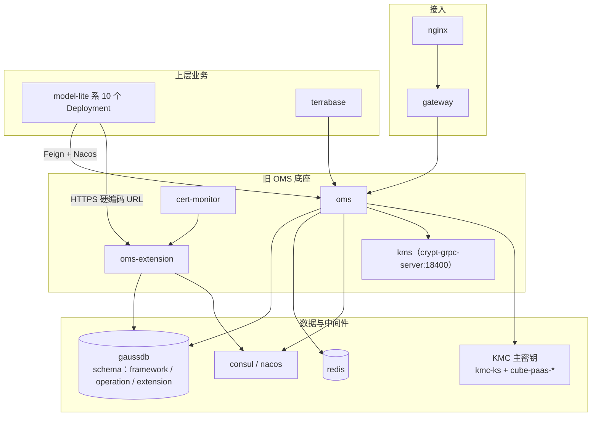

三个要点决定了迁移的难度：

1. **数据库是 gaussdb，不是 PostgreSQL**——迁移程序要跨库读写，不能假设 SQL 方言一致。
2. **加解密有两个后端并存**：KMC 直连（多数），以及 KMS gRPC 服务（`email` / `telephone` / JWT）。后者是独立进程，属于要下线的东西。
3. **`oms-extension` 是旧底座的"外挂"**：资源组、证书、账号导入都从这里走，上层业务还硬编码了它的地址。它下线后这些能力必须由新底座承接。

### 1.2 数据模型：账户、角色、资源组

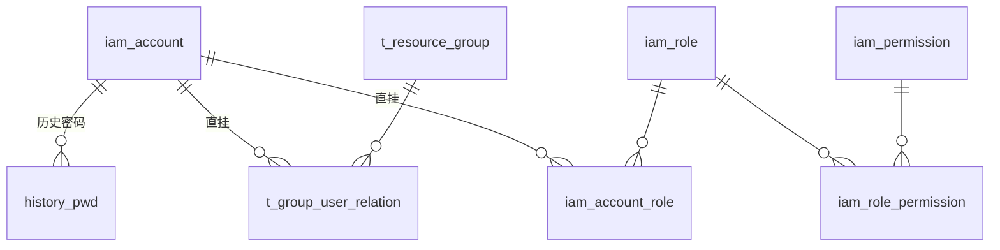

- 账户表 `iam_account`（GaussDB 大小写折叠，实际按小写取数），主键是 32 位 UUID 字符串；
- 账户**直接**挂角色（`iam_account_role`），也**直接**挂资源组（`t_group_user_relation`）；
- 资源组 `t_resource_group` 平铺，三个内置：`admin_group`、`public_group`、`default_group`；
- **没有"用户组"这个层**——这是新旧模型最大的差别。

### 1.3 授权模型：二维正交

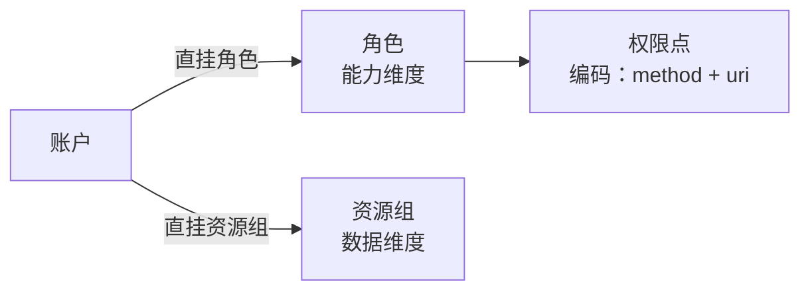

两个维度互不相干：角色决定"能做什么功能"，资源组决定"能看哪些数据"。业务代码里硬编码了三条访问规则（不是数据库约束）：

| # | 规则 | 谁受影响 |
| --- | --- | --- |
| 1 | `admin_group` 内的账户可访问**全部**资源组 | 特权来自"在组内"这个事实，不来自角色 |
| 2 | 所有账户都可访问 `public_group` | 全员 |
| 3 | 普通账户只能访问**本组 + public_group** | 普通账户 |

规则 1 是迁移里最麻烦的一条：**它把"资源范围"和"角色"解耦了**——在 `admin_group` 里就有全资源，不管你的角色是什么。

### 1.4 认证与会话

旧链路的会话是拼出来的：Redis 存随机 token，`gateway` 在转发时动态生成 JWT（payload 用 KMC 加密）。

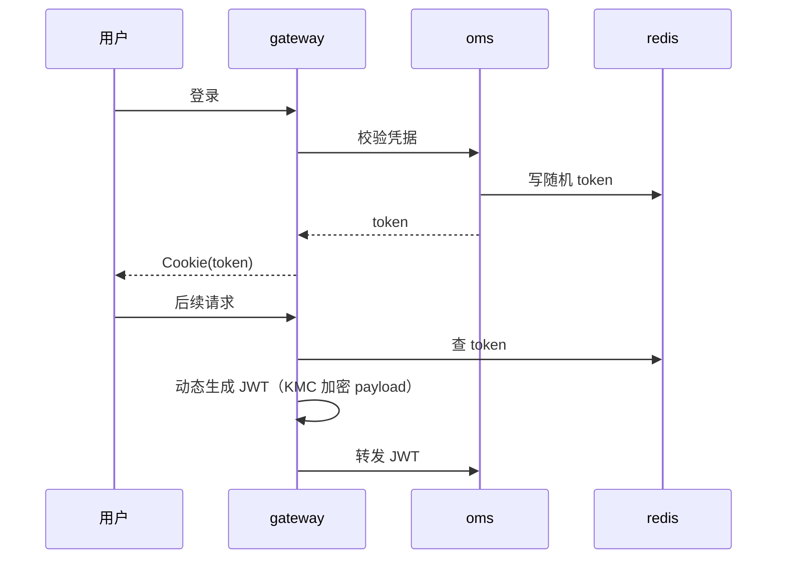

**这套东西不迁移**：新底座自己签发 JWT、自己管会话，旧 token 在新体系里根本不被承认。所以割接时用户必须重新登录一次——这是设计上的必然，不是偷懒。

### 1.5 加解密：KMC 与三种调用方式

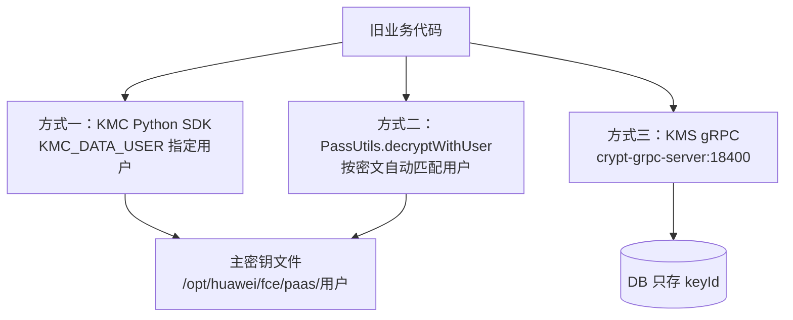

四个必须知道的事实：

| 事实 | 含义 |
| --- | --- |
| 主密钥**按用户隔离**，9–10 把 | 用 A 用户加密的密文，用 B 用户解不开 |
| 密文是**纯大写十六进制** | 正则 `^[A-F0-9]+$`，格式不符说明数据有问题 |
| 解密**不幂等** | 对已解出的明文再解一次，得到空串而不是报错 |
| `email` / `telephone` 走 KMS gRPC，**不是 KMC** | 这两列必须重加密，其余原样搬 |

### 1.6 证书：JKS / PKCS#12 混合

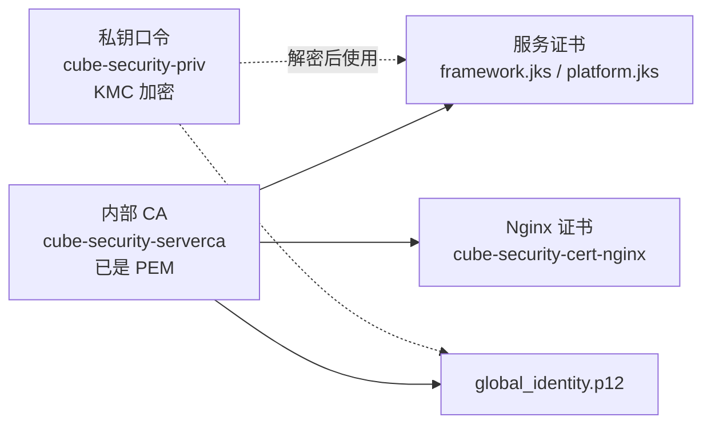

- 证书主要装在 **ConfigMap**（不是 Secret），路径 `cube-security-cert-*`；
- `oms-extension` 是 JKS + PKCS#12 混合，迁移工作量最大的单体；
- **内部 CA 已经是 PEM**——这意味着不一定要重建 CA，可以直接复用；
- 私钥口令仍然是 KMC 加密的（`tomcat` / `nginx` / `modelenginepublic` 用户）。

### 1.7 上层业务是怎么用它的

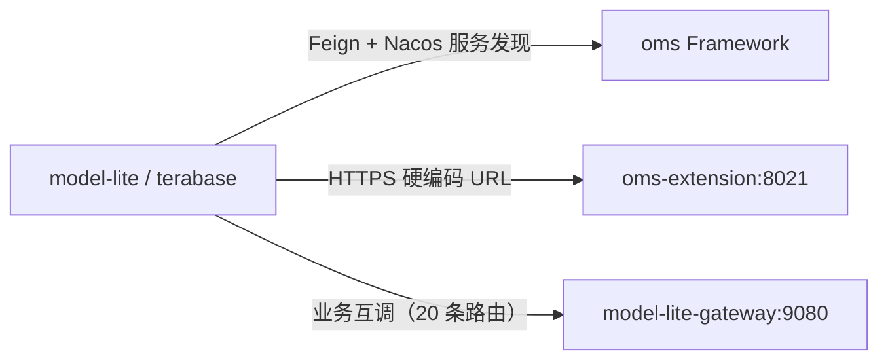

一个容易看错的地方：`model-lite-gateway` **不转发到 OMS**，它的 20 条路由全是业务互调。业务调 OMS 是两类**直接调用**——Feign 调 Framework、硬编码 URL 调 `oms-extension`。这两类在新底座里分别变成"契约接口"和"整体下线"。

---

## 2. 新系统目标态（迁入侧）

### 2.1 部署形态

新底座是**单个进程加三个依赖**，没有 gateway、没有 consul、没有 `oms-extension`：

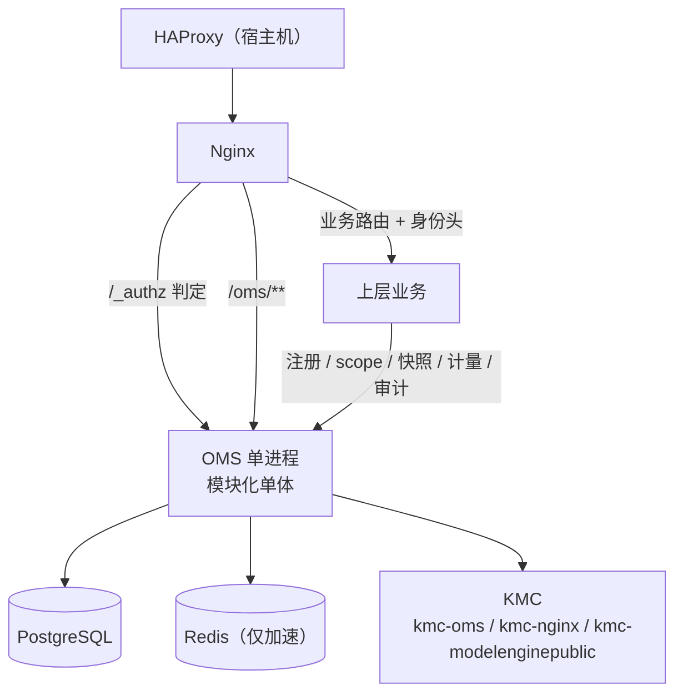

与旧底座的三处结构性差异：

| 差异 | 旧 | 新 |
| --- | --- | --- |
| 组件数 | 11 个 Deployment | 3 个（OMS + Nginx + 依赖） |
| 服务发现 | consul / nacos | K8s Service |
| 业务接入 | Feign + 硬编码 URL | Service + HTTP client + `client_id` 令牌 |

### 2.2 授权模型：一维归属

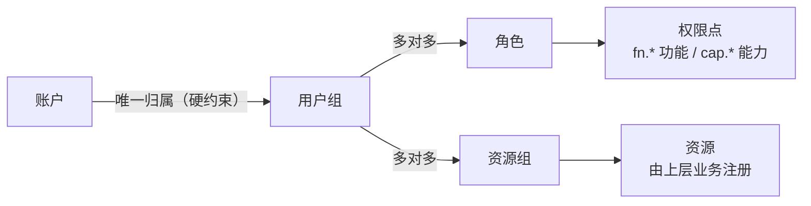

三条与迁移直接相关的约束：

- **账户只能属于一个用户组**——这就是"折叠"的强制性来源；
- 用户组的多个角色、多个资源组**取并集**，没有 deny 规则；
- 每个用户组**必须至少绑一个准入角色**（`humanAccess` 页面 / `m2mAccess` token），否则不允许保存。

### 2.3 认证与会话

新底座的 JWT 只带会话标识，不带权限：

| 字段 | 含义 |
| --- | --- |
| `sid` | 会话标识，所有判定的入口 |
| `sub` | 账户 ID |
| `exp` | 最大会话时长 |

授权变更时，受影响会话被置为 `stale`，下一次请求直接 401、强制重登。**权限不进 JWT**，所以旧 token 无法被"翻译"成新 token——这也是割接必须重登的原因。

### 2.4 加解密：KMC 的三个常驻用户

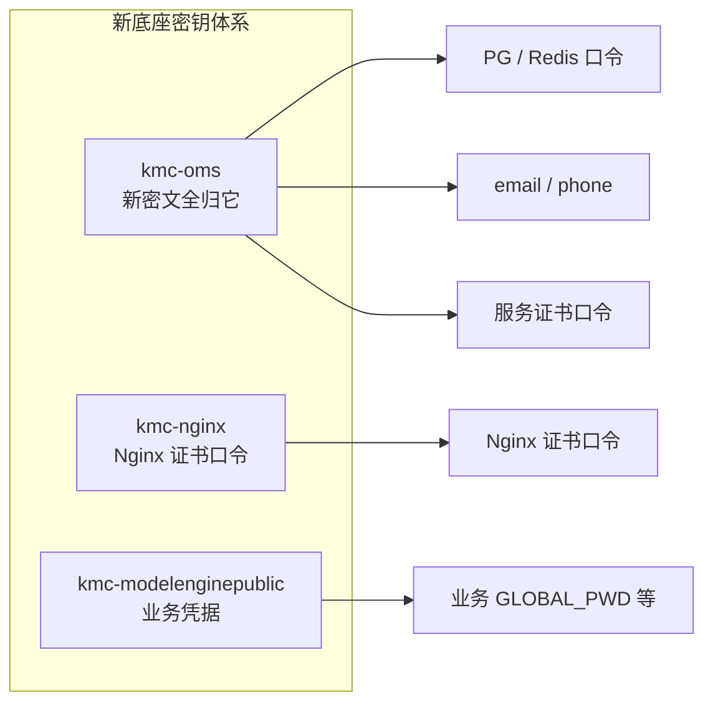

| 用户 | 保护什么 | 全新安装 | 从旧底座迁移 |
| --- | --- | --- | --- |
| `oms` | 新底座自身全部**新**密文 | 生成 | **同样生成**（名下不迁旧密文） |
| `nginx` | Nginx 对外证书口令 | 生成 | **复用旧** |
| `modelenginepublic` | 上层业务凭据 | 生成 | **复用旧** |

边界很清楚：**旧密文全在 `nginx` / `modelenginepublic` 名下，新密文全在 `oms` 名下**。所以两场景的差别只在材料来源，用户清单、挂载路径、权限、自检规则完全一致。

### 2.5 上下层契约：六个接口

| 契约 | 方向 | 形态 |
| --- | --- | --- |
| 模块注册 | 业务 → OMS | `POST /oms/internal/v1/registry/modules` |
| 资源查询 | OMS → 业务 | `GET /resources?type=&ids=` |
| 可见范围 | 业务 → OMS | `GET /oms/internal/v1/authz/scope` |
| 授权快照 | 业务 → OMS | `GET /oms/internal/v1/authz/snapshot` |
| 计量登记 | 业务 → OMS | `POST /oms/internal/v1/metering/report` |
| 审计上报 | 业务 → OMS | `POST /oms/internal/v1/audit/oplog` |

旧底座那套"Feign 调 Framework + 硬编码 URL 调 `oms-extension`"整体作废，业务侧改造见 `OMS-INT-001`。

---

## 3. 迁移总体设计

### 3.1 核心矛盾：二维折叠成一维

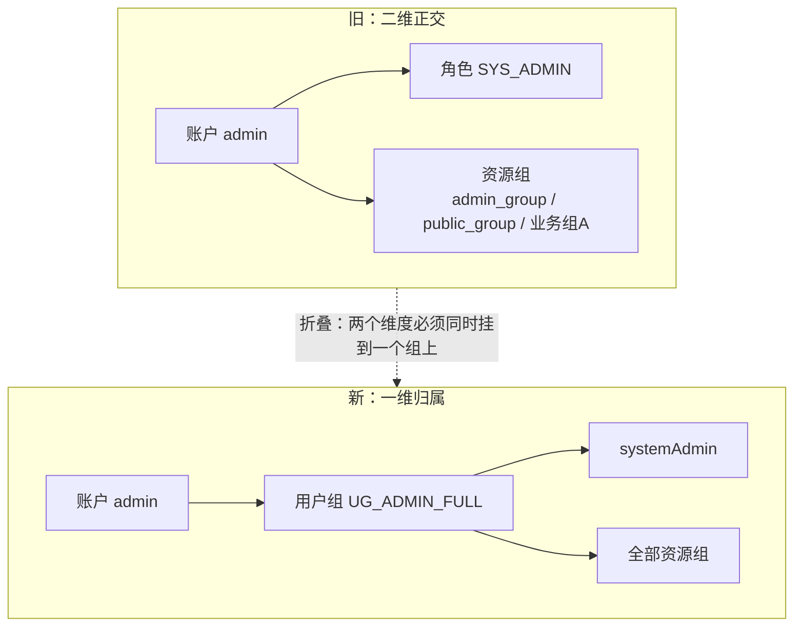

折叠的难点不在技术，在**语义损失**：旧模型里"角色"和"资源组"可以自由组合，新模型里一个账户只有一套组合。所以：

- 两个账户只要角色集合与资源组集合相同，就能进同一个组（组数会收敛）；
- 组合不同的账户必须拆成不同的组（组数可能膨胀）；
- 只要聚类算法按"画像"来，新旧语义就是等价的。

### 3.2 P0–P7 总览

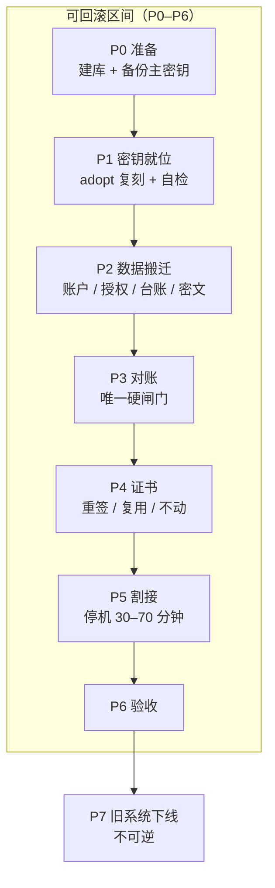

| 阶段 | 停机 | 可回滚 | 产物 |
| --- | --- | --- | --- |
| P0 准备 | 否 | 是 | 空库 + 主密钥离线备份 |
| P1 密钥就位 | 否 | 是 | 三个 `kmc-<user>` Secret |
| P2 数据搬迁 | 否（旧库只读） | 是 | 新库数据 |
| P3 对账 | 否 | 是 | 对账报表 |
| P4 证书 | 否 | 是 | 新证书 Secret |
| P5 割接 | **是** | 是 | 生产在新底座跑 |
| P6 验收 | 否 | — | 验收单 |
| P7 下线 | 否 | **否** | 旧系统消失 |

**顺序不能换的四处**：

1. **P1 必须在 P2 之前**——没有主密钥，搬过来的密文一条都解不开；
2. **P4 必须在 P5 之前**——业务 Pod 起不来就没法割接；而证书口令要用主密钥加密，所以 P4 反依赖 P1；
3. **P3 必须在 P5 之前**——带病割接等于把问题带到生产；
4. **P7 必须在 P6 之后**——P7 不可逆，验收没过就下线，回滚要靠重装旧系统。

### 3.3 三种"不迁"

| 不迁的东西 | 为什么 | 去向 |
| --- | --- | --- |
| 旧会话与 JWT | 新体系只认自己的 `sid`，无法翻译 | 割接后强制重登 |
| 三套业务自己的数据库 | 与 OMS 无关，业务自己管 | 不动 |
| 旧文件产物（转储包 / 日志包 / 导出） | 格式与目录结构都是旧的，新底座不解析 | **留在旧 PVC 永久保留**（9.6） |

---

## 4. 目标库准备与 ESN 接续

### 4.1 建库

`migrate` 以 `baseline` 模式建当前版本的全量 schema 与初始化数据。迁移程序**不建表、不改表**，只写数据——应用账号没有 DDL 权限，迁移 Job 用同一套账号。

### 4.2 内置数据的两条例外

| 对象 | 常规 | 迁移场景的例外 |
| --- | --- | --- |
| 内置管理员组 | 预置角色绑定 | 系统管理员组**接收迁移账户并补全资源组**（6.3）；安全 / 审计组仍为空 |
| 内置账户密码 | 部署期置初始密码 | **不迁旧密码**（旧库是占位符），首登强制改密 |

### 4.3 ESN 接续

ESN 是许可的绑定对象。**新底座不能生成新的 ESN**——一旦变了，客户已购许可全部失效，等于迁移把授权弄丢了。

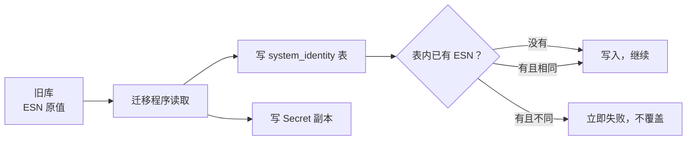

三条规则：

- 从旧库读原值，写入 `system_identity` 与 Secret 副本（不一致时以表为准）；
- **只写一次**：发现表里已有不同值即失败退出——这说明有人在别处初始化过，覆盖等于悄悄作废许可；
- 验收判据：License 页面显示的 ESN 与旧底座**逐字符**一致。

> **不在本文设计**：旧 ESN 存在哪张表、什么格式（旧底座文档未涉及）。本文只规定"读出来之后怎么写、什么情况必须失败"，取数方式由旧底座团队在实施时提供。已登记为 MO-20。

---

## 5. 账户与密码

### 5.1 字段映射

只列**容易错**的，其余按机械映射处理。

| 旧列 | 新列 | 规则 | 为什么 |
| --- | --- | --- | --- |
| `id` | `id` | **原值保留** | 历史日志的 `account_id` 靠它关联；变了审计链就断 |
| `password` | `password_hash` | **原样搬运** | 已是 `10000:saltHex:hashHex` |
| `locked` | `status` | 0→`ACTIVE`，1→`LOCKED` | 新底座用枚举 |
| `login_type` | `login_types` | 位拆为数组 | 位 1→人机，位 2→机机，用于补准入角色 |
| `user_type` | `auth_type` | 0→`LOCAL`，1→`SSO` | SSO 账户另表 |
| `deleted` | `deleted_at` | 0→NULL，1→迁移时刻 | 逻辑删除保留 |
| `email` / `telephone` | `email` / `phone` | **重加密后写入** | 旧为 KMS gRPC 密文（8.3） |
| `auth_privacy` + `eula_flag` | `agreement_accepted_at` | 合并为时间戳 | 新底座单一字段表达协议确认 |
| `usb_key_*` / `two_factor_auth_enable` | — | **丢弃** | 旧底座未启用，新底座不实现 |

### 5.2 密码：不重算，只校验

旧哈希是 PBKDF2-HMAC-SHA256、10000 轮、512 bit、格式 `iterations:saltHex:hashHex`，与 HLD 4.11 写死的参数一致。因此：

- 迁移**不改写** `password_hash`；
- 新底座 `PasswordEncoder` 必须能解析三段格式，而不是自己去算新格式；
- 迁移后做一次**真实登录抽样**：抽 5–10 个账户（含内外账号、含已锁定账户）用正确口令登一次。

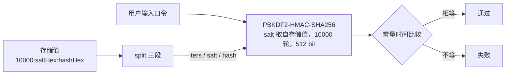

不做抽样，就只能等客户第一次登录时才发现——那时已经割接完了。

### 5.3 历史密码与内置账户

- **历史密码**：迁数据、不迁表结构。不迁则用户改密时绕过历史校验，密码策略形同失效。
- **内置账户**：`admin` / `secadmin` / `secauditor` / `openapi` 沿用旧 UUID，密码不迁；`internal_admin` 新底座没有这个内置账户，按普通账户处理——它的服务间调用能力由 `m2mAccess` + `openAPI` 业务角色承接。

### 5.4 外部账号

`user_type=1` 的账户迁到 `external_account`，与 `account` 一对一：`auth_type=SSO`、`password_hash=NULL`、`idp_id` 指向上游标识。

外部账号的权限来源是**导入时指定的用户组**，运行时没有角色映射——所以它们只是"账户行"，**不参与第 6 章的聚类**。

---

## 6. 授权模型迁移

### 6.1 聚类：以「角色集合 × 资源组集合」为键

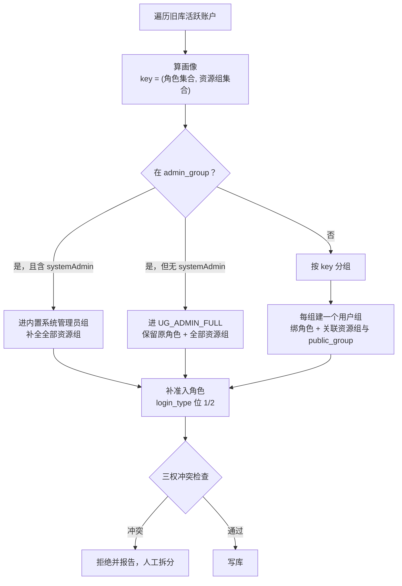

三条补充规则：

- 每个用户组**默认关联 `public_group`**（旧语义：全员可访问公共组）；
- 每个用户组**必须至少绑一个准入角色**，按旧 `login_type` 补：位 1→`humanAccess`，位 2→`m2mAccess`；
- `default_group` 作为普通资源组保留，组内账户按画像照常聚类。

### 6.2 为什么不能简单按"账户"迁

旧模型允许"角色 A + 资源组 X"和"角色 A + 资源组 Y"两个账户自由并存；新模型里它们必须是两个组。如果硬塞进一个组，资源组就变成并集——**其中一个人多看了另一个人的数据**。

这就是聚类要按"画像"而不是按"角色"或按"资源组"的原因：任取单维度都会导致权限并集扩大。

### 6.3 `admin_group` 的特殊处理

旧 `admin_group` 的语义是"在里面就有全资源访问"，而它里面**不只有系统管理员**——别人也可能被加进去蹭特权。

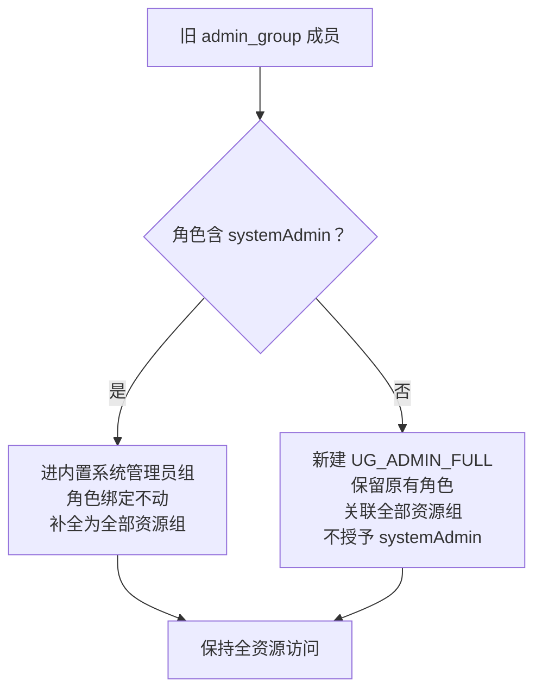

| 账户情形 | 去向 | 角色 | 资源组 |
| --- | --- | --- | --- |
| 在 `admin_group`，角色含 `systemAdmin` | 内置系统管理员组 | 组已预置，不动 | **补全为全部资源组** |
| 在 `admin_group`，无 `systemAdmin` | `UG_ADMIN_FULL` | 保留原有角色 | 全部资源组 |
| 不在 `admin_group` 的系统管理员 | 画像聚类 | `systemAdmin` | 本组 + `public_group`，不扩权 |
| 安全 / 审计管理员 | 画像聚类 | 对应管理员角色 | 本组 + `public_group` |

四条说明：

- **内置组可以收人**：`builtin_locked` 锁的是**角色绑定**，加成员、补资源组都不在它的约束内；
- **必须补全资源组**：内置系统管理员组默认不关联任何资源组（全新安装时资源组还没注册），不补就让人丢掉全部业务数据权限——不是扩大，是缩小；
- **只有混入者才建 `UG_ADMIN_FULL`**：多数局点 `admin_group` 里全是管理员，这条路径走不到；
- **安全 / 审计管理员不进内置组**：他们的资源范围各不相同，进内置组反而丢范围。内置的安全 / 审计组迁移后仍为空，是预期结果。

### 6.4 角色与权限点

| 旧角色 | 新角色 | 处理 |
| --- | --- | --- |
| `SYS_ADMIN` | `systemAdmin` | 内置，编码不变 |
| `SEC_ADMIN` | `securityAdmin` | 内置，编码不变 |
| `SEC_AUDITOR` | `auditAdmin` | 内置，编码不变 |
| `OPEN_API` | `m2mAccess` + `openAPI` | 拆两个：准入靠 `m2mAccess`，业务能力靠模块注册的 `openAPI` |
| `READ_ONLY` | `readOnly` | 业务角色，模块注册 |
| `INTERNAL_ADMIN` | — | 降级为普通账户 |
| 业务自定义角色 | `<modulePrefix>.<name>` | 由业务模块重新注册 |

**权限点不迁数据**。旧编码是 `"method uri"`，新编码是 `fn.*` / `cap.*`，没有机械对应关系。新权限点由各模块安装时注册；旧的角色-权限绑定表不搬（客户局点也未手工改过）。

### 6.5 冲突与兜底

| 情形 | 处置 |
| --- | --- |
| 聚类后某组同时含两个管理员角色 | **拒绝并报告**，人工拆分，不自动取舍 |
| `admin_group` 成员同时挂业务组 | 只进一个组，业务组归属被"全部资源组"覆盖 |
| 账户无任何资源组 | 归入「未分组」组（只有准入角色），登录看不到数据 |
| 账户无任何角色 | 同上 |

**"未分组"不是垃圾桶，是待办清单**——验收时要逐条确认这些账户是不是本该没权限。

---

## 7. 密钥体系迁移

### 7.1 三个常驻用户与两种材料来源

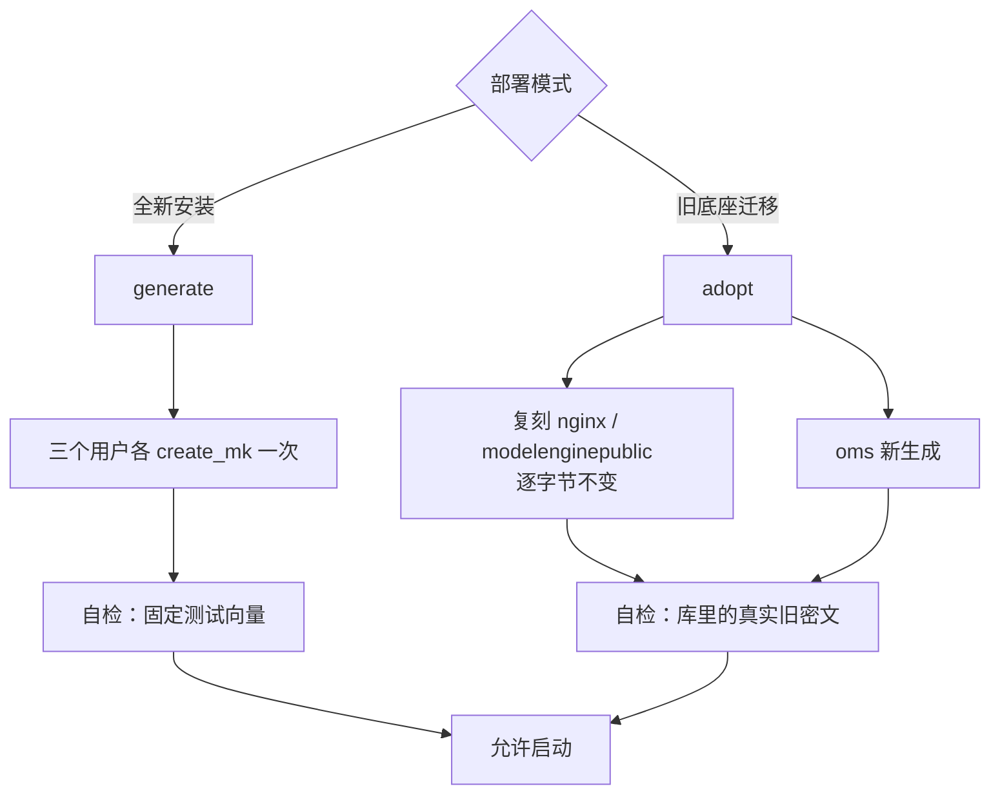

| 用户 | 迁移时怎么来 | 用途 |
| --- | --- | --- |
| `oms` | **新生成** | 新密文全归它 |
| `nginx` | **复用旧**，原样复刻 | Nginx 对外证书口令 |
| `modelenginepublic` | **复用旧**，原样复刻 | 上层业务凭据 |

### 7.2 迁移期临时用户

| 用户 | 挂给谁 | 何时退出 |
| --- | --- | --- |
| `gaussdba` | 迁移 Job | P7 后归档 |
| `kms` | 迁移 Job | `email`/`phone` 对账通过后 |
| `tomcat` | **不挂载**，需要拆 JKS 时才挂 | P7 后归档 |
| `root` | **不挂载** | 用途未查清，保留 |

### 7.3 `adopt` 模式的五步

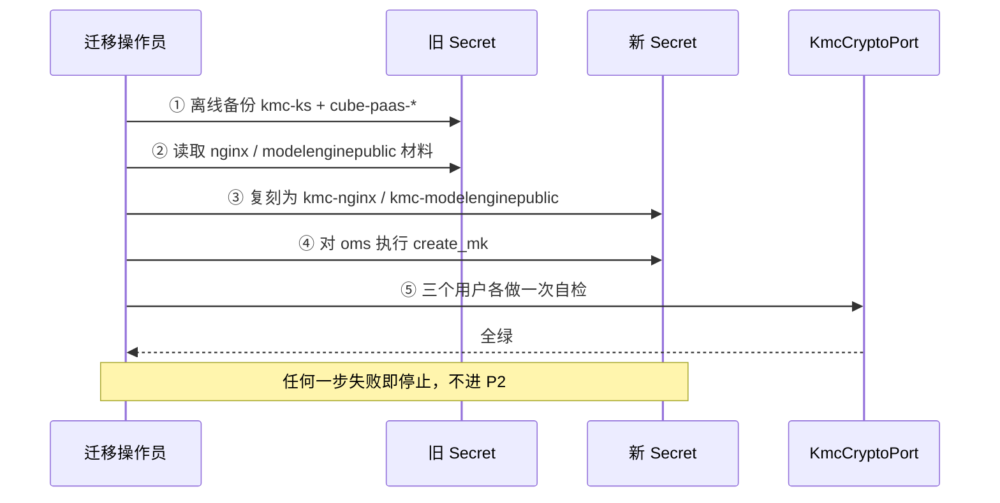

**严禁 `create_mk` 覆盖已复用的用户**——那会让旧密文永久不可解。

### 7.4 没有 SDK 时怎么开发

KMC 的 Python SDK 在本环境拿不到，实现分两段走：

- **先定接口**：`CryptoPort` 的 `encrypt` / `decrypt` / `rotate`，签名与异常语义先固化；
- **开发期用 `MockCryptoPort`**：可逆的内存映射，用于跑通业务与迁移程序；
- **生产必须拒绝 mock**：启动自检发现装配的是 mock 实现就**直接拒绝启动**。这条不能只写在注释里。

内部环境有 KMC 工具后换 `KmcCryptoPort`，业务代码与迁移程序不改。

### 7.5 迁移期禁令

**禁止轮换主密钥**。`create_mk(0)` 会覆盖旧密钥，全部旧密文当场不可解。迁移窗口内不做任何与轮换相关的操作，包括"顺手清理旧 Secret"。

---

## 8. 密文搬运与对账

### 8.1 两类密文，两条路径

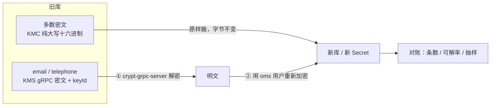

| 旧密文 | 动作 | 新落点 |
| --- | --- | --- |
| 数据库连接口令 | 原样搬 | `oms-db-cred` |
| 证书私钥口令 | 原样搬 | `oms-tls` / `nginx-tls` / `ca-key` |
| 业务凭据（SFTP / SNMP / SSO） | 原样搬 | 新库对应表 |
| `account.email` / `telephone` | **重加密** | 新库 `account` 表 |

### 8.2 原样搬运的三条校验

- 密文匹配 `^[A-F0-9]+$`，不匹配的**报告并跳过**，不要试图修复；
- 记录每条密文对应的 KSUser，搬完按用户分组统计条数；
- 用对应 KSUser 解密一次验证可解——解不开说明用户选错了。

### 8.3 `email` / `telephone` 的重加密链路

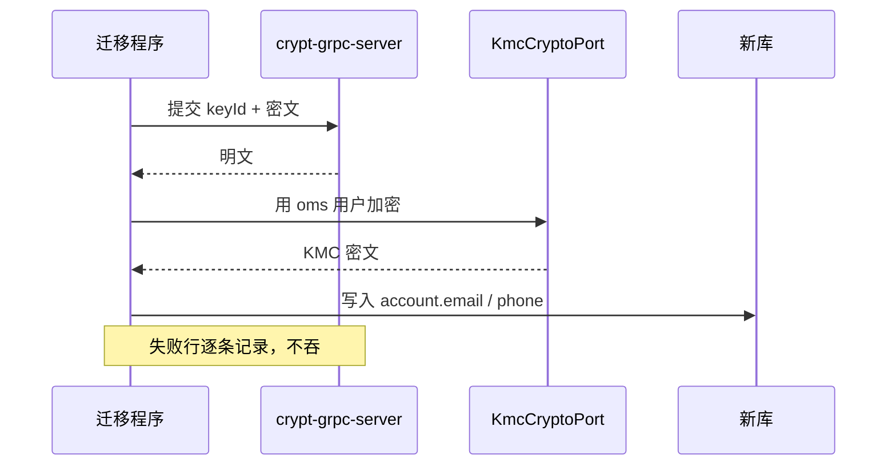

四条约束：

1. **`crypt-grpc-server` 在链路完成前不得下线**——它一停，剩下的行永久解不开；
2. **先小批量验证再全量**：抽 20 行走完全流程，确认明文正常再放开；
3. **失败行不吞**：解密失败、加密失败、明文为空，逐行进对账报表；
4. **下线门槛是对账相等**：已重加密行数 == 旧库有密文的行数，且抽样通过。

### 8.4 对账：唯一的硬闸门

```mermaid
flowchart LR
  A["跑对账"] --> B{"六项全绿？"}
  B -->|"是"| C["进 P4 证书"]
  B -->|"否"| D["停下，人工处理"]
  D --> A
```

| 项 | 判据 |
| --- | --- |
| 账户行数 | 新库 = 旧库（不含物理删除） |
| 每个 KSUser 的密文条数 | 搬运前后相等 |
| 密文可解率 | 100% |
| `email`/`phone` 完成率 | 100%，抽样明文合理 |
| 历史台账行数 | 新库 = 旧库 |
| ESN | 逐字符一致 |

---

## 9. 历史台账搬迁：操作日志与告警

### 9.1 为什么要迁

审计连续性不是"好看"的要求：等保与内部审计都要求"上一周期发生过什么"可查。旧系统下线、新系统从零开始，中间就断了。

### 9.2 三个必须处理的差异

```mermaid
flowchart TB
  OLD["旧台账"] --> Q1["账户关联"]
  OLD --> Q2["文案形态"]
  OLD --> Q3["完整性"]
  Q1 --> A1["新库按 account_id 关联<br/>需先确认旧 user_id 语义"]
  Q2 --> A2["历史无 i18n key<br/>走原文例外"]
  Q3 --> A3["旧 MAC 不通用<br/>迁移时重算"]
```

| 差异 | 旧 | 新 | 处理 |
| --- | --- | --- | --- |
| 账户关联 | `user_id` | `account_id` | 见下方说明 |
| 文案 | 渲染后的文本 | i18n key + 参数 | 历史数据走例外（9.4） |
| 完整性 | 旧 MAC | 逐条 `record_mac` | 迁移时用新密钥重算（9.5） |

**账户关联要先确认语义**：新 `account.id` 保留的是旧 `iam_account.id`，而旧日志里的 `user_id` 可能存的是同一个值，也可能存的是用户名。迁移程序必须先抽样确认，再决定直连还是走映射——搞错了全部历史记录的操作者都对不上。

> **不在本文设计**：旧日志 `user_id` 的实际语义。本文给出"抽样确认的方法"和两种情况各自的处理规则，具体取值由旧底座团队在实施时确认。已登记为 MO-22。

### 9.3 分区与容量

历史数据按 `occurred_at` 落入对应月份的分区，**跨多少个月就建多少个分区**。保留期策略对历史数据不适用——不能因为"只保留最近 N 个月"就把历史删掉。

> **不在本文设计**：历史日志与告警的实际数据量。它决定分区数量、P2 的耗时与磁盘容量，由旧底座团队实测后填入。已登记为 MO-21。
> 若实测远超停机窗口，按"先迁最近 N 年、其余离线归档"降级，并在验收单里注明。

### 9.4 历史数据的 i18n 例外

新规则是"存 key 与参数，查询时渲染"。历史记录没有 key，硬造假 key 只会让翻译表越来越脏。

因此定一条**只对迁移数据生效**的例外：

- 历史记录写 `message_key = NULL`，原文进 `message_text`；
- 查询时：有 `message_key` 就渲染，没有就原样显示 `message_text`；
- 新产生的记录**永远**走 key，由写入接口保证，不靠自觉。

### 9.5 完整性：迁移时重算 MAC

旧记录的 MAC 用旧密钥，新库验不了。两种选择：留空（放弃校验）或重算。**重算**——迁移程序能读到映射后的全部不可变字段，用新主密钥算一遍即可，`mac_key_version` 写当前版本。这样历史记录与新记录受同一套保护，转储时的 SHA-256 也才有意义。

### 9.6 告警的特殊性与"不迁但保留"

- **清除状态保留**：`cleared_at` 有值就是已清除，不重置；
- **去重键冲突**：新库有 `(source, alarm_id) WHERE cleared_at IS NULL` 的部分唯一索引。旧库若有重复的未清除记录会撞索引——先按 `(source, alarm_id)` 归并，保留最早一条、其余置为已清除并标注合并来源；
- **次数与最近发生时间**：取旧记录的聚合值，不重算。

**文件产物不迁，但必须永久保留**：

| 项 | 约定 |
| --- | --- |
| 范围 | 旧底座承载转储包 / 运行日志包 / 导出文件的全部 PVC |
| 标记 | label `oms.io/retention=permanent` + `helm.sh/resource-policy: keep` |
| 迁移期 | 不挂载、不写入；取证时**只读**挂 |
| P7 下线 | **保留**，旧系统删掉、PVC 不删 |
| 后续升级 | 清理 Job 作用域只限自己的资源名，**禁止按前缀通配删 PVC** |
| 交付物 | 「保留卷清单」：卷名、节点、大小、保留原因 |

三条理由任一条都够：合规（审计证据的保留期由客户定，不由版本定）、取证（旧库删了之后这些包就是最后一份）、不可再生。

---

## 10. 证书迁移

### 10.1 三类对象，三种做法

```mermaid
flowchart TB
  Q{"证书对象"} -->|"服务间证书"| A["重签<br/>内部 CA 签发"]
  Q -->|"内部 CA"| B["优先复用现有<br/>SAN 覆盖新服务名"]
  Q -->|"Nginx 对外证书"| C["维持原状<br/>文件与口令原样搬"]
  A --> D["口令用 oms 用户加密"]
  B --> D
  C --> E["口令仍由 nginx 用户保护"]
```

| 对象 | 做法 | 理由 |
| --- | --- | --- |
| 服务间证书 | **重签** | 现有 mTLS 不认证身份，没有谁 pin 它；重签比转换 JKS 干净 |
| 内部 CA | **优先复用**（已是 PEM） | 只换叶子不换锚，客户端信任库一字不改 |
| Nginx 对外证书 | **维持原状，不动** | 换证书要终端重新信任，客户侧有额外动作 |

### 10.2 内部 CA 能不能复用

判断条件只有一条：**现有 CA 的 SAN 覆盖新底座的服务名**。

- 覆盖 → 复用，`ca.key` / `ca.pem` 搬进新 Secret；
- 不覆盖 → 重建，此时**所有终端需要重新导入根证书**——这是客户侧动作，必须先确认。

### 10.3 旧 keystore 怎么处理

- 服务证书既然重签，旧 keystore 里的私钥**不需要**导入新体系；
- 但 `ca.crt` / `ca.key` 要单独取出来看——那是内部 CA，可能是唯一副本；
- 口令在 `cube-security-priv`（KMC 加密，`tomcat` 用户），需要时才挂 `tomcat` 主密钥；
- 旧 keystore **保留到 P7**，不要提前删。

### 10.4 Nginx 证书"不动"的含义

不动 = 证书文件、私钥、口令全部原样：搬进 `nginx-tls`，口令仍由 `nginx` 用户保护。HTTPS 配置不变，浏览器行为不变（自签证书仍显示"不安全"，客户可后续自行导入）。

---

## 11. 割接与验收

### 11.1 割接时序

```mermaid
sequenceDiagram
  participant D as 交付
  participant B as 业务 Pod
  participant N as Nginx
  participant O as 新 OMS
  participant U as 用户
  D->>B: ① 滚动升级（新镜像，已去 Feign/Nacos）
  B-->>D: 就绪
  D->>N: ② 流量切到新底座
  N->>O: /_authz
  O-->>N: 200
  U->>N: 旧 token
  N->>O: 判定
  O-->>U: 401（旧体系不认）
  U->>O: ③ 重新登录
  O-->>U: 新 sid，放行
  Note over D,U: 全程 30–70 分钟，主要耗在 ①
```

### 11.2 割接前检查单

- [ ] P3 对账全绿，报表已归档
- [ ] 抽样登录通过（本地 / SSO / 锁定账户各若干）
- [ ] 三个 KMC 用户自检通过，**mock 实现已被替换**
- [ ] 服务证书已重签，业务 Pod 能完成 mTLS 握手
- [ ] Nginx 证书与原状一致，`nginx -t` 通过
- [ ] 权限矩阵抽查：三类管理员、`UG_ADMIN_FULL`、普通用户、`openAPI` 各一人
- [ ] ESN 与旧值一致，License 状态正常
- [ ] 历史日志抽样：随便找一条旧日志，新库查得到、操作者对得上、时间对得上
- [ ] 回滚方案已演练，切回动作有人会做

### 11.3 验收判据

| 维度 | 判据 |
| --- | --- |
| 数据 | 对账报表全绿（8.4） |
| 功能 | 全功能回归通过，无 P0/P1 缺陷 |
| 权限 | 权限矩阵抽查一致，无越权、无漏权 |
| 审计 | 新旧日志可连续检索，操作者可追溯 |
| 加解密 | 三个用户自检通过；`email`/`phone` 可正常显示 |
| 证书 | 巡检通过，Nginx 与业务 mTLS 均正常 |

**业务侧全量重启、不分批**（已确认）——灰度需要新旧两套同时在跑，而两套的授权模型不通。

---

## 12. 回滚

```mermaid
flowchart LR
  P03["P0–P3"] -->|"清空新库"| OLD["旧系统继续服务"]
  P4["P4 证书"] -->|"换回挂载"| OLD
  P5["P5 割接"] -->|"DNS / Ingress 切回"| OLD
  P7["P7 之后"] -->|"需重装旧系统"| LOSS["新数据无法回灌"]
```

| 阶段 | 回滚动作 | 数据后果 |
| --- | --- | --- |
| P0–P3 | 清空新库，旧库未动 | 无 |
| P4 证书 | 换回旧挂载与配置 | 无（旧材料保留） |
| P5 割接 | 切回旧系统 | 新系统期间的会话与日志丢失 |
| P7 之后 | **不可回滚** | 需重装旧系统，新数据无法回灌 |

**P7 是唯一的不可逆点**，所以它排在验收之后，且必须有人签字。

> **回滚也不会动旧产物卷**。P0–P6 回滚是"清空新库、换回旧系统"，旧 PVC 从头到尾没被写过；P7 之后回滚要重装旧系统，那时旧 PVC 反而成了唯一的数据来源。所以"不删旧 PVC"对回滚同样成立。

---

## 13. 迁移程序与工具

### 13.1 脚本规范

- 命名 `V<版本>__<描述>.sql` / `<step>__<name>.jar`，**幂等、带校验和、可续跑**；
- 运行期禁止 DDL；迁移程序与业务用同一套数据库账号（只有 DML 权限），DDL 归 `migrate`；
- 日志里**不出现明文与密文**——只记行数、ID 区间、用户标识。

### 13.2 断点续跑

```mermaid
flowchart TB
  S["开始一步"] --> R["读 migration_progress<br/>已处理主键区间"]
  R --> L["按区间读旧库"]
  L --> W{"这条已写过？"}
  W -->|"是"| SKIP["跳过"]
  W -->|"否"| WRITE["写入 + 记进度"]
  WRITE --> N["下一条"]
  SKIP --> N
  N --> DONE["本步完成"]
```

判据是"这条记录是否已写过"，不是"跑到第几行"——后者在并发或中断时不可靠。密文搬运天然幂等（不改字节），但**重加密必须记进度**，否则重跑会把已加密的明文再加密一次，密文层层套娃。

### 13.3 失败处置

| 失败类型 | 处理 |
| --- | --- |
| 单行异常（格式、约束） | 记录并跳过，进对账报表的人工清单 |
| 整批失败（连接、事务） | 整批回滚，修好后重跑该批 |
| 不可继续（主密钥不可解、ESN 冲突） | **立即停止**，不进下一阶段 |

原则：**宁可停下来，不要带着问题往前走**。迁移是单向的，走错一步的代价远大于多停一小时。

---

## 14. 待决与风险

### 14.1 三处由旧底座团队实施时确认

| 编号 | 缺什么 | 影响 |
| --- | --- | --- |
| MO-20 | 旧 ESN 的存放表与格式 | 4.3 的取数语句 |
| MO-21 | 旧操作日志与告警的数据量 | 9.3 的分区数、P2 耗时、磁盘容量 |
| MO-22 | 旧日志 `user_id` 存的是账户 ID 还是用户名 | 9.2 的关联正确性 |

### 14.2 风险

| 风险 | 等级 | 缓解 |
| --- | --- | --- |
| 主密钥 `kmc-ks` / `cube-paas-*` 丢失或被误删 | **极高** | 迁移前离线备份；迁移期禁止任何清理动作 |
| 聚类导致权限扩大或缩小 | **高** | 三权冲突检查 + 验收时权限矩阵抽查 |
| `crypt-grpc-server` 提前下线，`email`/`phone` 永久不可解 | **高** | 对账相等才允许下线；下线由迁移程序最后一步触发 |
| KMC SDK 未到手，mock 被带上生产 | **高** | 启动自检拒绝 mock；验收单单列一条 |
| 历史日志迁移量远超预期，撑爆停机窗口 | 中 | MO-21 先估量；必要时先迁最近 N 年，其余归档 |
| 旧 keystore 里 CA 私钥是唯一副本，被提前删除 | 中 | 保留到 P7；P4 时单独提取并校验 |
| 业务侧未改完 Nacos 依赖就割接 | 中 | 割接检查单硬性一条；`OMS-INT-001` 跟踪 |

---

## 变更记录

| 版本 | 日期 | 说明 |
| --- | --- | --- |
| V0.4 | 2026-10-30 | 改为自包含：新增第 1 章旧系统现状、第 2 章新系统目标态，全篇补 26 张 mermaid 图（组件、ER、模型对照、聚类、决策树、时序、回滚）；4.3 / 9.2 / 9.3 明确标注「不在本文设计，由旧底座团队实施时确认」 |
| V0.3 | 2026-10-30 | 4.3 改为条件式 `admin_group` 迁移；2.2 与 6.5 同步 |
| V0.2 | 2026-10-30 | 9.6 旧产物卷改为「不迁但永久保留」；第 12 章补「回滚不动旧卷」 |
| V0.1 | 2026-10-30 | 建册：范围、P0–P7、ESN、账户与授权、密钥、密文、历史台账、证书、割接、回滚、程序规范 |
