# OMS 总体设计（评审版）

| 项目 | 内容 |
| --- | --- |
| 文档编号 | OMS-HLD-001（评审版） |
| 版本 | V0.98（评审稿） |
| 编写日期 | 2026-10-27 |
| 读者 | 评审人、架构师 |
| 上游依据 | `docs/requirements/OMS-需求规格说明书.md` 及 18 个模块分册（77 条 FR） |
| 交互依据 | `design/prototypes/login.html`、`app-shell.html`（101 张状态截图） |
| 台账另册 | `OMS-HLD-001A`（追踪矩阵、接口登记、表属主、权限点、枚举、错误码、ADR 全表） |
| 迁移另册 | `OMS-MIG-001`（存量迁移详细方案，单独成册；版本升级流程在本文 7.4） |
| 配套另册 | `OMS-INT-001`（上层业务接入指南）、`OMS-TST-001`（测试用例），均单独成册 |

> 本文是评审用的总体设计：回答系统的骨架、关键机制、安全与故障边界、部署形态与接口约定。
> 字段级契约、报文、建表、错误码取值归各详细设计文档（DD-01…DD-11）；表、接口、枚举等清单归附录册；存量迁移归 OMS-MIG-001。

---

## 0. 一页读懂

### 0.1 定位与边界

OMS 是**统一运维管理底座**：向上层业务系统提供账户与身份、授权、日志审计、告警、证书、许可、加解密、备份等底座能力，**自身不含任何业务语义**。上层业务通过注册菜单与资源类型接入，OMS 只认「资源类型 + 资源 ID」，不认业务对象。

**范围内**：M01–M18 全部功能的实现结构；OMS 自身数据模型；与上游认证、下游客户端、SNMP、SFTP、CA、KMC、被备份组件、平台自监控的集成；K8s 部署形态；版本升级与存量迁移。

**范围外**：上层业务的业务逻辑与业务数据；KMC 内部算法；接口报文与表字段明细（归 DD）；测试用例（归 OMS-TST-001）；UI 视觉稿（以原型为准）。

### 0.2 关键数字

| 维度 | 数量 | 说明 |
| --- | --- | --- |
| 需求模块 / FR | 18 / 77 | 全部有唯一 DD 归属，无孤儿需求 |
| 详细设计文档 | 11 份 | DD-01…DD-11，按领域分组，接口与建表随特性走 |
| 数据表 | 44 张 | 每张表有唯一属主 DD，跨域只可引用 |
| 对外接口 | 约 70 个 | 按域分命名空间，登记在附录册 |
| 架构决策 | 22 条 | 全部「已定」，3 条带预留扩展路径 |
| 定时任务 | 20 项 | 进程内调度；分钟级任务用 ShedLock，秒级任务不加分布式锁 |
| 原型状态截图 | 101 张 | 作为交互与文案依据 |

> 表中「数据表 / 对外接口 / 架构决策」三项为旧稿口径，最终数量以附录册登记为准。

### 0.3 五条总体取舍（评审先看这五条）

| 编号 | 取舍 | 结论 | 代价 / 风险 |
| --- | --- | --- | --- |
| T-1 | 单体还是微服务 | **模块化单体**：单进程、单镜像，按领域分模块（12 个模块 / 11 份 DD），跨模块只经 `api` 门面，依赖方向由 ArchUnit 在 CI 强制 | 后续拆分需先收紧包边界；当前规模不足以抵消分布式成本 |
| T-2 | 会话放哪 | **PostgreSQL 权威 + Redis 仅加速**：Redis 失效只降性能不丢会话 | 每次请求的会话校验有库访问成本，需靠 Redis 缓存命中率与连接池压住 P95 |
| T-3 | 单副本还是多副本 | **当前单副本交付，但全量状态外置**，具备 HPA 条件；多副本不作为验收项 | 交付期不能靠「重启即恢复」掩盖状态残留问题 |
| T-4 | 国密还是国际算法 | **本期国际算法**（PBKDF2-HMAC-SHA256 / AES-256-GCM / RSA+SHA-256 / TLS 1.2+），**SM2 不做但保留可扩展** | 保留算法枚举与 `CryptoPort` 适配层，后续改造不动业务代码 |
| T-5 | 单实例还是多套 | **一命名空间 = 一套 OMS（含其上层业务系统）**；同集群可并存多套，实例间不共享任何有状态资源 | 所有 K8s 资源必须命名空间内闭环，禁用 ClusterRole/CRD/固定 NodePort |

### 0.4 阅读路线

- 评审查结论与风险：第 0、1、5、9 章（约 30 分钟）。
- 架构师看机制与部署：第 2、3、7 章。
- 安全与合规：第 4、5 章，以及 1 章的 R-07、R-08。
- 要动手实现、查表查接口：直接去 DD 与附录册，不要期望在本文找到字段。

---

## 1. 十二条铁律

以下 12 条是**评审否决线**：任何设计、实现、变更与其冲突，评审直接不通过。其余要求（性能目标、文案口径、UI 一致性等）写在正文对应章节，属于「应满足」，不属于「违反即否决」。

| 编号 | 铁律 | 可判定线（评审怎么验） | 原编号 |
| --- | --- | --- | --- |
| R-01 | **默认拒绝**：授权 = 能力维度（用户组→角色→权限点）× 范围维度（用户组→资源组→目标资源），二者缺一即拒绝 | 四象限用例（有能力有范围 / 有能力无范围 / 有范围无能力 / 都无）中，后三种必须 403；绕过前端直接调接口同样 403 | HC-02 |
| R-02 | **身份归属链唯一**：账户 → 用户组 → 角色/资源组；账户**不直接**持有角色或资源组，且**只能属于一个用户组** | 库中不存在 `account_role`、`account_resource_group`；`user_group_member` 有唯一约束；一个账户迁两组必须失败 | HC-03/04/05 |
| R-03 | **三权分立靠算法阻断**：系统管理员、安全管理员、审计管理员三者互斥，校验发生在**角色绑定写接口内**，不依赖流程审批 | 给同一用户组绑定互斥角色必须被接口拒绝；三个内置组的角色关系锁定，不可增删 | HC-06 |
| R-04 | **授权变更即时生效**：授权关系一变，受影响会话立即过期；权限**不进 JWT** | 变更后持旧 token 请求必须 401（目标 ≤1s；Redis 不可用时退化为查库，仍必须 401）；JWT 载荷中无权限快照 | HC-07 |
| R-05 | **认证不可用不降级**：OMS 认证不可用时，上层业务拒绝登录，且既有会话失效；不提供任何免认证通道 | 停 OMS 后，下游新登录与既有会话均被拒；不得出现「本地缓存身份继续放行」 | HC-01 |
| R-06 | **角色与资源归属受控写入**：角色只来自两处——内置预置、模块安装时注册；运行期不提供编辑接口。资源清单由上层注册、OMS 回调获取，**归属关系 OMS 侧只读** | 角色表有 `source`（BUILTIN/MODULE），但只有注册接口能写；模块不得注册 OMS 域前缀的权限点，也不得占用三个内置管理员角色的编码；资源接口无写入口 | HC-08/09 |
| R-07 | **审计与告警不可删，转储是唯一出口**：审计表应用账号只有 `INSERT`/`SELECT`；告警记录不提供删除接口，只能置清除状态，移出主表只由转储归档后的分区清理完成（执行主体待定，见 9.1 O-11；应用账号无 DDL 权限）。**一次转储产出单个 zip，操作日志与告警两部分同时打进这一个包**，不再分类型出包 | 告警表无 DELETE 权限与删除接口；应用账号无 DDL 权限；转储包解压后同时含两类数据，manifest 分列两类条数且与包内一致；配置 SFTP 时整包上传 | HC-16/19 |
| R-08 | **凭据与私钥不出明文**：密码、凭据、私钥加密存储（主密钥本身是例外，见 3.5.1），明文不落日志；私钥**离开系统边界即视为导出**（页面下载、API 返回、明文展示、脚本导出），系统不提供任何导出能力，只输出 CSR；全链路 TLS，服务间证书由证书模块统一管理 | 库表抽检无明文；日志扫描无凭据；无任何私钥导出接口（含管理后台）；抓包验证 TLS | HC-10 |
| R-09 | **License 与自身功能解耦**：License 未授权、过期、吊销都**不影响 OMS 自身任何功能**，只影响计量登记与告警 | License 失效态下全功能冒烟通过 | HC-11 |
| R-10 | **部署与实例边界**：OMS 与 Nginx 容器化部署在 K8s；数据/日志/备份包落 PVC，配置落 ConfigMap，证书与密钥落 Secret；同集群多实例 = 每命名空间一套 | 清单审查：无 ClusterRole/CRD、无跨命名空间 PVC 共享；Service IP 与对外端口按实例指定且互不相同；多实例不串号 ESN 与 License | HC-12/18 |
| R-11 | **无状态化**：会话、失败计数、验证码、任务队列、锁、文件产物一律外置；进程内不得持有可变业务状态 | 代码扫描禁止项：`static` 可变集合、`ConcurrentHashMap` 充当业务缓存、启动线程、`ThreadLocal` 跨请求传递身份；杀 Pod 后会话与任务不丢 | HC-13 |
| R-12 | **升级不丢数据**：结构变更遵循 expand → migrate → contract，脚本幂等、可续跑、有门禁；不使用 Flyway/Liquibase | 升级测试矩阵全绿；中断后重跑不重复应用；应用账号无 DDL 权限 | HC-14/17 |

### 1.1 这 12 条覆盖不到的约束在哪

- **性能与容量目标**：7.6（当前取值，上线前用真实数据校准）。
- **审计留痕范围**：哪些操作必须留痕、留痕字段，见 R-07 与各 DD 的操作日志埋点表。
- **接口与数据格式**：第 8 章的约定 + 各 DD。
- **外网暴露面与安全基线**：第 3 章机制部分、第 4 章安全要求、第 5 章攻击面。

### 1.2 评审时最该追问的两处

1. **R-04 在 Redis 不可用时的退化路径是否可接受**。此时每请求查库，功能不失效但性能下降；这条路径需要在 DD-02 用例里断言，不能只写在文档里。
2. **R-08 的「不可导出」已确认为接口层承诺**：系统不开放任何导出入口（页面、API、脚本均无），私钥只输出 CSR。密钥材料以密文存在于数据库、Secret 与备份包中，能同时取得密文与主密钥的集群运维在技术上仍可还原——该残余风险由 K8s RBAC、Secret 访问审计与备份包加密承担；物理不可导出只有密码令牌（HSM）能兑现，本期不启用、仅保留扩展位。

---

## 2. 架构

本章只讲骨架：分几层、模块边界在哪、一个请求要过几道关。机制与特性基调在第 3 章，接口与表在第 8 章与各 DD。

### 2.1 逻辑架构


三条图注：

1. **依赖单向**：跨模块只能引用对方的 `api` 包，模块内部只能向下依赖 `web → app → domain → infra`，由 ArchUnit 在 CI 阻断。
2. **状态外置**：会话、计数、验证码、队列、锁、文件产物一律不在进程内存中持有，进程可随时被杀。
3. **单进程承载**：定时与任务都在应用进程内执行，不单独起 worker；`SchedulerPort` 与 `TaskQueue` 已把执行模型抽象，将来拆 worker 只换消费者。

### 2.2 模块与依赖禁令

| 模块 | 职责 | 归属 |
| --- | --- | --- |
| `oms-identity` | 账户、外部账号、协议确认 | DD-01 |
| `oms-authn` | 本地登录、会话、策略、验证码 | DD-02 |
| `oms-sso` | SSO Server/Client、ticket、单点登出 | DD-03 |
| `oms-authz` | 用户组、角色、资源组、两维判定、权限点 | DD-04 |
| `oms-audit` | 操作日志、运行日志、上报 | DD-05 |
| `oms-task` | 任务队列、备份、转储 | DD-06 |
| `oms-cert` | 证书、CSR、巡检 | DD-07 |
| `oms-license` | ESN、许可、计量 | DD-08 |
| `oms-alarm` | 告警台账、规则、统计 | DD-09 |
| `oms-integration` | SNMP / SFTP / CA 通道 | DD-09 |
| `oms-crypto` | `CryptoPort` 与 `KmcCryptoPort` 适配（叶子模块） | DD-10 |
| `oms-common` | 国际化、品牌、文件存储、系统配置（叶子模块） | DD-11 |

四条依赖禁令（评审重点）：

1. **跨模块只准走 `api`**：禁止引用他域的 `domain`/`infra`/`app`。
2. **`authz` 不依赖 `authn`**：授权只接受「已认证主体标识」，不感知本地登录还是 SSO。
3. **`alarm` 不被 `integration` 依赖，`cert` 不直连 `integration` 的 SNMP/SFTP**：通道只负责「怎么发」，「发什么、什么时候发」由业务域决定。
4. **业务模块不得直连外部客户端**（SNMP/SFTP/CA/KMC），一律经 `infra` 适配器；`crypto` 与 `common` 不依赖任何业务模块。

### 2.3 运行形态

| 维度 | 结论 |
| --- | --- |
| 部署单元 | `oms`（1 Pod）、`nginx`（1 Pod）、自建 PostgreSQL 与 Redis；`migrate` 为一次性 Job |
| 状态 | 会话、失败计数、验证码、队列、锁、产物全部外置，进程内不持有可变状态 |
| 定时与任务 | 均在应用进程内执行；队列用 `SKIP LOCKED` 抢占；分钟级及以上任务用 ShedLock 互斥，秒级任务不加锁 |
| 对外暴露 | **HAProxy 装在集群宿主机上**（主备 + 浮动 IP），只做 L4 透传，后端指向本实例的 Nginx Service IP；HAProxy 的监听端口在**安装部署时按实例指定**，因此多套实例不撞端口；Nginx Service 端口固定 443。TLS 仍在 Nginx 终结，HAProxy 不参与证书管理 |
| 真实客户端 IP | 由 **PROXY protocol** 传入：旧系统用 v1（HAProxy `send-proxy`），Nginx 的 `proxy_protocol` 同时兼容 v1/v2；`set_real_ip_from 0.0.0.0/0`（继承现状），但对外端口（默认 443）由 **NetworkPolicy** 限定为仅 HAProxy 宿主机可访问 |
| 健康检查 | 走独立的明文 HTTP 端口（如 `8080/healthz`），**不能复用**启用了 `proxy_protocol` 的 443——裸连缺少 PROXY 头会被直接断开 |
| 实例边界 | 一命名空间 = 一套 OMS 及其上层业务系统；多实例之间不共享 DB / Redis / PVC / ESN |
| 扩展 | 当前单副本交付；无状态化后可直接 HPA，**多副本不作为验收项** |

> **已知薄弱点（已收敛）**：`set_real_ip_from` 仍为 `0.0.0.0/0`，但对外端口（默认 443）已由 NetworkPolicy 限定为仅 HAProxy 宿主机可访问，可伪造 PROXY 头的来源从「任何能连到该端口的 Pod」收敛到「宿主节点本身」。残余风险是被攻破的宿主机仍可伪造来源地址；影响范围限于**基于 IP 的判断**（审计来源、失败计数、IP 限流），**不影响身份认证**（身份仍由 JWT 与会话决定）。
>
> 由此保留一条设计约束：**登录失败锁定必须以账户维度为主**，IP 维度只作辅助。

### 2.4 部署与流量视图


三条读图规则：

1. **只有 Nginx 对外**。HAProxy 在宿主机上，后端指向本实例的 Service IP 与指定端口；业务服务一律 ClusterIP。`/oms/internal/**` 在 Nginx 上直接 404（8.1），执行细节见 3.1.3。
2. **判定流量只有两条**：`/oms/**`（`/oms/internal/**` 除外，它对外 404）交给 OMS 自己的六道关；其余路径由 Nginx 的 `/_authz` 子请求判定（执行规则见 3.1.3）。
3. **业务与 OMS 之间还有第二条通道**：业务查询可见资源组集合（④）。这条通道只在集群内开放，不得暴露给外部。

### 2.5 一次请求要过六道关

| 序 | 关卡 | 判定 | 拒绝 |
| --- | --- | --- | --- |
| 1 | 认证 | JWT 签名有效；`sid` 存在且未过期、未登出、未剔除 | 401 |
| 2 | 新鲜度 | 会话未被标记 `stale`（授权变更导致） | 401 + 强制重登 |
| 3 | 改密 | 首登已改密、密码未过期 | 403，仅放行改密与登出 |
| 4 | 协议 | 首登协议版本已确认 | 403，仅放行协议确认与登出 |
| 5 | 能力 | 主体所属用户组 → 角色 → 是否含该权限点 | 403 |
| 6 | 范围 | 目标资源所属资源组 ∈ 该用户组关联的资源组集合 | 403 |

- **前置**：TLS 强制与限流在 Nginx / 过滤器层完成，不属于授权判定，不占这六道关。
- **旁路**：写操作落 outbox 供审计，与是否被拒无关——被拒的越权尝试同样留痕。
- **第 6 关只对业务资源生效**：OMS 自身功能（`fn.*`）只有能力维度，没有资源组可判。把功能权限也套上资源组，会让所有 OMS 页面都必须先关联资源组，逻辑上不成立。
- **需求所说的「四层拦截」**是：菜单可见性、按钮可见性、接口权限、后台能力调用。前两者只用于渲染，**不是安全边界**；后两者分别由第 5、6 关与权限点注解保证。菜单能看见不等于有权调用。
- **关序**：判定链实际先查 `stale` 集合，命中即 401、不再读会话缓存，因此「新鲜度」在会话读取之前完成（3.1.7）；上表按语义分层排列，不表示执行顺序。
- **准入角色**：`humanAccess` 负责页面登录，`m2mAccess` 负责 token；两者都没有的用户组不允许保存。第 3 关（改密）对纯机机账户由策略开关控制，第 4 关（协议确认）只在 web 通道生效；其余关卡与其他账户一致（见 3.1.5 与 3.2.5）。

### 2.6 外部边界与集成契约

2.4 的流量图回答了「谁连谁」，这张表回答「连不上怎么办、有什么不能碰」。每一条都是评审会追问的边界。

| 集成对象 | 方向 | 协议 / 形态 | 失败处理 | 关键约束 |
| --- | --- | --- | --- | --- |
| 上游统一认证 | 双向 | CAS 3.0（ticket 重定向 + serviceValidate） | 不可达 → 拒绝该方式登录，**不降级为免认证**；既有会话按 R-05 失效 | 只给身份、不给角色；不自动建号 |
| 下游 SSO 客户端 | 双向 | ticket 重定向 + 单点登出回调 | 不可达 → 标记待撤销并重试；超会话期后其登录态自动失效 | 重定向地址必须在登记白名单内；ticket 一次性、服务端可撤销 |
| 上层业务系统 | 双向 | OMS 调用其资源查询接口；其调用 OMS 的 scope / 授权快照 / 登记消耗 | 资源查询失败 → 标记清单「陈旧」，**不删除既有归属** | 资源归属 OMS 侧只读；业务只暴露 ClusterIP |
| SNMP 网管 | 单向 | Trap（v2c / v3） | 失败退避重试，超限转「接入异常」告警，不阻断业务 | 只发 Trap、不用 Inform；引擎 ID 创建后不可改 |
| SFTP 服务器 | 单向 | SSH / SFTP | 上传失败不影响本地备份成功的判定，标记「未同步」并告警 | 全局唯一连接；**保存前必须测试通过** |
| CA 服务器 | 双向 | HTTPS | 不可用 → 明确失败，**不回退自签** | 全局唯一；仅 IPv4 |
| KMC | 进程内（经 `CryptoPort`） | 子进程调 Python SDK | 主密钥缺失或解密失败 → 依赖功能明确失败，**不降级明文** | 密文为纯大写十六进制；解密非幂等（3.5.4） |
| 被备份组件 | 单向 | 各组件自身的备份接口 / 数据库 dump | 单组件失败是否整单失败可配；失败产生告警 | OMS 自身组件必选 |
| 平台监控（可选） | 单向 | 抓取 `/actuator/prometheus`（本期不开放，见 7.7），或 Alertmanager webhook 入账 | 不可用不影响主流程 | 与告警台账职责分离，**反向不依赖** |

三条贯穿全表的规则：

- **失败必须明确**：不可达就报错，不允许「降级为无保护」的兜底路径（免认证、明文、自签）。
- **异步的一律可重试**：SNMP、SFTP、SLO 通知都走 outbox，失败退避重试，超限转告警。
- **外部对象全局唯一或可枚举**：CA 与 SFTP 全局各一个连接；SNMP 可多条但引擎 ID 不可改；这样排查时不用猜「是哪条通道出的问题」。

### 2.7 核心设计索引

| 章节 | 机制 | 一句话 |
| --- | --- | --- |
| 3.1 | 授权与即时失效 | 两维判定（能力 × 范围），变更后受影响会话立即置 `stale` |
| 3.2 | 认证与单点登录 | 本地与上游两条入口、ticket 一次性、失败不降级 |
| 3.3 | 审计与转储 | 事务内写 outbox、提交后落库；出主表只能靠转储，日志与告警同包 |
| 3.4 | 证书与私钥 | 一个内部 CA 两张叶子，私钥不导出、只出 CSR |
| 3.5 | 加解密与凭据 | 单层主密钥存 Secret；安装期生成，轮换靠脚本 |
| 3.6 | 任务中心、备份与调度 | 通用任务中心 + 类型注册；调度器只负责触发 |
| 3.7 | 告警与上报通道 | 去重无时间窗、不可删；HTTP 同步受理，SNMP 全级别上报 |
| 3.8 | 许可与通用能力 | License 不影响自身功能；配置三级、菜单仅展示 |

---

## 3. 核心设计

> 本章按特性逐节定稿，每节只写这个特性「最关键的设计基调」与「不做的事」，字段与接口归各 DD。当前已定稿 3.1–3.8。

### 3.1 授权与即时失效

对应需求 FR-PERM-001～004、FR-ROLE-001～003；铁律 R-01～R-04。

#### 3.1.1 模型与三条约束

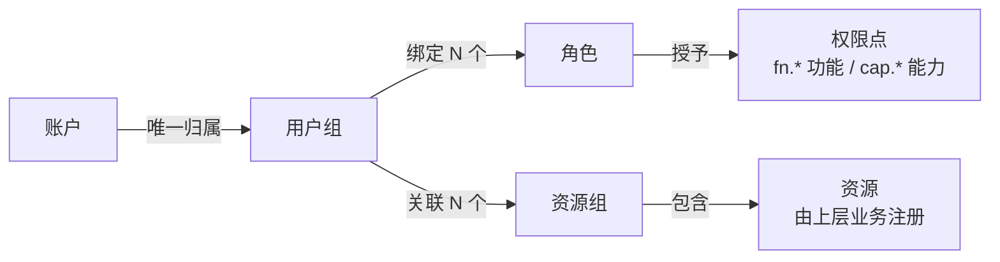

1. **账户只属于一个用户组**（唯一索引），不直接持有角色或资源组。这一条不是风格问题：它让「组级」的判定等价于「人级」的判定，三权分立才能只在一个地方阻断。
2. **组内多个角色、多个资源组取并集**。不做交集，也不设「拒绝优先」的负向授权——权限模型里没有 deny 规则，只做加法。
3. **资源组平铺无层级**，资源归属由上层业务注册、OMS 只读。层级会让范围判定退化成树遍历，平铺则是一次集合成员检查。

边界：角色有两个来源——内置预置与模块安装时注册；两者在运行期都只读，没有编辑接口（R-06）。模块只能注册自己前缀下的权限点，也**不能占用三个内置管理员角色与两个准入角色的编码**。权限点编码的唯一来源是附录册，DD 只可引用。

#### 3.1.2 判定：能力 × 范围

功能权限只看能力维度；业务资源必须同时满足能力与范围，缺一即拒。

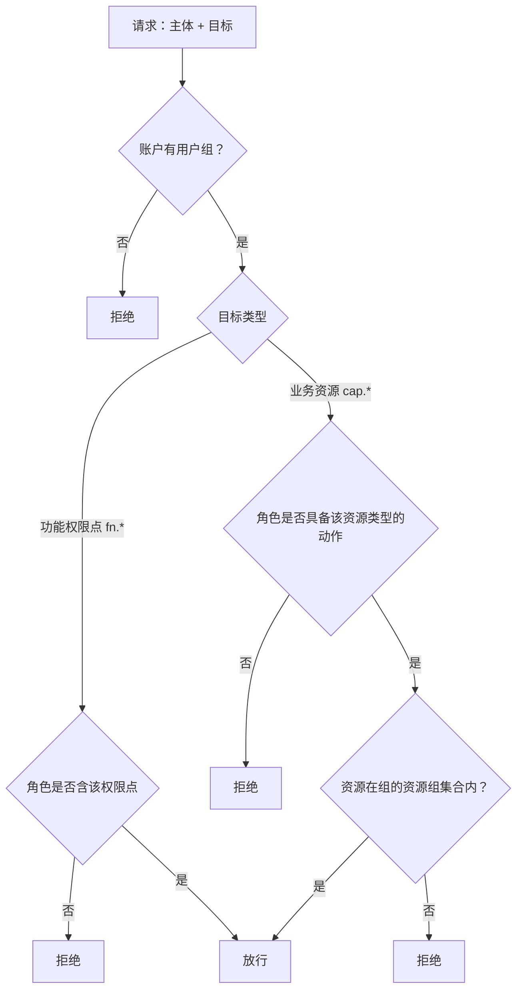

四个象限必须逐条有用例：

| 能力 | 范围 | 结果 |
| --- | --- | --- |
| 有 | 有 | 允许 |
| 有 | 无 | 拒绝：范围维度 |
| 无 | 有 | 拒绝：能力维度 |
| 无 | 无 | 拒绝：默认拒绝 |

三条性能约束，本质都是**正确性**约束：

- 权限点集合与资源组集合按 `group_id` 缓存（Redis，TTL 60s），授权变更时**主动失效**，不靠 TTL 到期。
- 单资源判定是集合成员检查，O(1)；不引入任何需要遍历的层级。
- **列表查询的范围过滤必须下推 SQL**（`WHERE resource_group_id IN (...)`）。先查全量再在内存过滤会让分页错位——第 2 页可能只剩 3 条，这是实现阶段最常见的返工点。

权限点编码：`<域>.<对象>.<动作>[.<限定>]`，`fn.*` 用于 OMS 自身功能，`cap.*` 用于业务资源能力。一个接口只声明一个权限点，禁止「任一满足即可」的隐式并集。

#### 3.1.3 判定在哪里执行

两维判定拆到两个地方：**能力维度在接入层（Nginx 调 OMS），范围维度在业务**。

一句话理由：能力只看「方法 + 路径」，不依赖具体是哪个资源；范围必须知道「这条记录属于哪个资源组」，而这个信息只有业务持有。

拓扑见 **2.4 部署与流量视图**，本节只讲执行规则。

五条落地规则：

1. **只有 Nginx 对外**。HAProxy 装在宿主机上，后端指向本实例的 Nginx Service IP 与部署时指定的端口，因此多套实例不撞端口；业务服务一律 ClusterIP——否则从集群内直达业务端口、自造 `X-OMS-Sid` 就能绕过全部判定。
2. **`auth_request` 配在 `server` 块上**，全站默认生效；只对 `/oms/**`（OMS 自身，走它自己的六道关）、登录页、静态资源、健康检查显式 `off`。模块路由由 ConfigMap 片段维护，漏配的模块会**默认被拦**，而不是默认放行。
3. **注册表在 OMS，不在 Nginx**。模块注册路由时同时登记 `(method, 路径模式) → (资源类型, 动作, 权限点)`；未登记的路径一律 403。Nginx 不持有任何业务语义。
4. **业务只信任 Nginx 注入的 `X-OMS-Sid` / `X-OMS-Subject`**，不自己解 JWT、不自己查会话。
5. **业务判范围只做两件事**：调 `GET /oms/internal/v1/authz/scope` 拿「可见资源组集合」（按 `sid` 缓存 ≤60s；授权变更会使该 `sid` 立即失效并 401，重登换新 `sid`，故缓存不会被用于旧授权，见 3.1.7），然后把集合下推到 SQL。单资源操作先判范围再查详情——顺序反了，返回值的差异会泄露资源是否存在。

四条产品语义，直接约束接口形状：

| 语义 | 规则 |
| --- | --- |
| 列表遇到越权资源 | 返回可见子集，不报错、不提示存在性 |
| 批量含部分越权 | **整体拒绝**：全量判完才执行，避免半个事务 |
| 异步任务 | 创建时判一次，**执行时重判**；失权则任务失败并留痕 |
| 系统身份 | 本期无此场景；接口按 `client_id` + 系统角色预留，不借用户身份链路 |

两个边界：

- **长连接**：WebSocket / SSE 只在握手时判一次，约定**连接最长生命周期 5 分钟**，到期重连重判；更长的流式响应必须拆段。
- **机机调用**：业务之间直连必须携带 OMS 签发的短时效令牌（含 `client_id` 与可选的委托用户 `act`）。共享证书只解决「是不是圈内」，不解决「能不能调这个接口」。

容量影响：判定 QPS 从「OMS 自身 API 调用量」放大为「OMS + 全部业务 API 调用量」。因此 `/_authz` 必须走缓存、热路径不查库——一旦它开始每次查库，压力会直接转给 PostgreSQL。

#### 3.1.4 三权分立：两两互斥

系统管理员、安全管理员、审计管理员**三者两两互斥**——任意两个同时具备即拒绝绑定。

| 角色 \ 角色 | 系统管理员 | 安全管理员 | 审计管理员 |
| --- | --- | --- | --- |
| 系统管理员 | — | 禁止 | 禁止 |
| 安全管理员 | 禁止 | — | 禁止 |
| 审计管理员 | 禁止 | 禁止 | — |

**判定依据是角色的内置编码，不是角色名称。** 三个内置管理员角色编码（`systemAdmin`、`securityAdmin`、`auditAdmin`）是保留的，模块角色不得占用；两个准入角色编码（`m2mAccess`、`humanAccess`，定义见 3.1.5）同样保留，但它们不参与三权分立。判定时看目标用户组的角色集合里是否**同时出现其中两个编码**，出现即拒绝。

为什么按编码而不是名称：名称要支持中英文切换，还可能被展示层改写；编码稳定。为什么不引入「能力标记」：模块只能注册自己前缀下的权限点，拼不出 OMS 管理员能力，角色集合实际是封闭的（内置 + 模块前缀），按编码判定已经足够。

四个阻断点，全部在写接口内校验，不依赖流程审批：

1. 给用户组绑定角色；
2. 给用户组解绑角色（解绑不会产生冲突，但同一入口复用校验，避免绕过）；
3. 创建账户、修改账户所属用户组；
4. 外部账号导入（导入时按目标用户组校验）。

三个内置用户组与内置角色的绑定关系在初始化脚本里预置并置 `builtin_locked`，绑定接口对该标记做守卫——**绕过页面直接调接口同样拒绝**。

`builtin_locked` 只约束**角色绑定**这一件事：加成员、关联资源组都不受它限制。否则迁移时无法把旧管理员放进内置组，也没法给组补资源组范围（`OMS-MIG-001` 4.3）。

因为「账户只属于一个用户组」，在组这一层阻断角色互斥，等价于在「人」这一层阻断，不需要再对账户做一次判定。

#### 3.1.5 角色分类与准入角色

角色按职责分两类，**通道**与**权限**彻底分开：

| 类型 | 例子 | 承载什么 | 创建方式 |
| --- | --- | --- | --- |
| 准入角色 | `m2mAccess` / `humanAccess` | 只决定「能从哪条通道登录」 | 内置，随版本固化 |
| 权限角色 | `systemAdmin` / `securityAdmin` / `auditAdmin`；模块服务角色 | 业务权限与运维管理权限 | 内置或模块安装时注册 |

两个准入角色：

| 角色 | 编码 | 持有权限 | 能做什么 |
| --- | --- | --- | --- |
| 机机接入 | `m2mAccess` | `fn.auth.token.api` | 只能调 token 端点 |
| 人机接入 | `humanAccess` | `fn.auth.login.web` | 只能页面登录 |

组合结果：

| 组内的准入角色 | 页面登录 | API token |
| --- | --- | --- |
| 只有 `m2mAccess` | ❌ 403 | ✅ |
| 只有 `humanAccess` | ✅ | ❌ |
| 两个都有 | ✅ | ✅ |
| 一个都没有 | **不允许保存** | **不允许保存** |

六条规则：

1. **每个用户组至少绑定一个准入角色**。绑定接口与用户组保存都要校验：没有准入角色 = 没有任何登录通道，直接拒绝，而不是留一个「能建但登不进」的组。
2. **准入角色只承载通道权限**，不带任何业务或管理权限；模块注册**不得**把权限点绑到这两个角色上。
3. **业务与运维管理权限一律由权限角色承担**：管理员角色管 OMS 自身功能，模块服务角色管模块自己的 `fn.*` / `cap.*`。
4. **管理员角色不再隐含页面登录**。三个内置管理员用户组由初始化脚本预置为「`humanAccess` + 对应管理员角色」；只有管理员角色、没有 `humanAccess` 的组，同样登不进页面。
5. **准入角色不参与三权分立**（判定只涉及三个管理员编码，见 3.1.4）。
6. **机机账户 = 所在用户组只绑 `m2mAccess` 的账户**；人机页面 = 所在组绑 `humanAccess`；页面 + API = 所在组两个都绑。三种情况都是显式配置，没有隐含权限。

#### 3.1.6 基础场景：一次业务请求

会话建立之后（登录流程见 3.2），每次请求都要把「主体」换算成两个集合，再做两次判定。

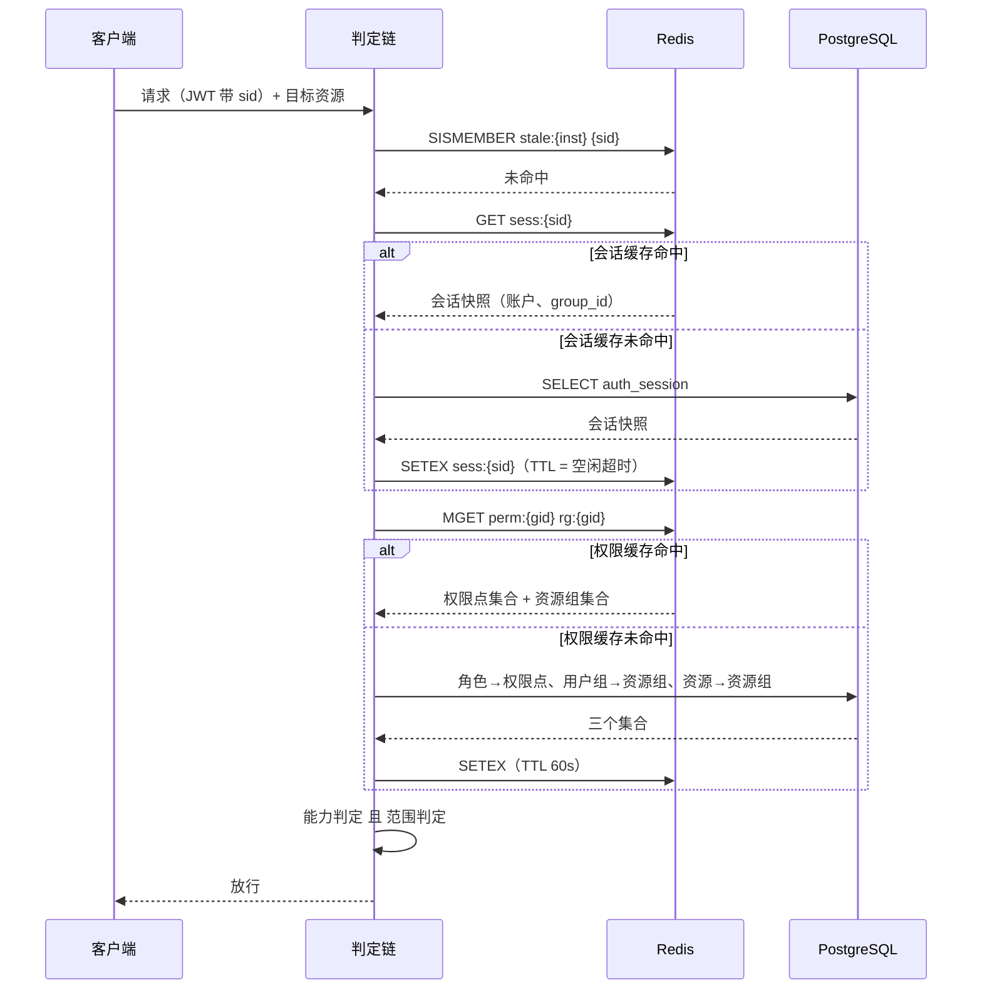

基础场景里只有两件事：**权限点集合决定能力，资源组集合决定范围**；资源本身的归属从资源注册表读，OMS 侧只读。四个缓存键长这样：

| 键 | 内容 | 谁写 | 谁删 | TTL |
| --- | --- | --- | --- | --- |
| `stale:{inst}` | 已失效的 sid 集合 | 授权变更事务提交后 | 到期自动消失 | 60s |
| `sess:{sid}` | 会话快照 | 首次回源查库后写入 | 登录变更时主动删 | 空闲超时（不超过会话剩余最大时长） |
| `perm:{gid}` | 用户组的权限点集合 | 首次回源查库后写入 | 授权变更时主动删 | 60s |
| `rg:{gid}` | 用户组的资源组集合 | 首次回源查库后写入 | 授权变更时主动删 | 60s |

> **硬约束**：`sess:*` 与 `stale:*` **不得持久化**（关闭 RDB/AOF，或启动时按前缀清空）。否则 Redis 重启会带回旧会话缓存、却丢掉失效集合，正好绕过下面的判定顺序，让已失效的授权复活。

#### 3.1.7 扩展场景：授权变更后

扩展场景**只改基础场景的第一步**：原本不命中的失效集合会命中，请求在读取会话之前就被拒。

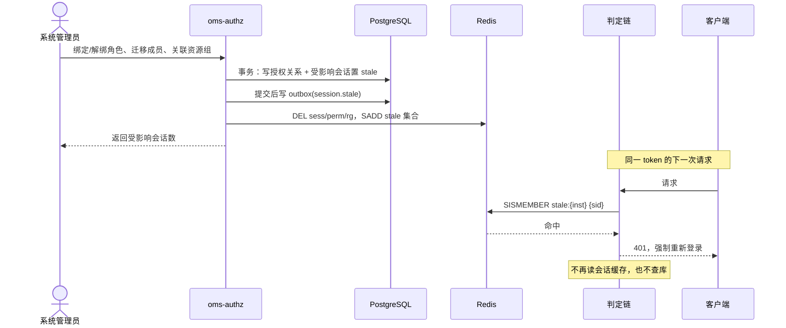

顺序必须是**「先查失效集合，再读会话缓存，最后才回源」**。这是这块唯一容易写错的地方：如果只靠「变更时删缓存」，会出现这样的竞态——请求 A 回源读到「会话有效」，此时变更事务提交并删掉缓存，A 随后把旧快照写回缓存，旧权限就此复活直到 TTL 到期。**删缓存挡不住回填，但一个只增不减的失效集合可以**：sid 进过集合，后续请求根本走不到读缓存那一步。

四个设计点：

| 问题 | 结论 | 理由 |
| --- | --- | --- |
| 受影响账户怎么界定 | 变更所涉用户组的全部成员；若是成员迁移，则迁出组的全部成员 + 迁入的那个账户 | 与 FR-PERM-001 的表述逐字对齐 |
| 置过期还是删会话 | 置 `stale` 标记，不删记录 | 删掉会让「谁在何时被强制下线」不可追溯 |
| 延迟上界 | 目标 ≤1s（Redis 命中） | 不做进程内短缓存（R-11），「即时」由失效集合的读写顺序保证 |
| Redis 不可用 | 跳过缓存与集合，每请求查库 | 宁可慢，不可放过旧权限 |

**向上层业务的授权快照（FR-PERM-004）**：需求要求业务侧与 OMS 的权限口径一致。实现用**拉取**，不用推送：

- 业务调 `GET /oms/internal/v1/authz/snapshot?since=<版本>`，OMS 返回 `user_group_role`、用户组与资源组关联的只读快照，以及当前版本号；
- 版本号在授权变更的**同一事务**里递增，与 `stale` 标记同生共死——「快照变了」与「受影响会话失效」是同一个事实，不存在两个时钟；
- 快照**只用于业务侧的本地展示与业务映射**，不得作为判定依据：能力判定仍走 `/_authz`，范围仍走 `/authz/scope`；OMS 不可用时业务必须拒绝，不得拿快照兜底（R-05）；
- **不做推送**：推送要维护「谁订阅了我、对方收到没有、断线后补哪些」，而拉取天然按需，目标长期离线也不会积压待同步内容。

审计口径：记录变更人、变更类型、受影响账户数、受影响会话数。**被拒绝的越权尝试也要留痕**，两类记录都在 operation_log 里，按类型区分。

---

### 3.2 认证与单点登录

对应需求 FR-AUTH-001～008、FR-SSOS/SSOC-001～003；铁律 R-05。

#### 3.2.1 端到端流程（登录一次 + 每请求判定）

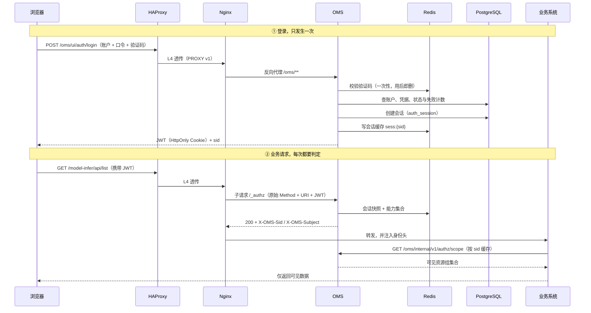

三句话读完这张图：

1. **JWT 只在阶段一签发一次**。之后每个请求都是「判定已有令牌」，不重新签发。
2. **`/_authz` 是 Nginx 的内部子请求**，浏览器看不到，返回值只有状态码与两个头。
3. **OMS 自身接口不经过 `/_authz`**，它走自己的六道关（2.5），避免同一请求被判两次。

#### 3.2.2 令牌与会话

**JWT 里只有会话标识，没有权限。** 一旦把权限快照放进令牌，授权变更就无法即时生效——这是 R-04 的直接推论。

| 字段 | 含义 | 说明 |
| --- | --- | --- |
| `sub` | 账户 ID | 不放用户名，避免改名后歧义 |
| `sid` | 会话标识 | 所有判定的入口，权威在 `auth_session` |
| `iat` / `exp` | 签发与到期时间 | `exp` 取**最大会话时长**，不是空闲超时 |
| `jti` | 令牌唯一标识 | 用于登出与剔除时精确失效 |
| `iss` | 签发方 | 固定为 OMS 实例标识 |

- **签名**：HMAC-SHA256，密钥存 Secret，支持双密钥并存以便平滑轮换。
- **载体**：浏览器用 `HttpOnly + Secure + SameSite=Lax` 的 Cookie；机机调用用 `Authorization: Bearer`。前端 JS 读不到令牌，降低 XSS 窃取风险。
- **登录成功必须重新生成 `sid`**：会话标识只由服务端生成，不接受客户端传入，避免会话固定攻击。
- **为什么 `exp` 取最大会话时长**：空闲超时由服务端会话判定，与令牌无关。这样续期只需要更新会话记录，不用重签令牌，也不需要 refresh token。

  代价要说清楚：**到达 `exp` 后，即使用户一直在操作，令牌也会失效、必须重新登录**。这正是「最大会话时长」的语义（FR-AUTH-003：累计时长超过上限不再续期，要求重新认证）。最大时长在会话创建时固化，策略调整只影响新会话——否则已签发的令牌与实际会话时长会对不上。

| 过期类型 | 由谁判定 | 触发条件 | 到达后 |
| --- | --- | --- | --- |
| 空闲超时 | 服务端会话 | 距最后一次活动超过阈值 | 401，重新登录 |
| 最大会话时长 | 令牌 `exp` + 服务端会话 | 从创建起累计超过上限 | 401，重新登录，**不看是否活跃** |

会话自身的状态只有五种：`ACTIVE`、`STALE`（授权变更）、`REVOKED`（剔除或登出）、`EXPIRED_IDLE`、`EXPIRED_MAX`。后四种一律拒绝，区别只在给用户的提示与审计口径。

- **续期**：每次请求更新 `last_active`，按分钟级限频写库，避免每请求一次 UPDATE；达到最大会话时长后不再续期。
- **并发上限**：超限时**拒绝新登录、既有会话保留**（FR-AUTH-003），不是踢掉旧会话——后者会让「被异地登录」变成一种攻击手段。
- **禁用与删除**：账户一禁用或删除，立即终止其全部会话（FR-ACC-004 / FR-ACC-007）。

#### 3.2.3 登录的异常路径

| 场景 | 行为 | 依据 |
| --- | --- | --- |
| 验证码错误或过期 | 拒绝登录，计入失败次数；验证码一次性，用后即删 | FR-AUTH-005 |
| 连续认证失败 | **以账户维度为主**锁定；IP 维度只用于触发验证码升级，不单独锁定 | FR-SEC-003、2.3 |
| 首登未改密 | 403，仅放行改密与登出两个接口 | FR-AUTH-006 |
| 首登协议未确认 | 403，仅放行协议确认与登出 | FR-AUTH-008 |
| 并发会话超限 | 拒绝新登录并说明原因，既有会话不动 | FR-AUTH-003 |
| 会话被管理员剔除 | 置 `REVOKED`、清缓存；**只终止 OMS 本地会话，不触发下游 SLO** | FR-AUTH-004 |
| 账户被禁用/删除 | 立即终止该账户全部会话 | FR-ACC-004 / FR-ACC-007 |
| OMS 认证能力不可用 | 拒绝登录且既有会话失效，**不存在免认证通道** | R-05 |

失败计数的阈值、窗口与锁定时长归 M15 的安全策略配置，不在本节写死。这里只定维度：**账户为主、IP 为辅**，因为 `set_real_ip_from 0.0.0.0/0` 之下源 IP 可被伪造（见 2.3）。

#### 3.2.4 单点登录：CAS + 协议适配

OMS 同时扮演两个角色：对下游是 **SSO Server**，对上游是 **SSO Client**。本期上游协议选 **CAS 3.0**，但协议本身被隔离在适配层，不进入会话、账号与授权模型。

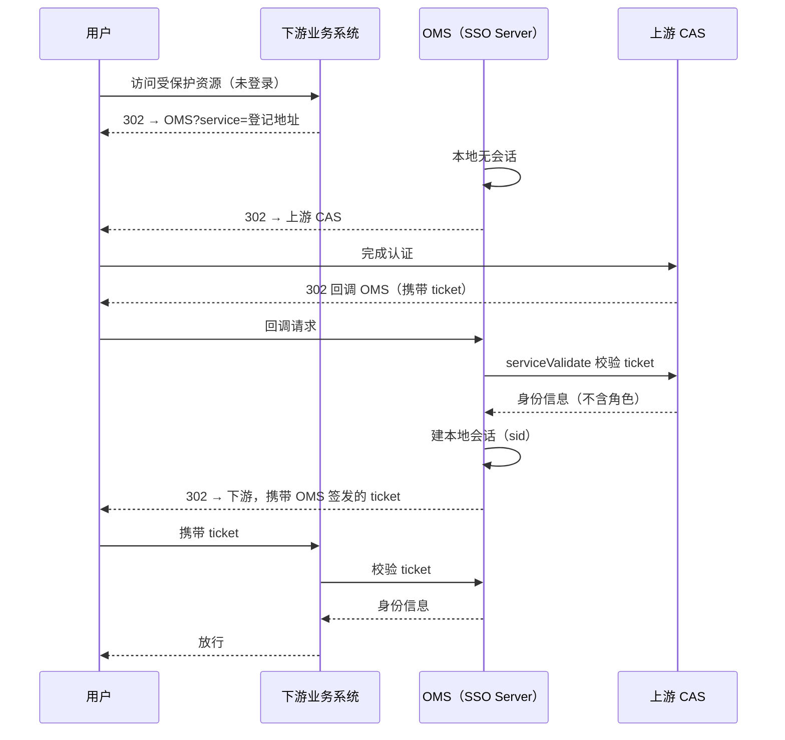

OMS 已有本地会话时，跳过「重定向上游」这一步，直接为下游签发 ticket——这是级联登录的复用规则，避免同一次会话反复向上游申请票据。

四条设计原则：

1. **协议适配层隔离**。定义 `IdentityProvider` SPI：`authorize` / `callback` / `validateTicket` / `logout`，外加一个能力声明（是否支持单点登出、是否支持令牌刷新等）。CAS 是第一个实现，将来加 OIDC / OAuth2 / SAML 只是新增实现类 + 一条配置，**不动会话、账号、权限三张模型**。
2. **会话与协议解耦**。不管走哪种协议，落地都是「建立本地会话 + 发 sid」。`sso_client` 表预留 `protocol` 字段；ticket 在模型里抽象成「一次性凭据」，与具体协议格式无关。
3. **ticket 的四个性质**：一次性、短时效（5 分钟）、服务端可撤销、**会话维度记录哪些下游用过它**（这是 SLO 广播范围的依据）。
4. **上游只给身份，不给权限**。上游返回的任何角色信息一律不采信；外部账号的权限来源是导入时指定的用户组，运行时没有角色映射。

单点登出（SLO）的执行顺序：

1. 任一客户端或 OMS 发起登出；
2. OMS 撤销该会话相关的一次性凭据，并**通知曾用该会话免密登录的全部下游**，而不是只通知发起方；
3. OMS 再通知上游使其 ticket 失效；
4. 不可达的下游标记为待撤销并重试，超过会话期后其登录态自动失效。

对外防护三条：重定向地址必须命中该客户端登记的白名单（防开放重定向）；ticket 必须服务端校验，绝不信任前端携带的身份声明；未登记或已禁用的客户端一律拒绝，且不为其签发 ticket。

SSO 路径的失败语义与本地登录一致：上游不可达时**拒绝登录，不降级**；上游认证失败时不建立任何登录态；OMS 认证不可用时，下游拒绝放行且既有会话失效（R-05）。

#### 3.2.5 登录通道判定

准入角色怎么配见 **3.1.5**，这里只说认证时怎么判：两个端点各查一个权限点。

| 端点 | 要求的权限点 | 来自哪个准入角色 |
| --- | --- | --- |
| `POST /oms/ui/auth/login` | `fn.auth.login.web` | `humanAccess` |
| `POST /oms/internal/v1/auth/token` | `fn.auth.token.api` | `m2mAccess` |

四条规则：

1. **权限点在认证之后、建立会话之前校验**。被拒的请求不产生会话。
2. **两个端点签发同一套会话**：同一套会话模型（各自生成 `sid`）、同样的空闲超时与最大时长、同样会被 `stale` 与剔除；会话上记录 `login_channel`（`web` / `token`）供审计。
3. **首登改密**：具备 `humanAccess` 的账户按人机规则强制改密；只有 `m2mAccess` 的账户由安全策略开关控制。
4. **协议确认只在 web 通道发生**，token 通道不适用。

### 3.3 审计与转储

对应需求 FR-OPLOG-001～004、FR-RTLOG-001～004；铁律 R-07。

#### 3.3.1 审计记录模型：只追加，不可改

| 约束 | 做法 |
| --- | --- |
| 不可篡改 | 数据库应用账号对 `operation_log` 只有 `INSERT` 与 `SELECT`，没有 `UPDATE`/`DELETE` 权限 |
| 不可删除 | 不提供任何删除接口；**转储归档是记录移出主表的唯一途径** |
| 可校验 | 每条记录写入时计算 `record_mac`（HMAC-SHA256），并记录 `mac_key_version`；密钥轮换后旧记录仍可验证 |
| 可伸缩 | 按 `occurred_at` 做月分区，查询按时间裁剪；整月移出由转储后的分区清理完成（执行主体见 9.1 O-11，应用账号无 DDL 权限） |
| 可国际化 | 存 i18n key 与参数，**渲染在查询时**按访问者当前语言完成，不存渲染后的字符串 |

记录的业务字段：操作者、来源 IP、时间、操作对象、操作类型（安全类/操作类）、结果、请求 ID。`record_mac` 只覆盖**不可变字段**。

告警的记录模型单独说一句：告警的「次数」「最近发生时间」是**聚合字段**，允许更新、不进入创建时的 MAC——重复告警可能每秒都在累加，为每次累加追加一条带 MAC 的记录既昂贵又没有审计价值。真正需要留痕的是**状态变更**：「清除」「屏蔽」这类动作追加一条 `alarm_clear_log`，单独带 MAC，记录操作者、时间、方式。这样既保住「创建事实不可改」，又能完整表达状态演进。

#### 3.3.2 留痕先于执行

审计最容易出的问题是「操作成功了，但日志没写进去」。所以写操作的顺序是固定的：

1. 业务事务内，同时写业务数据和 `outbox_event(type=AUDIT)`——两者同生共死；
2. 事务提交后由 outbox 投递器写入 `operation_log`；
3. 投递失败退避重试，超限告警；`event_id` 唯一，保证重试不产生重复记录。

这样即使进程在「提交后、写日志前」崩溃，审计意图仍在库里，恢复后会补上。**代价是日志可能延迟数秒可见**，这个延迟在审计场景可以接受；如果要求「零延迟」，就得把日志写入放进主事务，那会拖慢所有写操作。

外部来源（上层业务系统上报）走 `POST /oms/internal/v1/audit/oplog`，凭 `client_id` + 令牌调用，OMS 校验字段、来源与限流后落库，并标记 `source=module:<id>`。外部上报与内部写入共用同一张表、同一套查询，不另设存储。

#### 3.3.3 查询与导出

- 查询按时间、操作者、类型、结果筛选，时间范围是可选条件；分页用 `offset`（需要页码与总数），并对**深度设上限**——见 8.2。
- 导出 CSV 走**异步任务**（`task` 队列），不阻塞请求；结果文件落 PVC，有保留期。
- **公式注入防护**：单元格以 `=`、`+`、`-`、`@` 开头时加前缀 `'`，防止在 Excel 中被当作公式执行。
- **导出本身也留痕**：谁、导出了哪个时间范围、多少条。导出是把数据复制出系统，属于敏感操作。

#### 3.3.4 转储：一个包，两类数据

**一次转储产出一个 zip，操作日志与告警同时打进这个包。** 不再按类型分别出包——两条数据源共用同一次任务、同一个时间窗、同一个保留策略。

触发有三条路径，走同一个服务：

| 触发 | 默认 | 包的时间窗 |
| --- | --- | --- |
| 按月 | 每月 1 日 01:00（可配） | 上一个自然月 |
| 超量 | 每 10 分钟检查阈值（可配） | 从最旧记录起，截到两类都回落到阈值以下的那个时间点 |
| 手动 | 页面 / 接口 | 操作者指定的区间 |

包的结构：

```
archive/20261001/archive-2026-09-20261001T010000Z.zip
├── manifest.json     # 时间窗、两类条数、各文件 SHA-256、schema 版本、生成时间
├── oplog.ndjson      # 每行一条，原始字段 + record_mac + mac_key_version
└── alarm.ndjson      # 同上；某类为空时也保留空文件，便于解析
```

执行顺序固定：

1. 按时间窗取 `pg_advisory_lock`，同一时刻只允许一个转储任务；`(from_ts, to_ts)` 唯一键防重复触发；
2. 两类数据分别流式写 NDJSON 并计算 SHA-256，**不整表加载**；
3. 写 `manifest.json`，打包到临时文件，`fsync` 后原子 rename 到目标路径；
4. 登记 `archive_package`（时间窗、两类条数、大小、SHA-256、状态）；
5. 按保留策略删除最旧的包（默认保留最近 **10 个包**，不按类型分别计算）；
6. 配置了 SFTP 时**整包上传**，失败退避重试、本地包保留；
7. 包落盘并登记成功后，清理该时间窗内的分区/记录——**执行主体与凭据待定（9.1 O-11）**；约束是应用账号只有 `INSERT`/`SELECT`（见 3.3.1），清理必须由具备 DDL 权限的独立身份完成。清理失败标记部分失败，可按包内区间幂等重跑。

**超量触发时同时产生告警**：阈值检查命中后，除了启动转储，还产生一条 `log` 源告警（「操作日志量超过阈值」），转储成功后由源侧上报清除。这样即使转储任务失败或没排上队，也有人知道——**告警本身月增只有千级，不会被日志把台账淹没**。

三个边界：

- **转储时不做逐条 MAC 校验**。月增量数万条记录逐条验签的耗时与收益不成比例；`record_mac` 随包保留，供事后按需抽查。包的完整性由 manifest 里的**条数 + SHA-256** 保证。
- **归档包本身不可修改**，只能按保留策略整体删除最旧的包。
- **清理主表只由转储任务执行**，没有任何手工删除入口。

#### 3.3.5 运行日志与转储是两回事

运行日志（M09）是**排障材料**，不是审计证据：按时间范围与组件收集现有日志文件，打包后供下载，走任务队列，产物按保留期清理。

它与转储的区别必须在文档里说清楚，否则实现时容易合并成一套：

| | 转储包 | 运行日志包 |
| --- | --- | --- |
| 数据来源 | 数据库主表（结构化） | 容器日志文件（文本） |
| 目的 | 审计追溯、控制主表体积 | 排障 |
| 触发 | 按月 / 超量 / 手动 | 用户按需发起 |
| 保留 | 最近 10 个包 | 按配置的保留期 |
| 可删除性 | 主表记录只能经它移出 | 产物可随时删除，不影响审计 |

### 3.4 证书与私钥

对应需求 FR-CERT-001～005、FR-INSP-001；铁律 R-08。

全系统只有三张证书：一个内部 CA，和两张由它签发的叶子。**默认部署不依赖任何外部 CA，也没有自动续签**——对外证书可被用户替换，集群内证书只在部署期产生。

| 对象 | 签发者 | 有效期 | 用途 | 操作权限 |
| --- | --- | --- | --- | --- |
| 内部 CA | 自签（自己是根） | 100 年 | 只签发下面两张叶子；其公钥作为信任锚，校验集群内对端证书 | 部署流程 |
| 共享服务证书 | 内部 CA | 50 年 | 同一命名空间内，服务之间、服务与 OMS 之间的 mTLS | 部署流程 |
| Nginx 对外证书 | 内部 CA，可被外部 CA 证书替换 | 50 年（替换件不受限） | 终端 ↔ Nginx 的 HTTPS | **仅系统管理员**（可读写）；安全管理员不可读 |

#### 3.4.1 信任模型

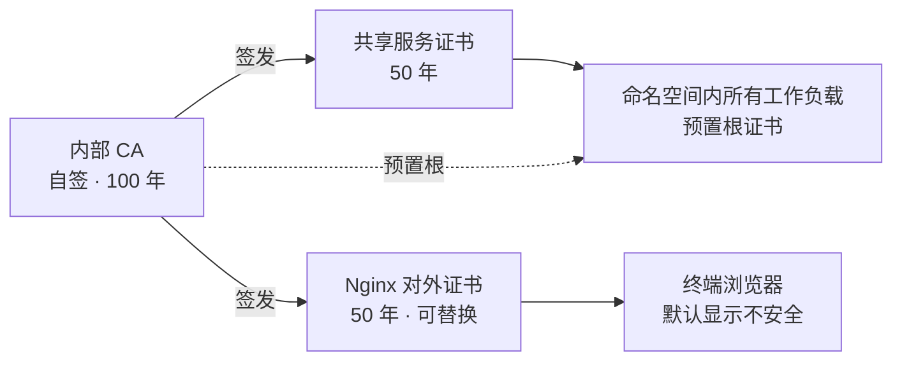

四条规则：

1. **单一信任锚**：内部服务只预置内部 CA 的根，不预置任何叶子证书；**终端浏览器默认不预置**，因此访问时显示「不安全」——这是接受的现状，不是缺陷。用户可手工导入根证书消除提示（系统提供下载），属于可选的交付动作。
2. **共享证书的 SAN 只含集群内名字**（`*.ns.svc`、`*.ns.svc.cluster.local`），**不得写入对外域名**。任何一方一旦预置了该 CA，就等于信任它签发的所有证书；而共享私钥对命名空间内所有工作负载可读，一旦 SAN 含对外域名，单个容器沦陷就能对外冒充站点。
3. **mTLS 只做准入，不做身份**。一张证书全命名空间共用，服务端只能证明「持有者在圈内」，无法区分是哪个系统在调用。调用方身份仍取 `client_id`/令牌，**授权绝不建立在证书身份上**。
4. **内部 CA 换叶子不换锚**。在内部 CA 名下替换任意一张叶子，客户端信任库一字不改，**滚动期**（新旧证书同时在线的过渡窗口）不存在「双方要互相预置对方证书」的问题——两张叶子同挂一个根，互验都能过。若对外证书被替换为外部 CA 签发的证书，客户端改为信任外部根，这属于**锚点变更**，按 3.4.2 处理。

**CA 私钥是整个信任体系唯一的根**：只在部署期由 Job 生成与使用，存独立 Secret，**不挂载进任何业务 Pod**；OMS 数据库只保存 CA 证书（公钥），用于展示与巡检。它一旦泄露，攻击者可以同时伪造对内与对外的证书，而本系统没有 CRL/OCSP、无法吊销——只能换 CA、全命名空间滚动、所有终端重新导入。

#### 3.4.2 导入与替换（对外证书）

页面导入的证书**由外部 CA 签发，或为自签证书（叶即根）**；内部 CA 只在部署期使用，不参与页面导入。**这条路径的存在意义就是消除浏览器的「不安全」提示**——换成公共 CA 签发的证书后，浏览器内置的根即可验证通过。根证书必须包含在上传内容里，接受三种组合：

| 组合 | 证书栏 | CA 证书栏 |
| --- | --- | --- |
| ① | 叶子 + 中间证书 | 根证书 |
| ② | 叶子 | 中间证书 + 根证书 |
| ③ | 自签证书（叶即根） | 同一份文件 |

系统按固定顺序处理：

1. 解析两栏的全部 PEM，按 SHA-256 指纹**去重**（用户很可能把 fullchain 同时塞进两栏）；
2. 按公钥匹配确定叶子，再按 Subject/Issuer **自下而上重排**，不信任上传顺序；
3. 校验能**唯一**定位一条「叶 → 中间 → 根」路径：零条拒绝（断链），多条拒绝（要求裁剪）；
4. 逐级验签，并校验根自签、有效期、SAN；域名不匹配时**提示风险并由操作者确认**后才允许继续（FR-CERT-002）；
5. 私钥按需提供（见下表），校验私钥与叶子公钥配对；
6. 生成只含「叶 + 中间」的 fullchain 交给 Nginx，**根剥掉**（叶即根时不剥）；
7. 根证书单独存为该证书的元数据；签发者不是公共可信 CA 时，页面提供「下载根证书」，供终端手工导入。

| 导入场景 | 私钥 | 私钥口令 |
| --- | --- | --- |
| CSR 签回 | 可空（公钥已匹配库中私钥） | 可空 |
| 手工上传，明文 key | 必填 | 可空 |
| 手工上传，加密 key | 必填 | 必填，仅用于本次解密 |
| 库中已有匹配私钥 | 可空 | 可空 |

> 注意区分**两份口令**：**上传件的口令**只用于解开用户提供的那份加密 PEM，用完即弃；**私钥口令**由系统生成，用于把私钥加密成 PKCS#8 存储，它自身再用主密钥加密后放进 Secret。两者互不影响——用户下次换证不需要记得上次的口令；私钥口令由主密钥保护，主密钥一旦丢失，所有密文都不可恢复。

三条红线：

- **上传的根不得进入 OMS 自身信任库**。导入是业务写操作；若它能改变系统的信任边界，具备该权限的人就能伪造上游身份。
- **私钥永不导出**：无页面下载、无 API 返回、无脚本入口，系统只输出 CSR。
- **不依赖客户端补链**：中间证书必须由 OMS 发全，不能赌浏览器去 CA 官网抓。

替换与回滚：替换前自动备份原证书与原私钥，失败自动回滚（FR-CERT-002）。CA 续约失败时保持当前证书可用、产生告警并标记待处理，**不回退为自签**（FR-3RD-003）。

替换件若由外部 CA 签发，**只有经外部域名访问 OMS 的客户端**需要能验证该 CA——浏览器通常内置公共根，无需额外配置；内部调用走 Service IP，不受影响。

#### 3.4.3 部署视图与生效

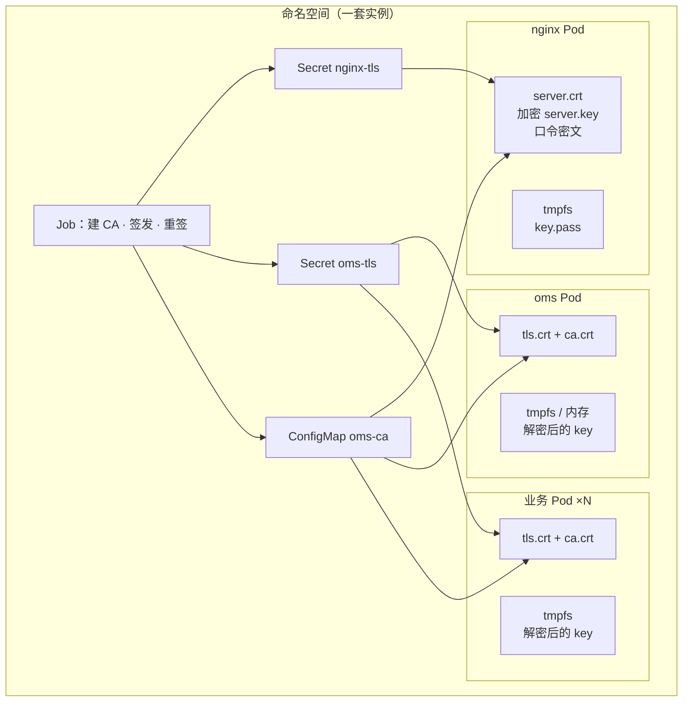

| Pod | 卷 | 内容 | 写入者 |
| --- | --- | --- | --- |
| nginx | Secret `nginx-tls` | `server.crt`（叶 + 中间链，无根；内部 CA 直签时只有叶）、`server.key`（AES-256 加密 PEM）、`server.key.pass.enc`（口令密文） | 部署流程 / 系统管理员导入 |
| nginx | ConfigMap `oms-ca` | `ca.crt`（内部 CA 公钥，用于校验客户端证书） | 部署流程 |
| nginx | `emptyDir{medium: Memory}` | `key.pass`（明文口令，仅 reload 期间存在） | wrapper |
| oms | Secret `oms-tls` + ConfigMap `oms-ca` | `tls.crt`（叶 + 中间）、`tls.key`（加密 PEM）、`tls.key.pass.enc`；`ca.crt` 来自 `oms-ca` | 部署流程 |
| oms | `emptyDir{medium: Memory}` | 解密后的 `tls.key`（仅当运行时要求文件路径） | 应用进程自身 |
| 业务 Pod ×N | Secret `oms-tls`（与 oms 同一个）+ ConfigMap `oms-ca` | 同上 | 部署流程 |
| 业务 Pod ×N（Python 等需文件路径的 SDK） | `emptyDir{medium: Memory}` | 解密后的私钥（仅内存） | 应用进程自身 |

- **明文只在内存中短暂存在**：口令与私钥解密后的形态只出现在 `emptyDir{medium: Memory}`，用完即删。完整的明文生命周期（tmpfs、毫秒级窗口、失败不降级）统一在 **3.5 加解密与凭据** 中定义，本节只描述挂载。
- **换证路径**：Nginx 证书 → 只更新 `nginx-tls`，卷同步（≤60s）后 wrapper reload，平滑生效；共享服务证书 → 更新 `oms-tls` 后 `rollout restart` 全部业务 Pod 与 oms Pod。
- **OMS 唯一的 K8s 写权限**：只能写本命名空间的 `nginx-tls` 这一个 Secret（Role 按资源名限定），其余 Secret 由部署流程维护。
- **私钥由业务自己解**：业务 Pod 挂载它所需的 `kmc-modelenginepublic` 主密钥（3.5.3），经 `KmcCryptoPort` 用 KMC 解开口令，再用口令解开私钥。Python 的 `ssl` 要求文件路径，需解密到 `emptyDir{medium: Memory}` 后再加载。
- **接入契约**：业务系统必须部署 KMC Python 库并挂载对应 KSUser 的主密钥（写进 OMS-INT-001），否则无法解开共享私钥。

#### 3.4.4 预警、巡检与残余风险

| 对象 | 预警策略 |
| --- | --- |
| Nginx 证书 | 按**当前生效证书的 `notAfter`** 计算，剩余天数进入 30–90 天（可配）区间即告警；替换件有效期任意，规则不变 |
| 共享服务证书 | 不预警，标记「长期有效」 |
| 内部 CA | 不预警，仅展示 |

- 巡检对象：两张叶子 + 内部 CA。证书管理页只展示 Nginx 证书（固定一条），共享服务证书在巡检结果中体现。
- **接受的残余风险**：无 CRL/OCSP，泄露只能换 CA + 全命名空间滚动 + 终端重新导入；50 年有效期长于算法寿命，真实更换动因是安全事件与算法升级，不是到期；共享私钥对命名空间内所有工作负载可读。
- **备份要求**：私钥密文与主密钥分离存放，主密钥不随数据库备份一起归档；两者同时丢失即私钥不可恢复，只能重新生成密钥对并重签。
- mTLS 的终止点（Nginx 校验客户端证书，还是应用层校验）与启用范围归 DD-07，本节只约定信任模型与证书来源。
- **权限口径**：证书管理仅系统管理员可见可写，**安全管理员不可读**。此结论与 OI-M13-002「安全管理员只读」的旧口径冲突，以本结论为准，需回写 SRS。

---

### 3.5 加解密与凭据

对应需求 FR-CRYP-001～002；铁律 R-08；迁移细节见 `OMS-MIG-001`。

> **信任边界**：集群 root 及以上不在防御范围内。加解密要防的是**没有集群权限的攻击者**——拖库、备份泄露、存储介质泄露。据此明确接受一条风险：**用到某类密文的 Pod 会挂载对应的主密钥**，该 Pod 沦陷即可解开该类密文；该风险在 9.2 登记（AR-02），不回避。

**后端是 KMC。** 接口是 `CryptoPort`，实现是 `KmcCryptoPort`；业务代码只依赖接口，不感知 KMC。这是迁移侧 2026-10-28 的决策（继续用 KMC、不切 SCC），理由是旧密文可以原地解开、不引入新组件，而 `CryptoPort` 的设计本来就允许换实现。

**同一套密钥体系要同时支撑两种场景**——全新安装与从旧底座迁移。两者的一致性只允许有一个缺口：**密钥材料从哪来**（见 3.5.2）。用户清单、挂载路径、权限、自检、失败语义全部相同，否则同一个产品就有两个密钥模型。

#### 3.5.1 密钥模型：一组主密钥，按 KSUser 隔离

主密钥不是一把，而是**按 KSUser 拆开的一组**，每把存各自的 Secret，KMC SDK 通过环境变量 `KMC_DATA_USER` 选用哪一把。这不是设计偏好，是硬约束：**用哪把钥匙加密的，就必须用哪把解开**。

| 项 | 结论 | 理由 |
| --- | --- | --- |
| 层数 | 单层，无数据密钥（DEK） | 需要加密的数据只有几十条；两层只在接 HSM 时才有收益 |
| 把数 | 常驻**三个**：`oms`、`nginx`、`modelenginepublic` | 见下表；旧体系的九个用户里只有两个承载了仍需解的旧密文 |
| 生成 | `oms` 两场景都新生成；另外两个只在全新安装时生成 | 旧密文必须用原主密钥解，重新生成等于永久不可解 |
| 存放 | 每把一个 Secret（`kmc-<user>`），密钥本体与校验文件放在同一个 Secret 里 | 不再像旧底座那样把校验文件拆到 ConfigMap，挂载目录结构不变 |

**常驻三个用户**（两种场景完全一致）：

| 用户 | 保护什么 | 全新安装 | 从旧底座迁移 |
| --- | --- | --- | --- |
| `oms` | 新底座自身全部**新**密文：PG 口令、Redis 口令、SFTP / SNMP / SSO 凭据、`email` / `telephone`、服务间证书口令 | `create_mk` 生成 | **同样生成**——它名下不迁入任何旧密文 |
| `nginx` | Nginx 对外证书私钥口令 | 生成 | **复用旧**（证书不动，口令必须能解） |
| `modelenginepublic` | 上层业务凭据（`GLOBAL_PWD`、SSL 口令） | 生成 | **复用旧**（业务继续用） |

**边界是这么划的**：旧密文全部落在 `nginx` / `modelenginepublic`（以及迁移期临时挂载的旧用户）名下，新密文全部落在 `oms` 名下。所以「迁移」与「新装」的差别只在后两个用户的材料来源，`oms` 永远是新的。

**迁移期临时用户**，不进产品交付物、不出现在 Deployment 的挂载清单里：

| 用户 | 用途 | 处理 |
| --- | --- | --- |
| `gaussdba` | 迁移程序读旧库 | 仅迁移 Job 挂载，P7 后归档 |
| `kms` | 解 `email` / `telephone` 旧密文 | 仅迁移期，对账通过后归档 |
| `tomcat` | 拆旧 JKS / P12 的口令 | 保留 Secret 但**不挂载**，需要时才挂 |
| `root` | 旧平台根密钥（用途未查清） | 保留不挂载——新底座没有它的密文 |

**不新增其它用户、也不合并已有用户**：合并要把全部密文翻译一遍，收益不抵风险；而 `oms` 是新增的，代价为零（它名下没有旧密文）。

主密钥不进日志、不进镜像、不进代码仓库；它的指纹可以打印，用来核对各实例用的是不是同一份。

#### 3.5.2 初始化：两种模式，一条铁律

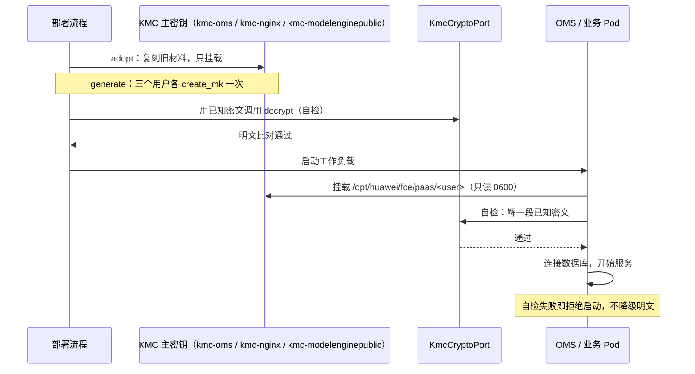

初始化只有两个模式，由部署参数选择，**不靠人记**：

| 模式 | 场景 | 对常驻三个用户做什么 |
| --- | --- | --- |
| `generate` | 全新安装 | 对 `oms` / `nginx` / `modelenginepublic` 各执行一次 `create_mk`，生成新密钥 |
| `adopt` | 从旧底座迁移 | **只挂载、绝不生成**：把旧 `nginx` / `modelenginepublic` 的材料原样复刻到 `kmc-<user>`，`oms` 仍然新生成 |

两条硬约束：

- **`adopt` 模式下严禁 `create_mk`**。执行它会覆盖旧主密钥，届时全部旧密文不可解——这是迁移期最容易犯、后果最重的错。
- **自检必须用真实材料**：`generate` 用固定测试向量，`adopt` 用库里的真实旧密文。随机向量只能证明「算法可用」，证明不了「这把钥匙对得上这批密文」。

第三种情况没有: 没有「先 adopt 再 generate」的混合模式——那等于中途换钥匙。

#### 3.5.3 挂载清单与加密对象

| 卷 | 类型 | 内容 | 挂载方 |
| --- | --- | --- | --- |
| `kmc-oms` | Secret | `oms` 主密钥 + 校验文件 | OMS |
| `kmc-nginx` | Secret | `nginx` 主密钥 + 校验文件 | OMS（证书模块）、证书 Job |
| `kmc-modelenginepublic` | Secret | 业务主密钥 + 校验文件 | 上层业务 Pod |
| `oms-db-cred` | Secret | 数据库口令**密文** | OMS |
| `oms-tls` / `nginx-tls` | Secret | 私钥（加密 PEM）+ 口令密文 | OMS / Nginx |
| `ca-key` | Secret | 内部 CA 私钥（加密 PEM）+ 口令密文 | 仅部署 / 轮换 Job |

- 主密钥卷挂在 `/opt/huawei/fce/paas/<user>`，`defaultMode: 0600`、`readOnly: true`；**只有用到该 user 密文的 Pod 才挂它**，不做「全量挂载省事」。
- 每个用户的密钥本体与校验文件放**同一个 Secret**（旧底座把校验文件拆在 `kmc-ks` ConfigMap 里，新底座不继承这个拆法）。挂载后目录里的文件名不变：`data.1` / `data.2` + `data.1.sha`（或 `.sm3`）。
- 迁移时旧 Secret 一个都不动：迁移 Job 把需要的材料**复刻**成 `kmc-<user>`，旧名留给 P7 回滚。

加密对象与落点：

| 加密对象 | KSUser | 落点 |
| --- | --- | --- |
| 数据库连接口令 | `oms` | `oms-db-cred` |
| Redis 口令 | `oms` | Secret（部署时写入） |
| 账户 email / telephone | `oms` | 数据库 |
| SFTP / SNMP v3 / SSO 客户端凭据 | `oms` | 数据库 |
| 服务间证书（重签）私钥口令 | `oms` | `oms-tls` |
| 内部 CA 私钥口令 | `oms` | `ca-key` |
| Nginx 对外证书私钥口令 | `nginx` | `nginx-tls`（迁移时为旧密文） |
| 产品层凭据（`GLOBAL_PWD` 等） | `modelenginepublic` | 业务侧 Secret |

> 落点只是典型位置。约束只有一条：**落入任何持久化介质之前必须先加密**；明文不经环境变量长期传递（4.6）。

#### 3.5.4 调用方式与四条实现约束

`KmcCryptoPort` 不在进程内做算法，而是**调 KMC 的 Python SDK**（子进程）。它不是性能路径——一次业务请求通常零次调用。

四条约束，每条都踩过坑：

1. **密文格式先校验**。KMC 密文是纯大写十六进制（`^[A-F0-9]+$`）；格式不符直接抛异常，**不得返回空串**——空串会让调用方把「解密失败」当成「明文就是空」。
2. **解密非幂等**。对已经解出来的明文再调一次 `decrypt`，得到的是空串而不是报错。调用方必须始终从**原始密文**解，不要在已解密的路径上再解一次。
3. **明文经环境变量传给子进程，用完立即清除**。`KMC_PYTHON_PLAIN_TEXT` 会在子进程存活期内出现在 `/proc/<pid>/environ`，因此：单次调用单次设置、返回即 `unset`、失败路径同样清理、不并发复用同一个进程。这是**接受的设计代价**，登记在 4.13。
4. **不进日志、不进异常栈、不进 dump**。子进程 stdout 只取密文/明文本身，stderr 过滤后才可记录。

#### 3.5.5 轮换：手工，且迁移期禁止

KMC 不支持「新旧主密钥双版本并存」，轮换是计划内的**破坏性动作**：

1. 停写或进入维护模式；
2. `create_mk(0)` 生成新主密钥；
3. 重新加密该用户下的**全部**密文；
4. 重启挂载该用户的全部 Pod；
5. 抽样验证后，旧密钥才可删除。

**迁移期严禁轮换**：旧密文是用旧主密钥加密的，一旦 `create_mk` 覆盖，全部旧密文永久不可解。

**备份约束**：主密钥与数据库备份分开存放。两者同时丢失即全部密文不可解——这是 6.7 里唯一「不可恢复」的失效。

#### 3.5.6 明文窗口与失败语义

明文只允许出现在五处：

| 位置 | 生命周期 | 约束 |
| --- | --- | --- |
| 请求处理的内存 | 单次请求 | 用完立即清空；不进日志、异常栈、dump |
| KMC 子进程的环境变量 | 单次调用 | 调用返回即 `unset`；不并发复用 |
| `emptyDir{medium: Memory}` | Nginx 启动与 reload 期间 | 毫秒级；用完即删，不落节点磁盘 |
| 业务进程内存 | 解密后到使用完 | 同上，不做长期缓存 |
| 部署 / 轮换 / 导入 Job 进程内存 | 单次任务 | 同样不落盘、不进日志；任务结束即释放 |

任何一步失败（主密钥缺失、KMC 不可用、密文格式不符、KSUser 选错），依赖该数据的操作**一律明确失败**，不降级为明文、不回退到未加密路径。

#### 3.5.7 国密与扩展位

本期使用国际算法（AES-256-GCM、PBKDF2-HMAC-SHA256、HMAC-SHA256、RSA + SHA-256）；旧底座未启用国密（迁移侧已确认）。

三处扩展位：`CryptoPort` 的算法枚举预留 SM2 / SM3 / SM4；后端可替换（换 KMC 之外的实现只换实现类，业务代码不改）；Nginx 的国密版镜像替换点已预留（见 3.4）。

> **口令哈希不走 `CryptoPort`**。PBKDF2 是单向哈希不是加解密，换后端不影响已存哈希——这也是旧密码能原样搬运的原因（4.15）。

### 3.6 任务中心、备份与调度

对应需求 FR-COM-002、FR-BAK-001～004、FR-RTLOG-002。

**三个角色，职责不重叠**：

| 角色 | 职责 | 明确不做 |
| --- | --- | --- |
| 调度器 | 按周期触发：轻量动作就地执行，重活提交任务中心 | 不执行业务逻辑，不持有进度 |
| 任务中心 | 排队、并发控制、执行、进度、取消、超时、历史 | 不理解业务语义 |
| 业务模块 | 注册任务类型、实现执行器、入队前校验参数 | 不自己起线程、不自己管并发 |

#### 3.6.1 任务中心：一个可扩展的执行底座

`task` 表是**应用内**唯一的耗时操作队列：备份执行、日志与告警转储、日志收集包、数据导出、证书巡检批处理，全部从这里走。部署期的 `migrate`、`cert-rotate` 是 K8s Job，不走任务中心。

| 能力 | 做法 |
| --- | --- |
| 领取 | `FOR UPDATE SKIP LOCKED`，多副本天然安全 |
| 优先级 | 同类型内按 `priority DESC, created_at ASC` |
| 并发 | 按任务类型配置上限，超限留在队列并展示排队位置 |
| 进度 | 执行器自报，限频 1 次/秒，前端轮询 |
| 取消 | 置 `CANCEL_REQUESTED`，执行器在检查点退出 |
| 超时 | 心跳超时由僵尸任务判定置 `FAILED`，不无限占用并发 |
| 幂等 | 业务键唯一索引，重复提交被忽略 |
| 历史 | 默认保留 90 天，只删任务记录、不删产物 |

状态机：`QUEUED → RUNNING → SUCCEEDED / FAILED / CANCELLED`，取消过程中存在 `CANCEL_REQUESTED` 中间态。

**扩展方式是这一节的重点**：新增任务类型 = 注册一条类型定义 + 实现一个执行器，**任务中心代码不改**。

| 扩展点 | 内容 |
| --- | --- |
| `TaskType` | 类型编码、并发上限、超时、默认优先级、是否允许取消 |
| `TaskHandler` | `execute(payload, context)`；`context` 提供进度上报与取消检查点 |
| 入队接口 | `submit(type, payload, businessKey)`，返回任务 ID |

没有这套 SPI，「任务中心」就退化成一个写死的队列——每接一个新任务都要改中心的判断逻辑，这正是要避免的。

#### 3.6.2 调度器：只负责触发

定时任务约 20 项，归六类。**除备份执行外，其余默认在调度线程内就地完成**（清理类批删量大时转入任务队列）：

| 类别 | 典型任务 | 形态 |
| --- | --- | --- |
| 会话 | 过期会话清理 | 轻量，分批 `DELETE` |
| 任务 | 僵尸任务判定、超时取消 | 轻量 |
| 投递 | outbox 重试、SFTP 补传 | 轻量，每轮限 50 条 |
| 检查 | 许可到期、证书巡检、转储阈值检查 | 轻量，查一次写一条 |
| 计划 | 备份计划触发 | 只触发，执行入队 |
| 清理 | 任务历史、转储包、导出文件、过期验证码 | 批删，量大时入队 |

两条与实现相关的约束：

- **秒级任务不加分布式锁**。outbox 轮询这类秒级动作只用进程内调度；每秒查一次锁表不值得。需要多副本时改成「选主」，而不是每个 tick 抢锁。
- **分钟级及以上的任务才加 ShedLock**，保证同一时刻只有一个节点执行。

#### 3.6.3 备份：任务中心的第一个大用户


- **计划**：频率（每日；选每周会同步放宽 RPO，与 6.7 的对账口径一致）、星期集合、时间、副本上限、组件集合；**OMS 自身组件必选**，另可纳入模型工程、Terabase 等。
- **执行**：逐组件备份，单组件失败是否整单失败可配。
- **加密**：产物用主密钥派生的密钥流式加密（AES-256-GCM），**密钥不进包**。这与下面「主密钥不在备份包内」是同一条约束——恢复时必须同时具备主密钥 Secret。
- **清理**：按副本数量上限、最旧优先；手动与自动产生的副本同等对待，不区分来源。
- **外送**：配置 SFTP 时上传；失败不影响本地备份成功的判定。
- **恢复**：只交付脚本与说明，**不做页面一键恢复**——恢复需要停机、要核对主密钥，做成按钮会鼓励误操作。

一条与加密联动的约束：**数据库备份里是凭据密文，主密钥不在包内**（见 3.5.5）。备份包本身又用主密钥派生的密钥加密，所以「有包没密钥」等于「没有备份」——主密钥 Secret 必须单独备份且与包分离（6.7）。

#### 3.6.4 转储：任务中心的第二个大用户

3.3.4 的三条触发路径（按月 / 超量 / 手动）最终都收敛成一次 `submit(ARCHIVE, 时间窗, 业务键)`，与备份共用同一套并发控制、重试、进度与历史，不另建队列。

这也是任务中心存在的意义：**转储、备份、日志收集、导出、证书巡检批处理的形态各不相同，但「排队、限并发、报进度、能取消、留历史」是同一套。**

### 3.7 告警与上报通道

对应需求 FR-ALM-001～006、FR-3RD-001。

**定位**：OMS 自建告警台账，既是全系统异常的汇聚点，也是对外通报点。告警源有六类：证书、许可、备份、日志（上报失败、量超阈值）、第三方接入、平台（可选）。**本期不引入 Prometheus / Alertmanager**——客户现场没有该体系，OMS 自身也只需要「事件 → 台账 → Trap」这一条链路。

#### 3.7.1 接收与去重

上报走 **HTTP 同步受理**：OMS 在请求内完成鉴权、校验、去重、屏蔽匹配与入库，返回受理结果；SNMP 投递异步进行。当前规模不需要引入 MQ。

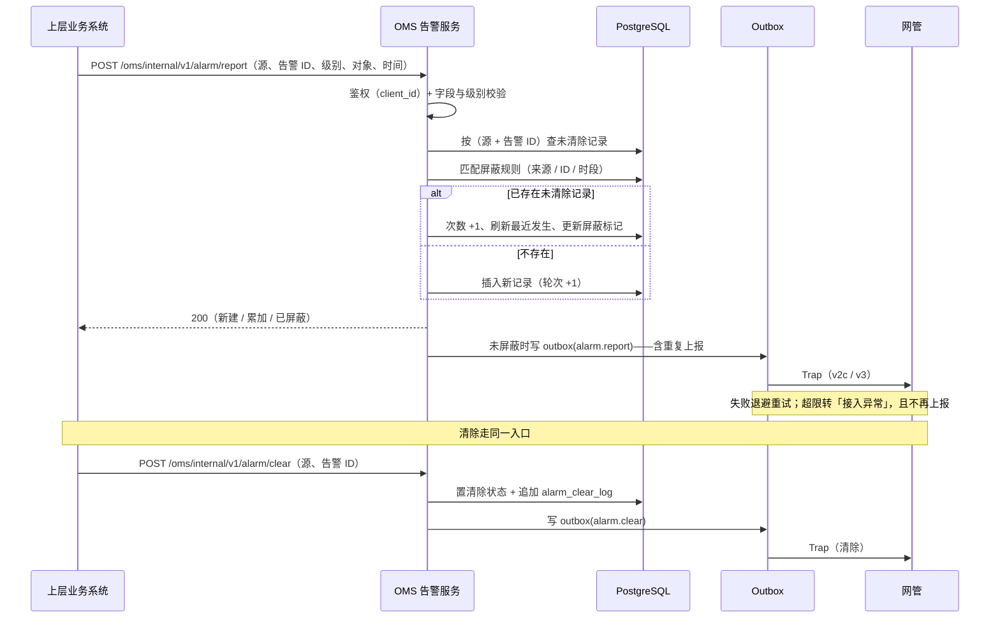

五条规则：

1. **去重键是（告警源 + 告警 ID）**。重复上报只累加次数、刷新最近发生时间，**不设时间窗**——告警的语义是「同一件事还在」，不是「又发生了一次」。
2. **受理结果回给上报方**：新建 / 累加 / 已屏蔽。上报方据此决定是否重试。
3. **台账不产生重复记录**：上报方超时重试会命中去重键，只累加次数，不会多出第二条告警。并发上报靠 `(source, alarm_id) WHERE cleared_at IS NULL` 的**部分唯一索引**兜底——两个请求同时判定「不存在」时只有一个能插入，另一个转为累加。
4. **清除后再次发生，算新告警**（轮次 +1），不复用已清除的记录——否则历史的清除时间会被覆盖，审计链断裂。
5. **去重只作用于台账，不作用于上报**。台账把重复合并成「次数 +1」，但**未被屏蔽、且不是「接入异常」的每一次上报都要产生一次对外通知**，包括重复的告警。处理不处理重复是对端的事，OMS 不能替对端做决定。

#### 3.7.2 屏蔽与统计

- 屏蔽规则可按来源、告警 ID、日期与时段配置；多条命中时按**规则创建时间最早的一条生效**。
- **命中屏蔽的告警仍然入库并打标记**，但**既不上报、也不纳入统计**。入库是为了让「屏蔽了多少」可查、规则配错时能回溯；不上报是因为屏蔽是运维显式的抑制意图——它与去重的性质不同：**屏蔽明确停上报**（去重只合并台账，见 3.7.1）。
- 规则可增删改，告警记录不可删——两者在数据模型上分开，权限也分开。
- 统计按告警 ID 聚合（次数、最近发生、级别分布），支持时间范围与 Top N；被屏蔽的记录不参与。

#### 3.7.3 清除与不可删

- 清除是**业务动作**，不是删除：置清除状态，记录清除方式（源侧上报 / 人工）、时间与操作者，并追加 `alarm_clear_log`（带 MAC，见 3.3.1）。
- 清除同样幂等：重复清除不报错、不重复写日志。
- **没有任何删除接口**。记录移出主表只能靠转储（3.3.4），且转储是整包归档，不改变单条语义。
- 人工清除属于敏感操作，写操作日志。

#### 3.7.4 SNMP 上报

- **触发条件**：已配置 SNMP 通道，且该告警未被屏蔽——**全部级别都上报**，不按级别过滤。
- **重复告警逐次上报**：同一条告警重复 N 次，就产生 N 个 Trap；OMS 只做可靠投递与重试，**不做合并、不做速率抑制**。Trap 里携带「累计次数、首次发生时间、最近发生时间」，让对端自己决定怎么处理。代价是高频抖动的告警会在 outbox 产生大量事件，需要监控队列深度——这是用「保真」换来的成本，不能靠限速把它抹掉。
- **只发 Trap，不用 Inform**：不依赖对端回执判定送达，失败交给 outbox 退避重试。
- 通道可配多条，v2c 与 v3 均支持；**引擎 ID 创建时生成、之后不可修改**——改了等于更换设备身份，网管侧历史会断。
- 清除同样上报，使网管侧同步收敛。
- **反身保护**：通道持续失败产生的「接入异常」告警**不再上报 SNMP**，否则会形成「失败 → 告警 → 再失败」的循环。这类告警只进台账。

#### 3.7.5 为什么不用 Prometheus + Alertmanager

两者的输入模型不同：M17 收的是**事件**（对方主动上报），Prometheus 收的是**指标**（自己定时抓取）。把事件告警塞进指标模型，会得到三个后果：

- Alertmanager 的告警是「当前状态」，resolve 后记录消失——与「发生过就必须留痕」直接冲突；
- 没有屏蔽规则、清除语义与台账查询，这三样恰好是 M17 的核心；
- 多维护一套 TSDB 与一套配置，收益只是通知路由。

所以本期纯自建。将来若需要指标监控，OMS 开放 `/actuator/prometheus` 供抓取即可，**不需要改动本节任何设计**；若客户已有 Alertmanager，可作为可选的告警源接入（webhook → `platform` 源），但反向绝不依赖。

### 3.8 许可与通用能力

#### 3.8.1 License：只管商业授权，不管功能可用性

这是全节最重要的一条边界：**License 未导入、过期、吊销，都不影响 OMS 自身任何功能**（R-09）。它只影响 **OMS 自身**的两件事——计量项的余量提示，以及是否产生告警；是否据此限制上层业务，由上层业务自己决定（见本节末的交互逻辑）。把 License 做成 OMS 的功能开关，会让「许可过期」变成「系统不可用」，那是事故。

**ESN** 是许可的绑定对象，必须稳定：

- 首次启动生成，写 `system_identity` 表，同时在 Secret 留一份副本；
- 两者不一致时**以表为准**；
- 重装或空库恢复时，Secret 的副本可以兜底，避免 ESN 漂移导致已购许可全部失效；
- ESN 恢复自另一个实例时，许可需要重新导入——绑定关系不跨实例继承。

**状态**只有四个：未导入、有效、已过期、已吊销，且只能由许可文件驱动。「即将过期」不是独立状态，而是按 `notAfter` 与预警天数算出来的提示。

```
未导入 → 有效 → 已过期
              ↘ 已吊销（由新文件声明）
```

不提供任何本地改状态的接口。导入失败时保持原状态不变，不能出现「导入失败但许可没了」。

**接口先定，指标后定**。许可文件的具体格式与计量项清单，以拿到的格式为准，本期只把接口与交互固定下来：

| 接口 | 方向 | 用途 | 约束 |
| --- | --- | --- | --- |
| `LicenseParser.parse(bytes)` | 内部 | 解析许可文件为「指标清单 + 授权量 + 有效期」 | **SPI**：格式变了只换实现，不动业务 |
| 导入 / 激活 | 页面 → OMS | 上传文件、校验签名、切换状态 | 失败不影响现有许可 |
| 查询状态 | 页面 → OMS | 状态、到期时间、各指标余量 | 只读 |
| 登记消耗 | 业务 → OMS | 上报「某指标已用 N」 | 幂等键；**不阻断调用方** |

计量项**通配**：文件声明什么就记什么，OMS 不内置清单、不解释业务语义。

**与上层业务的交互逻辑**固定为三步：

1. 业务完成一次计量动作后，调用「登记消耗」；
2. OMS 只记账，返回当前余量；若已超限，返回「已超限」标志并产生告警；
3. **是否阻断由业务决定**，OMS 不替它做。

这样商业策略留在业务侧，OMS 不把「超限就拒绝」写进自己的调用路径——否则 License 就变成了功能开关，与 R-09 冲突。

**告警**：到期前 N 天（后台配置，未配置时用内置默认值，不开放界面修改——OI-M07-004）、已过期、已吊销、超限，四类都作为 `license` 告警源汇入 3.7 的台账。定时检查每天一次即可。

#### 3.8.2 国际化

系统里有**三类文本**，处理方式完全不同。把它们混在一起，是国际化做不下去的主要原因：

| 类型 | 存在哪 | 何时渲染 | 例子 |
| --- | --- | --- | --- |
| 界面静态文案 | 前端语言包（JSON） | 前端渲染时 | 菜单名、按钮名、表单标签 |
| 接口返回消息 | 后端语言包 | 请求时按 locale 渲染 | 错误提示、业务提示 |
| 已留存的业务数据 | 数据库存 **key + 参数** | 查询时按访问者 locale 渲染 | 操作日志的操作名称 |

三条原则：

1. **要跨语言展示的数据，存 key 不存文本。** 操作日志如果入库时就渲染成中文，英文界面永远显示中文；存 `fn.account.create` + 参数，查询时按访问者语言渲染（见 3.3.1）。
2. **错误码与文案分离。** `code` 稳定，供程序判断与接口契约；`messageKey` 供展示。两者不能互相替代——把中文文案当错误码，改一次文案就破坏一次契约。
3. **回退链明确**：目标语言 → 默认语言 → key 本身。缺键时显示裸 key 比显示空白好排查，但要同时记一条告警，否则线上会带着裸 key 跑很久。

**locale 解析顺序**：用户在账户设置里的偏好 → 请求头 `Accept-Language` → 系统默认。偏好存库，切换即持久化，下次登录仍生效。

接口返回的消息同时给「key + 参数」和「已渲染文本」：

```json
{
  "code": "AUTH_101",
  "messageKey": "auth.login.failed",
  "params": { "remaining": 3 },
  "message": "密码错误，还可尝试 3 次"
}
```

为什么要两份：前端偏好用 `messageKey + params` 自己渲染，保证与界面语言一致；而 curl、脚本、第三方调用方没有语言包，只能直接用 `message`。少给任何一份，都会让某一类调用方别扭。

数字、日期、时区的格式化跟随 locale 与用户时区，**存储一律 UTC**——展示按用户时区，比较与排序按 UTC，两者不能混。

#### 3.8.3 权限点驱动的界面与接口注册

菜单、按钮、接口三者能对齐，靠的是**权限点这一个连接键**。模型如下：

**五张表各存什么**

| 表 | 内容 | 关键约束 |
| --- | --- | --- |
| `permission` | 编码、类型（菜单/按钮/接口/能力）、父级、i18n key | 编码全局唯一，废弃后不复用；模块只能注册自己的前缀 |
| `menu` | 编码、父级、路由、图标、排序、i18n key、绑定权限点 | 一个菜单项绑一个权限点 |
| `api_permission` | 方法 + 路径模式、绑定权限点、资源类型与动作 | **未登记的路径默认拒绝** |
| `role_permission` | 角色 × 权限点 | 内置角色随版本预置；模块角色在安装时注册；运行期都只读 |
| `module_registry` | 模块、菜单、路由前缀、静态资源路径、资源类型 | 上层业务注册，OMS 只读渲染 |

**先看数据结构：谁引用谁**

| 从 | 到 | 基数 | 含义 |
| --- | --- | --- | --- |
| `module_registry` | `menu` | 1:N | 一个模块声明多个菜单项 |
| `module_registry` | `api_permission` | 1:N | 一个模块声明多条路由 |
| `menu` | `permission` | N:1 | 每个菜单项**绑定一个**权限点 |
| `api_permission` | `permission` | N:1 | 每条路由**绑定一个**权限点 |
| `role_permission` | `permission` | N:1 | 角色引用权限点 |
| `user_group_role` | `role` | N:1 | 用户组绑定角色 |

这里只有两种关系，不要混：**声明**（模块注册表声明出菜单行与路由行，是「谁产生谁」）和**引用**（N:1，箭头指向被引用的表）。按钮没有独立的表，它只是 `permission` 里 `type=BUTTON` 的一行，由前端代码按编码引用。

**再看运行时：两条独立的读路径**

**路径一（前端）**：登录后调 `GET /oms/ui/authz/profile`，服务端按「账户 → 用户组 → 角色 → 权限点」算出集合，连同过滤后的菜单树下发；前端据此渲染菜单与按钮。这份集合只是**快照**，只影响「看得见什么」。

**路径二（接入层判定）**：每次业务请求，判定服务要做**两次查询再比对**——一次查「这个接口需要什么」，一次查「这个用户有什么」：

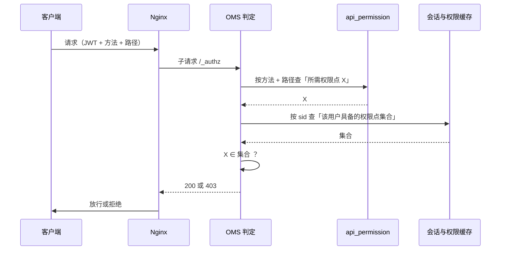

这两次查询缺一不可：只查「需要什么」不知道用户有没有；只查「用户有什么」不知道这次请求该用哪个权限点。

**关键区别**：判定服务**不读前端那份集合**。前端那份是快照、可被篡改；判定服务每次都从会话重新算，走 Redis 缓存。两条路径共用同一份底层数据（角色与权限点），但取数入口不同。

注册与生效的链路：

1. 模块声明自己的菜单项、按钮权限点、API 路由前缀与权限点、资源类型；
2. 写入注册表，权限点进入 `permission`，随版本预置到内置角色；
3. 用户登录后，`GET /oms/ui/authz/profile` 返回**权限点集合**与**按权限过滤后的菜单树**；
4. 前端按集合渲染菜单与按钮；Nginx 调 OMS 按 `api_permission` 判定接口；业务侧按 `cap.*` 判资源范围。

**按钮的显示与隐藏**，机制是这样的：

1. 承接路径一已下发的权限点集合与菜单树，不再重复请求；
2. 集合放进全局 store；
3. 页面上的按钮用统一指令声明所需权限点（如 `v-perm="PERM.ACCOUNT_CREATE"`），不在集合里就**从 DOM 移除**，不是 `display:none`；
4. 集合**只在登录时拉一次**——授权变更会让会话失效并强制重登，重登后自然刷新，不需要实时推送；
5. 拉取失败时**一律不渲染**（fail-closed），不能「拿不到就全显示」。

一个必须区分的场景：**行级按钮**（某一行数据的「启停」「删除」）不能只看全局权限点，还要看范围——这条数据在不在该用户的资源组里。两种做法：

- **后端在列表接口里对每行返回 `allowedActions`**（推荐）：前端不用懂授权，也不会出现「按钮能点、点了 403」；
- 前端照常显示、点击后被 403 拒绝：实现简单，但体验差，而且会泄露「这条数据存在」。

菜单与按钮的权限点必须来自同一份注册表，**前端不许手写字符串**——构建期从注册表生成常量，避免拼错导致「按钮永远不显示」。

五条规则：

- **菜单与按钮只是展示绑定**，不构成安全边界；绕过前端直接调接口，仍有接入层与业务侧两道判定（3.1.3）。
- **一个接口只绑一个权限点**，禁止「任一满足即可」的隐式并集。
- **未登记 = 拒绝**。新增接口必须先登记，否则调不通——这比「忘了加校验」安全得多。
- **模块下线要撤销登记**，否则菜单会残留成死链。
- **权限点编码不复用**：废弃后保留记录，避免历史授权指向新功能。

#### 3.8.4 配置分层与品牌

| 层级 | 来源 | 生效方式 | 典型内容 |
| --- | --- | --- | --- |
| 代码默认值 | 打包在镜像内 | 重启 | 兜底值 |
| 运维级 | ConfigMap | 重启 | 端口、线程池、超时、连接串 |
| 界面可改 | 数据库 | 即时 | 会话策略、证书过期预警天数、屏蔽规则 |

> 「预警天数」指 **Nginx 证书**的过期预警（3.4.4）。**License 的到期提前天数与容量占比阈值不走这一层**——按 OI-M07-004 由后台配置提供，不开放界面修改（3.8.1）。

同名项**以数据库为准**，数据库没有才读 ConfigMap，最后才是代码默认。每一项都要显式声明「是否允许界面修改」，不允许的只认 ConfigMap——否则运维改完会被界面覆盖，或者反过来，界面改了不生效。

品牌（产品名、Logo、默认语言）走同一套配置，不硬编码在页面里；一键收集这类文案里出现的产品名必须走品牌配置，否则换了客户就露出旧品牌。

#### 3.8.5 文件存储：FileStore 的形状

**接口只有五个方法，全部流式**，不出现 `byte[]`：

```java
interface FileStore {
    StoredFile  put(InputStream in, PutOptions opts);  // 原子写入；返回路径、大小、SHA-256
    InputStream get(String path);                     // 不存在抛 FileNotFound
    boolean     exists(String path);
    void        delete(String path);                  // 幂等，不存在视为成功
    List<StoredFile> list(String prefix, int limit);
}
```

配套两个值对象：

- `StoredFile { path, size, sha256, contentType, createdAt }`
- `PutOptions { purpose, name, maxBytes }`

**路径模型**：调用方只给**逻辑路径**，根目录由配置固定，永远不接受绝对路径。

```
<purpose>/<yyyyMMdd>/<name>
例：export/20261020/账户导出-9f2c.csv
    backup/20261020/oms-20261020T020000Z.tar.gz
```

每条路径都要过 `PathSanitizer`：拒绝 `..`、绝对路径、空字节与保留设备名；路径长度上限 255 字节。打开文件时不允许跟随符号链接，落盘权限固定 `0600`。

**原子性与并发**：`put` 先写 `.tmp/<uuid>`，`fsync` 后原子 `rename` 到目标位置——这样进程在写入中途被杀，也不会留下半截文件被当成完整产物。同一路径并发写是「后写覆盖」（rename 本身原子）；`delete` 幂等。

**容量与保留**：

- 按 `purpose` 分别设单文件上限与目录配额（导出、备份包、日志包三者量级差很多）；
- 保留期由**生产方**负责：路径里带日期，各自的清理任务按「前缀 + 日期」删除；
- `FileStore` **不做 TTL 扫描**——它没有元数据表，靠遍历目录判断过期既慢又容易误删。

**它明确不做的事**：不提供签名 URL、分片上传、秒传去重、版本管理、图片处理。这些是对象存储的能力，真接了再加，不会破坏现有调用方。

**谁在用它**——只有五类产物经过 `FileStore`，都是「需要留存、需要下载、量大」的文件：

| 场景 | 产物 | 量级 | 保留策略 |
| --- | --- | --- | --- |
| 导出 | 操作日志 / 告警的 CSV | MB 级 | 按天清理 |
| 运行日志包 | 按时间范围收集的日志 zip | 百 MB ~ GB | 按天清理 |
| 转储包 | 操作日志 + 告警的归档 zip | 百 MB | 最近 10 个 |
| 备份包 | 数据库 dump 与组件产物 | GB 级 | 副本数量上限 |
| 品牌资源 | Logo、图标 | KB 级 | 长期保留，覆盖写 |

**刻意不用的场景**，避免把 `FileStore` 当成万能桶：

- **前端静态资源（JS / CSS / 页面）发布**：由 Job 直接写静态资源 PVC，Nginx 直服，不经过应用进程；
- **证书**：请求内在内存处理，用完即弃，不落盘；**许可文件是例外**——必须落盘保存（文件、指纹、导入时间、失败原因），否则「保存为待激活」与失效追溯都无从实现（3.8.1）；
- **配置类内容**：走 ConfigMap 或数据库，不是文件。

这三条边界的作用是：`FileStore` 里只放「产物」，不放前端静态资源，也不放配置。混进来之后，配额、保留期和清理责任就说不清了。

**默认实现**：`LocalFileStore`，根目录挂 PVC，单机文件系统语义。调用方只依赖接口，不感知根目录在哪。

## 4. 安全要求与落实

> 依据 `ME-系统安全要求总结.md`（2026-10-27，基于 `oms-extension`、`model-lite`、`terrabase`、`oms-ui` 四仓的 Helm Chart、Dockerfile 与启动脚本整理）。该文档描述的是**现状与要求**；本章把它转成设计约束，并在 4.14 给出与本文其他章节不一致条目的裁决结果。威胁建模与攻击面分析见第 5 章。

### 4.1 十三个安全域

| 安全域 | 核心要求 | 主要落实位置 |
| --- | --- | --- |
| 镜像与构建 | 多阶段构建、内置非 root 用户、最小权限文件 | 4.2 + 各仓 `Dockerfile` |
| Pod 安全上下文 | init 容器 root、常驻容器非 root、`fsGroup: 2000` | 4.3 + `deployment.yaml` |
| 进程降权 | root 完成准备后 `chroot --userspec` 切换到业务用户 | 4.4 + `start.sh` / `dbInit.sh` |
| 文件权限 | `umask 0027/0077`、`defaultMode 0440/0600/0444/0750`、敏感文件 `600/700` | 4.5 + Dockerfile / Helm |
| 只读挂载 | 业务只读卷 `readOnly: true`；`readOnlyRootFilesystem` 尚未启用 | 4.5、4.13 |
| 凭证管理 | KMC 加密，主密钥按 KSUser 分组存 Secret，密文落库或 Secret | 3.5、4.6 |
| 服务间认证 | mTLS 只做准入 + OMS 签发令牌 | 4.7 |
| 用户态认证 | OMS 签发 JWT（`sid`）；OMS 接口走六道关，业务请求走 Nginx `auth_request` | 3.2 / 3.1.3 |
| 网络隔离 | 同命名空间 default-deny + 逐条放行 | 4.8 |
| RBAC | 每个组件独立 ServiceAccount + 最小权限 Role | 4.9 + `*-service-account.yaml` |
| 资源限制 | 所有 Pod 设 `requests/limits`（CPU / 内存 / 临时存储） | 4.10 + `values.yaml` |
| 口令强度 | 弱口令字典 + 复杂度校验 | 4.11 + `weak_password.conf` |
| 操作审计 | 写操作落 `outbox_event`，提交后由投递器写 `operation_log` | 4.12、3.3 |

### 4.2 镜像与构建

- **多阶段构建**：`builder` 阶段装构建工具，`base` 阶段只 COPY 产物；运行镜像不含编译工具链。
- **内置非 root 业务用户**：只建两个——OMS 主服务 `oms`（UID 200）与 PostgreSQL `postgres`（UID 1100），均带 `-M`（无 home）与 `-s /sbin/nologin`。Nginx 与 Redis 使用镜像内置用户，不另行创建。
- **文件权限收紧**：启动脚本 `500`（仅属主可执行）、二进制 `500`、密钥目录 `700`、配置文件 `440`。
- **tini 作 PID 1**：OMS 与 Nginx 容器均以 `tini --` 启动，正确转发信号、回收僵尸进程。

### 4.3 Pod 安全上下文

统一模式：**init 容器以 root 做准备，常驻容器最终以业务用户运行**。

```yaml
initContainers:
  - name: init-perm
    securityContext: { runAsUser: 0 }   # chown 数据/日志目录、准备证书
containers:
  - name: oms
    # 不设 runAsUser，由 start.sh 内 chroot 降权（4.4）
```

Pod 级 `securityContext.fsGroup` 设为与 PVC 属组一致（2000），使挂载卷对常驻进程可读。

**唯一例外**：采用 local 存储（hostPath）时，`pre-install-job` 需要 `runAsUser: 0` + `privileged: true` 才能在宿主机目录下建子目录并 `chown`。约束是资源限 `50Mi / 0.5 CPU`、`backoffLimit: 0`、`helm.sh/hook: pre-install`，安装完成后自动清理，特权窗口很短。改用 PVC 时该例外不出现。

### 4.4 进程降权：为什么不用 `runAsUser`

OMS 与 PostgreSQL 都遵循「root 启动 → 准备资源 → `chroot` 切用户 → exec 业务」：

```bash
# OMS：root 阶段 chown 数据/日志目录、准备证书与密钥
exec chroot --userspec=oms:oms / java -jar oms.jar

# PostgreSQL：root 阶段 chown 数据目录
exec chroot --userspec=postgres:postgres / postgres -D $DATA_HOME
```

**为什么不能用 K8s 的 `runAsUser`**：启动期需要 root 完成 `chown` 挂载卷、准备证书、解密口令；而 `runAsUser` 是 Pod 级全程生效，无法表达「启动期 root、运行期非 root」。所以 `securityContext` 不设 `runAsUser`，由启动脚本手动降权。

Nginx 是另一类：master 进程需要绑定 443，以 root 启动，worker 由镜像默认降权到 `nginx` 用户；wrapper 由 `tini` 托管。

`umask` 同步收紧：证书初始化阶段 `0077`（属主读写，组与其他全无），常驻进程 `0027`（属主读写、组读）。

### 4.5 文件与卷权限

`defaultMode` 按「里面是什么」决定，不按组件决定：

| 卷 | 类型 | defaultMode | 理由 |
| --- | --- | --- | --- |
| `kmc-oms` / `kmc-nginx` / `kmc-modelenginepublic` | Secret | `0600` | 各 KSUser 主密钥与校验文件，仅对应进程可读 |
| `oms-db-cred` | Secret | `0440` | 数据库口令密文，常驻进程需读 |
| `oms-tls` | Secret | `0440` | 私钥与口令密文，属主 + 组读 |
| `nginx-tls` | Secret | `0440` | Nginx 私钥与口令密文 |
| `ca-key` | Secret | `0600` | CA 私钥，仅部署/轮换 Job 挂载 |
| `oms-ca` | ConfigMap | `0444` | 公开证书 |
| `nginx-routes` | ConfigMap | `0444` | 路由片段 |
| `oms-data` | PVC | `0750` | 产物目录，属主可写、组可读 |

- **只读挂载**：除 `oms-data` 外全部 `readOnly: true`。证书、路由、密钥都不允许运行期改写。
- **为什么常驻进程读的密钥用 `0440` 而不是 `0600`**：Secret 卷文件的属主是 root，非 root 进程只能靠**组权限**读；`0600` 只有 root 能读，常驻进程会打不开。`0440` 配合 Pod 的 `fsGroup`，属主 root、组可读，才是「非 root 进程读密钥」的正确组合。只有 root 阶段（init 容器、部署 Job）使用的 `ca-key` 才用 `0600`。
- **`readOnlyRootFilesystem`**：目标启用；当前 OMS 仍需写 `/tmp`，做法是把临时目录挂成 `emptyDir` 后再打开该开关（列入 4.13 改进项）。
- **内存卷**：Nginx 的口令文件、Python 业务解密后的私钥均放 `emptyDir{medium: Memory}`，用完即删，不落节点磁盘。

### 4.6 凭证与加密

- **统一经 KMC 加密，主密钥按 KSUser 分组存放**（3.5）；业务只经 `CryptoPort` 使用，不直连 KMC。
- **数据库口令**：主密钥加密后存独立 Secret `oms-db-cred`，启动时解密到内存再连库；不写在配置文件里。
- **业务凭据**（SFTP、SNMP v3、CA 接入的私钥与口令、证书私钥、SSO 客户端密钥）：经 `CryptoPort` 加密，落点由模块决定（数据库 / PVC / Secret / ConfigMap），约束是**落盘前必须加密**。
- **证书私钥口令**：随机生成，用主密钥加密后存 Secret；解开私钥只在内存中进行（3.5.4）。
- **不留残留**：解密后的明文只在内存中存在，用完清空临时变量；**唯一例外是 KMC 子进程的入参**——明文经 `KMC_PYTHON_PLAIN_TEXT` 传递，调用返回即清除、不并发复用（3.5.4、4.13）；其余场景一律不得用环境变量传密钥；日志、异常栈、dump 中不出现任何密钥材料。
- **备份不含主密钥**：数据库备份里只有密文，恢复必须同时具备对应的主密钥 Secret（3.5.5）。

### 4.7 服务间认证

三条链路，各自解决不同的问题，不能互相替代：

| 层 | 机制 | 解决什么 | 不解决什么 |
| --- | --- | --- | --- |
| 传输层 | 共享证书 mTLS | 加密、圈内准入 | **不证明是哪个服务**——全命名空间共用一张证书 |
| 应用层 | OMS 签发的短时效令牌（`client_id` + 可选 `act`） | 调用方身份 | 不解决传输加密 |
| 用户层 | OMS 签发 JWT（含 `sid`）：业务请求由 Nginx `auth_request` 判定，OMS 自身接口走六道关 | 「谁在操作」 | 不做服务身份 |

实现要点：

- 服务之间用 **HTTP client 直连对方的 Service 名**（`<svc>.<ns>.svc`；共享证书的 SAN 只含集群内名字，见 3.4.1），不使用 RPC 拦截器，也不存在独立网关进程。
- 用户访问**业务系统**的请求由 **Nginx 的 `auth_request`** 调 OMS 判定（3.1.3）；访问 OMS 自身接口走 OMS 的六道关。OMS 不是网关，不转发业务流量。
- 上层业务上报日志、查询 scope、登记计量，都带 `client_id` + 令牌。

> mTLS「只做准入、不做身份」是**设计取舍**：共享一张证书就无法区分服务。若将来要求 mTLS 自证身份，需改为内部 CA 给每个服务签独立证书（3.4.1 的扩展路径）。

### 4.8 网络隔离

一套实例一个命名空间（2.3 / T-5），OMS 与业务系统同域，因此 NetworkPolicy 可以在同一命名空间内按 Pod 标签精确选择。

策略模型是 **default-deny + 逐条放行**：

| 策略 | 源 → 目的 | 端口 | 作用 |
| --- | --- | --- | --- |
| default-deny | 全部 | — | 默认拒绝 |
| allow-dns | 所有 Pod → kube-dns | 53（UDP/TCP） | 服务名解析 |
| allow-probe | 节点网段 → 所有 Pod | 健康检查端口 | kubelet 探针 |
| allow-haproxy | HAProxy 宿主机 → Nginx | 443（Nginx Service 端口） | 唯一外部入口 |
| allow-nginx-app | Nginx → OMS / 业务 Pod | 8080 / 模块端口 | 业务流量 |
| allow-app-oms | 业务 Pod / 安装 Job → OMS | 8080（scope / 计量 / 审计 / 告警 / 注册） | 判定、上报与注册 |
| allow-data | OMS / 业务 Pod → PG、Redis | 5432 / 6379 | 数据访问 |
| allow-egress | OMS → SNMP / SFTP / CA | 162/UDP、22、443 | 外部通道 |
| deny-storage | 业务 Pod ✗ 存储 IP | — | 防数据外泄 |
| allow-metrics（本期不启用） | Prometheus → OMS | 8080（`/actuator/prometheus`） | 需要时再开放 |

四条约束：

- **CNI 必须支持 NetworkPolicy**（Calico）。不支持的 CNI 会**静默忽略**策略，看起来配了、实际没生效。
- **探针来自节点**，必须显式放行；否则 default-deny 会让所有 Pod 永远不 Ready，报错却只是「探针超时」。
- **模块注册要声明网络需求**：入站端口、出站目标。新模块没有对应策略会被默认拒绝，这条与 2.6 的集成契约联动。
- **业务侧沿用其既有策略**（例如推理、训练 Pod 的 egress Deny 存储 IP），OMS 侧新增策略与之取并集；合并时要逐条核对，避免某条放得比预期更宽。

### 4.9 RBAC 与 ServiceAccount

| ServiceAccount | 用途 | 权限 |
| --- | --- | --- |
| `oms` | 应用主进程 | **只对 `nginx-tls` 一个 Secret 有写权限**；其余 Secret 只读挂载（由 kubelet 完成，不需要 API 权限） |
| `nginx` | 反向代理 | 读取挂载的 Secret / ConfigMap；无需 API 写权限 |
| `biz` | 业务 Pod | 最小权限，按需授予 |
| `deploy-job` | 部署 / 轮换 | 写证书类 Secret、创建一次性 Job |
| `module-install` | 业务模块安装 Job | **只对 `nginx-routes` ConfigMap 有写权限**；调用模块注册接口 |
| `migrate` | 迁移 | 读写数据库与迁移相关 Secret |

原则：不使用 `default` SA；所有 Role 明确列出 `verbs`，**没有 `*` 通配**；不使用 ClusterRole——OMS 不需要读节点或跨命名空间资源。

### 4.10 资源限制与探针

所有 Pod 必须设置 `requests/limits`，且包含 `ephemeral-storage`——这是防 DoS 的关键，防止日志或临时文件把节点磁盘撑爆。

```yaml
resources:
  limits:    { cpu: "2", memory: "2Gi", ephemeral-storage: "5Gi" }
  requests:  { cpu: "0.5", memory: "512Mi", ephemeral-storage: "1Gi" }
```

具体数值按 7.6 容量模型回填，这里只定「必须设、必须含临时存储」这条规则。init 容器同样设限。

探针分三种，职责不同：

- `startupProbe`：脚本执行与上下文就绪，给足启动时间；
- `readinessProbe`：含数据库连通与 schema 版本校验，不通过不接流量；
- `livenessProbe`：**不含数据库**，避免数据库抖动引发重启风暴。

Nginx 的健康检查走独立明文端口（2.3），不能复用启用了 `proxy_protocol` 的 443。PostgreSQL 与 Redis 使用镜像自带探针。

### 4.11 口令强度

- **弱口令字典**：维护一份黑名单（常见默认口令、厂商默认值），命中直接拒绝；文件权限 `400`。
- **复杂度**：长度 ≥ 8，且同时含大写、小写、数字、特殊字符。
- **存储**：口令用 PBKDF2-HMAC-SHA256 单向哈希，不可逆；**参数固定为 10000 轮、512 bit，存取格式 `iterations:saltHex:hashHex`**——与旧底座一致，迁移时旧哈希可原样搬运、无需重算（4.15）。任何位置都不保存明文。
- **生命周期**：首登强制改密；口令过期、失败锁定阈值归 M15 安全策略；机机账户是否免首登改密由策略开关控制（3.2.5）。

### 4.12 操作审计

- **写入路径**：写操作在业务事务内落 `outbox_event(AUDIT)`，提交后由投递器写入 `operation_log`（3.3.2）。这样即使进程在提交后崩溃，审计意图也不会丢。
- **外部上报**：上层业务经 `POST /oms/internal/v1/audit/oplog` 上报，凭 `client_id` + 令牌，OMS 校验字段与限流后落库。
- **内容**：存 i18n key 与参数，查询时按访问者语言渲染（3.3.1）；不存渲染后的文本。
- **不可篡改**：应用账号对 `operation_log` 只有 `INSERT`/`SELECT`；逐条 MAC；只能经转储移出。
- **不采用**：旧系统的切面直报 + RPC 调用（见 4.14）。

### 4.13 已知差距与改进项

| 项 | 现状 | 建议 |
| --- | --- | --- |
| `runAsNonRoot` | 依赖 `chroot` 降权，`securityContext` 未显式声明 | 显式 `runAsNonRoot: true` + 容器级 `runAsUser: 200`，把启动准备移入 init 容器 |
| `readOnlyRootFilesystem` | 未启用 | 把 `/tmp` 等可写路径挂 `emptyDir` 后启用 |
| `capabilities drop: ALL` | 未启用 | 所有容器 `drop: ALL`，按需 `add` |
| `seccompProfile` | 未设置 | 全局 `RuntimeDefault` |
| mTLS 身份 | 共享证书，只做准入 | 已由应用层令牌弥补；若要求 mTLS 自证，改为每服务一证 |
| 特权 pre-install Job | local 存储时需要 root + privileged | 改用 `fsGroup` + 非特权 init 容器，或限定 hostPath 类型 |
| KMC 子进程传参 | 明文经环境变量传给 Python 子进程，子进程存活期内可见于 `/proc/<pid>/environ` | 单次调用单次设置、返回即清；若 KMC 提供进程内 Java SDK，改为进程内调用 |
| `imagePullSecrets` | 默认未配置 | 私有仓库场景配置固定 Secret，避免匿名拉取 |
| PodSecurity admission | 未打 enforce 标签 | 先打 `warn` / `audit`，待 root init 改造完成后再 `enforce: restricted` |
| 证书轮换 | 手动脚本（3.4） | 属设计选择；若要求自动，引入 cert-manager 或定时 Job |

### 4.14 与本文其他章节的差异：裁决结果

| # | 项 | 结论 |
| --- | --- | --- |
| 1 | 对外暴露 | **以 2.3 为准**：HAProxy（宿主机）→ Nginx Service IP。ME 文档是局部视图，未包含 HAProxy |
| 2 | JWT | **以 3.2 为准**：OMS 签发 HMAC JWT（内含 `sid`），Redis 只做加速。现状的「Redis 随机 token + 网关动态生成 JWT」不继承 |
| 3 | 加密组件 | **以 3.5 为准**：后端为 KMC，`CryptoPort` 接口不变。原定的 SCC 方案作废——迁移侧 2026-10-28 决定继续用 KMC，且永不下线 |
| 4 | NetworkPolicy | **启用**：OMS 与业务同命名空间，统一 default-deny + 逐条放行（策略集见 4.8）。2.3 的薄弱点相应收敛 |
| 5 | 证书格式 | **以 3.4 为准**：PEM + 内部 CA。迁移时重签，不复用旧 p12/JKS；客户公共 CA 签发的对外证书除外（只转 PEM、保留原密钥，见 4.15） |
| 6 | 容器基线 | 本章已按现状（`chroot --userspec`）改写；`runAsNonRoot` 仍列为改进项（4.13） |
| 7 | mTLS 定性 | 证书校验由新实现自己控制（校验链与 SAN）；共享证书只能做到「圈内准入」，身份靠应用层令牌。旧 Feign 的放行逻辑不继承，「只做准入、不做身份」是设计取舍，不是缺陷 |

### 4.15 迁移影响：密文原样搬运与证书体系替换

这次迁移有两条互不相同的线，别混：**密文基本不动，证书基本要动**。

**密文：原样搬，不重加密**

因为继续用 KMC，旧密文在新底座可以直接解开——不需要「解密 → 重加密」的 Job，这是本方案最大的简化。只有一类例外：

| 对象 | 旧形态 | 动作 |
| --- | --- | --- |
| DB 口令、证书口令、业务凭据 | KMC 密文 | **原样搬**，落点换到新 Secret / 新表 |
| `account.email` / `telephone` | 旧 KMS gRPC 密文（DB 存 keyId） | **迁移窗口内重加密**：用 `crypt-grpc-server` 解成明文 → 用 KMC 按 `oms` 用户重新加密 → 搬入新库 |

`crypt-grpc-server` 在对账通过前**不得下线**：迁移程序要输出「已重加密行数 vs 旧库总行数」，两者相等且校验通过才允许停。停掉之后再发现漏行，那些密文就永久不可解了。

顺序不能反：**主密钥先就位，才谈得上搬密文和换证书**。证书私钥的口令是用主密钥加密的，主密钥没挂上，新证书的口令无处存。

**证书：分三类处理，不要一刀切**

| 对象 | 做法 | 理由 |
| --- | --- | --- |
| 服务间证书 | **重签**，由内部 CA 签发 | 现有 mTLS 不认证身份，没有谁在 pin 它；重签比迁移密钥材料干净 |
| 内部 CA | **优先复用现有**（`cube-security-serverca` 已是 PEM） | 重签只换叶子不换锚，客户端信任库一字不改；只有 SAN 覆盖不到新服务名时才重建 |
| Nginx 对外证书 | **维持原状，不动** | 换证书会导致终端重新信任，客户侧有额外动作；旧 p12/JKS 保留一个版本备回滚 |

**回滚**：密文从未被改写，回滚只是换回挂载与配置，不涉及数据反向迁移。真正的不可逆点在割接之后（`OMS-MIG-001` 的 P7），不在本节。

---

## 5. 威胁模型与攻击面

> 方法：STRIDE + 攻击面枚举 + 滥用用例，风险按「可能性 × 影响」定级。
> **与第 6 章 SFMEA 的分工**：本章问「有人故意攻击会怎样」，SFMEA 问「组件自己坏了会怎样」。两者不重叠，也不要合并——一个是安全，一个是可靠性。

### 5.1 范围与不防御的对象

**范围内**：OMS 及同命名空间的业务系统，从外部入口到数据落盘的全链路。

**不在范围**：宿主机与集群 root、物理安全、镜像构建流水线本身、上游供应链（只覆盖到「镜像怎么拉、配置怎么来」这一层）。这些要么由平台保证，要么已在 3.5 与 9.2 登记为接受风险。

### 5.2 资产清单

| 资产 | 位置 | 泄露或破坏的后果 | 主要保护 |
| --- | --- | --- | --- |
| 账户口令摘要 | PostgreSQL | 离线爆破出明文 | PBKDF2 高迭代，不可逆 |
| 会话与 JWT | PG + Redis + 浏览器 | 冒用身份 | HttpOnly Cookie、`sid` 可撤销、`stale` 即时失效 |
| 主密钥 | Secret | 解开全部密文 | RBAC + NetworkPolicy 收敛访问源 |
| 证书私钥 / CA 私钥 | Secret | 冒充服务、签发任意证书 | 不导出、CA 私钥仅 Job 挂载 |
| 业务凭据 | DB / Secret | 横向到外部系统 | KMC 加密，明文只在内存 |
| 审计日志 | PostgreSQL | 抵赖、掩盖痕迹 | 只追加 + 逐条 MAC + 转储 |
| 许可文件 | DB / PVC | 商业损失 | 签名校验、状态不可本地改 |
| 镜像与配置 | 镜像仓库 / ConfigMap | 供应链投毒 | digest 固定、`imagePullSecrets`、PSA |

### 5.3 信任边界

| 边界 | 两侧 | 穿越方式 | 控制 |
| --- | --- | --- | --- |
| 外部 ↔ 接入 | 不可信网络 ↔ Nginx（经 HAProxy L4 透传） | 443；TLS 在 Nginx 终结 | TLS 1.2+、验证码、限流、HSTS |
| HAProxy ↔ Nginx | 宿主机 ↔ 集群 | TCP 透传 + PROXY | NetworkPolicy 限定源为宿主机；PROXY 头**不校验**（已接受，AR-05） |
| Nginx ↔ 应用 | 接入 ↔ OMS / 业务 | HTTP + 身份头 | `auth_request`、Nginx 注入身份头、业务 ClusterIP |
| 应用 ↔ 数据 | 应用 ↔ PG / Redis / Secret | 内网 | RBAC、NetworkPolicy、加密存储 |
| 应用 ↔ 外部系统 | OMS ↔ SNMP / SFTP / CA | 出站 | 白名单、凭据加密 |
| 运维 ↔ 集群 | 管理员 ↔ 一切 | kubectl / exec | **不防御**，视为可信（3.5） |

### 5.4 STRIDE 分析

| 威胁 | 具体场景 | 影响 | 控制 | 残余风险 |
| --- | --- | --- | --- | --- |
| **S** 身份欺骗 | 伪造或重放 JWT；重放 SSO ticket；伪造 `client_id` 调内部接口；伪造 PROXY 头冒充来源 IP | 冒用身份、绕过 IP 策略 | JWT 签名 + `sid` 校验；ticket 一次性且服务端校验；`/_authz` 校验不依赖调用方自述；PROXY 头来源已收敛到宿主机 | 宿主机被攻破后仍可伪造来源 IP |
| **T** 篡改 | 改请求参数越权；改审计记录；改配置；替换镜像 | 越权、掩盖痕迹、植入后门 | 参数校验 + 两维判定；审计表无 `UPDATE`/`DELETE`；配置变更留痕；镜像 digest 固定 | 有集群权限者可改一切 |
| **R** 抵赖 | 否认执行过某操作；删除日志 | 无法追责 | 审计只追加 + MAC + 转储包 SHA-256 | 转储前的主表仍可被 root 篡改 |
| **I** 信息泄露 | 拖库；备份泄露；读取 Secret；日志打印凭据；错误信息暴露结构；导出文件外流 | 凭据与隐私泄露 | 敏感字段加密；主密钥在 Secret；日志脱敏；错误只回 `code` + `messageKey`；导出留痕 | 容器沦陷 = 主密钥泄露（3.5） |
| **D** 拒绝服务 | 登录爆破；超大文件上传；无限列表查询；告警风暴；任务队列塞满 | 服务不可用 | 验证码 + 失败锁定；上传大小上限；查询强制时间范围与分页上限；outbox 背压；任务并发上限 | 单副本，无冗余 |
| **E** 提权 | 越权访问资源；绕过角色互斥；容器逃逸；SSRF 探测内网；恶意镜像 | 拿到不该有的权限 | 默认拒绝 + 两维判定；三权分立；`drop: ALL` 与只读根（目标态）；egress 白名单 | 特权 pre-install Job；PSA 未强制 |

### 5.5 攻击面清单

| # | 攻击面 | 入口 | 主要威胁 | 控制 | 残余 |
| --- | --- | --- | --- | --- | --- |
| 1 | 外部 HTTPS | HAProxy:443 | 扫描、爆破、协议降级 | TLS 1.2+、限流、HSTS | — |
| 2 | 页面登录 | `/oms/ui/auth/login` | 撞库、会话固定 | 验证码、账户锁定、登录后换 `sid` | IP 可伪造，锁定只作辅助 |
| 3 | 令牌端点 | `/oms/internal/v1/auth/token` | 凭据泄露后长期调用 | 独立权限点、会话超时、可剔除 | 有效期内可重放 |
| 4 | SSO 回调 | ticket 校验端点 | 伪造 ticket、开放重定向 | 服务端校验、一次性、白名单 | 上游不可达即拒绝 |
| 5 | 业务 API | Nginx 转发 | 越权、参数篡改、枚举 | 接入层判能力 + 业务判范围 + 分页上限 | 行级动作依赖业务实现 |
| 6 | 文件上传 | 证书/许可/Logo 等 | 恶意内容、路径穿越、撑爆磁盘 | 类型白名单、大小上限、`PathSanitizer`、`ephemeral-storage` 限额 | 未做病毒扫描 |
| 7 | 下载与导出 | 导出/下载接口 | 越权下载、目录穿越、CSV 公式注入 | 先鉴权再取文件、路径不来自用户输入、单元格转义 | 导出文件落 PVC 后的流转靠运维 |
| 8 | 内部服务端口 | ClusterIP | 横向调用、伪造身份头 | NetworkPolicy + 应用层令牌；业务 ClusterIP | 同命名空间内被攻破的 Pod 可发请求 |
| 9 | 数据面 | PG:5432 / Redis:6379 | 弱口令、未加密连接 | 两者均强制口令；TLS（生产建议）；网络策略 | 集群内明文连接 |
| 10 | 出站通道 | SNMP / SFTP / CA | 凭据泄露、SSRF 借道 | 凭据加密、目标白名单 | 未做全量出站审计 |
| 11 | K8s API | ServiceAccount token | 权限滥用 | 独立 SA、无 `*`、只对 `nginx-tls` 写 | Pod 内 token 可被读取 |
| 12 | 运维通道 | kubectl / exec | 直接读 Secret、改数据 | **不防御** | 最高风险项，见 5.7 |
| 13 | 镜像供应链 | 镜像仓库 | 投毒、匿名拉取 | digest 固定、`imagePullSecrets` | 流水线本身不在范围 |

> 残余列里未单列评级的项（未做病毒扫描、未做出站审计、Pod 内 token 可读），均由该攻击面的控制措施降到了可接受程度；其中 ClusterRole 级的影响并入 AR-01 / AR-02，不另立条目。

### 5.6 关键攻击路径与拦截点

**路径 A：外部爆破 → 越权 → 拖库**

1. 爆破登录 → 验证码与账户锁定拦截；
2. 登录成功 → 签发 JWT，`sid` 可撤销；
3. 越权调用 → 接入层判能力、业务判范围，双重拦截；
4. 直接拖库 → 敏感字段是密文，没有主密钥解不开。

**路径 B：容器沦陷 → 横向**

1. 攻破任一业务 Pod → 读到挂载的主密钥与数据库口令；
2. 解开库中全部业务凭据 → 拿到 SFTP / SNMP / CA 的口令；
3. 横向到外部系统 → 被 NetworkPolicy 的出站白名单与「Deny 存储 IP」限制；
4. 残余：**主密钥泄露是这条路的关键节点，已在 3.5 登记为接受风险。**

**路径 C：供应链投毒**

1. 替换镜像 → digest 固定可发现；
2. 匿名拉取被替换 → `imagePullSecrets` 阻断；
3. 即使镜像被投毒，落到 Pod 后仍受「读 Secret → 路径 B」的同一组控制约束。

**路径 D：审计规避**

1. 越权操作 → 被拒也留痕；
2. 删日志 → 应用账号无 `DELETE` 权限；
3. 改日志 → 逐条 MAC 与转储包 SHA-256 可发现；
4. 残余：cluster root 可直接改库，不在防御范围。

**路径 E：SSRF 借道**

1. 业务发起外部请求 → 出站白名单限制目标；
2. 探测元数据服务 / 内网 → NetworkPolicy default-deny 阻断；
3. 残余：白名单内的目标若被攻破，仍可作为跳板。

### 5.7 风险评级与处置

| 编号 | 风险 | 可能性 | 影响 | 等级 | 处置 |
| --- | --- | --- | --- | --- | --- |
| AR-01 | 集群 root 可读全部 Secret 并解密 | 高 | 高 | **高** | 不防御（3.5）；要防需 KMS/HSM |
| AR-02 | 业务 Pod 挂其 KSUser 的主密钥，单容器沦陷即该类密文全量泄露 | 中 | 高 | **高** | 接受（3.5）；按 KSUser 把泄露面切片，靠 NetworkPolicy 与最小镜像收敛 |
| AR-03 | 供应链投毒 | 中 | 高 | **高** | 缓解：digest + `imagePullSecrets` + PSA |
| AR-04 | mTLS 不认证服务身份 | 中 | 中 | 中 | 应用层令牌弥补 |
| AR-05 | PROXY 头伪造 | 低 | 中 | 中 | 已收敛到宿主机；登录锁定以账户维度为主 |
| AR-06 | 特权 pre-install Job | 低 | 高 | 中 | 条件接受；改用 PVC 时不出现 |
| AR-07 | 无 CRL / OCSP | 低 | 中 | 中 | 接受（证书生命周期长） |
| AR-08 | 单副本无冗余 | 中 | 中 | 中 | 接受（当前规模） |
| AR-09 | 审计被 root 篡改 | 低 | 高 | 中 | 不防御；转储包可作外部副本 |
| AR-10 | 共享证书无法区分服务 | 中 | 中 | 中 | 接受；身份靠令牌 |

### 5.8 结论

- **在集群 root 以下，不存在「无需认证即可读取数据」的路径**：所有入口都要过认证，所有数据落盘都是密文或有访问控制。root 本身的能力见 5.7 首行。
- **最高风险集中在三处**：集群 root（不防御）、容器沦陷（接受）、供应链（缓解中）。前两条无法靠设计消除，只能靠基础设施与运维约束；第三条靠 digest、私有仓库与 PSA 收敛。
- **最值得投入的缓解**是供应链（digest、私有仓库、PSA）和出站白名单——它们把「一个 Pod 被攻破」的爆炸半径压到最小。

---

## 6. SFMEA：故障模式与影响分析

> 第 5 章问「有人故意攻击会怎样」，本章问「组件自己坏了会怎样」。
> **恢复目标（已确认接受现状）**：RPO ≤ 24 小时（每日备份，产物加密），RTO ≤ 4 小时（脚本恢复，无自动切换）。这两个值用于评定严重度，也是 6.7 对账的基准。

### 6.1 方法与严重度判据

逐组件列「失效模式 → 影响 → 检测 → 缓解 → 残余」，再按「功能影响 + 是否突破 RTO/RPO」定级，不用主观打分：

| 级别 | 判据 | 处置要求 |
| --- | --- | --- |
| **S1** | 全站不可用，且恢复时间超过 RTO；或数据丢失超过 RPO | 必须有缓解措施，否则不能上线 |
| **S2** | 核心功能（登录、授权判定、告警）不可用，但可在 RTO 内恢复 | 允许，需有恢复手册 |
| **S3** | 功能降级（同步失败、上报延迟、只读），主流程不受影响 | 允许，需有告警 |
| **S4** | 局部影响或可忽略 | 记录即可 |

### 6.2 组件失效

| 组件 | 失效模式 | 影响 | 检测 | 缓解 | 残余 |
| --- | --- | --- | --- | --- | --- |
| **PostgreSQL** | 宕机 / 连接拒绝 | **全站不可用**（无权威数据不服务） | readiness、连接错误率 | 重启 Pod；必要时从备份恢复 | 无主备：重启分钟级；若要走备份恢复，耗时取决于数据量，可能超 RTO（S1 情形） |
| | 磁盘满 | 写入失败，审计与告警积压 | PVC 使用率、写入错误 | 转储、清理产物、扩容 PVC | 转储本身需要空间 |
| | 连接池耗尽 | 请求超时、级联失败 | 池占用率、等待队列 | 限流、调小池上限、查慢查询 | 慢查询仍会拖垮 |
| | 数据损坏 | 需从备份恢复 | 校验失败、启动报错 | 按 RTO 脚本恢复，RPO ≤ 24h | 最多丢一天数据 |
| **Redis** | 宕机 | 验证码无法校验（**新登录受阻**）、限流失效、会话校验退化为查库（变慢） | 连接错误、探针 | 重启；**不降级放行**，验证码失败即拒绝 | 登录短时不可用，**S2** |
| | 内存满 | 写入失败、键被驱逐 | 内存使用率、驱逐计数 | 扩容、缩短 TTL | 会话缓存丢失只影响性能 |
| | 持久化误开 | 重启带回旧会话、丢失失效集合 | 配置审查 | 关闭 RDB/AOF（3.1.6 硬约束） | 配错了会让旧权限复活 |
| **Nginx** | Pod 崩溃 | **全站不可达** | HAProxy TCP 检查失败 | 重启 Pod | 单副本，重启期间不可用，**S2** |
| | 配置错误 | 不 reload，保留旧配置；首次启动则不就绪 | `nginx -t`、readiness | 回滚 ConfigMap | 不会带病上线 |
| | 证书过期 | 握手失败或浏览器告警 | 巡检、`notAfter` 预警 | 页面导入替换（3.4.2） | 预警漏配则可能过期 |
| **OMS 应用** | 进程崩溃 / OOM | 全站不可用 | liveness | 重启 | 重启期间业务 API 全部 403/502 |
| | 启动失败（主密钥缺失、schema 版本不符） | 不就绪，不接流量 | startupProbe | 恢复 Secret、修正 schema | 拒绝启动是**正确行为**，不能绕过 |
| | 线程池耗尽 | 请求排队、超时 | 指标 | 限流、扩容 | 单副本上限固定 |
| **KMC** | 主密钥缺失 / 子进程不可用 | 依赖加解密的读写全部失败 | 启动自检 | 恢复主密钥 Secret、重启 | **不降级明文**；可恢复的不可用为 S2，密钥丢失见 6.7 |
| **业务 Pod** | 崩溃 / 不可达 | 对应模块不可用；OMS 自身不受影响 | 业务自身探针 | 重启 | 业务侧自行负责 |
| **节点** | 节点故障 | Pod 漂移；**RWO 的 PVC 无法挂到新节点** | 节点状态 | 等节点恢复，或改用 RWX / 对象存储；RWO 下强制驱逐有数据风险 | PVC 可能成为恢复瓶颈，拉长 RTO |
| **PVC** | 满 | 备份、导出、转储失败 | 使用率 > 80% 告警 | 清理、扩容 | 备份写不下 = RPO 失效 |
| | 损坏 | 产物丢失（数据库数据不在 PVC） | 挂载失败 | 重建 PVC + 重跑任务 | 产物需重做 |
| **HAProxy** | 主节点故障 | 浮动 IP 漂移，秒级中断 | keepalived | 自动切换 | 切换期间连接重置 |
| **时钟** | NTP 漂移 | JWT `exp`、ticket TTL、证书有效期判断错误 | 时间偏差监控 | 集群统一 NTP | 漂移大时会出现「刚登录就过期」 |

### 6.3 依赖失效

| 依赖 | 失效表现 | 是否降级 | 依据 |
| --- | --- | --- | --- |
| 上游 CAS | SSO 登录失败；**本地登录仍可用**；已建立的本地会话不受影响 | 不降级，但保留其他登录方式 | 3.2.4 |
| 下游 SSO 客户端 | OMS 照常运行；登出通知标记待撤销并重试 | 局部降级 | 3.2.4 |
| SNMP 网管 | 告警照常入库；上报失败重试，超限转「接入异常」告警 | 局部降级 | 3.7.4 |
| SFTP 服务器 | 备份本地成功，标记「未同步」并告警 | 局部降级 | 3.6.3 |
| CA 服务器 | 证书续约失败，保持当前证书可用，**不回退自签** | 不降级 | 3.4.2 |
| 平台监控（可选） | 无影响 | 不适用 | 3.7.5 |

### 6.4 关键链路失效

| 链路 | 断点 | 表现 | 是否可用 | 恢复 |
| --- | --- | --- | --- | --- |
| 登录 | Nginx → OMS | 登录不可用 | 否 | 重启 OMS |
| | OMS → PG | 登录不可用 | 否 | 恢复 PG |
| | OMS → Redis | 验证码失败，登录被拒 | 否（明确失败） | 重启 Redis |
| 授权判定 | Nginx `/_authz` → OMS | **全部业务 API 被拒**（fail-closed） | 否 | 恢复 OMS |
| | OMS → Redis | 退化为查库，变慢 | 是 | 性能恢复 |
| 告警上报 | 源 → OMS | 上报失败，源侧重试 | 部分 | 恢复 OMS |
| | OMS → outbox → SNMP | 告警仍在库，仅上报延迟 | 是 | outbox 自动重试 |
| 备份 | 调度 → 队列 | 本次备份未触发 | 是 | 手动补跑 |
| | 组件 → PVC | 备份失败 | 是 | 修复后重跑 |
| | PVC → SFTP | 本地成功、远程未同步 | 是 | 补传 |
| 转储 | 打包 → PVC | 转储失败，主表不清理 | 是 | 重跑 |
| | 清理主表 | 部分失败，可幂等重跑 | 是 | 按包内区间重跑 |
| 换证 | 导入 → Secret | 写入失败，旧证书继续服务 | 是 | 重试 |
| | Secret → wrapper reload | `nginx -t` 失败则不 reload | 是 | 修正后重试 |

### 6.5 检测手段

| 层面 | 手段 | 覆盖 |
| --- | --- | --- |
| 进程 | `startupProbe` / `readinessProbe` / `livenessProbe` | 启动完成、可接流量、进程存活（liveness 不含数据库，避免重启风暴） |
| 接入 | HAProxy TCP 检查 + Nginx 独立健康端口 | Nginx 存活（不能复用 443，见 2.3） |
| 数据 | PG / Redis 自带探针 + 连接池与内存指标 | 数据面健康 |
| 资源 | PVC 使用率、`ephemeral-storage` 使用率 | 磁盘类故障 |
| 队列 | outbox 积压数、task 排队数、僵尸任务数 | 异步链路堵塞 |
| 业务 | 登录失败率、越权拒绝数、告警未上报数 | 业务异常 |

告警统一汇入 3.7 的台账；「接入异常」「上报失败」这类由系统自身产生的告警只进台账、不再外发 SNMP（3.7.4 的反身保护）。

### 6.6 单点清单

| 单点 | 影响 | 当前缓解 | 消除路径 |
| --- | --- | --- | --- |
| OMS 单副本 | 崩溃即全站不可用 | 快速重启；无状态化可随时重建 | HPA + 多副本（当前不验收） |
| Nginx 单副本 | 崩溃即全站不可达 | 重启；配置错误不 reload | 多副本 + 共享 PVC（需 RWX） |
| PostgreSQL 单实例 | 全站不可用，恢复靠备份 | 每日备份，RPO 24h | 自建主备（流复制 + 自动切换） |
| Redis 单实例 | 登录受阻，判定变慢 | 可快速重建；会话权威在 PG | 主从 + 哨兵 |
| PVC（RWO） | 节点故障后无法挂到新节点 | 驱逐重建 | 换 RWX 或对象存储 |
| 主密钥 Secret | 丢失则全部密文不可解 | 单独备份、与数据库备份分离 | KMS / HSM |
| HAProxy | 主机故障 | 主备 + 浮动 IP | 已用主备缓解，不需额外动作 |
| 网络路径 | 单一路径 | — | 多可用区（当前不要求） |

### 6.7 与恢复目标的对账

按 RPO ≤ 24h、RTO ≤ 4h 核对关键失效；耗时是量级估算，交付前需用真实数据校准：

| 失效 | 是否满足 | 估算耗时 | 说明 |
| --- | --- | --- | --- |
| PostgreSQL 数据损坏 | **勉强满足** | 1–3 h（取决于数据量与校验） | 每日备份 → RPO 24h 达标；恢复超过 4h 则 RTO 不达标 |
| PostgreSQL 宕机 | 满足 | 5–10 min | 重启或重建，不需要恢复数据 |
| Redis 宕机 | 满足 | 1–2 min | 重建后会话回源，登录恢复 |
| Nginx / OMS 崩溃 | 满足 | 2–5 min | 重启即可 |
| 节点故障 + RWO PVC | **可能不满足** | 不定 | PVC 无法跨节点挂载，等待节点恢复会拉长 RTO |
| 主密钥 Secret 丢失 | **不满足** | 不可恢复 | 密文不可解，等价于数据永久丢失——这是最需要防的「备份之外」的单点 |
| 备份失败且未发现 | **不满足** | 不定 | RPO 名义 24h，实际无限；必须监控「最近一次成功备份时间」 |

**两条必须落地的运维要求**：

1. **监控最近一次成功备份的时间**，超过 24h 未成功即告警——否则 RPO 只是纸面数字；
2. **主密钥 Secret 与数据库备份分开存放**，且两者都要能恢复——只恢复数据库而不恢复主密钥，等于全部凭据不可用。

### 6.8 结论

- 当前设计在「单组件故障 + 快速重启」这一类上是满足 RTO 的；**真正的风险集中在数据面**：PG 单实例、备份是否成功、主密钥是否可恢复。
- 最需要补的不是高可用架构，而是**两件运维事实**：备份成功率监控、主密钥的独立备份与恢复演练。
- 多副本、主备、RWX 都是消除单点的路径，但当前规模下属于「将来要做的」，不在本期验收范围。

---

## 7. 技术基线与部署

> 本章定「用什么版本、装成什么形状、怎么发布、怎么启动」。安全基线见第 4 章，网络策略见 4.8，本章不重复。

### 7.1 版本基线

版本号是**契约**：实施时不得自行升级小版本，升级须走 ADR。

| 层次 | 组件 | 版本基线 | 备注 |
| --- | --- | --- | --- |
| 语言与运行时 | Java | **21（LTS）** | — |
| 应用框架 | Spring Boot | **4.0.7** | 主版本跃迁，生态兼容性须先验证（见下方风险） |
| 数据访问 | MyBatis core | **3.5.19** | 与 Spring 的粘合层版本需实测；分页统一手写 `LIMIT/OFFSET` |
| 数据库 | PostgreSQL | **15.12** | 交付基线；补丁升级同样走 ADR（每季度评估 15.x），大版本另立 ADR |
| 缓存 | Redis | **7.2.12** | 仅作加速，权威在 PG |
| 反向代理 | Nginx | **1.31.3** | 与 K8s 1.31.1 是两回事，清单中不得混写 |
| 编排 | Kubernetes / Helm | **1.31.1 / 3.16.4** | — |
| 证书与 CSR | Bouncy Castle | **1.86**（`bcprov`/`bcpkix`/`bcutil`） | 编解码、链校验、CSR、软件密钥签名 |
| 加解密 | KMC（Python SDK） | 随旧底座交付 | 密文为纯大写十六进制；经 `CryptoPort` / `KmcCryptoPort` 适配（3.5） |
| 口令哈希 | 应用内实现 | — | PBKDF2-HMAC-SHA256，10000 轮 / 512 bit（4.11） |
| SNMP | SNMP4J | **2.8.18** | 只发 Trap |
| SFTP | sshj | **0.40.0** | — |
| 定时互斥 | ShedLock | 版本线随 Boot 验证 | 分钟级任务使用；秒级任务不加锁 |
| 访问令牌 | jjwt | **0.12** | 仅做结构编解码；签名密钥经 `CryptoPort`（KMC）保护 |
| 前端 | React / Ant Design / TypeScript | **19.2.4 / 5.29.3 / 5.x** | AntD 5 在 React 19 下需 `@ant-design/v5-patch-for-react-19` |
| 基础镜像 | openEuler | **24.03 SP3** | 仅 **aarch64**，不构建多架构 |
| 浏览器基线 | Chromium / Firefox / Safari | ≥100 / ESR / 15+ | 构建目标 ES2018 |

三项已知风险，须在工程启动时验证并留结论：

| 风险 | 问题 | 验证 |
| --- | --- | --- |
| Spring Boot 4.0.7 生态 | Spring Security 配置 API、MyBatis 粘合层、ShedLock、springdoc 的版本线都要逐个确认 | 最小工程跑通「登录 → 鉴权 → 分页 → 文档 → 定时任务」 |
| React 19 + AntD 5 | `message`/`notification`/`Modal` 的静态方法需要补丁包 | 冒烟：消息、通知、确认框、抽屉、分页 |
| PostgreSQL 补丁策略 | 15.12 不能长期冻结，安全修复只随小版本发布 | 每季度评估 15.x，升级前跑备份恢复与迁移回归 |

### 7.2 部署清单

| 对象 | 名称 | 类型 | 副本 | 说明 |
| --- | --- | --- | --- | --- |
| 工作负载 | `oms` | Deployment | 1 | 无状态，可重建 |
| | `nginx` | Deployment | 1 | TLS 终结、静态资源、反向代理 |
| | `postgres` | StatefulSet | 1 | 自建，非托管实例 |
| | `redis` | StatefulSet | 1 | 自建，仅加速 |
| | `migrate` | Job | 一次性 | schema 变更执行器 |
| | `cert-rotate` | Job | 按需 | CA 签发、证书轮换 |
| | `release` | Job | 一次性 | 静态资源发布与 `current` 指针切换（7.3） |
| | `module-install` | Job | 按需 | 模块注册、写路由片段、部署静态资源（7.3） |
| Service | `nginx` | Service（类型由环境决定） | — | HAProxy 指向其 Service IP（2.3） |
| | `oms` / `postgres` / `redis` | ClusterIP | — | 仅集群内可达 |
| 配置 | `oms-config` | ConfigMap | — | 非敏感配置 |
| | `oms-ca` | ConfigMap | — | 内部 CA 公钥（见 3.4.3） |
| | `nginx-routes` | ConfigMap | — | 路由片段，模块自维护 |
| 密钥 | `kmc-oms` / `kmc-nginx` / `kmc-modelenginepublic` | Secret | — | KMC 主密钥与校验文件，按需挂载（3.5.3） |
| | `oms-db-cred` / `oms-tls` / `nginx-tls` / `ca-key` | Secret | — | 密文与口令，见 3.5.3 与 4.5 |
| 存储 | `pg-data` / `redis-data` / `oms-data` / `oms-static` | PVC | — | 数据、产物、静态资源 |
| 隔离 | NetworkPolicy | — | — | 见 4.8 |
| 身份 | ServiceAccount | — | — | 见 4.9 |

资源配额（**当前取值，见 7.6**）：

| 组件 | requests | limits |
| --- | --- | --- |
| oms | 0.5 CPU / 512Mi / 1Gi 临时存储 | 2 CPU / 2Gi / 5Gi |
| nginx | 0.1 CPU / 64Mi | 0.5 CPU / 256Mi |
| postgres | 0.5 CPU / 512Mi | 2 CPU / 2Gi |
| redis | 0.2 CPU / 256Mi | 1 CPU / 1Gi |
| Job | 0.5 CPU / 256Mi | 1 CPU / 512Mi |

上表只对 `oms` 给出临时存储示例；**所有 Pod 都必须设 `ephemeral-storage`**（4.10），其余组件按实际回填。

### 7.3 静态资源与模块发布

发布分成两条独立的链，**一条不需要 reload，一条需要**：

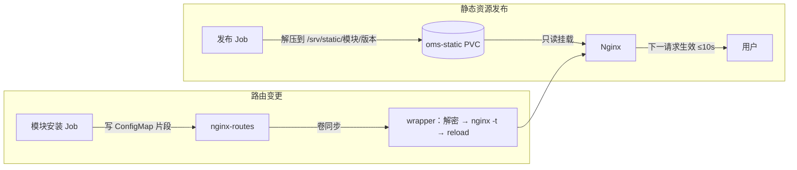

**静态资源（不需要 reload）**：

1. 发布 Job 把模块包解压到 `/srv/static/<module>/<version>/`；
2. 切换 `<module>/current` 指向新版本（原子 `rename` 或 symlink）；
3. Nginx 通配 location 每请求读文件，**不需要 reload**；受 `open_file_cache_valid 10s` 影响，最迟 10 秒生效；
4. 保留上一版本目录，回滚就是切回 `current` 指针。

**路由（需要 reload，但不重启）**：

1. 模块的安装 Job 写入自己的 `nginx-routes` 片段（`<module>.conf`）——**OMS 不代写**，所以 OMS 的 K8s 写权限仍然只有 `nginx-tls`；
2. 卷同步后 wrapper 检测到 `..data` 变化 → 解密口令 → `nginx -t`；
3. 校验通过才 `nginx -s reload`；失败则保留旧配置，旧路由继续服务。

**模块登记必须四样齐全**，少一样模块就是「半残」：

| 登记项 | 缺失的后果 |
| --- | --- |
| 菜单项 | 用户看不到入口 |
| 路由前缀 | 请求 404 或被 `auth_request` 拒绝 |
| 静态资源路径 | 页面加载不出来 |
| 资源类型 | 范围判定无依据，`cap.*` 校验不了 |

**模块安装时还要注册权限**。这一步不是可选的——只注册菜单和路由、不注册权限点，模块会「能看见入口但点不动」，因为判定服务找不到这个路径对应的权限点。

| 注册项 | 说明 | 约束 |
| --- | --- | --- |
| 权限点 | 菜单、按钮、API 各自的权限点 | 前缀必须是模块自己的，如 `fn.model-infer.*`、`cap.model-infer.*`；**不得注册 OMS 域的前缀**（`fn.auth.*`、`fn.account.*` 等） |
| 角色 | 模块自带的角色，如「推理运维」 | `source=MODULE`；**不得使用保留编码** `systemAdmin` / `securityAdmin` / `auditAdmin` / `m2mAccess` / `humanAccess`；名称带模块前缀，避免与内置角色重名 |
| 绑定 | 角色 → 权限点；菜单 → 权限点；API → 权限点 | 模块可以把权限点绑到**自己建的角色**，也可以申请绑到 **OMS 内置角色**（如系统管理员）——但只能新增，不能移除内置角色已有的权限 |
| 版本 | 注册带模块版本号 | 同版本重复注册幂等；升级时按版本差异应用；旧权限点标记废弃而不是删除 |

注册走接口，不直接写库：

```
POST /oms/internal/v1/registry/modules
{
  "module": "model-infer",
  "version": "1.2.0",
  "menus": [...],
  "routePrefixes": [...],
  "staticPaths": [...],
  "resourceTypes": [...],
  "permissions": [...],
  "roles": [...],
  "bindings": [...]
}
```

三条注册校验，任一条不过就**整体拒绝**（不允许半注册）：

- 权限点前缀必须属于本模块，跨域前缀直接拒绝；
- **不得占用保留编码、不得注册 OMS 域前缀、不得绑定准入角色**：前两条保证模块造不出「管理员角色」；第三条保证准入角色不被塞入业务权限。把模块自己的权限点绑定到内置管理员角色（如系统管理员）是允许的——那是给已有角色加能力；
- 绑到内置角色只能新增，请求里出现「移除」操作直接拒绝。

模块停用或卸载时，权限点置废弃、角色置停用，**不物理删除**，避免历史授权指向空。

> 这些角色是在**安装期**写入的，运行期仍然只读——所以没有推翻 R-06 的「运行期只读」，只是把「自定义角色」的入口从运行期 UI 挪到了安装注册。

**三条实现约束**：

- 静态资源路径必须与路由前缀**一一对应**，否则出现「页面能打开、接口全 404」；
- 每个模块只写自己的目录，禁止跨模块写——由 `FileStore` 的 `PathSanitizer` 与发布 Job 的参数共同保证；
- `nginx -t` 失败**绝不 reload**，这是唯一的兜底。

### 7.4 启动顺序

顺序错了会出现「应用起来了但连不上库」「Nginx 拿不到证书」这类问题，所以固化如下：

| 序号 | 步骤 | 就绪判据 | 失败处理 |
| --- | --- | --- | --- |
| 1 | `cert-rotate` Job 生成 CA 与证书 | Secret `oms-tls` / `nginx-tls` 与 ConfigMap `oms-ca` 均存在，指纹一致 | 阻塞后续，不启动应用 |
| 2 | PostgreSQL / Redis 启动 | 探针通过 | 重试；数据面不可用则应用不启动 |
| 3 | `migrate` Job 执行 schema 变更 | 退出码 0、版本表更新 | 失败即停止发布，不启动应用 |
| 4 | OMS 启动 | 读到主密钥、解密自检通过、schema 版本匹配 | 拒绝启动（**不能绕过**） |
| 5 | Nginx 启动 | 证书加载、`nginx -t` 通过 | 不就绪，HAProxy 摘除 |
| 6 | 业务模块注册（菜单、路由前缀、静态路径、资源类型、权限、角色） | 注册接口返回成功 | 失败则该模块不启动 |
| 7 | 业务 Pod 启动 | 各自探针通过 | 不影响 OMS |

**`migrate` 只做一件事**：把 OMS 自己的 schema 与初始化数据带到目标版本。它**不负责跨系统的数据搬迁**——那是 `OMS-MIG-001` 里独立迁移程序的事。下表场景都用它，但模式不同：

| 场景 | 模式 | 做什么 | 不做什么 |
| --- | --- | --- | --- |
| 从零安装 | `baseline` | 用**当前版本的全量 schema + 初始化数据**建库，并在版本表登记基线版本 | 不重放历史增量脚本——既慢，又依赖早已不存在的中间状态 |
| 从旧系统升级 | `baseline` + 迁移程序 | 先建**新** schema，再由迁移程序搬数据、换加密体系、换证书 | `migrate` 不读旧库、不做字段映射、不猜业务语义 |
| 从当前版本往上升 | `upgrade` | 按版本表顺序执行增量脚本，遵循 expand → migrate → contract | 不做数据搬迁 |
| 发布前预检 | `verify` | 只比对版本号与脚本校验和，不执行任何变更 | 不修改数据，可在生产只读执行 |

三条铁律：

- **应用不得先启动、后补 schema**。`migrate` 是前置 Job，失败即停止发布；OMS 启动时还会再校验一次 schema 版本，不匹配就拒绝启动（本节第 4 步）。
- **脚本幂等、带校验和、可续跑**。中断后重跑不应重复应用；校验和变化视为脚本被篡改，直接拒绝执行。
- **旧系统升级不做「结构改造」**。不要写一堆一次性脚本把旧表改成新表——那是不可维护的。正确做法是「新建 schema + 程序搬数据 + 校验对账」，旧库只读。

两个容易忽略的点：

- **Nginx 可以先于业务启动**：`auth_request` 在 OMS 未就绪时会失败，表现为 5xx，这是可恢复的；但**证书必须先生成**，否则 Nginx 起不来。
- **OMS 必须校验 schema 版本**：版本不匹配时启动失败，而不是「带着旧结构跑」——后者会造成更难排查的数据错乱。

### 7.5 探针与端口

| 组件 | 端口 | 用途 | 探针 |
| --- | --- | --- | --- |
| nginx | 443（Service 端口，各实例相同不冲突） | 对外 HTTPS，启用 `proxy_protocol` | **不能用于探针** |
| nginx | 8080 | 明文健康检查 | readiness / liveness |
| oms | 8080 | HTTP（ClusterIP） | startup（脚本+上下文）、readiness（含 DB 与 schema）、liveness（不含 DB） |
| postgres | 5432 | 数据库 | 镜像自带 |
| redis | 6379 | 缓存 | 镜像自带 |
| HAProxy | **安装时指定**（默认 443） | 对外入口（宿主机），端口可改 | TCP 检查 |

三类探针的分工见 4.10：startup 给足启动时间，readiness 决定是否接流量，liveness 只管进程存活。

### 7.6 容量模型

**核心结论先说：判定 QPS = OMS 自身 API + 全部业务 API**，因为每个业务请求都要过一次 `/_authz`（3.1.3）。这是选型与扩容时最容易漏的一项。

| 维度 | 当前取值（上线前用真实数据校准） | 影响 |
| --- | --- | --- |
| 账户数 | 1 万 | 账户表、授权查询 |
| 在线会话 | 1 千 | 会话表与 Redis |
| OMS 自身 API | 100 QPS | OMS 副本与连接池 |
| 业务 API | 1000 QPS | **判定负载 = 1100 QPS** |
| 操作日志 | **2 万条/月** | 分区、转储周期；转储后主表只留当月 |
| 告警 | **千级/月** | 台账与统计；同样可转储 |
| 备份包 | 按被备份组件实际大小预留；仅 OMS 时 < 5 GB | PVC 容量与 RTO |

由此推导的基线：OMS 的 CPU 上限按 2 核规划（requests 0.5 核，见 7.2）；PostgreSQL 预留 **10–20 GB** PVC——数据本身按月增量只有几 MB 量级，绝大部分留给索引、WAL、膨胀余量与增长（远小于旧稿的百 GB 量级）；`oms-data` 按「导出产物 + 10 个转储包 + 备份副本」计算。**这些数字必须在上线前用真实数据校准**，本章只给方法。

### 7.7 可观测性

| 类型 | 内容 | 注意 |
| --- | --- | --- |
| 日志 | 结构化 JSON，带 `requestId`、`sid`（脱敏） | 不打印凭据、令牌、私钥、Cookie |
| 指标 | 登录失败率、越权拒绝数、`/_authz` 延迟、outbox 积压、任务队列深度、连接池占用、缓存命中率（检测手段见 6.5） | **本期不开放 `/actuator/prometheus`**；关键计数先进结构化日志与内部健康检查，需要时再开放并配 NetworkPolicy 放行 |
| 追踪 | 可选；至少保留 `requestId` 贯穿 | 跨 Nginx → OMS → 业务 |
| 告警 | 汇入 3.7 台账；基础设施指标由平台监控负责 | 两者职责分离，不互相依赖 |

**必须监控的三个数**：最近一次成功备份时间（6.7）、outbox 积压（告警能否及时送出）、`/_authz` 的 P95（它是所有业务 API 的必经之路）——三项的判定口径见 6.5 与 6.7。本期这三个数通过**日志聚合与数据库查询**获得；开放指标端点后再改为抓取。

### 7.8 多实例与命名空间隔离

| 约束 | 做法 |
| --- | --- |
| 实例边界 | 一套实例一个命名空间（T-5），OMS 与业务同域 |
| 资源闭环 | 所有 K8s 资源命名空间内闭环：不用 ClusterRole、不跨命名空间挂 PVC、不用固定 NodePort |
| 对外入口 | 每实例一个 Service IP（端口固定 443，互不冲突）；HAProxy 的后端地址与监听端口按实例配置（2.3） |
| 身份与许可 | ESN 与 License 按实例独立，不跨实例继承 |
| 网络策略 | NetworkPolicy 按命名空间生效（4.8） |

多实例之间**不共享任何有状态资源**：DB、Redis、PVC、ESN 各自独立。这条是 HC-18 的落点，也是「多套环境同集群」能成立的前提。

---

## 8. 数据与接口约定

> 本章只定**规则**，不列清单。表名、接口、错误码、枚举、权限点的完整清单在附录册 `OMS-HLD-001A`；新增任何一项都要先在附录册登记，再写代码。

### 8.1 接口命名空间与版本

- **OMS 自己的接口统一以 `/oms` 开头**，再按调用方分两类：
  - **UI 接口**：`/oms/ui/<域>/<资源>`，只接受浏览器会话，由 **OMS 自身的六道关**判定（`/oms/**` 不走 Nginx 的 `auth_request`，见 2.4）；
  - **内部机机接口**：`/oms/internal/v1/<域>/<资源>`，只允许集群内以 `client_id` + 令牌调用，不对浏览器开放。
- 域与模块一一对应：`auth`、`sso`、`account`、`authz`、`audit`、`task`、`cert`、`license`、`alarm`、`integration`、`crypto`、`common`；另有 `metering`（计量，归 `license` 模块）与 `registry`（模块注册，归 `common` 模块）两个路径域。
- **上层业务自己的接口不以 `/oms` 开头**，路径由业务自定，OMS 不解析也不代理；OMS 提供给业务的契约接口（模块注册、scope、授权快照、计量、审计上报）走 `/oms/internal/v1/...`，破坏性变更走 `v2`，旧版本至少保留一个发布周期。
- 前缀就是边界：Nginx 按 `/oms/ui`、`/oms/internal`、业务前缀分流，NetworkPolicy 按端口与来源限制，三者一致才不会出现「绕过去」的路径。
- **`/oms/internal/**` 在 Nginx 上直接对外屏蔽**（返回 404），它只能从集群内直连 OMS Service 调用，且只接受 `client_id` + 令牌，**不接受浏览器 Cookie 会话**。否则一个普通登录用户就能从浏览器敲到内部接口。
- 统一请求头：`X-Request-Id`（缺省由 Nginx 生成）、`Authorization: Bearer` 或会话 Cookie；Nginx 向下游注入 `X-OMS-Sid`、`X-OMS-Subject`，业务只信任这两个头。
- 列表统一用 **`offset` 分页**：请求参数固定为 `offset` 与 `size`，响应必须同时返回 `total`，支持跳到第 N 页；`size` 上限 100，超过直接拒绝而不是截断。深分页有额外约束，见 8.2。

### 8.2 统一响应、分页与错误码

成功响应只带 `data` 与 `requestId`，不套 `code` / `msg` 之类的壳：

```json
{ "data": { "id": 12, "name": "..." }, "requestId": "b1c2..." }
```

列表（`offset` 分页，带总数）：

```json
{ "items": [ ... ], "total": 1382, "offset": 40, "size": 20, "requestId": "b1c2..." }
```

失败响应（HTTP 状态码与业务码同时给，**不用 200 包错误**）：

```json
{
  "code": "AUTH_101",
  "messageKey": "auth.login.failed",
  "params": { "remaining": 3 },
  "message": "密码错误，还可尝试 3 次",
  "requestId": "b1c2..."
}
```

错误码格式 `<域>_<三位数字>`，数字段表达性质：

| 段 | 含义 | 例子 |
| --- | --- | --- |
| 000–099 | 参数与通用 | `COMMON_001` |
| 100–199 | 认证与会话 | `AUTH_101` |
| 200–299 | 授权 | `AUTHZ_201` |
| 300–399 | 资源与状态 | `ACCOUNT_301` |
| 400–499 | 业务规则 | `CERT_401` |
| 500–599 | 依赖与内部 | `ALARM_501` |

三条规则：

- **`code` 稳定，文案可变**。文案改了不能动 code，否则调用方的判断逻辑会跟着碎。
- **对外不回显内部结构**：堆栈只进服务端日志，用 `requestId` 关联；响应里不出现表名、SQL、类名。
- **被拒绝的越权请求返回 403 并留痕**，不返回 404 伪装「不存在」——审计需要看到尝试。

**分页用 offset，但必须配两条约束**：

| 约束 | 做法 | 原因 |
| --- | --- | --- |
| 深度上限 | `offset` 上限 10000（可配），超过时提示缩小时间范围或加筛选 | `LIMIT 10 OFFSET 100000` 仍要扫描并丢弃 10 万行，页码越深越慢 |
| 稳定排序 | `ORDER BY <排序键>, id`，把 `id` 作为并列打破 | 排序键不唯一时，翻页可能出现重复或漏行 |

**要接受的代价**：`offset` 分页在数据持续写入时会出现「翻页漂移」——翻到第 2 页时，如果前面新增了 5 条，用户会看到 5 条重复；删除则相反，会漏掉几行。这是 `offset` 的固有属性，不能通过实现消除。缓解办法是把列表默认按时间倒序、并提示「数据实时变化，可刷新」。既然业务上必须支持页码与总数，这个代价是明确的取舍。

**总数查询单独优化**：`COUNT(*)` 与列表用同一组筛选条件，但**不要和列表放在同一个大事务里**；筛选条件复杂时允许缓存 5–10 秒，或对超大表按分区估算。不要为了「总数绝对实时」把列表拖慢。

**按当前量级，分页不会成为瓶颈**：操作日志每月 2 万条、告警千级，主表在转储的配合下常年维持在「一个月内」的量级（几万行），首页、深页、`COUNT` 都在几十毫秒内完成。**当前量级不必缓存总数，也不必为分页专门加索引**。

深度上限与稳定排序仍然保留，但它们的定位是**防误用的护栏**，不是性能手段——防止有人写脚本一页页翻到底。

何时需要重新评估（按行数触发，不按时间）：

| 单表行数 | 现象 | 处置 |
| --- | --- | --- |
| 100 万 | `COUNT` 约 50–150ms | 仍可接受，不必处理 |
| 500 万 | `COUNT` 0.3–0.6s，开始有感 | 总数缓存 5–10 秒，或默认给最近时间范围 |
| 1000 万 | `COUNT` 1s 以上，筛选变慢 | 加复合索引、缓存、限制模糊搜索 |
| 5000 万 | 深页与筛选都明显变慢 | 必须重新设计（归档、分区裁剪、搜索方案） |

按当前增量测算，操作日志一年约 24 万行、告警一年约 1–2 万行，**离第一档还差一个数量级**。再加上按月转储把主表压回月增量，正常使用下不会触发任何一档。

所以这一节真正的结论是：**数据量不是风险，转储是否按时执行才是**——转储停了，量级才会往上涨。

兜底机制是「日志量超阈值」告警（3.3.4）：阈值命中就产生一条 `log` 源告警，转储成功后自动清除。**这个告警不会被淹没**——告警本身月增只有千级，日志再涨也不会把告警台账冲垮。

### 8.3 表属主与命名

| 规则 | 约定 |
| --- | --- |
| 属主唯一 | 每张表有且只有一个属主 DD，其他模块只能读、不能写 |
| 表名前缀 | 表达数据域：`account`、`user_group`、`role`、`permission`、`auth`、`operation`、`alarm`、`cert`、`license`、`task`、`snmp`、`sftp`、`ca`、`module`、`system` |
| 命名 | 小写下划线、单数；主键统一 `id`；时间 `created_at` / `updated_at`；逻辑删除 `deleted_at`；乐观锁 `version` |
| 类型 | 时间一律 `timestamptz` 并存 UTC；载荷用 `jsonb`；枚举用 `varchar` + 检查约束或字典表 |
| 索引 | `idx_<表>_<列>`、`uk_` 唯一、`fk_` 外键；大表索引用 `CREATE INDEX CONCURRENTLY` 单独执行 |
| 分区 | 大表按月分区，子表 `<表>_p<yyyyMM>`；分区键与查询条件必须一致，否则分区裁剪失效 |

### 8.4 跨域引用与事务边界

- **同域**可以用外键；**跨域不用外键**，用逻辑引用，由属主保证一致性——跨域外键会让两个域的发布互相锁死。
- 跨域读取只走对方 `api`；报表类需要 JOIN 时，由属主提供**只读视图**，调用方不得直接 JOIN 他域表。
- **一个事务只写一个域**。跨域一致性用 outbox 事件（3.3.2），不用分布式事务。
- 逻辑删除不级联：父记录删除后，子记录保留并在查询时按 `deleted_at` 过滤。
- **账户是唯一例外**：删除账户必须显式解除其用户组归属（R-02 的唯一归属约束），这是业务动作，不是级联删除——否则会出现「已删除的账户仍占着组的成员位」。

### 8.5 枚举与字典

| 类型 | 存放 | 例子 | 变更方式 |
| --- | --- | --- | --- |
| 安全敏感、固定集合 | 代码常量 + 数据库检查约束 | 角色类型、告警级别、账户类型 | 随版本发布，需评审 |
| 可扩展的字典 | 字典表 | 告警源、部件类型、计量项 | 运行期配置 |
| 外部声明 | 文件/接口 | 计量项清单（3.8.1） | 文件声明即生效 |

三条规则：**同一枚举只能有一个定义处**；**值一经发布不复用**（废弃后保留，避免历史数据指向新语义）；**新增值向后兼容**，不得改变已有值的含义。

### 8.6 上下层契约

OMS 与上层业务之间的接口只有六个，全部固定路径、固定语义：

| 契约 | 方向 | 形态 | 失败语义 |
| --- | --- | --- | --- |
| 模块注册 | 业务 → OMS | `POST /oms/internal/v1/registry/modules` | 未注册：菜单不渲染、路由被拒 |
| 资源查询 | OMS → 业务 | OMS 回调 `GET /resources?type=&ids=` | 失败：标记清单「陈旧」，**不删除既有归属** |
| 可见范围 | 业务 → OMS | `GET /oms/internal/v1/authz/scope` | 失败：**拒绝请求**（fail-closed），不做推测 |
| 授权快照 | 业务 → OMS | `GET /oms/internal/v1/authz/snapshot?since=<版本>` | 失败：沿用上次快照，**但快照不得用于判定**；无新版本返回空（3.1.7） |
| 计量登记 | 业务 → OMS | `POST /oms/internal/v1/metering/report` | 失败：重试，**不阻断业务** |
| 审计上报 | 业务 → OMS | `POST /oms/internal/v1/audit/oplog` | 失败：重试，超限告警 |

失败语义的差别是刻意的：**授权类必须失败即拒绝，记录类必须不阻断主流程**。把两者混为一谈，要么越权放行，要么日志拖垮业务。授权快照单独一档：拉不到只影响业务侧展示与映射，判定仍走 `/_authz` 与 `/authz/scope`，所以不 fail-closed。

### 8.7 数据保留与结构变更

| 数据 | 保留 | 清理方式 |
| --- | --- | --- |
| 会话 | 结束后 30 天 | 定时任务 |
| 操作日志 / 告警 | 保留至转储 | 转储后移出主表（3.3.4） |
| 任务记录 | 90 天 | 定时任务，不删产物 |
| 导出文件 | 7 天（可配） | 定时任务 |
| 转储包 | 最近 10 个 | 转储任务 |
| 备份副本 | 副本数量上限 | 备份清理 |
| 运行日志包 | 按配置 | 定时任务 |

结构变更一律走 `migrate`（7.4）：脚本命名 `V<版本>__<描述>.sql`、幂等、带校验和、可续跑；**运行期禁止 DDL**，应用账号没有 DDL 权限。

### 8.8 登记与附录册

本文只定规则，以下七类清单全部在附录册维护：

- 表清单与表属主；字段级说明归各 DD；
- 接口清单（路径、方法、权限点、请求/响应要点）；
- 错误码全表；
- 枚举与字典全表；
- 权限点清单与角色矩阵；
- 需求追踪矩阵（FR ↔ 章节）；
- ADR 全表（已定决策与预留扩展位）。

**新增任何一项，先在附录册登记，再写代码**——这是跨文档一致性机制（附录册 ADR-012）的落点，也是「多份文档不打架」的唯一保证。

---

## 9. 未决与风险

> 全篇收口：哪些事还需要别人给输入、哪些风险已经被明确接受、哪些结论要回写到需求文档。

### 9.1 待决项

| 编号 | 事项 | 阻塞什么 | 责任方 | 紧急度 |
| --- | --- | --- | --- | --- |
| O-01 | License 文件格式、是否带签名、计量项声明方式（3.8.1） | DD-08 的解析与校验 | 产品 | 高 |
| O-02 | 上游 CAS 的具体端点、属性名、SLO 回调方式（3.2.4） | DD-03 的全部接口 | 架构 / 客户 | 高 |
| O-03 | 存量系统信息、迁移范围、停机窗口（4.15、7.4） | `OMS-MIG-001` 全文 | 交付 | 高 |
| O-04 | 被备份组件清单：除 OMS 外，模型工程 / Terabase 是否必选（3.6.3） | DD-06 的组件选择与失败策略 | 产品 | 中 |
| O-05 | 容量目标与资源配额确认（7.6） | 部署清单与压测基线 | 运维 | 中 |
| O-06 | 容器基线是否要求 PSA `restricted`（4.13） | 镜像与安全上下文 | 安全 | 中 |
| O-07 | 本期是否启用 SNMP、SFTP、CA 三类外部通道 | 部署配置与联调范围 | 交付 | 中 |
| O-08 | 上层业务模块清单及其权限点、角色（7.3） | 模块注册与联调 | 业务方 | 中 |
| O-09 | 客户是否已有公共 CA 签发的对外证书（4.15） | 迁移时证书是重签还是转换 | 交付 | 低 |
| O-10 | 是否需要邮件 / 短信通知 | 通知通道实现与 DD 范围 | 产品 | 低 |
| O-11 | 转储后清理主表的执行主体与凭据（3.3.4 第 7 步）：独立维护 Job + DDL 账号，还是复用 `migrate` 的账号 | 清理实现与 4.9 的 ServiceAccount 清单 | 架构 / DBA | 中 |

### 9.2 已接受风险

以下风险**不是遗漏**，是明确接受并写清了触发重估的条件：

| 编号 | 风险 | 等级 | 接受理由 | 何时重新评估 |
| --- | --- | --- | --- | --- |
| AR-01 | 集群 root 可读 Secret 并解密数据 | 高 | 要防它只能靠 KMS/HSM，本期无此基础设施 | 客户提出等保/密评要求，或提供 KMS |
| AR-02 | 用到某类密文的 Pod 挂载对应 KSUser 的主密钥，单容器沦陷即该类密文全量泄露 | 高 | 旧密文必须用原主密钥解，收敛到 OMS 会引入新调用链与单点；按 KSUser 隔离已把泄露面切片 | 出现实际泄露案例，或 KMC 提供服务化按请求授权的形态 |
| AR-03 | 供应链投毒 | 高 | 缓解中：digest + `imagePullSecrets` + PSA | 私有仓库与 PSA 落地后重评 |
| AR-04 | mTLS 只加密、不证明服务身份 | 中 | 身份由应用层令牌承担 | 要求 mTLS 自证身份时 |
| AR-05 | PROXY 头可伪造来源 IP | 中 | 已收敛到宿主机（NetworkPolicy 限定源为 HAProxy 宿主机） | 宿主机被攻破，或出现跨命名空间访问 |
| AR-06 | 特权 `pre-install-job` | 中 | 仅 local 存储模式的目录初始化需要，窗口短 | 切换到 PVC 部署 |
| AR-07 | 无 CRL / OCSP | 中 | 内部证书生命周期长，吊销成本大于收益 | 证书改由公共 CA 签发 |
| AR-08 | 单副本，无高可用 | 中 | 当前规模不需要，RTO 4h 可接受 | 客户要求 SLA > 99.9% |
| AR-09 | 审计可被集群 root 篡改 | 中 | 不防御 root | 合规要求防内部篡改 |
| AR-10 | 共享证书无法区分服务 | 中 | 令牌兜底，部署简单 | 出现跨命名空间或第三方接入 |

### 9.3 需求回写清单

设计过程中发现的需求侧偏差或新增口径，需要回写 SRS，否则追踪矩阵会出现「文档里查不到」的条目：

| 编号 | 事项 | 现状 | 建议 |
| --- | --- | --- | --- |
| W-01 | FR 数量不一致 | 主索引 74 条，分册实际 77 条（缺 `FR-ALM-006`、`FR-CERT-004/005`） | 以分册为准，补主索引三行 |
| W-02 | 证书管理权限口径 | OI-M13-002 写「安全管理员只读」，本文定为**不可读**（菜单不可见） | 以本文为准，修订 OI-M13-002 |
| W-03 | 两个准入角色与权限点 | 需求里没有；本文新增 `m2mAccess`（机机接入）、`humanAccess`（人机接入），以及 `fn.auth.login.web`、`fn.auth.token.api` 两个权限点 | 补入角色矩阵与权限点清单（配置预置，非需求新增） |
| W-04 | 登录通道与准入角色 | 需求未区分人机 / 机机登录 | 在 M01、M02 中说明：页面登录与 token 端点分别由 `fn.auth.login.web`、`fn.auth.token.api` 控制，通过 `m2mAccess` / `humanAccess` 组合；每个用户组至少绑定一个；不新增账户类型 |
| W-05 | 转储口径 | 需求未写明是否同包 | 明确「日志与告警同包、单 zip、SFTP 整包上传；保留 10 个包」 |
| W-06 | 告警重复上报 | 需求未说明去重是否影响上报 | 明确「去重只作用于台账；重复告警逐次 SNMP 上报」 |
| W-07 | 屏蔽语义 | 需求未说明屏蔽后是否统计 | 明确「既不入统计、也不上报，但记录保留」 |
| W-08 | 证书有效期与轮换 | 需求未规定 100 年 / 50 年、不自动续签 | 补入 M12 巡检与 M13 证书策略 |
| W-09 | 附录册登记规则 | 需求侧无对应机制 | 在研发流程中固化：新增表/接口/枚举/权限点先登记再编码 |
| W-10 | 角色配置同步的形态 | FR-PERM-004 写的是「定时 + 变更 + 手工触发的推送」，含同步目标与同步周期配置 | 改为业务按需拉取授权快照（3.1.7、8.6），不再需要维护同步目标与周期；需产品确认后回写 M16 |

### 9.4 评审待办

评审会按这个顺序过，逐项给结论：

1. **十二条铁律**（第 1 章）：有没有需要新增、删除或放宽的；
2. **4.14 的七条裁决**：是否全部认可，尤其 JWT 与加密体系两条；
3. **4.15 的迁移顺序**：先换加密、再换证书，是否可行；
4. **5.7 的风险评级**：等级与处置是否与实际接受度一致；
5. **6.7 的两条运维要求**：备份成功率监控、主密钥独立备份，是否纳入交付；
6. **7.6 的容量假设**：数值是否需要在评审前用真实数据校准；
7. **9.1 的待决项**：逐条指定责任人与截止时间。

### 9.5 文档状态

| 部分 | 状态 |
| --- | --- |
| 第 0–9 章 | 本轮完成 |
| 附录册 `OMS-HLD-001A` | V0.3：需求追踪矩阵（77 条 FR 全部落位）+ 遗留问题台账（设计冲突 12、设计缺口 4、待决输入 11）；待建：接口清单、表清单、错误码全表、枚举、权限点与角色矩阵、ADR 表 |
| `OMS-MIG-001` 存量迁移 | V0.4 已建（自包含）：旧系统现状、新系统目标态、P0–P7 模型、ESN 接续、账户与授权迁移、密钥体系、密文搬运与对账、历史台账搬迁、证书、割接与验收、回滚；26 张图；升级流程仍见 7.4 |
| DD-01…DD-11 | 待写 |

---

## 变更记录

| 版本 | 日期 | 说明 |
| --- | --- | --- |
| V0.1 | 2026-10-20 | 评审精简版起步：第 0 章（定位、数字、五条取舍、阅读路线）、第 1 章（12 条铁律） |
| V0.2 | 2026-10-20 | 按评审意见修订：转储口径改为「操作日志与告警同包、单 zip」；私钥「不可导出」明确为边界定义 |
| V0.3 | 2026-10-20 | 确认私钥为接口层承诺；确认 FR-CERT-003 的「微服务」为上层业务系统，新增附 A 记录待折入正文的结论 |
| V0.4 | 2026-10-20 | 定稿方案 A：上层业务与 OMS 同 namespace、共享一张自签名证书；服务间证书与上层接入证书合并为同一概念，实例边界改为「一套 OMS + 其上层业务」 |
| V0.5 | 2026-10-20 | 确认 Nginx 对外证书独立自签；确认 CA 100 年 / 共享服务证书 50 年、不自动续签；登记由此产生的巡检与吊销缺口 |
| V0.6 | 2026-10-20 | 修正：Nginx 证书同样由内部 CA 签发、同样 50 年，可被导入替换；确认预警按当前证书 notAfter 计算，故 Nginx 证书保留 30–90 天预警 |
| V0.7 | 2026-10-20 | 补充：导入时「CA 证书」为中间证书链、必填并校验链自洽；区分「服务端要发的中间证书」与「客户端信任库里的根」 |
| V0.8 | 2026-10-20 | 定稿导入规则：CA 栏必须含根证书，接受三种上传组合；系统重排去重、校验签名闭环、发送时剥根；根不进 OMS 信任库 |
| V0.9 | 2026-10-20 | 修正 CSR 定位：CSR 为外部 CA 签发路径，内部 CA 只用于部署期默认证书与共享证书，不参与页面导入 |
| V0.10 | 2026-10-20 | 确认私钥口令为系统内部行为；导入时私钥与口令按「公钥是否已在库中匹配」按需提供，区分上传件解密口令与存储口令 |
| V0.11 | 2026-10-20 | 新增 3.4 证书与私钥（信任模型、导入替换、装载生效、预警与残余风险）；证书结论全部折入正文，删除临时决策清单 |
| V0.12 | 2026-10-20 | 补充 3.4.3 部署视图（各 Pod 挂载的 Secret 与临时卷）；修正权限口径为「安全管理员不可读」 |
| V0.13 | 2026-10-20 | 确认 SCC 提供 Java/Go/Python SDK，删除中转容器方案；改为进程内解密，Python 需 tmpfs 文件路径 |
| V0.14 | 2026-10-20 | 明文临时存放的完整逻辑移交 3.5 加解密章节，3.4 只保留挂载与指向 |
| V0.15 | 2026-10-20 | 新增第 2 章架构：逻辑架构图、模块与四条依赖禁令、运行形态、六道关、六机制索引 |
| V0.16 | 2026-10-20 | 新增 3.1 授权与即时失效：两维判定、三权分立改为三者两两互斥、变更即时生效 |
| V0.17 | 2026-10-20 | 3.1.4 补入 Redis 的三类键与固定判定顺序，明确 Redis 只加速拒绝、不作权威 |
| V0.18 | 2026-10-20 | 补一条硬约束：会话缓存与失效集合不得持久化，避免重启后旧会话复活 |
| V0.19 | 2026-10-20 | 3.1 拆为基础场景（一次请求的判定链路，含四个缓存键）与扩展场景（授权变更后失效） |
| V0.20 | 2026-10-20 | 确认 HAProxy 仅 L4 透传、TLS 仍在 Nginx 终结；2.3 补对外暴露与 PROXY protocol 约束 |
| V0.21 | 2026-10-20 | 新增 3.1.3 判定在哪里执行：网关判能力、业务判范围，含流量图、注册表与四条语义；原 3.1.3–3.1.5 顺延 |
| V0.22 | 2026-10-20 | 明确 HAProxy 部署在宿主机、后端指向本实例 Service IP，端口按实例在部署时指定；R-10 判定线随之调整 |
| V0.23 | 2026-10-20 | 确认 PROXY protocol 为 v1（send-proxy），Nginx 兼容 v1/v2；补充健康检查端口必须与 443 分离 |
| V0.24 | 2026-10-20 | 修正 `set_real_ip_from` 口径：覆盖宿主机网段（含备机），而非浮动 IP |
| V0.25 | 2026-10-20 | 按现状继承：`set_real_ip_from 0.0.0.0/0`、不配 NetworkPolicy；登记为已知薄弱点并给出优化触发条件 |
| V0.26 | 2026-10-20 | 流量视图移入第 2 章（2.4）；新增 3.2.1 端到端时序；补齐 CA 私钥保护、两个私钥密码、外部 CA 信任三项结论 |
| V0.27 | 2026-10-20 | 补充域名不匹配的人工确认、主密钥与备份分离要求 |
| V0.28 | 2026-10-20 | 补完 3.2：令牌与会话、登录异常路径、CAS 单点登录与协议适配层 |
| V0.29 | 2026-10-20 | 明确两种过期语义：空闲超时由服务端判定，最大会话时长由令牌 exp 硬性截断 |
| V0.30 | 2026-10-20 | 新增 3.3 审计与转储：只追加模型、留痕先于执行、查询与导出、单包双数据源转储、运行日志边界 |
| V0.31 | 2026-10-20 | 明确告警聚合字段不做 MAC、仅状态变更追加留痕 |
| V0.32 | 2026-10-20 | 新增第 4 章功能框架：11 份 DD 的生态位、主线、关键取向与边界；后续章节顺延至 5–8 |
| V0.33 | 2026-10-20 | 撤销第 4 章（与第 3 章重复）；章名改为「核心设计」 |
| V0.34 | 2026-10-20 | 回滚未经讨论的 3.5–3.8，改为逐节讨论后再写；当前定稿 3.1–3.4 |
| V0.35 | 2026-10-20 | 按讨论结果写入 3.7 告警与上报通道：纯自建、HTTP 同步受理、全级别 SNMP、不用 P+A |
| V0.36 | 2026-10-20 | 确认清除后再次发生算新告警；补并发上报的部分唯一索引兜底 |
| V0.37 | 2026-10-20 | 明确去重只作用于台账、不作用于上报：重复告警逐次发 Trap，不合并、不限速 |
| V0.38 | 2026-10-20 | 补充逐次上报的队列压力说明；修正小节内规则条数 |
| V0.39 | 2026-10-20 | 明确屏蔽的语义：既不纳入统计也不上报，与去重区分 |
| V0.40 | 2026-10-20 | 按讨论结果写入 3.5 加解密：单层主密钥、安装期生成、两个 Secret、手动轮换脚本、国密预留 |
| V0.41 | 2026-10-20 | 修正 3.5.3：数据库口令密文同样挂载业务 Pod；密文落点不写死为数据库 |
| V0.42 | 2026-10-20 | 3.5 重排：新增挂载清单与证书材料生命周期；确认 PEM、CA 私钥只给 Job、PVC 不整体加密 |
| V0.43 | 2026-10-20 | 修正生命周期：口令先于私钥加密；密钥对与 CSR 由 openssl/BC 完成，SCC 只保护口令；说明 PKCS#8 PEM 与 PKCS#12 的区别 |
| V0.44 | 2026-10-20 | 新增 3.6 任务备份与调度；修正 3.5 被误置于 3.7 之后的顺序问题 |
| V0.45 | 2026-10-20 | 3.6 区分定时任务与队列任务；补会话清理存在的理由与成本说明 |
| V0.46 | 2026-10-20 | 3.6 改写为通用任务中心：三角色、TaskType/TaskHandler 扩展点、调度器只触发、备份与转储为前两个用户 |
| V0.47 | 2026-10-20 | 新增 3.8 许可与通用能力：ESN 双写、许可接口与交互逻辑、计量通配、配置两级 |
| V0.48 | 2026-10-20 | 3.8 展开：国际化三类文本与 locale 解析、权限点驱动的注册模型、FileStore 取舍论证 |
| V0.49 | 2026-10-20 | 注册模型补 menu / api_permission 两张表；补按钮渲染机制与行级按钮的两种做法 |
| V0.50 | 2026-10-20 | 用「关系表 + 运行时双路径图」替换语义混杂的注册图 |
| V0.51 | 2026-10-20 | 3.8.3 调整顺序：表内容 → 引用关系 → 运行时路径 |
| V0.52 | 2026-10-20 | 运行时路径改为时序图，显式区分「接口需要什么」与「用户有什么」两次查询 |
| V0.53 | 2026-10-20 | 3.8.5 重写为 FileStore 的接口与路径模型，去掉「为什么保留」的论证 |
| V0.54 | 2026-10-20 | 3.8.5 补充使用场景与刻意不用的场景 |
| V0.55 | 2026-10-20 | 新增 2.6 外部边界与集成契约（9 类外部对象的方向、失败处理与约束） |
| V0.56 | 2026-10-20 | 新增 3.2.5 机机账户（初版按账户形态设计） |
| V0.57 | 2026-10-20 | 3.2.5 改为 openAPI 角色承载：页面登录作为权限点，不新增账户类型；会话要求与其他账户一致 |
| V0.58 | 2026-10-20 | 3.2.5 定稿：两个端点 + 两个权限点；token 端点不对人机账户开放 |
| V0.59 | 2026-10-20 | 新增第 4 章安全设计（初版）；迁移另开 OMS-MIG-001 |
| V0.60 | 2026-10-20 | 3.2.2 补「登录成功重新生成 sid」，与第 4 章会话固定控制对齐 |
| V0.61 | 2026-10-20 | 依 `ME-系统安全要求总结.md` 重写第 4 章：13 个安全域、组件基线与已知差距，并新增 4.14 差异待对齐表 |
| V0.62 | 2026-10-20 | 4.14 改为裁决结果；新增 4.15 迁移影响：KMC→SCC 与 p12/JKS→PEM 的顺序、分类与回滚 |
| V0.63 | 2026-10-20 | 启用 NetworkPolicy：4.8 给出 OMS 命名空间策略集；2.3 薄弱点收敛为仅剩 PROXY 头可伪造 |
| V0.64 | 2026-10-20 | 第 4 章按新实现改写：去掉 KMC/Feign/网关/OperationLogAop 等旧系统细节，只保留安全原则并适配 OMS |
| V0.65 | 2026-10-20 | 4.4 用户组名改为 oms/postgres；4.8 去掉旧系统组件名；4.14 #7 表述修正 |
| V0.66 | 2026-10-20 | 修正 4.5 的 defaultMode：常驻进程读取的密钥用 0440 + fsGroup，而非 0600 |
| V0.67 | 2026-10-20 | 新增第 5 章威胁模型与攻击面：资产、信任边界、STRIDE、13 个攻击面、5 条攻击路径、风险评级 |
| V0.68 | 2026-10-20 | 新增第 6 章 SFMEA：组件/依赖/链路失效、检测、单点清单、与 RTO/RPO 对账 |
| V0.69 | 2026-10-20 | 新增第 7 章技术基线与部署：版本基线、部署清单、静态资源发布、启动顺序、容量与可观测性 |
| V0.70 | 2026-10-20 | 7.4 补 migrate 的四种模式与三种升级场景的边界 |
| V0.71 | 2026-10-20 | 7.5 HAProxy 端口改为安装时指定；7.6 容量按当前值；/actuator/prometheus 本期不开放 |
| V0.72 | 2026-10-20 | 新增第 8 章数据与接口约定：命名空间、响应与错误码、表属主、跨域边界、枚举、上下层契约、保留期 |
| V0.73 | 2026-10-20 | 接口前缀改为 `/oms/ui` 与 `/oms/internal/v1`；补游标分页与 offset 的取舍说明，全文路径同步 |
| V0.74 | 2026-10-20 | 明确 `/oms/internal/**` 由 Nginx 对外屏蔽，只接受机机令牌 |
| V0.75 | 2026-10-20 | 分页改为 offset：支持页码与总数，配时间范围、深度上限、稳定排序三条约束 |
| V0.76 | 2026-10-20 | 恢复被误删的 8.2 节（统一响应与错误码），分页规则归位 |
| V0.77 | 2026-10-20 | 去掉分页的「强制时间范围」约束，时间范围改为可选筛选 |
| V0.78 | 2026-10-20 | 8.2 补数据量与查询延迟的拐点分析（初版按百万级/月估算） |
| V0.79 | 2026-10-20 | 按实际量级修正：操作日志 2 万/月、告警千级，分页不构成瓶颈；结论改为「转储是否执行才是风险」 |
| V0.80 | 2026-10-20 | 明确日志量超阈值产生 log 源告警、转储成功后清除；告警量低不会被淹没 |
| V0.81 | 2026-10-20 | 7.3 补模块安装时的权限注册：权限点、模块角色、与内置角色的绑定及四条校验；R-06 与 3.8.3 同步 |
| V0.82 | 2026-10-20 | 澄清哨兵点约束：允许把模块权限绑到内置角色，禁止创建或新增哨兵点 |
| V0.83 | 2026-10-20 | 去掉哨兵点概念：三权分立改为按内置角色编码判定；模块约束改为「保留编码 + 域前缀」两条 |
| V0.84 | 2026-10-20 | 新增第 9 章未决与风险：待决项、已接受风险、需求回写清单、评审待办；主文 0–9 章完成 |
| V0.85 | 2026-10-27 | 全文校对：修正章节引用、统一术语、修正容量与版本口径、调整阅读路线 |
| V0.86 | 2026-10-27 | `openAPI` 更名为 `m2mAccess`（机机接入），新增 `humanApiAccess`（人机接口）；准入角色不得承载业务权限 |
| V0.87 | 2026-10-27 | 终校：3.4.3 挂载命名与 3.5.3/4.5 统一为 `oms-tls`/`oms-ca`（ConfigMap）；第 5 章五处误引 4.10/4.1 改为 3.5（信任边界），6.2 误引 3.1.4 改为 3.1.5，O-06 误引 4.9 改为 4.13，Nginx 证书过期缓解误引 3.4.3 改为 3.4.2；3.4.1「五条规则」改四条、7.3 停用规则拆出校验清单、8.2「三条约束」改两条（V0.77 已删时间范围条）、7.4 场景计数表述修正；8.1 域清单补 `sso`/`metering`/`registry`；3.8.2 错误码示例对齐 8.2 的 `AUTH_101`、3.8.3 profile 路径补 `/oms/ui` 前缀；FR-ACC 引用 001 改 004/007（终止会话的出处）；前置事项补列配套另册 `OMS-INT-001` / `OMS-TST-001`；变更记录表合并被空行截断的两段 |
| V0.88 | 2026-10-27 | 准入角色移入 3.1.5 与角色建模合并，3.2.5 只保留登录通道判定；3.1.5/3.1.6 顺延 |
| V0.89 | 2026-10-27 | 准入角色简化为 `m2mAccess`（token）与 `humanAccess`（页面），通道与权限分离；每个用户组至少绑定一个准入角色 |
| V0.98 | 2026-10-30 | 3.1.4 澄清 `builtin_locked` 只约束角色绑定，不约束成员与资源组关联（配合 MIG-001 中旧管理员组直迁内置组） |
| V0.97 | 2026-10-30 | `OMS-MIG-001` V0.1 建册（存量迁移 12 章）；9.5 状态更新。本文正文无设计变更 |
| V0.96 | 2026-10-30 | 密钥体系收敛为两场景通用：常驻三个 KSUser（`oms` 新增、`nginx` / `modelenginepublic` 迁移复用），新密文一律归 `oms`；旧体系其余用户降为迁移期临时挂载（3.5.1）；初始化明确 `generate` / `adopt` 两种模式（3.5.2）；Secret 统一为 `kmc-<user>` 并合并校验文件（3.5.3、4.5、7.2） |
| V0.95 | 2026-10-27 | 按迁移侧 2026-10-28 的决策改写加解密：后端由 SCC 改为 **KMC**（`KmcCryptoPort` 实现 `CryptoPort`），主密钥由「一把」改为「按 KSUser 隔离的一组」，3.5 整节重写（密钥模型/初始化/挂载/调用约束/轮换/明文窗口）；4.5、4.6、4.13、4.14、4.15、6.2、7.1、7.2、9.2 的 AR-02 同步；4.15 改为「密文原样搬运 + 证书三类处理」，删除 KMC→SCC 重加密与 KMC 下线；4.11 补 PBKDF2 参数（10000 轮 / 512 bit / `iterations:saltHex:hashHex`）以兼容旧哈希 |
| V0.94 | 2026-10-27 | 附录册 V0.3 新增遗留问题台账（8.1 冲突 12 / 8.2 缺口 4 / 8.3 待决 11 / 8.4 回写索引），9.5 指向该台账；本节只更新状态，不含设计变更 |
| V0.93 | 2026-10-27 | 按追踪矩阵闭环 4 项冲突：C-06 删除账户显式解除归属（8.4）、C-07 许可文件改为必须落盘（3.8.5）、C-09 License 阈值归后台配置（3.8.1、3.8.4）、C-10 备份产物加密写入流程（3.6.3、第 6 章） |
| V0.92 | 2026-10-27 | 补 77 条 FR 的覆盖审计结果：附录册 V0.1 建册并完成追踪矩阵，暴露 12 项设计冲突（C-01…C-12）与 4 项缺口（G-01…G-04）；本版只更新 9.5 状态，冲突待裁决 |
| V0.91 | 2026-10-27 | 补 FR-PERM-004：新增「授权快照拉取」契约（3.1.7、8.6），8.6 的契约由五个改为六个，2.6 集成表同步；9.3 新增 W-10 登记形态变更 |
| V0.90 | 2026-10-27 | 全文通读校对：①取消进程内短缓存，授权延迟统一为 ≤1s（与 R-11 一致）；②转储后的清理主体改为待决项 O-11，明确其必须由具备 DDL 权限的独立身份执行；③5.7 加 AR 编号与 9.2 对齐，PROXY 头定级统一为中；④6.2 的 S1/S2 按 6.7 结论修正，6.7 补估算耗时；⑤分页响应、错误码域名、表名前缀、契约接口清单、模块注册报文等 20 余处口径统一；⑥OMS-MIG-001 范围收窄为存量迁移 |
