# OMS 总体设计（评审版）

| 项目 | 内容 |
| --- | --- |
| 文档编号 | OMS-HLD-001（评审精简版） |
| 版本 | V0.1 草稿 |
| 读者 | 评审人、架构师 |
| 上游依据 | `docs/requirements/OMS-需求规格说明书.md` 及 18 个模块分册（77 条 FR） |
| 交互依据 | `design/prototypes/login.html`、`app-shell.html`（101 张状态截图） |
| 台账另册 | `OMS-HLD-001A`（追踪矩阵、接口登记、表属主、权限点、枚举、ADR 全表） |

> 本文只回答两件事：**系统的骨架是什么**、**哪些约束一旦违反就必须否决**。
> 字段级契约、报文、建表、错误码取值一律归各详细设计文档（DD-01…DD-11），本文不复述。

---

## 0. 一页读懂

### 0.1 定位与边界

OMS 是**统一运维管理底座**：向上层业务系统提供账户与身份、授权、日志审计、告警、证书、许可、加解密、备份等底座能力，**自身不含任何业务语义**。上层业务通过注册菜单与资源类型接入，OMS 只认「资源类型 + 资源 ID」，不认业务对象。

**范围内**：M01–M18 全部功能的实现结构；OMS 自身数据模型；与上游认证、下游客户端、SNMP、SFTP、CA、SCC SDK、被备份组件、平台自监控的集成；K8s 部署形态；版本升级与存量迁移。

**范围外**：上层业务的业务逻辑与业务数据；SCC 内部算法；接口报文与表字段明细（归 DD）；测试用例（归 OMS-TST-001）；UI 视觉稿（以原型为准）。

### 0.2 关键数字

| 维度 | 数量 | 说明 |
| --- | --- | --- |
| 需求模块 / FR | 18 / 77 | 全部有唯一 DD 归属，无孤儿需求 |
| 详细设计文档 | 11 份 | DD-01…DD-11，按领域分组，接口与建表随特性走 |
| 数据表 | 44 张 | 每张表有唯一属主 DD，跨域只可引用 |
| 对外接口 | 约 70 个 | 按域分命名空间，登记在附录册 |
| 架构决策 | 22 条 | 全部「已定」，3 条带预留扩展路径 |
| 定时任务 | 20 项 | 进程内调度 + ShedLock，无独立 worker |
| 原型状态截图 | 101 张 | 作为交互与文案依据 |

### 0.3 五条总体取舍（评审先看这五条）

| 编号 | 取舍 | 结论 | 代价 / 风险 |
| --- | --- | --- | --- |
| T-1 | 单体还是微服务 | **模块化单体**：单进程、单镜像，按 DD 分模块，跨模块只经 `api` 门面，依赖方向由 ArchUnit 在 CI 强制 | 后续拆分需先收紧包边界；当前规模不足以抵消分布式成本 |
| T-2 | 会话放哪 | **PostgreSQL 权威 + Redis 仅加速**：Redis 失效只降性能不丢会话 | 每次请求的会话校验有库访问成本，需靠本地短缓存压住 P95 |
| T-3 | 单副本还是多副本 | **当前单副本交付，但全量状态外置**，具备 HPA 条件；多副本不作为验收项 | 交付期不能靠「重启即恢复」掩盖状态残留问题 |
| T-4 | 国密还是国际算法 | **本期国际算法**（PBKDF2-HMAC-SHA256 / AES-256-GCM / RSA+SHA-256 / TLS 1.2+），**SM2 不做但保留可扩展** | 保留算法枚举与 `CryptoPort` 适配层，后续改造不动业务代码 |
| T-5 | 单实例还是多套 | **一命名空间 = 一套 OMS（含其上层业务系统）**；同集群可并存多套，实例间不共享任何有状态资源 | 所有 K8s 资源必须命名空间内闭环，禁用 ClusterRole/CRD/固定 NodePort |

### 0.4 阅读路线

评审查结论与风险：本文全部（约 40 分钟）。架构师看机制细节：第 2、3 章。安全与合规：第 1 章 R-07、R-08 + 3.4。要动手实现、查表查接口：直接去 DD 与附录册，不要期望在本文找到字段。

---

## 1. 十二条铁律

以下 12 条是**评审否决线**：任何设计、实现、变更与其冲突，评审直接不通过。其余要求（性能目标、文案口径、UI 一致性等）写在正文对应章节，属于「应满足」，不属于「违反即否决」。

| 编号 | 铁律 | 可判定线（评审怎么验） | 原编号 |
| --- | --- | --- | --- |
| R-01 | **默认拒绝**：授权 = 能力维度（用户组→角色→权限点）× 范围维度（用户组→资源组→目标资源），二者缺一即拒绝 | 四象限用例（有能力有范围 / 有能力无范围 / 有范围无能力 / 都无）中，后三种必须 403；绕过前端直接调接口同样 403 | HC-02 |
| R-02 | **身份归属链唯一**：账户 → 用户组 → 角色/资源组；账户**不直接**持有角色或资源组，且**只能属于一个用户组** | 库中不存在 `account_role`、`account_resource_group`；`user_group_member` 有唯一约束；一个账户迁两组必须失败 | HC-03/04/05 |
| R-03 | **三权分立靠算法阻断**：系统管理员、安全管理员、审计管理员三者互斥，校验发生在**角色绑定写接口内**，不依赖流程审批 | 给同一用户组绑定互斥角色必须被接口拒绝；三个内置组的角色关系锁定，不可增删 | HC-06 |
| R-04 | **授权变更即时生效**：授权关系一变，受影响会话立即过期；权限**不进 JWT** | 变更后持旧 token 请求必须 401（目标 ≤1s，最坏 ≤5s）；JWT 载荷中无权限快照 | HC-07 |
| R-05 | **认证不可用不降级**：OMS 认证不可用时，上层业务拒绝登录，且既有会话失效；不提供任何免认证通道 | 停 OMS 后，下游新登录与既有会话均被拒；不得出现「本地缓存身份继续放行」 | HC-01 |
| R-06 | **角色与资源归属只读**：角色全部内置、运行期只读（保留自定义扩展位但不开放写接口）；资源清单由上层注册、OMS 回调获取，**归属关系 OMS 侧只读** | 角色表有 `builtin`/`source` 字段但无运行期写接口；资源接口无写入口，界面无变更归属入口 | HC-08/09 |
| R-07 | **审计与告警不可删，转储是唯一出口**：审计表应用账号只有 `INSERT`/`SELECT`；告警记录只能「清除」或「转储归档」移出主表。**一次转储产出单个 zip，操作日志与告警两部分同时打进这一个包**，不再分类型出包 | 告警表无 DELETE 权限与删除接口；转储包解压后同时含两类数据，manifest 分列两类条数且与包内一致；配置 SFTP 时整包上传 | HC-16/19 |
| R-08 | **凭据与私钥不出明文**：密码、凭据、密钥加密存储，明文不落日志；私钥**离开系统边界即视为导出**（页面下载、API 返回、明文展示、脚本导出），系统不提供任何导出能力，只输出 CSR；全链路 TLS，服务间证书由证书模块统一管理 | 库表抽检无明文；日志扫描无凭据；无任何私钥导出接口（含管理后台）；抓包验证 TLS | HC-10 |
| R-09 | **License 与自身功能解耦**：License 未授权、过期、吊销都**不影响 OMS 自身任何功能**，只影响计量登记与告警 | License 失效态下全功能冒烟通过 | HC-11 |
| R-10 | **部署与实例边界**：OMS 与 Nginx 容器化部署在 K8s；数据/日志/备份包落 PVC，配置落 ConfigMap，证书与密钥落 Secret；同集群多实例 = 每命名空间一套 | 清单审查：无 ClusterRole/CRD、无跨命名空间 PVC 共享；Service IP 与对外端口按实例指定且互不相同；多实例不串号 ESN 与 License | HC-12/18 |
| R-11 | **无状态化**：会话、失败计数、验证码、任务队列、锁、文件产物一律外置；进程内不得持有可变业务状态 | 代码扫描禁止项：`static` 可变集合、`ConcurrentHashMap` 充当业务缓存、启动线程、`ThreadLocal` 跨请求传递身份；杀 Pod 后会话与任务不丢 | HC-13 |
| R-12 | **升级不丢数据**：结构变更遵循 expand → migrate → contract，脚本幂等、可续跑、有门禁；不使用 Flyway/Liquibase | 升级测试矩阵全绿；中断后重跑不重复应用；应用账号无 DDL 权限 | HC-14/17 |

### 1.1 这 12 条覆盖不到的约束在哪

- **性能与容量目标**：第 4 章（先给设计假设，目标值待产品确认后回填）。
- **审计留痕范围**：哪些操作必须留痕、留痕字段，见 R-07 与各 DD 的操作日志埋点表。
- **接口与数据格式**：第 5 章的 10 条约定 + 各 DD。
- **外网暴露面与安全基线**：第 3 章机制部分与安全专项章节。

### 1.2 评审时最该追问的两处

1. **R-04 的「最坏 5 秒」是否可接受**。Redis 不可用时会退化为每请求查库，功能不失效但性能下降；这个上界需要在 DD-02 用例里断言，不能只写在文档里。
2. **R-08 的「不可导出」已确认为接口层承诺**：系统不开放任何导出入口（页面、API、脚本均无），私钥只输出 CSR。密钥材料以密文存在于数据库、Secret 与备份包中，能同时取得密文与 KEK 的集群运维在技术上仍可还原——该残余风险由 K8s RBAC、Secret 访问审计与备份包加密承担；物理不可导出只有密码令牌（HSM）能兑现，本期不启用、仅保留扩展位。

---

## 2. 架构

本章只讲骨架：分几层、模块边界在哪、一个请求要过几道关。机制与特性基调在第 3 章，接口与表在第 5 章与各 DD。

### 2.1 逻辑架构

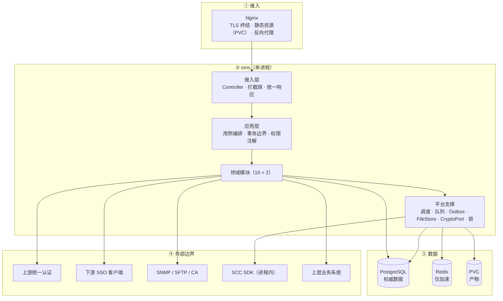

三条图注：

1. **依赖单向**：跨模块只能引用对方的 `api` 包，模块内部只能向下依赖 `web → app → domain → infra`，由 ArchUnit 在 CI 阻断。
2. **状态外置**：会话、计数、验证码、队列、锁、文件产物一律不在进程内存中持有，进程可随时被杀。
3. **单进程承载**：定时与任务都在应用进程内执行，不单独起 worker；`SchedulerPort` 与 `TaskQueue` 已把执行模型抽象，将来拆 worker 只换消费者。

### 2.2 模块与依赖禁令

| 模块 | 职责 | 归属 |
| --- | --- | --- |
| `oms-identity` | 账户、外部账号、协议确认 | DD-01 |
| `oms-authn` | 本地登录、会话、策略、验证码 | DD-02 |
| `oms-sso` | SSO Server/Client、ticket、单点登出 | DD-03 |
| `oms-authz` | 用户组、角色、资源组、两维判定、权限点 | DD-04 |
| `oms-audit` | 操作日志、运行日志、上报 | DD-05 |
| `oms-task` | 任务队列、备份、转储 | DD-06 |
| `oms-cert` | 证书、CSR、巡检 | DD-07 |
| `oms-license` | ESN、许可、计量 | DD-08 |
| `oms-alarm` | 告警台账、规则、统计 | DD-09 |
| `oms-integration` | SNMP / SFTP / CA 通道 | DD-09 |
| `oms-crypto` | `CryptoPort`、SCC 适配（叶子模块） | DD-10 |
| `oms-common` | 国际化、品牌、文件存储、系统配置（叶子模块） | DD-11 |

四条依赖禁令（评审重点）：

1. **跨模块只准走 `api`**：禁止引用他域的 `domain`/`infra`/`app`。
2. **`authz` 不依赖 `authn`**：授权只接受「已认证主体标识」，不感知本地登录还是 SSO。
3. **`alarm` 不被 `integration` 依赖，`cert` 不直连 `integration` 的 SNMP/SFTP**：通道只负责「怎么发」，「发什么、什么时候发」由业务域决定。
4. **业务模块不得直连外部客户端**（SNMP/SFTP/CA/SCC），一律经 `infra` 适配器；`crypto` 与 `common` 不依赖任何业务模块。

### 2.3 运行形态

| 维度 | 结论 |
| --- | --- |
| 部署单元 | `oms`（1 Pod）、`nginx`（1 Pod）、自建 PostgreSQL 与 Redis；`migrate` 为一次性 Job |
| 状态 | 会话、失败计数、验证码、队列、锁、产物全部外置，进程内不持有可变状态 |
| 定时与任务 | 均在应用进程内执行；队列用 `SKIP LOCKED` 抢占，定时用 ShedLock 互斥 |
| 对外暴露 | **HAProxy 装在集群宿主机上**（主备 + 浮动 IP），只做 L4 透传，后端指向本实例的 Nginx Service IP；对外端口在**安装部署时按实例指定**，因此多套实例不撞端口。TLS 仍在 Nginx 终结，HAProxy 不参与证书管理 |
| 真实客户端 IP | 由 **PROXY protocol** 传入：旧系统用 v1（HAProxy `send-proxy`），Nginx 的 `proxy_protocol` 同时兼容 v1/v2，无需改动；`set_real_ip_from 0.0.0.0/0`、不配 NetworkPolicy，**继承旧系统现状** |
| 健康检查 | 走独立的明文 HTTP 端口（如 `8080/healthz`），**不能复用**启用了 `proxy_protocol` 的 443——裸连缺少 PROXY 头会被直接断开 |
| 实例边界 | 一命名空间 = 一套 OMS 及其上层业务系统；多实例之间不共享 DB / Redis / PVC / ESN |
| 扩展 | 当前单副本交付；无状态化后可直接 HPA，**多副本不作为验收项** |

> **已知薄弱点（继承现状，待优化）**：`set_real_ip_from 0.0.0.0/0` 且不配 NetworkPolicy，任何能连到该端口的来源都可以伪造 PROXY 头。影响范围限于**基于 IP 的判断**——审计日志里的来源地址、登录失败计数、IP 限流；**不影响身份认证本身**（身份仍由 JWT 与会话决定）。触发优化的条件：客户提出更高安全等级要求，或出现跨命名空间访问、SSRF 等场景。
>
> 由此得到一条设计约束：**登录失败锁定必须以账户维度为主**，IP 维度只能作为辅助手段，不能作为唯一防线。

### 2.4 部署与流量视图

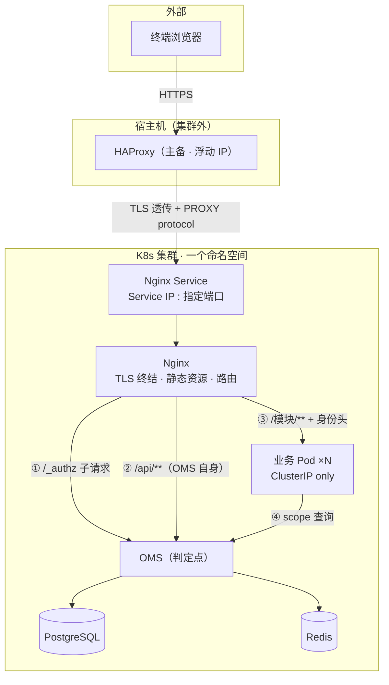

三条读图规则：

1. **只有 Nginx 对外**。HAProxy 在宿主机上，后端指向本实例的 Service IP 与部署时指定的端口；业务服务一律 ClusterIP，不对外暴露。
2. **判定流量只有两条**：`/api/**` 交给 OMS 自己的六道关；其余路径由 Nginx 的 `/_authz` 子请求判定（执行规则见 3.1.3）。
3. **业务与 OMS 之间还有第二条通道**：业务查询可见资源组集合（④）。这条通道只在集群内开放，不得暴露给外部。

### 2.5 一次请求要过六道关

| 序 | 关卡 | 判定 | 拒绝 |
| --- | --- | --- | --- |
| 1 | 认证 | JWT 签名有效；`sid` 存在且未过期、未登出、未剔除 | 401 |
| 2 | 新鲜度 | 会话未被标记 `stale`（授权变更导致） | 401 + 强制重登 |
| 3 | 改密 | 首登已改密、密码未过期 | 403，仅放行改密与登出 |
| 4 | 协议 | 首登协议版本已确认 | 403，仅放行协议确认与登出 |
| 5 | 能力 | 主体所属用户组 → 角色 → 是否含该权限点 | 403 |
| 6 | 范围 | 目标资源所属资源组 ∈ 该用户组关联的资源组集合 | 403 |

- **前置**：TLS 强制与限流在 Nginx / 过滤器层完成，不属于授权判定，不占这六道关。
- **旁路**：写操作落 outbox 供审计，与是否被拒无关——被拒的越权尝试同样留痕。
- **需求所说的「四层拦截」**是：菜单可见性、按钮可见性、接口权限、后台能力调用。前两者只用于渲染，**不是安全边界**；后两者分别由第 5、6 关与权限点注解保证。菜单能看见不等于有权调用。

### 2.6 核心设计索引

| 章节 | 机制 | 一句话 |
| --- | --- | --- |
| 3.1 | 授权与即时失效 | 两维判定（能力 × 范围），变更后受影响会话立即置 `stale` |
| 3.2 | 认证与单点登录 | 本地与上游两条入口、ticket 一次性、失败不降级 |
| 3.3 | 审计与转储 | 事务内留痕，出主表只能靠转储，日志与告警同包 |
| 3.4 | 证书与私钥 | 一个内部 CA 两张叶子，私钥不导出、只出 CSR |
| 3.5 | 加解密与凭据 | 单层主密钥存 Secret；安装期生成，轮换靠脚本 |
| 3.7 | 告警与上报通道 | 去重无时间窗、不可删；HTTP 同步受理，SNMP 全级别上报 |

> 3.6 任务与备份、3.8 许可与通用待逐一讨论后补入。

---

## 3. 核心设计

> 本章按特性逐节定稿，每节只写这个特性「最关键的设计基调」与「不做的事」，字段与接口归各 DD。当前已定稿 3.1–3.5 与 3.7；3.6 任务与备份、3.8 许可与通用待讨论后补入。

### 3.1 授权与即时失效

对应需求 FR-PERM-001～004、FR-ROLE-001～003；铁律 R-01～R-04。

#### 3.1.1 模型与三条约束

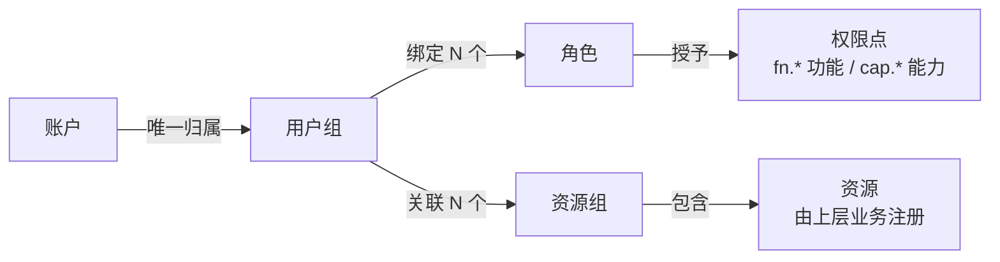

1. **账户只属于一个用户组**（唯一索引），不直接持有角色或资源组。这一条不是风格问题：它让「组级」的判定等价于「人级」的判定，三权分立才能只在一个地方阻断。
2. **组内多个角色、多个资源组取并集**。不做交集，也不设「拒绝优先」的负向授权——权限模型里没有 deny 规则，只做加法。
3. **资源组平铺无层级**，资源归属由上层业务注册、OMS 只读。层级会让范围判定退化成树遍历，平铺则是一次集合成员检查。

边界：角色全部内置、运行期只读，自定义角色只留扩展位（R-06）；权限点编码的唯一来源是附录册，DD 只可引用。

#### 3.1.2 判定：能力 × 范围

功能权限只看能力维度；业务资源必须同时满足能力与范围，缺一即拒。

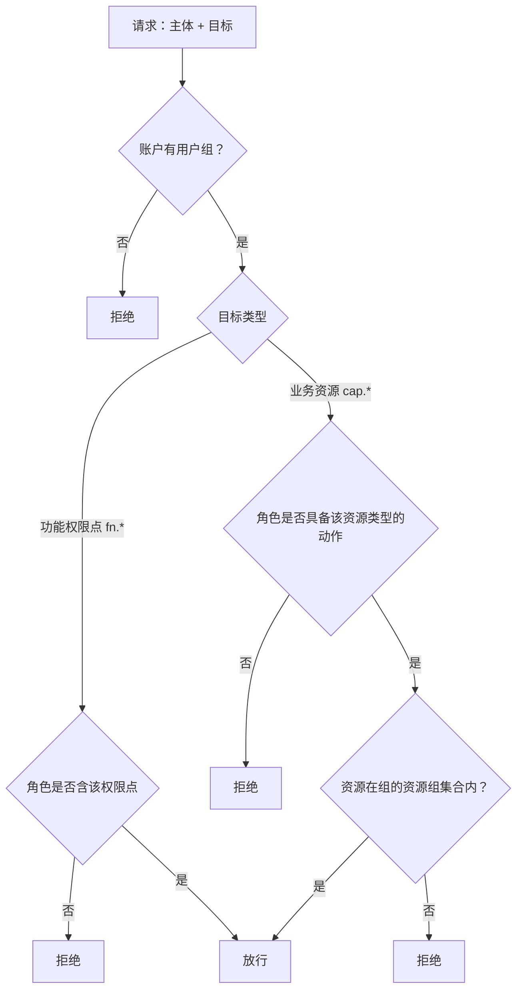

四个象限必须逐条有用例：

| 能力 | 范围 | 结果 |
| --- | --- | --- |
| 有 | 有 | 允许 |
| 有 | 无 | 拒绝：范围维度 |
| 无 | 有 | 拒绝：能力维度 |
| 无 | 无 | 拒绝：默认拒绝 |

三条性能约束，本质都是**正确性**约束：

- 权限点集合与资源组集合按 `group_id` 缓存（Redis，TTL 60s），授权变更时**主动失效**，不靠 TTL 到期。
- 单资源判定是集合成员检查，O(1)；不引入任何需要遍历的层级。
- **列表查询的范围过滤必须下推 SQL**（`WHERE resource_group_id IN (...)`）。先查全量再在内存过滤会让分页错位——第 2 页可能只剩 3 条，这是实现阶段最常见的返工点。

权限点编码：`<域>.<对象>.<动作>[.<限定>]`，`fn.*` 用于 OMS 自身功能，`cap.*` 用于业务资源能力。一个接口只声明一个权限点，禁止「任一满足即可」的隐式并集。

#### 3.1.3 判定在哪里执行

两维判定拆到两个地方：**能力维度在网关，范围维度在业务**。

一句话理由：能力只看「方法 + 路径」，不依赖具体是哪个资源；范围必须知道「这条记录属于哪个资源组」，而这个信息只有业务持有。

拓扑见 **2.4 部署与流量视图**，本节只讲执行规则。

五条落地规则：

1. **只有 Nginx 对外**。HAProxy 装在宿主机上，后端指向本实例的 Nginx Service IP 与部署时指定的端口，因此多套实例不撞端口；业务服务一律 ClusterIP——否则从集群内直达业务端口、自造 `X-OMS-Sid` 就能绕过全部判定。
2. **`auth_request` 配在 `server` 块上**，全站默认生效；只对 `/api/**`（OMS 自身，走它自己的六道关）、登录页、静态资源、健康检查显式 `off`。模块路由由 ConfigMap 片段维护，漏配的模块会**默认被拦**，而不是默认放行。
3. **注册表在 OMS，不在 Nginx**。模块注册路由时同时登记 `(method, 路径模式) → (资源类型, 动作, 权限点)`；未登记的路径一律 403。Nginx 不持有任何业务语义。
4. **业务只信任网关注入的 `X-OMS-Sid` / `X-OMS-Subject`**，不自己解 JWT、不自己查会话。
5. **业务判范围只做两件事**：调 `GET /api/authz/scope` 拿「可见资源组集合」（按 `sid` 缓存 ≤60s），然后把集合下推到 SQL。单资源操作先判范围再查详情——顺序反了，返回值的差异会泄露资源是否存在。

四条产品语义，直接约束接口形状：

| 语义 | 规则 |
| --- | --- |
| 列表遇到越权资源 | 返回可见子集，不报错、不提示存在性 |
| 批量含部分越权 | **整体拒绝**：全量判完才执行，避免半个事务 |
| 异步任务 | 创建时判一次，**执行时重判**；失权则任务失败并留痕 |
| 系统身份 | 本期无此场景；接口按 `client_id` + 系统角色预留，不借用户身份链路 |

两个边界：

- **长连接**：WebSocket / SSE 只在握手时判一次，约定**连接最长生命周期 5 分钟**，到期重连重判；更长的流式响应必须拆段。
- **机机调用**：业务之间直连必须携带 OMS 签发的短时效令牌（含 `client_id` 与可选的委托用户 `act`）。共享证书只解决「是不是圈内」，不解决「能不能调这个接口」。

容量影响：判定 QPS 从「OMS 自身 API 调用量」放大为「OMS + 全部业务 API 调用量」。因此 `/_authz` 必须走缓存、热路径不查库——一旦它开始每次查库，压力会直接转给 PostgreSQL。

#### 3.1.4 三权分立：两两互斥

系统管理员、安全管理员、审计管理员**三者两两互斥**——任意两个同时具备即拒绝绑定。

| 角色 \ 角色 | 系统管理员 | 安全管理员 | 审计管理员 |
| --- | --- | --- | --- |
| 系统管理员 | — | 禁止 | 禁止 |
| 安全管理员 | 禁止 | — | 禁止 |
| 审计管理员 | 禁止 | 禁止 | — |

**判定依据是能力，不是角色名。** 三个内置角色各持一个哨兵权限点（`SYS_ADMIN_CAP`、`SEC_ADMIN_CAP`、`AUDIT_ADMIN_CAP`），判定时把目标用户组的全部角色所能提供的权限点取并集，**只要并集里出现任意两个哨兵点就拒绝**。这样将来开放自定义角色时，规则不需要改——自定义角色只要被授予了哨兵点，同样受互斥约束。

四个阻断点，全部在写接口内校验，不依赖流程审批：

1. 给用户组绑定角色；
2. 给用户组解绑角色（解绑不会产生冲突，但同一入口复用校验，避免绕过）；
3. 创建账户、修改账户所属用户组；
4. 外部账号导入（导入时按目标用户组校验）。

三个内置用户组与内置角色的绑定关系在初始化脚本里预置并置 `builtin_locked`，绑定接口对该标记做守卫——**绕过页面直接调接口同样拒绝**。

因为「账户只属于一个用户组」，在组这一层阻断角色互斥，等价于在「人」这一层阻断，不需要再对账户做一次判定。

#### 3.1.5 基础场景：一次业务请求

会话建立之后（登录流程见 3.2），每次请求都要把「主体」换算成两个集合，再做两次判定。


基础场景里只有两件事：**权限点集合决定能力，资源组集合决定范围**；资源本身的归属从资源注册表读，OMS 侧只读。四个缓存键长这样：

| 键 | 内容 | 谁写 | 谁删 | TTL |
| --- | --- | --- | --- | --- |
| `stale:{inst}` | 已失效的 sid 集合 | 授权变更事务提交后 | 到期自动消失 | 60s |
| `sess:{sid}` | 会话快照 | 首次回源查库后写入 | 登录变更时主动删 | 会话超时 |
| `perm:{gid}` | 用户组的权限点集合 | 首次回源查库后写入 | 授权变更时主动删 | 60s |
| `rg:{gid}` | 用户组的资源组集合 | 首次回源查库后写入 | 授权变更时主动删 | 60s |

> **硬约束**：`sess:*` 与 `stale:*` **不得持久化**（关闭 RDB/AOF，或启动时按前缀清空）。否则 Redis 重启会带回旧会话缓存、却丢掉失效集合，正好绕过下面的判定顺序，让已失效的授权复活。

#### 3.1.6 扩展场景：授权变更后

扩展场景**只改基础场景的第一步**：原本不命中的失效集合会命中，请求在读取会话之前就被拒。

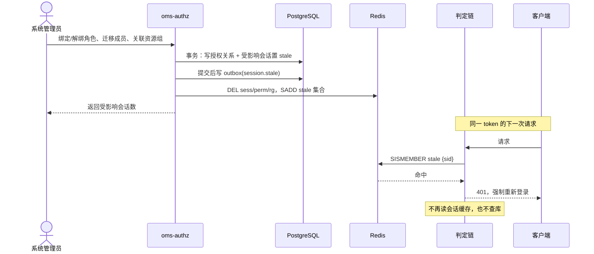

顺序必须是**「先查失效集合，再读会话缓存，最后才回源」**。这是这块唯一容易写错的地方：如果只靠「变更时删缓存」，会出现这样的竞态——请求 A 回源读到「会话有效」，此时变更事务提交并删掉缓存，A 随后把旧快照写回缓存，旧权限就此复活直到 TTL 到期。**删缓存挡不住回填，但一个只增不减的失效集合可以**：sid 进过集合，后续请求根本走不到读缓存那一步。

四个设计点：

| 问题 | 结论 | 理由 |
| --- | --- | --- |
| 受影响账户怎么界定 | 变更所涉用户组的全部成员；若是成员迁移，则迁出组的全部成员 + 迁入的那个账户 | 与 FR-PERM-001 的表述逐字对齐 |
| 置过期还是删会话 | 置 `stale` 标记，不删记录 | 删掉会让「谁在何时被强制下线」不可追溯 |
| 延迟上界 | 目标 ≤1s；若启用进程内 5s 短缓存，最坏 ≤5s | 兼顾「即时」与每次请求的判定开销 |
| Redis 不可用 | 跳过缓存与集合，每请求查库 | 宁可慢，不可放过旧权限 |

审计口径：记录变更人、变更类型、受影响账户数、受影响会话数。**被拒绝的越权尝试也要留痕**，两类记录都在 operation_log 里，按类型区分。

---

### 3.2 认证与单点登录

对应需求 FR-AUTH-001～008、FR-SSOS/SSOC-001～003；铁律 R-05。

#### 3.2.1 端到端流程（登录一次 + 每请求判定）

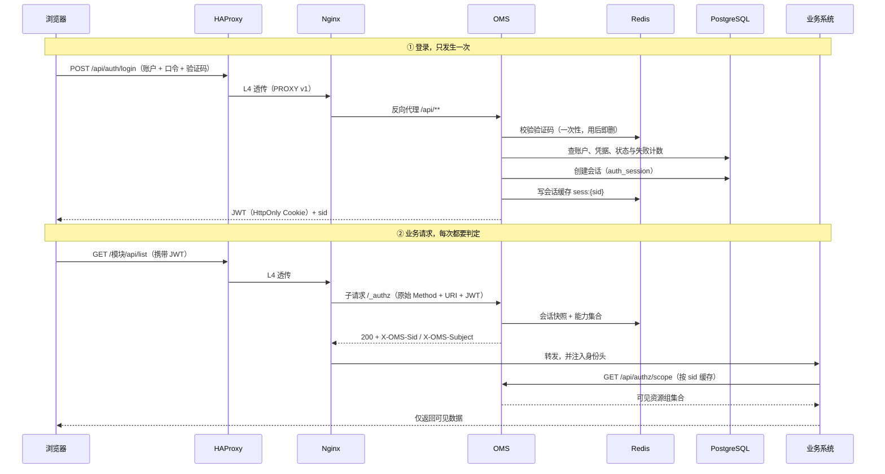

三句话读完这张图：

1. **JWT 只在阶段一签发一次**。之后每个请求都是「判定已有令牌」，不重新签发。
2. **`/_authz` 是 Nginx 的内部子请求**，浏览器看不到，返回值只有状态码与两个头。
3. **OMS 自身接口不经过 `/_authz`**，它走自己的六道关（2.5），避免同一请求被判两次。

#### 3.2.2 令牌与会话

**JWT 里只有会话标识，没有权限。** 一旦把权限快照放进令牌，授权变更就无法即时生效——这是 R-04 的直接推论。

| 字段 | 含义 | 说明 |
| --- | --- | --- |
| `sub` | 账户 ID | 不放大用户名，避免改名后歧义 |
| `sid` | 会话标识 | 所有判定的入口，权威在 `auth_session` |
| `iat` / `exp` | 签发与到期时间 | `exp` 取**最大会话时长**，不是空闲超时 |
| `jti` | 令牌唯一标识 | 用于登出与剔除时精确失效 |
| `iss` | 签发方 | 固定为 OMS 实例标识 |

- **签名**：HMAC-SHA256，密钥存 Secret，支持双密钥并存以便平滑轮换。
- **载体**：浏览器用 `HttpOnly + Secure + SameSite=Lax` 的 Cookie；机机调用用 `Authorization: Bearer`。前端 JS 读不到令牌，降低 XSS 窃取风险。
- **为什么 `exp` 取最大会话时长**：空闲超时由服务端会话判定，与令牌无关。这样续期只需要更新会话记录，不用重签令牌，也不需要 refresh token。

  代价要说清楚：**到达 `exp` 后，即使用户一直在操作，令牌也会失效、必须重新登录**。这正是「最大会话时长」的语义（FR-AUTH-003：累计时长超过上限不再续期，要求重新认证）。最大时长在会话创建时固化，策略调整只影响新会话——否则已签发的令牌与实际会话时长会对不上。

| 过期类型 | 由谁判定 | 触发条件 | 到达后 |
| --- | --- | --- | --- |
| 空闲超时 | 服务端会话 | 距最后一次活动超过阈值 | 401，重新登录 |
| 最大会话时长 | 令牌 `exp` + 服务端会话 | 从创建起累计超过上限 | 401，重新登录，**不看是否活跃** |

会话自身的状态只有五种：`ACTIVE`、`STALE`（授权变更）、`REVOKED`（剔除或登出）、`EXPIRED_IDLE`、`EXPIRED_MAX`。判定只看后四种都拒绝，区别只在给用户的提示与审计口径。

- **续期**：每次请求更新 `last_active`，按分钟级限频写库，避免每请求一次 UPDATE；达到最大会话时长后不再续期。
- **并发上限**：超限时**拒绝新登录、既有会话保留**（FR-AUTH-003），不是踢掉旧会话——后者会让「被异地登录」变成一种攻击手段。
- **禁用与删除**：账户一禁用或删除，立即终止其全部会话（FR-ACC-001）。

#### 3.2.3 登录的异常路径

| 场景 | 行为 | 依据 |
| --- | --- | --- |
| 验证码错误或过期 | 拒绝登录，计入失败次数；验证码一次性，用后即删 | FR-AUTH-005 |
| 连续认证失败 | **以账户维度为主**锁定；IP 维度只用于触发验证码升级，不单独锁定 | FR-SEC-002、2.3 |
| 首登未改密 | 403，仅放行改密与登出两个接口 | FR-AUTH-006 |
| 首登协议未确认 | 403，仅放行协议确认与登出 | FR-AUTH-008 |
| 并发会话超限 | 拒绝新登录并说明原因，既有会话不动 | FR-AUTH-003 |
| 会话被管理员剔除 | 置 `REVOKED`、清缓存；**只终止 OMS 本地会话，不触发下游 SLO** | FR-AUTH-004 |
| 账户被禁用/删除 | 立即终止该账户全部会话 | FR-ACC-001 |
| OMS 认证能力不可用 | 拒绝登录且既有会话失效，**不存在免认证通道** | R-05 |

失败计数的阈值、窗口与锁定时长归 M15 的安全策略配置，不在本节写死。这里只定维度：**账户为主、IP 为辅**，因为 `set_real_ip_from 0.0.0.0/0` 之下源 IP 可被伪造（见 2.3）。

#### 3.2.4 单点登录：CAS + 协议适配

OMS 同时扮演两个角色：对下游是 **SSO Server**，对上游是 **SSO Client**。本期上游协议选 **CAS 3.0**，但协议本身被隔离在适配层，不进入会话、账号与授权模型。

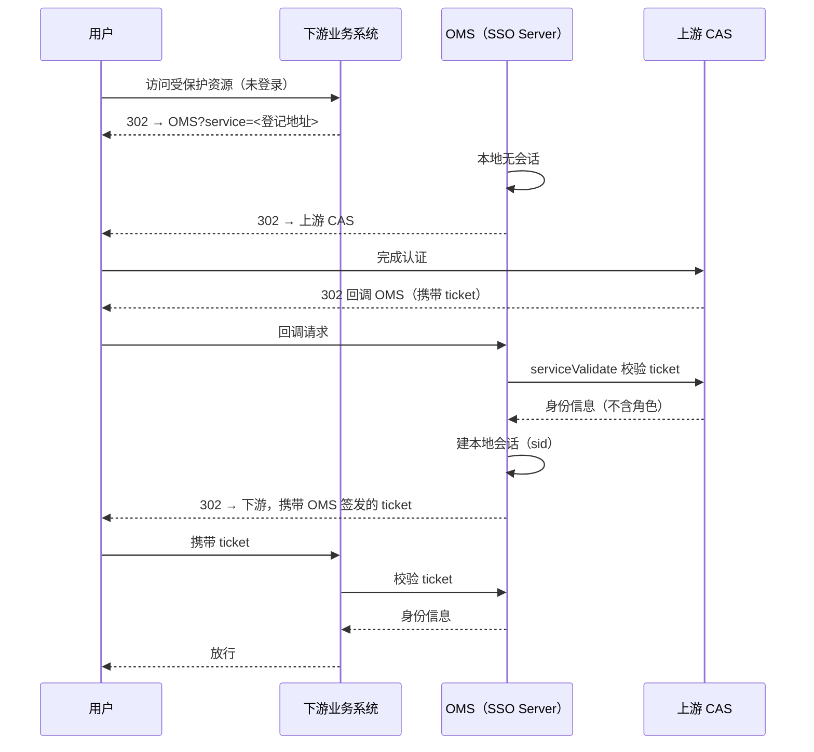

OMS 已有本地会话时，跳过「重定向上游」这一步，直接为下游签发 ticket——这是级联登录的复用规则，避免同一次会话反复向上游申请票据。

四条设计原则：

1. **协议适配层隔离**。定义 `IdentityProvider` SPI：`authorize` / `callback` / `validateTicket` / `logout`，外加一个能力声明（是否支持单点登出、是否支持令牌刷新等）。CAS 是第一个实现，将来加 OIDC / OAuth2 / SAML 只是新增实现类 + 一条配置，**不动会话、账号、权限三张模型**。
2. **会话与协议解耦**。不管走哪种协议，落地都是「建立本地会话 + 发 sid」。`sso_client` 表预留 `protocol` 字段；ticket 在模型里抽象成「一次性凭据」，与具体协议格式无关。
3. **ticket 的四个性质**：一次性、短时效（5 分钟）、服务端可撤销、**记录被哪些下游使用过**（这是 SLO 广播范围的依据）。
4. **上游只给身份，不给权限**。上游返回的任何角色信息一律不采信；外部账号的权限来源是导入时指定的用户组，运行时没有角色映射。

单点登出（SLO）的执行顺序：

1. 任一客户端或 OMS 发起登出；
2. OMS 撤销本次 ticket，并**通知所有曾用该 ticket 免密登录的下游**，而不是只通知发起方；
3. OMS 再通知上游使其 ticket 失效；
4. 不可达的下游标记为待撤销并重试，超会话期后其登录态自动失效。

对外防护三条：重定向地址必须命中该客户端登记的白名单（防开放重定向）；ticket 必须服务端校验，绝不信任前端携带的身份声明；未登记或已禁用的客户端一律拒绝，且不为其签发 ticket。

SSO 路径的失败语义与本地登录一致：上游不可达时**拒绝登录，不降级**；上游认证失败时不建立任何登录态；OMS 认证不可用时，下游拒绝放行且既有会话失效（R-05）。


### 3.3 审计与转储

对应需求 FR-OPLOG-001～004、FR-RTLOG-001～004；铁律 R-07。

#### 3.3.1 审计记录模型：只追加，不可改

| 约束 | 做法 |
| --- | --- |
| 不可篡改 | 数据库应用账号对 `operation_log` 只有 `INSERT` 与 `SELECT`，没有 `UPDATE`/`DELETE` 权限 |
| 不可删除 | 不提供任何删除接口；**转储归档是记录移出主表的唯一途径** |
| 可校验 | 每条记录写入时计算 `record_mac`（HMAC-SHA256），并记录 `mac_key_version`；密钥轮换后旧记录仍可验证 |
| 可伸缩 | 按 `occurred_at` 做月分区；查询按时间裁剪分区，删除整月只需 `DETACH` |
| 可国际化 | 存 i18n key 与参数，**渲染在查询时**按访问者当前语言完成，不存渲染后的字符串 |

记录的业务字段：操作者、来源 IP、时间、操作对象、操作类型（安全类/操作类）、结果、请求 ID。`record_mac` 只覆盖**不可变字段**。

告警的记录模型单独说一句：告警的「次数」「最近发生时间」是**聚合字段**，允许更新、不进入创建时的 MAC——重复告警可能每秒都在累加，为每次累加追加一条带 MAC 的记录既昂贵又没有审计价值。真正需要留痕的是**状态变更**：「清除」「屏蔽」这类动作追加一条 `alarm_clear_log`，单独带 MAC，记录操作者、时间、方式。这样既保住「创建事实不可改」，又能完整表达状态演进。

#### 3.3.2 留痕先于执行

审计最容易出的问题是「操作成功了，但日志没写进去」。所以写操作的顺序是固定的：

1. 业务事务内，同时写业务数据和 `outbox_event(type=AUDIT)`——两者同生共死；
2. 事务提交后由 outbox 投递器写入 `operation_log`；
3. 投递失败退避重试，超限告警；`event_id` 唯一，保证重试不产生重复记录。

这样即使进程在「提交后、写日志前」崩溃，审计意图仍在库里，恢复后会补上。**代价是日志可能延迟数秒可见**，这个延迟在审计场景可以接受；如果要求「零延迟」，就得把日志写入放进主事务，那会拖慢所有写操作。

外部来源（上层业务系统上报）走 `POST /api/audit/oplog`，凭 `client_id` + 令牌调用，OMS 校验字段、来源与限流后落库，并标记 `source=module:<id>`。外部上报与内部写入共用同一张表、同一套查询，不另设存储。

#### 3.3.3 查询与导出

- 查询按时间、操作者、类型、结果筛选，强制带时间范围（不允许全表扫）；分页用游标而非 `offset`，避免深分页。
- 导出 CSV 走**异步任务**（`task` 队列），不阻塞请求；结果文件落 PVC，有保留期。
- **公式注入防护**：单元格以 `=`、`+`、`-`、`@` 开头时加前缀 `'`，防止在 Excel 中被当作公式执行。
- **导出本身也留痕**：谁、导出了哪个时间范围、多少条。导出是把数据复制出系统，属于敏感操作。

#### 3.3.4 转储：一个包，两类数据

**一次转储产出一个 zip，操作日志与告警同时打进这个包。** 不再按类型分别出包——两条数据源共用同一次任务、同一个时间窗、同一个保留策略。

触发有三条路径，走同一个服务：

| 触发 | 默认 | 包的时间窗 |
| --- | --- | --- |
| 按月 | 每月 1 日 01:00（可配） | 上一个自然月 |
| 超量 | 每 10 分钟检查阈值（可配） | 从最旧记录起，截到两类都回落到阈值以下的那个时间点 |
| 手动 | 页面 / 接口 | 操作者指定的区间 |

包的结构：

```
/data/archive/archive-2026-09-20261001T010000Z.zip
├── manifest.json     # 时间窗、两类条数、各文件 SHA-256、schema 版本、生成时间
├── oplog.ndjson      # 每行一条，原始字段 + record_mac + mac_key_version
└── alarm.ndjson      # 同上；某类为空时也保留空文件，便于解析
```

执行顺序固定：

1. 按时间窗取 `pg_advisory_lock`，同一时刻只允许一个转储任务；`(from_ts, to_ts)` 唯一键防重复触发；
2. 两类数据分别流式写 NDJSON 并计算 SHA-256，**不整表加载**；
3. 写 `manifest.json`，打包到临时文件，`fsync` 后原子 rename 到目标路径；
4. 登记 `archive_package`（时间窗、两类条数、大小、SHA-256、状态）；
5. 按保留策略删除最旧的包（默认保留最近 **10 个包**，不按类型分别计算）；
6. 配置了 SFTP 时**整包上传**，失败退避重试、本地包保留；
7. 包落盘并登记成功后，才清理主表中该时间窗内的记录；清理失败标记部分失败，可按包内区间幂等重跑。

三个边界：

- **转储时不做逐条 MAC 校验**。百万级记录逐条验签的耗时与收益不成比例；`record_mac` 随包保留，供事后按需抽查。包的完整性由 manifest 里的**条数 + SHA-256** 保证。
- **归档包本身不可修改**，只能按保留策略整体删除最旧的包。
- **清理主表只由转储任务执行**，没有任何手工删除入口。

#### 3.3.5 运行日志与转储是两回事

运行日志（M09）是**排障材料**，不是审计证据：按时间范围与组件收集现有日志文件，打包后供下载，走任务队列，产物按保留期清理。

它与转储的区别必须在文档里说清楚，否则实现时容易合并成一套：

| | 转储包 | 运行日志包 |
| --- | --- | --- |
| 数据来源 | 数据库主表（结构化） | 容器日志文件（文本） |
| 目的 | 审计追溯、控制主表体积 | 排障 |
| 触发 | 按月 / 超量 / 手动 | 用户按需发起 |
| 保留 | 最近 10 个包 | 按配置的保留期 |
| 可删除性 | 主表记录只能经它移出 | 产物可随时删除，不影响审计 |

### 3.4 证书与私钥

对应需求 FR-CERT-001～005、FR-INSP-001；铁律 R-08。

全系统只有三张证书：一个内部 CA，和两张由它签发的叶子。**默认部署不依赖任何外部 CA，也没有自动续签**——对外证书可被用户替换，集群内证书只在部署期产生。

| 对象 | 签发者 | 有效期 | 用途 | 操作权限 |
| --- | --- | --- | --- | --- |
| 内部 CA | 自签（自己是根） | 100 年 | 只签发下面两张叶子，不参与运行时校验 | 部署流程 |
| 共享服务证书 | 内部 CA | 50 年 | 同一命名空间内，服务之间、服务与 OMS 之间的 mTLS | 部署流程 |
| Nginx 对外证书 | 内部 CA，可被外部 CA 证书替换 | 50 年（替换件不受限） | 终端 ↔ Nginx 的 HTTPS | **仅系统管理员**（可读写）；安全管理员不可读 |

#### 3.4.1 信任模型

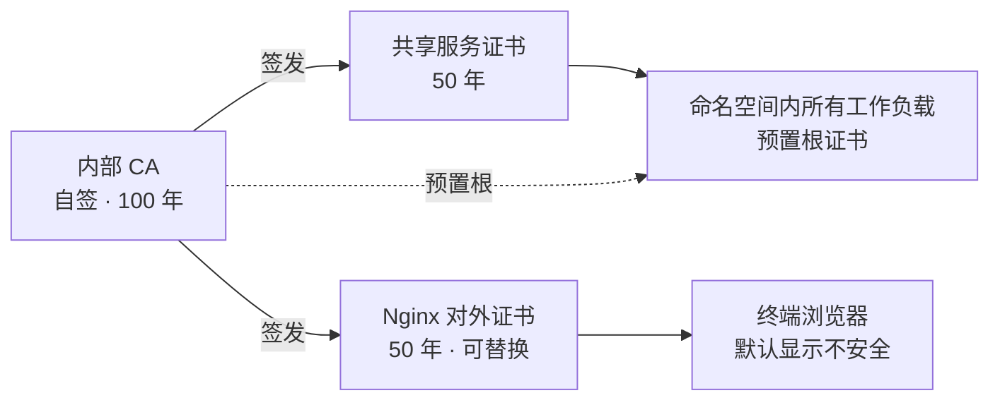

五条规则：

1. **单一信任锚**：内部服务只预置内部 CA 的根，不预置任何叶子证书；**终端浏览器默认不预置**，因此访问时显示「不安全」——这是接受的现状，不是缺陷。用户可手工导入根证书消除提示（系统提供下载），属于可选的交付动作。
2. **共享证书的 SAN 只含集群内名字**（`*.ns.svc`、`*.ns.svc.cluster.local`），**不得写入对外域名**。任何一方一旦预置了该 CA，就等于信任它签发的所有证书；而共享私钥对命名空间内所有工作负载可读，一旦 SAN 含对外域名，单个容器沦陷就能对外冒充站点。
3. **mTLS 只做准入，不做身份**。一张证书全命名空间共用，服务端只能证明「持有者在圈内」，无法区分是哪个系统在调用。调用方身份仍取 `client_id`/令牌，**授权绝不建立在证书身份上**。
4. **内部 CA 换叶子不换锚**。在内部 CA 名下替换任意一张叶子，客户端信任库一字不改，**滚动期**（新旧证书同时在线的过渡窗口）不存在「双方要互相预置对方证书」的问题——两张叶子同挂一个根，互验都能过。若对外证书被替换为外部 CA 签发的证书，客户端改为信任外部根，这属于**锚点变更**，按 3.4.2 与交付说明处理。

**CA 私钥是整个信任体系唯一的根**：只在部署期由 Job 生成与使用，存独立 Secret，**不挂载进任何业务 Pod**；OMS 数据库只保存 CA 证书（公钥），用于展示与巡检。它一旦泄露，攻击者可以同时伪造对内与对外的证书，而本系统没有 CRL/OCSP、无法吊销——只能换 CA、全命名空间滚动、所有终端重新导入。

#### 3.4.2 导入与替换（对外证书）

页面导入的证书**一律由外部 CA 签发**；内部 CA 只在部署期使用，不参与页面导入。**这条路径的存在意义就是消除浏览器的「不安全」提示**——换成公共 CA 签发的证书后，浏览器内置的根即可验证通过。根证书必须包含在上传内容里，接受三种组合：

| 组合 | 证书栏 | CA 证书栏 |
| --- | --- | --- |
| ① | 叶子 + 中间证书 | 根证书 |
| ② | 叶子 | 中间证书 + 根证书 |
| ③ | 自签证书（叶即根） | 同一份文件 |

系统按固定顺序处理：

1. 解析两栏的全部 PEM，按 SHA-256 指纹**去重**（用户很可能把 fullchain 同时塞进两栏）；
2. 按公钥匹配确定叶子，再按 Subject/Issuer **自下而上重排**，不信任上传顺序；
3. 校验能**唯一**定位一条「叶 → 中间 → 根」路径：零条拒绝（断链），多条拒绝（要求裁剪）；
4. 逐级验签，并校验根自签、有效期、SAN；域名不匹配时**提示风险并由操作者确认**后才允许继续（FR-CERT-002）；
5. 私钥按需提供（见下表），校验私钥与叶子公钥配对；
6. 生成只含「叶 + 中间」的 fullchain 交给 Nginx，**根剥掉**（叶即根时不剥）；
7. 根证书单独存为该证书的元数据；签发者不是公共可信 CA 时，页面提供「下载根证书」，供终端手工导入。

| 导入场景 | 私钥 | 私钥口令 |
| --- | --- | --- |
| CSR 签回 | 可空（公钥已匹配库中私钥） | 可空 |
| 手工上传，明文 key | 必填 | 可空 |
| 手工上传，加密 key | 必填 | 必填，仅用于本次解密 |
| 库中已有匹配私钥 | 可空 | 可空 |

> 注意区分**两个「私钥密码」**：**上传件的口令**只用于解开用户提供的那份加密 PEM，用完即弃；**存储口令（KEK）**由系统生成与保管，用于加密数据库中的私钥。两者互不影响——用户下次换证不需要记得上次的口令，KEK 丢失也无法靠原口令恢复。

三条红线：

- **上传的根不得进入 OMS 自身信任库**。导入是业务写操作；若它能改变系统的信任边界，具备该权限的人就能伪造上游身份。
- **私钥永不导出**：无页面下载、无 API 返回、无脚本入口，系统只输出 CSR。
- **不依赖客户端补链**：中间证书必须由 OMS 发全，不能赌浏览器去 CA 官网抓。

替换与回滚：替换前自动备份原证书与原私钥，失败自动回滚（FR-CERT-002）。CA 续约失败时保持当前证书可用、产生告警并标记待处理，**不回退为自签**（FR-3RD-003）。

替换件若由外部 CA 签发，**经 Nginx 调用 OMS 的内部方**必须能验证该 CA：推荐信任库 = JDK 默认公共根 + 内部 CA，一次配好两种证书都能过；直连应用侧共享证书的调用方不受影响。

#### 3.4.3 部署视图与生效

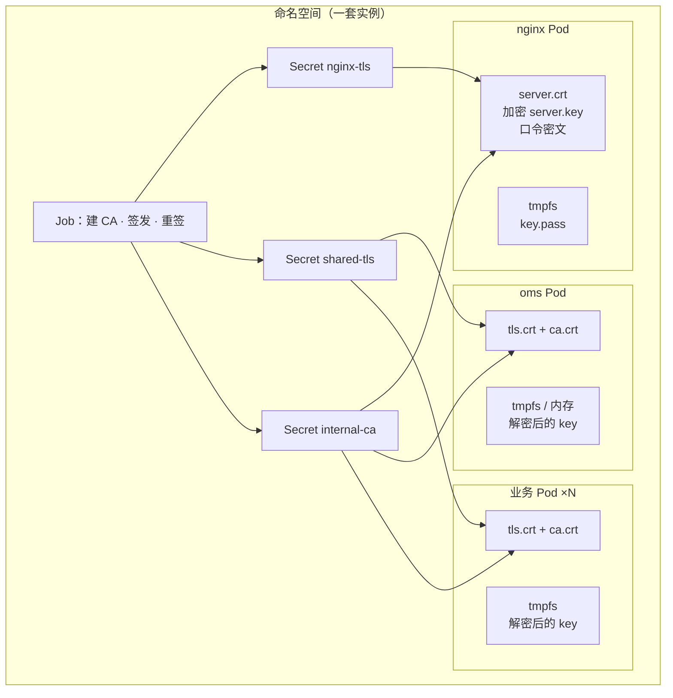

| Pod | 卷 | 内容 | 写入者 |
| --- | --- | --- | --- |
| nginx | Secret `nginx-tls` | `server.crt`（叶 + 中间，无根）、`server.key`（AES-256 加密 PEM）、`server.key.pass.enc`（口令密文） | 部署流程 / 系统管理员导入 |
| nginx | Secret `internal-ca` | `ca.crt`（内部 CA 公钥，用于校验客户端证书） | 部署流程 |
| nginx | `emptyDir{medium: Memory}` | `key.pass`（明文口令，仅 reload 期间存在） | wrapper |
| oms | Secret `shared-tls` | `tls.crt`（叶 + 中间）、`tls.key`（加密 PEM）、`tls.key.pass.enc`、`ca.crt` | 部署流程 |
| oms | `emptyDir{medium: Memory}` | 解密后的 `tls.key`（仅当运行时要求文件路径） | 应用进程自身 |
| 业务 Pod ×N | Secret `shared-tls`（与 oms 同一个） | 同上 | 部署流程 |

- **明文只在内存中短暂存在**：口令与私钥解密后的形态只出现在 `emptyDir{medium: Memory}`，用完即删。完整的明文生命周期（tmpfs、毫秒级窗口、失败不降级）统一在 **3.5 加解密与凭据** 中定义，本节只描述挂载。
- **换证路径**：Nginx 证书 → 只更新 `nginx-tls`，卷同步（≤60s）后 wrapper reload，平滑生效；共享服务证书 → 更新 `shared-tls` 后 `rollout restart` 全部业务 Pod 与 oms Pod。
- **OMS 唯一的 K8s 写权限**：只能写本命名空间的 `nginx-tls` 这一个 Secret（Role 按资源名限定），其余 Secret 由部署流程维护。
- **私钥由各语言 SDK 在进程内解密**：SCC 提供 Java / Go / Python 原生 SDK，业务系统按 SDK 集成即可，不需要中转容器或额外 initContainer。Java 与 Go 可直接内存加载、不落盘；Python 的 `ssl` 要求文件路径，需解密到 `emptyDir{medium: Memory}` 后再加载。未覆盖的语言才退回 initContainer + SCC CLI 兜底。
- **接入契约**：业务系统必须集成与 OMS 同版本的 SCC SDK（写进 OMS-INT-001），否则无法解开共享私钥。

#### 3.4.4 预警、巡检与残余风险

| 对象 | 预警策略 |
| --- | --- |
| Nginx 证书 | 按**当前生效证书的 `notAfter`** 计算，剩余 ≤ 30–90 天（可配）告警；替换件有效期任意，规则不变 |
| 共享服务证书 | 不预警，标记「长期有效」 |
| 内部 CA | 不预警，仅展示 |

- 巡检对象：两张叶子 + 内部 CA。证书管理页只展示 Nginx 证书（固定一条），共享服务证书在巡检结果中体现。
- **接受的残余风险**：无 CRL/OCSP，泄露只能换 CA + 全命名空间滚动 + 终端重新导入；50 年有效期长于算法寿命，真实更换动因是安全事件与算法升级，不是到期；共享私钥对命名空间内所有工作负载可读。
- **备份要求**：私钥密文与 KEK 分离存放，KEK 不随数据库备份一起归档；两者同时丢失即私钥不可恢复，只能重新生成密钥对并重签。
- mTLS 的终止点（Nginx 校验客户端证书，还是应用层校验）与启用范围归 DD-07，本节只约定信任模型与证书来源。
- **权限口径**：证书管理仅系统管理员可见可写，**安全管理员不可读**。此结论与 OI-M13-002「安全管理员只读」的旧口径冲突，以本结论为准，需回写 SRS。

---

### 3.7 告警与上报通道

对应需求 FR-ALM-001～006、FR-3RD-001。

**定位**：OMS 自建告警台账，既是全系统异常的汇聚点，也是对外通报点。告警源有六类：证书、许可、备份、日志上报失败、第三方接入、平台（可选）。**本期不引入 Prometheus / Alertmanager**——客户现场没有该体系，OMS 自身也只需要「事件 → 台账 → Trap」这一条链路。

#### 3.7.1 接收与去重

上报走 **HTTP 同步受理**：OMS 在请求内完成鉴权、校验、去重、屏蔽匹配与入库，返回受理结果；SNMP 投递异步进行。当前规模不需要引入 MQ。

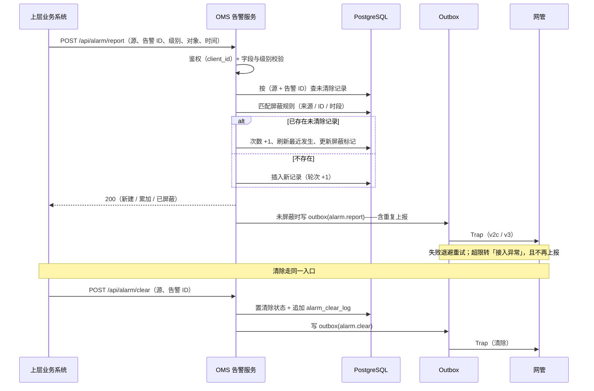

五条规则：

1. **去重键是（告警源 + 告警 ID）**。重复上报只累加次数、刷新最近发生时间，**不设时间窗**——告警的语义是「同一件事还在」，不是「又发生了一次」。
2. **受理结果回给上报方**：新建 / 累加 / 已屏蔽。上报方据此决定是否重试。
3. **接口天然幂等**：上报方超时重试不会产生重复记录。并发上报靠 `(source, alarm_id) WHERE cleared_at IS NULL` 的**部分唯一索引**兜底——两个请求同时判定「不存在」时只有一个能插入，另一个转为累加。
4. **清除后再次发生，算新告警**（轮次 +1），不复用已清除的记录——否则历史的清除时间会被覆盖，审计链断裂。
5. **去重只作用于台账，不作用于上报**。台账把重复合并成「次数 +1」，但**每一次上报都要产生一次对外通知**，包括重复的告警。处理不处理重复是对端的事，OMS 不能替对端做决定。

#### 3.7.2 屏蔽与统计

- 屏蔽规则可按来源、告警 ID、日期与时段配置；多条命中时按**最先生效**。
- **命中屏蔽的告警仍然入库并打标记**，但**既不上报、也不纳入统计**。入库是为了让「屏蔽了多少」可查、规则配错时能回溯；不上报是因为屏蔽是运维显式的抑制意图——它与去重的性质完全不同：**去重只合并台账、不停上报；屏蔽明确停上报**。
- 规则可增删改，告警记录不可删——两者在数据模型上分开，权限也分开。
- 统计按告警名称聚合（次数、最近发生、级别分布），支持时间范围与 Top N；被屏蔽的记录不参与。

#### 3.7.3 清除与不可删

- 清除是**业务动作**，不是删除：置清除状态，记录清除方式（源侧上报 / 人工）、时间与操作者，并追加 `alarm_clear_log` 带 MAC。
- 清除同样幂等：重复清除不报错、不重复写日志。
- **没有任何删除接口**。记录移出主表只能靠转储（3.3.4），且转储是整包归档，不改变单条语义。
- 人工清除属于敏感操作，写操作日志。

#### 3.7.4 SNMP 上报

- **触发条件**：已配置 SNMP 通道，且该告警未被屏蔽——**全部级别都上报**，不按级别过滤。
- **重复告警逐次上报**：同一条告警重复 N 次，就产生 N 个 Trap；OMS 只做可靠投递与重试，**不做合并、不做速率抑制**。Trap 里携带「累计次数、首次发生时间、最近发生时间」，让对端自己决定怎么处理。代价是高频抖动的告警会在 outbox 产生大量事件，需要监控队列深度——这是用「保真」换来的成本，不能靠限速把它抹掉。
- **只发 Trap，不用 Inform**：不依赖对端回执判定送达，失败交给 outbox 退避重试。
- 通道可配多条，v2c 与 v3 均支持；**引擎 ID 创建时生成、之后不可修改**——改了等于更换设备身份，网管侧历史会断。
- 清除同样上报，使网管侧同步收敛。
- **反身保护**：通道持续失败产生的「接入异常」告警**不再上报 SNMP**，否则会形成「失败 → 告警 → 再失败」的循环。这类告警只进台账。

#### 3.7.5 为什么不用 Prometheus + Alertmanager

两者的输入模型不同：M17 收的是**事件**（对方主动上报），Prometheus 收的是**指标**（自己定时抓取）。把事件告警塞进指标模型，会得到三个后果：

- Alertmanager 的告警是「当前状态」，resolve 后记录消失——与「发生过就必须留痕」直接冲突；
- 没有屏蔽规则、清除语义与台账查询，这三样恰好是 M17 的核心；
- 多维护一套 TSDB 与一套配置，收益只是通知路由。

所以本期纯自建。将来若需要指标监控，OMS 开放 `/actuator/prometheus` 供抓取即可，**不需要改动本节任何设计**；若客户已有 Alertmanager，可作为可选的告警源接入（webhook → `platform` 源），但反向绝不依赖。

### 3.5 加解密与凭据

对应需求 FR-CRYP-001～002；铁律 R-08。

> **信任边界**：集群 root 及以上不在防御范围内。加解密要防的是**没有集群权限的攻击者**——拖库、备份泄露、存储介质泄露。据此明确接受一条风险：**每个业务 Pod 都挂载主密钥**，因此任一容器沦陷即可解开全部密文；该风险在安全评审中登记，不回避。

#### 3.5.1 密钥模型：单层

全系统只有一把**主密钥**（KEK），没有 DEK 层。

| 项 | 结论 | 理由 |
| --- | --- | --- |
| 层数 | 单层，业务数据直接用主密钥加密 | 真正需要加密的数据只有几十条，轮换时重加密的成本可以忽略；两层只在接 HSM 时才有收益 |
| 生成 | 安装部署阶段由 **SCC 生成**，运行期不再调用 init | 与部署流程一致，避免每次重启产生新密钥 |
| 存放 | 独立 Secret，明文（base64），靠 RBAC 与 etcd 静态加密保护 | 主密钥是随机串，不含用户信息；它不是「敏感数据」 |
| 与数据库口令密文的关系 | **分两个 Secret** | 理由是轮换节奏与责任方不同，**不是安全隔离**——两者对应用进程都可读 |

主密钥不进日志、不进镜像、不进代码仓库。它的指纹（SHA-256 前 8 位）可以打印，用来核对「各实例用的是不是同一把」。

#### 3.5.2 初始化：只在安装部署时发生一次

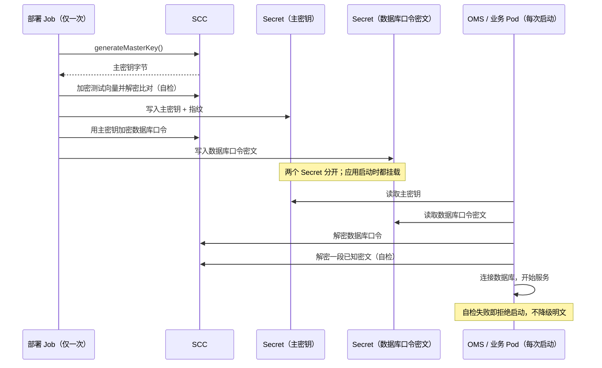

初始化只在部署期做，重启 Pod 时**不重新生成密钥**。如果主密钥 Secret 丢失而数据库里还有密文，系统必须**拒绝启动**，而不是生成新密钥——否则历史数据会永久不可解。

#### 3.5.3 运行时：谁在用、用在哪

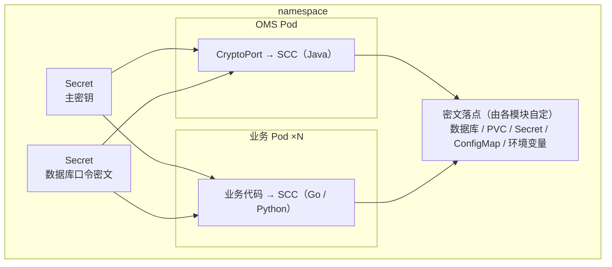

**本文只约束「必须经 `CryptoPort` 加密、不得明文」，不规定密文存在哪里。** 数据库、PVC、Secret、ConfigMap、环境变量都可以，由各模块按自己的数据形态决定；约束只有一条：落入任何持久化介质之前必须先加密。

| 加密对象 | 谁写入 | 典型落点 |
| --- | --- | --- |
| 数据库连接口令 | 部署 Job | Secret（与主密钥分开） |
| SFTP 连接口令 | 系统管理员 | 数据库 |
| SNMP v3 认证口令 / 加密口令 | 系统管理员 | 数据库 |
| CA 接入的私钥与口令 | 系统管理员 | 数据库 |
| 证书私钥（含 Nginx 私钥） | 部署 / 导入 / CSR | 数据库、Secret |
| 下游 SSO 客户端密钥 | 系统管理员 | 数据库 |
| 上层业务上报用的 client 密钥 | 模块注册 | 数据库、ConfigMap |

> 上表只是**典型**落点，不是白名单。新增凭据时只要遵守「先加密再落盘」，放在哪里由模块自己决定。

不在加密范围内、但同样不能明文落盘的：**账户口令摘要**（用 PBKDF2 单向哈希，不可逆）、**访问令牌签名密钥**（独立生成，存 Secret，不参与主密钥体系）。

#### 3.5.4 轮换：手动脚本，不自动

主密钥轮换会重新加密全部密文，因此必须是计划内动作：

1. 进入维护模式或停写；
2. 用当前主密钥解密**全部**密文（数据库中的凭据 + 数据库口令 Secret）；
3. 调用 SCC 生成新主密钥；
4. 用新主密钥重新加密并写回；
5. 更新两个 Secret，重启全部 Pod；
6. 抽样验证后，旧 Secret 才可删除。

因为加密对象只有几十条，整个过程在秒级完成，但**停机窗口仍然存在**，脚本必须写成可重复执行、失败可回滚——旧主密钥 Secret 在验证通过前不得删除。

**备份约束**：主密钥 Secret 不得与数据库备份放在一起。否则备份包泄露 = 全部数据可解，加密等于白做。

#### 3.5.5 明文窗口与失败语义

明文只允许出现在三处：

| 位置 | 生命周期 | 约束 |
| --- | --- | --- |
| 请求处理的内存 | 单次请求 | 用完立即清空临时变量；不进日志、不进异常栈、不进 dump |
| `emptyDir{medium: Memory}` | Nginx 启动与 reload 期间 | 毫秒级；用完即删，不落节点磁盘 |
| 业务进程内存 | 解密后到使用完 | 同上，不做长期缓存 |

任何一步解密失败（主密钥缺失、SCC 不可用、密文损坏），依赖该数据的操作**一律明确失败**，不降级为明文、不回退到未加密路径。

#### 3.5.6 国密与扩展位

本期使用国际算法（AES-256-GCM、PBKDF2-HMAC-SHA256、HMAC-SHA256、RSA + SHA-256）。国密**本期不实施**，但保留三处扩展位：

- `CryptoPort` 的算法枚举预留 SM2 / SM3 / SM4；
- SCC 当前不提供 SM2，将来由 `CryptoPort` 的另一实现承载，业务代码不改；
- Nginx 的国密版镜像替换点已预留（证书与套件层面，见 3.4）。

## 变更记录

| 版本 | 日期 | 说明 |
| --- | --- | --- |
| V0.1 | 2026-10-20 | 评审精简版起步：第 0 章（定位、数字、五条取舍、阅读路线）、第 1 章（12 条铁律） |
| V0.2 | 2026-10-20 | 按评审意见修订：转储口径改为「操作日志与告警同包、单 zip」；私钥「不可导出」明确为边界定义 |
| V0.3 | 2026-10-20 | 确认私钥为接口层承诺；确认 FR-CERT-003 的「微服务」为上层业务系统，新增附 A 记录待折入正文的结论 |
| V0.4 | 2026-10-20 | 定稿方案 A：上层业务与 OMS 同 namespace、共享一张自签名证书；服务间证书与上层接入证书合并为同一概念，实例边界改为「一套 OMS + 其上层业务」 |
| V0.5 | 2026-10-20 | 确认 Nginx 对外证书独立自签；确认 CA 100 年 / 共享服务证书 50 年、不自动续签；登记由此产生的巡检与吊销缺口 |
| V0.6 | 2026-10-20 | 修正：Nginx 证书同样由内部 CA 签发、同样 50 年，可被导入替换；确认预警按当前证书 notAfter 计算，故 Nginx 证书保留 30–90 天预警 |
| V0.7 | 2026-10-20 | 补充：导入时「CA 证书」为中间证书链、必填并校验链自洽；区分「服务端要发的中间证书」与「客户端信任库里的根」 |
| V0.8 | 2026-10-20 | 定稿导入规则：CA 栏必须含根证书，接受三种上传组合；系统重排去重、校验签名闭环、发送时剥根；根不进 OMS 信任库 |
| V0.9 | 2026-10-20 | 修正 CSR 定位：CSR 为外部 CA 签发路径，内部 CA 只用于部署期默认证书与共享证书，不参与页面导入 |
| V0.10 | 2026-10-20 | 确认私钥口令为系统内部行为；导入时私钥与口令按「公钥是否已在库中匹配」按需提供，区分上传件解密口令与存储口令 |
| V0.11 | 2026-10-20 | 新增 3.4 证书与私钥（信任模型、导入替换、装载生效、预警与残余风险）；证书结论全部折入正文，删除临时决策清单 |
| V0.12 | 2026-10-20 | 补充 3.4.3 部署视图（各 Pod 挂载的 Secret 与临时卷）；修正权限口径为「安全管理员不可读」 |
| V0.13 | 2026-10-20 | 确认 SCC 提供 Java/Go/Python SDK，删除中转容器方案；改为进程内解密，Python 需 tmpfs 文件路径 |
| V0.14 | 2026-10-20 | 明文临时存放的完整逻辑移交 3.5 加解密章节，3.4 只保留挂载与指向 |
| V0.15 | 2026-10-20 | 新增第 2 章架构：逻辑架构图、模块与四条依赖禁令、运行形态、六道关、六机制索引 |
| V0.16 | 2026-10-20 | 新增 3.1 授权与即时失效：两维判定、三权分立改为三者两两互斥、变更即时生效 |
| V0.17 | 2026-10-20 | 3.1.4 补入 Redis 的三类键与固定判定顺序，明确 Redis 只加速拒绝、不作权威 |
| V0.18 | 2026-10-20 | 补一条硬约束：会话缓存与失效集合不得持久化，避免重启后旧会话复活 |
| V0.19 | 2026-10-20 | 3.1 拆为基础场景（一次请求的判定链路，含四个缓存键）与扩展场景（授权变更后失效） |
| V0.20 | 2026-10-20 | 确认 HAProxy 仅 L4 透传、TLS 仍在 Nginx 终结；2.3 补对外暴露与 PROXY protocol 约束 |
| V0.21 | 2026-10-20 | 新增 3.1.3 判定在哪里执行：网关判能力、业务判范围，含流量图、注册表与四条语义；原 3.1.3–3.1.5 顺延 |
| V0.22 | 2026-10-20 | 明确 HAProxy 部署在宿主机、后端指向本实例 Service IP，端口按实例在部署时指定；R-10 判定线随之调整 |
| V0.23 | 2026-10-20 | 确认 PROXY protocol 为 v1（send-proxy），Nginx 兼容 v1/v2；补充健康检查端口必须与 443 分离 |
| V0.24 | 2026-10-20 | 修正 `set_real_ip_from` 口径：覆盖宿主机网段（含备机），而非浮动 IP |
| V0.25 | 2026-10-20 | 按现状继承：`set_real_ip_from 0.0.0.0/0`、不配 NetworkPolicy；登记为已知薄弱点并给出优化触发条件 |
| V0.26 | 2026-10-20 | 流量视图移入第 2 章（2.4）；新增 3.2.1 端到端时序；补齐 CA 私钥保护、两个私钥密码、外部 CA 信任三项结论 |
| V0.27 | 2026-10-20 | 补充域名不匹配的人工确认、KEK 与备份分离要求 |
| V0.28 | 2026-10-20 | 补完 3.2：令牌与会话、登录异常路径、CAS 单点登录与协议适配层 |
| V0.29 | 2026-10-20 | 明确两种过期语义：空闲超时由服务端判定，最大会话时长由令牌 exp 硬性截断 |
| V0.30 | 2026-10-20 | 新增 3.3 审计与转储：只追加模型、留痕先于执行、查询与导出、单包双数据源转储、运行日志边界 |
| V0.31 | 2026-10-20 | 明确告警聚合字段不做 MAC、仅状态变更追加留痕 |
| V0.32 | 2026-10-20 | 新增第 4 章功能框架：11 份 DD 的生态位、主线、关键取向与边界；后续章节顺延至 5–8 |
| V0.33 | 2026-10-20 | 撤销第 4 章（与第 3 章重复）；章名改为「核心设计」 |
| V0.34 | 2026-10-20 | 回滚未经讨论的 3.5–3.8，改为逐节讨论后再写；当前定稿 3.1–3.4 |
| V0.35 | 2026-10-20 | 按讨论结果写入 3.7 告警与上报通道：纯自建、HTTP 同步受理、全级别 SNMP、不用 P+A |
| V0.36 | 2026-10-20 | 确认清除后再次发生算新告警；补并发上报的部分唯一索引兜底 |
| V0.37 | 2026-10-20 | 明确去重只作用于台账、不作用于上报：重复告警逐次发 Trap，不合并、不限速 |
| V0.38 | 2026-10-20 | 补充逐次上报的队列压力说明；修正小节内规则条数 |
| V0.39 | 2026-10-20 | 明确屏蔽的语义：既不纳入统计也不上报，与去重区分 |
| V0.40 | 2026-10-20 | 按讨论结果写入 3.5 加解密：单层主密钥、安装期生成、两个 Secret、手动轮换脚本、国密预留 |
| V0.41 | 2026-10-20 | 修正 3.5.3：数据库口令密文同样挂载业务 Pod；密文落点不写死为数据库 |
