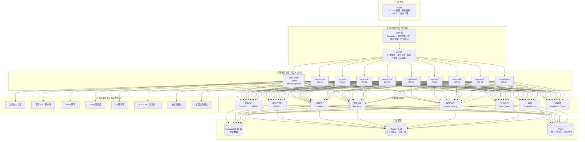
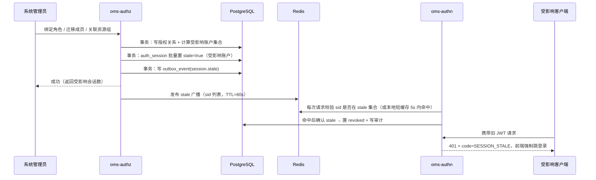
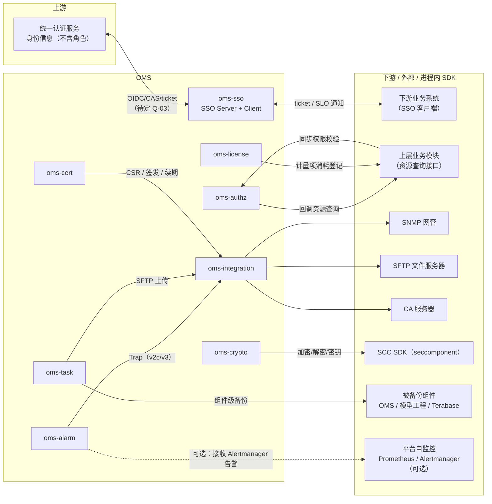
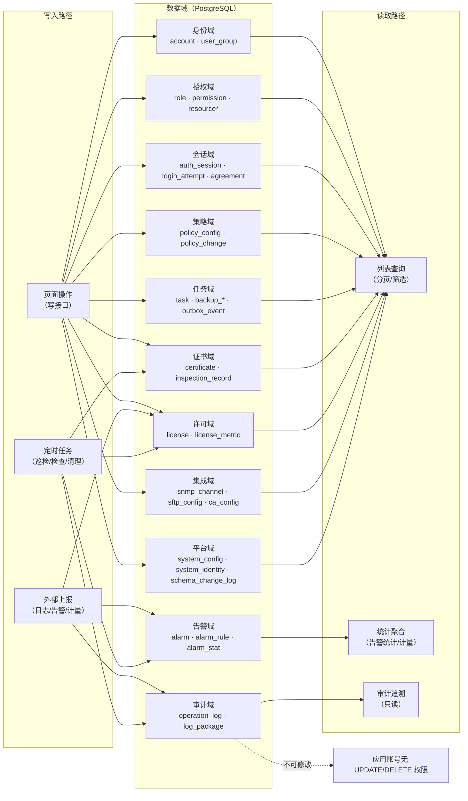
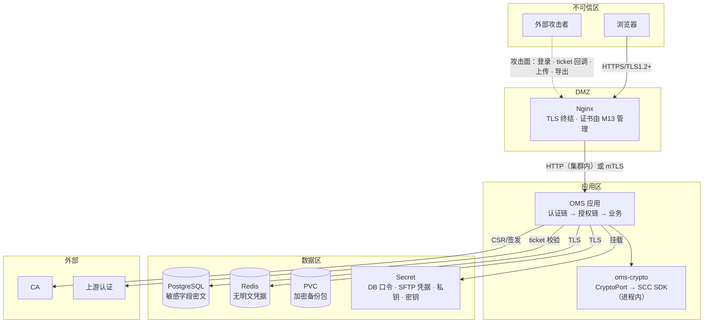
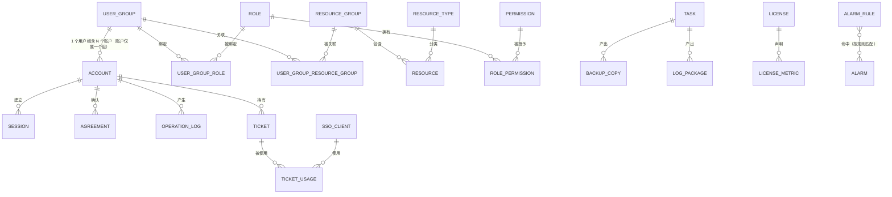
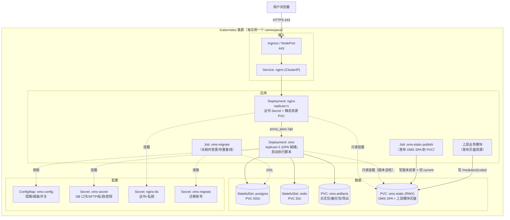
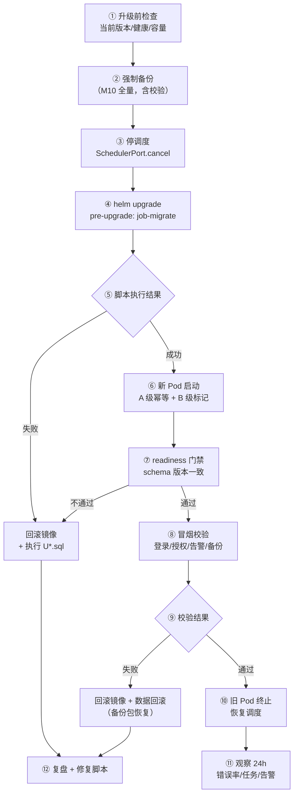

# OMS 总体设计文档

| 项目 | 内容 |
| --- | --- |
| 系统/产品名称 | OMS（统一运维管理底座服务） |
| 文档名称 | OMS 总体设计文档 |
| 文档编号 | OMS-HLD-001 |
| 版本号 | V0.45（初稿，待评审） |
| 编写日期 | 2026-10-19 |
| 上游依据 | `docs/requirements/OMS-需求规格说明书.md` V0.1 及 18 个模块分册（77 条 FR） |
| 交互依据 | `design/prototypes/login.html`、`design/prototypes/app-shell.html`（101 张状态截图） |
| 结构依据 | `design/OMS-设计文档大纲.md` V0.49 |
| 下游文档 | OMS-DD-01 … DD-11（详细设计）、OMS-DEP-001（部署方案） |

> **本文状态**：初稿。第 3、5、7、8、9、10、11、12 章的结论已可直接进入详细设计；带 `[待定]` 与 `ODI-xxx` 标记的条目须在评审中闭环（见 14.3）。
>
> **阅读指引**：只想了解架构 → 第 3 章；要动接口/建表 → 第 7、8 章与对应 DD；要评估风险 → 第 12 章与 14.1；要确认需求覆盖 → 第 13 章。


---

## 目录

| 章 | 标题 | 内容要点 |
| --- | --- | --- |
| 0 | 文档说明 | 目的与读者、文档族、编号规则、术语、追溯方式 |
| 1 | 设计概述 | 9 项设计目标、**17 条硬约束**、设计原则、范围、ADR 索引 |
| 2 | 需求到设计的映射 | 模块—组件映射、NFR 覆盖、原型映射、边界澄清、**输入基线偏差** |
| 3 | 总体架构 | 逻辑/运行时/集成/数据/安全架构、无状态化、四层拦截、授权即时生效、事件与任务 |
| 4 | 技术栈与版本 | 锁定版本表、4 项兼容风险、Spike 清单、**密码与证书组件**、**调度（ADR-001）**、**数据库变更（ADR-011）** |
| 5 | 领域与数据模型 | 44 张表的域对象、ER 总览、三权分立与两维授权算法、7 个状态机、**枚举唯一来源**、保留期与**转储** |
| 6 | 特性索引 | DD 清单与统一骨架、7 条跨特性链路、**20 项定时任务**、依赖矩阵、前端信息架构 |
| 7 | 接口约定 | 命名空间、版本策略、统一响应、**错误码分段**、认证约定、**70 个接口登记**、上下层契约、**上层接入指南（OMS-INT-001）** |
| 8 | 数据约定 | **表属主索引**、命名与类型、引用完整性、**PG 15 能力约定**、枚举来源、初始化脚本 |
| 9 | 非功能设计 | 性能与容量模型、可用性、可观测性、国际化、无障碍、迁移期约束 |
| 10 | 部署与运维 | K8s 拓扑、多副本就绪、**同集群多实例（命名空间隔离）**、Helm 清单、**配置分层**、初始化、证书传导（ADR-006）、容量 |
| 11 | 升级与迁移 | 11.A 升级流程与回滚；11.B 存量迁移映射、割接、校验、风险 |
| 12 | 安全专项 | STRIDE、认证/会话、授权、密码学与凭据、传输与证书、审计、文件与集成、基线、容器 |
| 13 | 追踪矩阵 | **77 条 FR → DD / HLD**、DD 交叉引用、NFR 验证、ODI 对应 |
| 14 | 决策与待决 | **17 条 ADR**、11 项待确认输入、**30 条 ODI** |
| 15 | 附录 | 权限点清单、菜单路由表、枚举速查、图索引、配置项、术语、编写计划 |

---

## 0. 文档说明

### 0.1 文档目的与读者

本文回答「**怎么做**」：把 SRS 的 77 条功能需求与 7 类非功能需求落成可实现的架构、模块边界、技术栈、领域与数据模型、接口与数据约定、非功能指标、部署形态、升级迁移与安全方案。

| 读者 | 主要关注章节 | 期望用法 |
| --- | --- | --- |
| 开发（后端 / 前端） | 3、4、5、6、7、8、9 | 拿到模块边界、接口与表约定后按 DD 落地 |
| 测试 | 2、5.4、6.3、6.4、9、13 | 从跨特性链路与状态机派生集成用例 |
| 部署 / 运维 | 10、11、12.8、12.9 | 按第 10 章出 K8s 清单，按 11 章做升级与迁移 |
| 产品 | 1、2、5、13、14 | 确认设计口径与遗留问题闭环计划 |
| 安全 / 合规 | 5.3、12、8.5 | 核对三权分立、密钥、审计与脱敏口径 |

**与 SRS 的边界**：SRS 答「做什么、谁来做、受什么约束」，本文答「用什么结构、什么机制、什么数据与接口做到」。**报文级字段、表字段与索引、错误码具体取值归各 DD**，本文只定约定与登记索引（见 0.2）。

### 0.2 设计文档族与交付物

**已确认**：总体设计 1 份 + 详细设计 11 份 + 部署方案 1 份 + **上层业务接入指南 1 份**；**接口设计与数据库设计不单独成册**，随特性分散到各 DD。

| 文档 | 编号 | 承载内容 | 状态 |
| --- | --- | --- | --- |
| OMS 总体设计文档 | OMS-HLD-001 | 架构、领域模型总览、技术栈、非功能、部署概要、升级兼容与迁移总纲、**跨特性机制**、接口/数据约定与登记索引、ADR、需求追踪 | 本文 |
| OMS 详细设计文档 | OMS-DD-01 … DD-11 | 各关键特性：领域模型与**数据设计**、**接口设计**、关键流程、权限点、配置项、测试要点 | 待编写 |
| OMS 部署方案 | OMS-DEP-001 | K8s 资源清单、Helm、配置项清单、容量规划与升级操作手册 | 待编写 |
| **OMS 上层业务接入指南** | **OMS-INT-001** | 面向上层应用研发/交付/运维：认证、授权、前端菜单与**静态资源发布**、日志/告警上报、License 计量、加解密、**备份接入**、**证书打通**、联调验收、**旧系统切换**；只写「接入方要做什么、怎么验证」 | 待编写 |
| OMS 测试方案与用例 | OMS-TST-001 | 由测试侧维护，本文只做引用与追踪登记 | 不在本文范围 |

**详细设计文档清单（按领域分组）**

| 文档 | 文档名 | 覆盖特性 | 需求模块 | FR 条数 |
| --- | --- | --- | --- | --- |
| DD-01 | 账户与身份管理 | 账户全生命周期、本地/外部账号、三权分立建模 | M01 | 8 |
| DD-02 | 认证、会话与安全策略 | 本地认证与 JWT、验证码、首登改密与协议确认、会话生命周期与在线用户、账户/密码/会话策略 | M02、M15 | 11 |
| DD-03 | 单点登录（SSO Server / Client） | 客户端接入与 ticket、单点登出（SLO）、级联登录登出、外部账号导入 | M05、M06 | 6 |
| DD-04 | 授权模型与权限控制 | 用户组/资源组/角色绑定、两维授权、权限点体系、四层拦截、同步校验、角色配置同步 | M03、M04、M16 | 11 |
| DD-05 | 日志与审计 | 操作日志上报/查询/导出/国际化、运行日志收集与下载 | M08、M09（含 M11 上报能力） | 9 |
| DD-06 | 备份恢复与任务中心 | 备份计划与执行、副本清理、远程 SFTP 同步、恢复脚本、后台任务承载 | M10（含 M11 任务中心） | 5 |
| DD-07 | 证书管理与巡检 | Nginx 证书导入与 CSR、过期预警、服务间证书、证书巡检 | M12、M13 | 6 |
| DD-08 | License 管理 | ESN、导入/激活/吊销、计量与消耗、定时检查告警 | M07 | 8 |
| DD-09 | 告警管理与第三方接入 | 告警接收/判级/去重/屏蔽/统计/清除/SNMP 上报；SNMP 通道、SFTP 连接、CA 接入 | M14、M17 | 9 |
| DD-10 | 加解密与敏感数据保护 | SCC 适配、密钥管理与轮换、上层业务加解密接口、敏感字段与凭据清单 | M18 | 2 |
| DD-11 | 通用能力与前端应用 | 国际化与时区、Logo/品牌配置、系统配置项、文件存储抽象、前端信息架构/路由/菜单与按钮可见性 | M11（其余） | 2 |
| **合计** | | | | **77** |

> 另有 **OMS-INT-001《上层业务接入指南》**：不承载 FR，服务上层应用接入（7.7），不计入上表。

### 0.3 编号规则

| 类别 | 规则 | 示例 |
| --- | --- | --- |
| 设计条目 | `DS-<域>-<两位序号>` | `DS-AUTHZ-03` |
| 硬约束 | `HC-<两位序号>` | `HC-07` |
| 图（HLD） | `FIG-<类型>-<两位序号>` | `FIG-ARC-01` |
| 图（DD） | `FIG-DD<nn>-<类型>-<两位序号>` | `FIG-DD04-SEQ-01` |
| 表（DD） | `TBL-<DDnn>-<两位序号>` | `TBL-DD01-03` |
| 定时任务 | `JOB-<两位序号>` | `JOB-05` |
| 架构决策 | `ADR-<三位序号>` | `ADR-011` |
| 设计期待决 | `ODI-<三位序号>` | `ODI-003` |

**域代码**：`ARC` 架构 / `IDN` 身份 / `AUTHN` 认证 / `SSO` 单点 / `AUTHZ` 授权 / `LOG` 日志 / `TASK` 任务 / `CERT` 证书 / `LIC` 许可 / `ALM` 告警 / `CRYPTO` 加解密 / `COM` 通用 / `DEP` 部署 / `MIG` 迁移。

**编号唯一性**：表名、接口路径、错误码、权限点、枚举值五类标识**全局唯一且有唯一属主**（见 7.1、8.1、8.5、ADR-012）。DD 只可引用他域标识，不可重复定义。

### 0.4 术语与缩略语

承接 SRS 1.3，补充设计侧术语：

| 术语 | 说明 |
| --- | --- |
| 会话票据（Session Token） | OMS 签发的 JWT，携带 `sid`（会话标识）而非权限快照；权限每次请求实时判定 |
| 权限点（Permission Point） | 可授权的最小功能单元，编码形如 `fn.account.create`；一个权限点被菜单、按钮、接口、后台能力四层共同消费 |
| 资源能力点（Capability） | 对**某类资源**可执行的动作，编码形如 `cap.model-infer.invoke`；只表达「能不能做这类事」，不含「能做哪些具体资源」 |
| 资源类型（ResourceType） | 上层业务注册的资源分类，是能力维度的判定单位 |
| 资源组（ResourceGroup） | 资源的平铺分组，是范围维度的判定单位；不设层级 |
| Ticket | 单点登录票据：OMS 作为 SSO Server 向下游签发，或作为 SSO Client 从上游获取；**不是 JWT**，一次性、短时效、服务端可撤销 |
| SLO | 单点登出：撤销 ticket 并通知所有使用过该 ticket 的下游客户端 |
| 计量项（Metric） | License 中声明的容量维度，OMS 侧通配处理，不内置清单 |
| ESN | 设备序列号，安装部署时生成并固化，是 License 的授权对象标识 |
| SCC | seccomponent：公司内部安全隐私工程 Lab 封装的**进程内安全加解密 SDK**；支持 AES-256-CBC/GCM、SM4-CBC/CTR、SM3、SHA-256、RSA、HMAC-SHA256/SM3、PBKDF2-HMAC-SHA256/SM3、TSA 等；**无 SM2** |
| Trap | SNMP 单向通知，OMS 不依赖对端回执判定送达 |
| CSR | 证书签名请求，由 OMS 生成、交 CA 签发 |
| Outbox | 事务内写入的待投递事件表，用于跨域异步与失败重试（见 3.3.3） |
| 逻辑删除 | 置 `deleted_at` 而非物理删除；账户 ID 不复用、名称可复用（M01） |

### 0.5 需求追溯方式

主追溯链：**需求分册 FR → 详细设计文档 DD → DD 内的接口与表**。本文承担两段：

1. **FR → DD**（13.1）：77 条全覆盖，无孤儿需求；
2. **FR → HLD 章节**（13.2）：只登记无法归入单一 DD 的落点（架构、跨特性机制、非功能）。

设计条目（`DS-`）在正文中就地回填 FR 编号；DD 编写时须回填 `DS-` 与 FR 双向引用。

### 0.6 变更记录

| 版本 | 日期 | 说明 |
| --- | --- | --- |
| V0.1 | 2026-10-19 | 初稿：按 V0.10 大纲成文；完成架构、领域与数据模型、技术栈、非功能、部署、升级迁移、安全、追踪矩阵与 ADR/ODI |

---

## 1. 设计概述

### 1.1 设计目标

| 目标 | 说明 | 主要落点 |
| --- | --- | --- |
| G1 三权分立可执行 | 互斥不靠流程约束，而由**绑定环节的算法阻断**；三个内置角色与三个内置用户组由版本固化 | 5.3、DD-04 |
| G2 默认拒绝 | 未显式授权一律拒绝；四层（菜单/按钮/接口/后台能力）任一层缺失视为越权风险 | 3.3.2、DD-04、DD-11 |
| G3 授权即时生效 | 授权关系变更后**受影响会话立即置过期**，不存在「旧权限在旧会话里继续有效」 | 3.3.4、DD-02、DD-04 |
| G4 认证失败不降级 | OMS 认证不可用时上层业务拒绝登录、既有会话失效，不提供免认证通道 | 3.6、9.2、12.2 |
| G5 审计留痕优先 | 敏感操作全部留痕且不可篡改；上报失败不阻断业务但必须补报 | 3.3.5、DD-05 |
| G6 无状态化可扩展 | 当前单副本交付，但所有可变状态外置，具备 HPA 扩容条件 | 3.3.3、3.7、10.2 |
| G7 底座可插拔 | 上层业务模块注册菜单与资源、复用认证与告警，OMS 不感知业务语义 | 3.8、DD-11 |
| G8 升级不丢数据 | 结构变更遵循 expand → migrate → contract；脚本幂等、可续跑、有门禁 | 4.9、11.A |
| G9 存量可迁移 | 提供旧系统账户/用户组/策略/资源的映射与割接方案 | 11.B |

### 1.2 设计约束（硬约束）

以下约束来自 SRS 与已确认输入，**任何设计不得违反**；违反即评审否决。

| 编号 | 硬约束 | 设计落点 | 验证方式 |
| --- | --- | --- | --- |
| HC-01 | 认证不可用时上层业务**拒绝登录、既有会话失效**，不得降级为免认证（OI-G-004） | 3.6、9.2、12.2 | 故障注入：停 OMS 后下游登录与既有会话均被拒 |
| HC-02 | 授权 = **能力维度（用户组→角色）× 范围维度（用户组→资源组）**，二者缺一即拒绝 | 3.3.2、5.2、DD-04 | 四象限用例（有能力无范围 / 有范围无能力 / 都有 / 都无） |
| HC-03 | 账户 → 用户组 → 角色/资源组；**账户不直接持有角色或资源组** | 5.1、8.1 | 库表无 account_role / account_resource_group |
| HC-04 | 一个账户**只能归属一个用户组** | 8.1（`user_group_member` 唯一约束） | 唯一索引 + 迁入用例 |
| HC-05 | 用户组可绑多角色、关联多资源组，**取并集** | 5.3 | 多角色多资源组判定用例 |
| HC-06 | 三权分立互斥（系统管理员 ∩ 审计管理员）**在角色绑定环节阻断** | 5.3 | 绑定接口负向用例 |
| HC-07 | 授权关系变更**即时生效**：受影响在线会话立即置过期 | 3.3.4 | 变更后旧 token 立即 401 |
| HC-08 | 角色全部内置、权限范围运行时只读；架构保留运行期自定义角色的扩展能力 | 5.3、3.8 | 角色表有 `builtin` 与 `source` 字段，无运行期写接口 |
| HC-09 | 资源清单由上层业务注册查询接口、OMS 回调获取；**归属关系 OMS 侧只读** | 3.4、7.6 | 资源接口无写入口 |
| HC-10 | 密码/凭据/密钥加密存储，明文不落日志；全链路加密，服务间证书由 M13 统一管理 | 3.6、12.4、12.5 | 扫描日志与库表；抓包验证 TLS |
| HC-11 | OMS 自身功能**不因 License 未授权/过期/吊销而受限** | DD-08、3.8 | License 失效态下全功能冒烟 |
| HC-12 | **部署基线**：OMS 与 Nginx 容器化部署在 K8s；数据/日志/备份包落 **PVC**，配置落 **ConfigMap**，证书与密钥落 **Secret** | 第 10 章 | 清单审查 |
| HC-13 | **单实例多副本**当前不要求，但须**无状态化**，可通过 HPA/多副本扩展；**多实例**按 HC-18 每命名空间一套 | 3.3.3、3.7、10.2、10.9 | 双副本压测 + 随机杀 Pod |
| HC-14 | 升级过程中**既有数据不丢失**；结构变更向前兼容 | 11.1、11.5 | 升级测试矩阵 |
| HC-15 | 外部账号**不在 OMS 保存凭据**，只能由外部账号导入产生，类型不可变 | 5.1、DD-03 | 库表凭据为空 + 类型不可更新 |
| HC-16 | 告警记录**不可手工删除**：只能清除，或经**转储归档**后移出主表；屏蔽规则可删除 | DD-09、DD-06 | 无删除接口；清除幂等；转储是唯一移出途径 |
| HC-19 | **操作日志与告警必须支持转储**：①按月周期、②超数量阈值两条触发路径，**共用同一入口**；③打包为 zip 落 PVC 指定路径，**滚动保留最近 10 个**；④配置了 SFTP 时同步上传（按当前口径为**告警包**） | 5.8、6.4（JOB-19/20）、DD-06、DD-05、DD-09 | 转储包可生成、可解压；条数与 manifest 一致 |
| HC-17 | 数据库变更**不使用 Flyway/Liquibase**，用 SQL 脚本 + 自建执行器（ADR-011） | 4.9、11.3 | 脚本规范与执行器能力清单 |
| HC-18 | **同集群多实例**：同一 K8s 集群允许部署多套 OMS，**每个命名空间最多一套**；实例间不共享有状态资源；所有 K8s 资源必须命名空间内闭环（见 10.9） | 10.9、10.1、12.9 | 清单审查：无 ClusterRole/CRD/固定 NodePort/跨命名空间 PVC 共享 |

### 1.3 设计原则

| 原则 | 具体做法 |
| --- | --- |
| 模块化单体 | 单进程、单镜像交付；按 DD 划分包边界，跨域只经 `*.api` 门面，禁止直接访问他域 Mapper |
| 分层与依赖单向 | `web → domain → platform → data`；`platform` 不依赖任何 domain；依赖方向由 ArchUnit 规则在 CI 中强制 |
| 状态外置 | 会话、失败计数、验证码、任务队列、锁、文件产物一律不在进程内存中持有（见 3.3.3） |
| 配置驱动 | 周期、阈值、限流、开关走 ConfigMap；界面可配策略走数据库；两者优先级明确（10.4） |
| 能力可插拔 | 上层模块注册槽、身份源适配、文件存储抽象、告警源扩展、计量项通配 |
| 失败明确 | 依赖不可用时**明确失败**而非降级：不返回未受保护数据、不放行未认证请求、不静默丢日志 |
| 审计优先 | 写操作先落审计意图再执行（同一事务写 outbox），避免「操作成功但没留痕」 |
| 契约先行 | 接口与表先登记（7.5、8.1），后实现；跨文档一致性由 ADR-012 的机制保证 |

### 1.4 设计范围与非范围

**范围内**：M01–M18 全部功能需求的实现结构；OMS 自身数据模型；OMS 与外部系统/SDK（上游认证、下游客户端、SNMP、SFTP、CA、SCC、被备份组件、平台自监控）的集成；K8s 部署形态；版本升级与存量迁移；**上层应用接入 OMS 的接入面与交付物（细节归 OMS-INT-001）**。

**范围外**：
- 上层业务系统的业务逻辑与业务数据（OMS 只提供底座能力）；
- SCC 内部算法实现（只做适配）；
- 接口报文逐字段定义、表字段与索引明细（归各 DD）；
- 测试用例与验收标准（归 OMS-TST-001）；
- 具体 UI 视觉稿（以原型为准，DD-11 只做信息架构与交互约定）。

### 1.5 关键设计决策（ADR）索引

| 编号 | 决策 | 结论 | 详见 |
| --- | --- | --- | --- |
| ADR-001 | 调度方案 | `@Scheduled` + ShedLock，封装 `SchedulerPort`；Quartz 为升级路径 | 4.8、14.1 |
| ADR-002 | 文档族拆分与边界 | 1 份 HLD + 11 份 DD + 1 份部署；接口/数据随 DD | 0.2 |
| ADR-003 | 无状态化与状态外置 | 会话权威在 PG、热缓存在 Redis；队列用 DB + `SKIP LOCKED` | 3.3.3 |
| ADR-004 | 文件产物存储抽象 | `FileStore` 接口，默认 PVC，可切对象存储 | 3.8、DD-11 |
| ADR-005 | ESN 持久化位置 | 首次启动生成 → 写 `system_identity` 表 + Secret 副本，启动时比对 | 10.5、DD-08 |
| ADR-006 | 证书到 Nginx 的传导 | 应用写 Secret（加密 PEM + 口令密文）→ 共享卷更新 → **容器内 wrapper**（`tini --` 作 PID 1，SCC CLI + shell）解密口令写 tmpfs → `nginx -t` → `nginx -s reload` | 3.4、10.6、12.5.2、DD-07 |
| ADR-007 | SCC 集成与算法可插拔 | `CryptoPort` 适配**进程内 SDK**，算法可插拔；**首发不启用国密**（见 ADR-013） | 3.8、12.4 |
| ADR-008 | 数据库首发选型 | PostgreSQL 15.12（锁定）；后续可替换，可移植性由 ADR-022 约束 | 4.2、8.4 |
| ADR-009 | 迁移工具归属 | OMS 侧提供 K8s Job 迁移程序；是否独立成册待定 | 11.12 |
| ADR-010 | 平台自监控边界 | Prometheus/Alertmanager 可选，与 M17 告警台账职责分离 | 3.4、DD-09 |
| ADR-011 | 数据库变更管理 | SQL 脚本 + 启动执行器（A/B 两级、校验和、advisory lock、就绪门禁） | 4.9、11.3 |
| ADR-012 | 跨文档一致性机制 | 表属主唯一、接口命名空间、错误码分段、枚举唯一来源、权限点唯一编码 | 7.1、8.1、8.5 |
| ADR-013 | 密码算法基线 | **本期用国际算法**（PBKDF2-HMAC-SHA256 / AES-256-GCM / RSA+SHA-256 / HMAC-SHA256 / TLS 1.2+）；**SM2/国密不实施但保留可扩展** | 4.2、4.6、12.2、12.5 |
| ADR-014 | 口令哈希选型 | 用 **PBKDF2-HMAC-SHA256（SCC）** 替代 Argon2id；高迭代 + 登录即重哈希 | 4.2、12.2、DD-01/02 |
| ADR-015 | 同集群多实例与命名空间隔离 | **1 命名空间 = 1 套 OMS**；实例间不共享有状态资源；禁用集群级单例资源 | 10.9、12.9 |
| ADR-016 | 日志/告警转储（归档）机制 | 打包 zip（manifest + 条数 + SHA-256）、落 PVC（每类型 10 个）、SFTP 可选上传；转储是移出主表的唯一途径 | 5.8、6.4、DD-06 |
| ADR-017 | 证书与 CSR 技术栈 | **BC 1.86 负责编解码/链校验 + 软件密钥签名**；BCPKCS11（Java 侧）与 openssl-pkcs11（OpenSSL 侧）**仅作 HSM 预留，本期不启用** | 4.2、4.3、4.6、12.5、DD-07 |
| ADR-018 | **私钥不可导出** | 私钥一律**不可导出**（无导出接口、只出 CSR）；本期为**软件密钥 + AES-256-GCM 加密存储 + Secret 挂载**，密码令牌作为将来可选加固 | 4.2、4.6、12.5、DD-07 |
| ADR-019 | Nginx 私钥与口令的存储分发 | **私钥 AES-256 → PKCS#8 加密 PEM 进 Secret；口令 SCC 加密；由 wrapper 解密为瞬时 tmpfs 文件供 `ssl_password_file`** | 12.5.2、10.1、DD-07 |
| ADR-020 | Nginx 热加载的执行者 | **容器内 wrapper**（`tini --` 作 PID 1）负责解密、`nginx -t`、reload 与信号；**不用边车、不共享 PID 命名空间** | 12.5.2、10.1、10.6、DD-07 |
| ADR-021 | 静态资源与路由的载体与生效 | 静态资源走 **PVC**（Job 发布，无需 reload）；路由走 **ConfigMap**（Helm 预置、模块自维护，需 reload 不重启） | 7.6.6、7.6.7、10.1 |
| ADR-022 | 数据库可移植性策略 | **允许 PG 特性 + 登记等价路径**；专有语法收敛到 Mapper/端口；方言脚本换库时再补 | 4.2、8.4、DD-08 |

---

## 2. 需求到设计的映射

### 2.1 模块—组件映射

| 需求模块 | FR | 详细设计 | 服务模块（包） | 数据域 | 页面路由 |
| --- | --- | --- | --- | --- | --- |
| M01 账户管理 | FR-ACC-001…008 | DD-01 | `oms-identity` | 身份 | `#/settings/account` |
| M02 登录管理 | FR-AUTH-001…008 | DD-02 | `oms-authn` | 会话与策略 | `login.html`、`#/settings/session` |
| M03 角色管理 | FR-ROLE-001…003 | DD-04 | `oms-authz` | 授权 | 用户组权限配置抽屉（无独立路由） |
| M04 资源组与用户组 | FR-RG-001…004 | DD-04 | `oms-authz` | 授权 | `#/settings/user-group`、`#/settings/resource-group` |
| M05/M06 SSO | FR-SSOS/SSOC-001…003 | DD-03 | `oms-sso` | 单点 | 无页面（协议端点 + 账户导入抽屉） |
| M07 License | FR-LIC-001…008 | DD-08 | `oms-license` | 许可 | `#/settings/license` |
| M08 操作日志 | FR-OPLOG-001…004 | DD-05 | `oms-audit` | 审计 | `#/settings/oplog` |
| M09 运行日志 | FR-RTLOG-001…004 | DD-05 | `oms-audit` | 审计 | `#/settings/runlog` |
| M10 备份恢复 | FR-BAK-001…004 | DD-06 | `oms-task` | 任务 | `#/settings/backup` |
| M11 通用 | FR-COM-001…004 | DD-05/06/11 | `oms-common`、`oms-task` | 平台 | `#/tasks`、`#/home` |
| M12 巡检 | FR-INSP-001 | DD-07 | `oms-cert` | 证书 | 无独立页面（巡检结果并入证书页） |
| M13 证书管理 | FR-CERT-001…005 | DD-07 | `oms-cert` | 证书 | `#/settings/cert` |
| M14 第三方接入 | FR-3RD-001…003 | DD-09 | `oms-integration` | 集成 | `#/settings/integration` |
| M15 安全策略 | FR-SEC-001…003 | DD-02 | `oms-authn` | 会话与策略 | `#/security` |
| M16 权限控制 | FR-PERM-001…004 | DD-04 | `oms-authz` | 授权 | 全站（拦截与渲染） |
| M17 告警管理 | FR-ALM-001…006 | DD-09 | `oms-alarm` | 告警 | `#/settings/alarm-list`、`alarm-config`、`alarm-stats` |
| M18 加解密 | FR-CRYP-001…002 | DD-10 | `oms-crypto` | 密钥 | 无页面 |

> **覆盖自检**：77 条 FR 全部有唯一 DD 归属，无孤儿需求；反向每份 DD 至少覆盖 2 条 FR（DD-10/DD-11 为 2 条，其余 ≥5 条）。

### 2.2 非功能需求覆盖

| NFR | 要求摘要 | 设计章节 | 验证方式 |
| --- | --- | --- | --- |
| NFR-PERF-001…006 | 登录/SSO/日志写入与查询/账户规模/并发任务 | 9.1 | 压测基线 + 监控看板 |
| 可用性（SRS 3.2） | 单副本起步、故障可恢复、认证不降级 | 3.7、9.2 | 混沌：杀 Pod / 停 Redis / 停 DB |
| NFR-SEC-001 | 密码不明文存储 | 12.2、12.4 | 库表抽检 + 算法评审 |
| NFR-SEC-002 | 默认拒绝 | 3.3.2、12.3 | 四层越权用例 |
| NFR-SEC-003 | 全链路加密、服务间证书统一 | 12.5 | 抓包 + 证书清单核对 |
| NFR-SEC-004 | 敏感操作留痕且不可篡改 | 12.6、DD-05 | 触发器/权限验证：应用账号无 UPDATE/DELETE |
| NFR-SEC-005 | 会话超时/并发/多端按会话数判定 | DD-02 | 会话数边界用例 |
| NFR-SEC-006 | 敏感信息加密与脱敏 | 12.4、DD-10 | 敏感字段清单逐项核对 |
| NFR-SEC-007 | 越权拒绝并留痕 | 12.3 | 越权用例 + 审计查询 |
| 兼容性（SRS 3.4） | 浏览器/第三方系统 | 4.5、9.4 | 兼容矩阵冒烟 |
| 国际化（SRS 3.5） | 语言、时区、日志国际化 | 9.6、DD-11 | 中英切换 + 时区切换 |

### 2.3 原型—设计映射

原型共 **101 张状态截图**（登录页 9 张 + 主界面 92 张）。信息架构如下（明细归 DD-11，索引见 6.6）：

```
首页 #/home
── 上层业务模块注册区（扩展槽，原型演示 2 项）──
设置 ▾
    安全策略 #/security            ← 仅安全管理员
    证书管理 #/settings/cert
    许可证管理 #/settings/license
    系统备份 #/settings/backup
    操作日志 #/settings/oplog
    运行日志 #/settings/runlog
    [告警管理]  告警列表 #/settings/alarm-list
                告警设置 #/settings/alarm-config
                告警统计 #/settings/alarm-stats
    第三方接入 #/settings/integration
    [用户管理组] 资源组管理 #/settings/resource-group
                用户组管理 #/settings/user-group
                账户管理   #/settings/account
                会话管理   #/settings/session
顶栏：任务中心 #/tasks · 中英文切换 · 用户菜单（基本信息 / 修改密码 / 退出登录）
```

**角色视图差异（必须由权限点而非前端硬编码实现）**

| 视图 | 可见菜单 | 关键差异 |
| --- | --- | --- |
| 系统管理员 | 首页 + 13 个设置子项 + 任务中心（**不含安全策略**，该页仅安全管理员可见） | 账户可创建/导入/批量删除；会话可剔除；证书可写；第三方接入三块全可见 |
| 安全管理员 | 首页、安全策略、操作日志、账户管理 | 账户只能锁定/激活本地普通账户；无勾选列；证书只读；**不可见第三方接入页（含 CA 配置）** |
| 审计管理员 | 首页、操作日志（只读） | 全站只读，无写操作入口 |
| 无任何菜单权限 | 无 | 明确提示而非空白页（FR-PERM-002） |

### 2.4 边界澄清表

| 澄清项 | SRS 结论 | 设计落地 |
| --- | --- | --- |
| OI-G-001 角色权限矩阵 | 矩阵为草案，角色权限开发期内置 | 5.3 给出角色→权限点建模；矩阵随版本以脚本预置，运行期只读；附录 A 为初始清单 |
| OI-G-004 认证不可用 | 拒绝登录、会话失效，不降级 | 3.6 认证链；9.2 故障模式表；下游契约写入 7.6 |
| OI-G-007 资源与权限边界 | 上层注册资源查询接口，OMS 回调；操作前同步校验 | 3.4 集成图；7.6 上下层契约；DD-04 同步校验接口 |
| OI-M04-005 资源归属只读 | OMS 侧不可变更归属 | `resource_group_resource` 只由同步任务写；无界面写入口 |
| OI-M04-007 内置组角色固化 | 三个内置用户组绑定角色不可增删 | `user_group_role.builtin_locked` + 绑定接口守卫 |
| OI-M10-006 副本清理 | 按数量上限、最旧优先、手动自动同等 | DD-06 清理算法；`backup_copy` 不区分来源 |
| OI-M17-006 删除口径 | 告警记录不可删，屏蔽规则可删 | 告警表无 DELETE 权限；规则表有删除接口 |
| OI-G-003 性能目标 | 待定 | 9.1 先给设计假设与容量模型，待目标值确定后回填 |

### 2.5 输入基线核对（发现的偏差）

> 以下偏差已在设计中兼容处理，但**须回写 SRS**，否则追踪矩阵会出现「需求文档里查不到」的条目。

| 编号 | 偏差 | 影响 | 处理建议 | 登记 |
| --- | --- | --- | --- | --- |
| ODI-001 | SRS 2.2 功能清单索引共 **74 条** FR，而 18 个分册实际定义 **77 条**：索引缺 `FR-ALM-006`、`FR-CERT-004`、`FR-CERT-005`（后补条目未回填主索引） | 追踪矩阵若以索引为准会漏 3 条 | 以分册为准（77 条），请产品补主索引 3 行 | 14.3 |
| ODI-002 | 大纲称原型 82 张截图，实际 **101 张**（新增 M14 的 83–89 等） | 仅影响文档统计口径 | 本文按 101 张登记；大纲版本号与统计建议同步更新 | 14.3 |
| ODI-003 | M03 FR-ROLE-001 提到「角色管理页面」，但原型无该菜单（角色只读、绑定入口在用户组权限配置抽屉） | 若按字面建页面会与信息架构冲突 | 设计结论：**不单设角色菜单**，角色清单在「用户组 → 权限配置 → 绑定角色」弹窗内只读展示；角色详情抽屉提供权限范围查看 | 6.6、DD-04 |
| ODI-004 | M09 一键收集文案含产品名「ModelEngine」，而 OMS 为底座产品名 | 品牌口径不一致 | 文案键化（`runlog.quickCollect.desc`），产品名走品牌配置（DD-11） | 9.6 |
| ODI-005 | 原型截图编号存在重号（`45-backup-mobile` 与 `46-backup-mobile` 内容重复） | 回归脚本引用易错 | 不影响设计；建议原型侧合并 | 14.3 |
| ODI-019 | **角色口径冲突（已闭环）**：评审确认「安全管理员不可见第三方接入页」，原 SRS M14 §1/M15 §1 与原型写「CA 对接由安全管理员维护」 | 角色可见菜单、权限点 `fn.integration.*`、原型 `SECADMIN_ALLOWED` | **已按评审口径同步修订**：SRS 第 5 章、M14 分册（§1、FR-3RD-003、OI-M14-005）、原型 `app-shell.html`、`design/README.md` | 14.3 |

---

## 3. 总体架构

### 3.1 逻辑架构（FIG-ARC-01）

OMS 采用**模块化单体**：单一可部署单元、单一镜像，内部按域划分模块，模块间只经门面接口调用。选择单体而非微服务的理由见 ADR-003 与 14.1：当前规模（单副本、账户量级见 9.1）不足以抵消分布式事务、链路追踪与多套部署的成本，而模块化边界 + ArchUnit 规则已能保证后续拆分。



**图要点**：依赖方向严格单向（①→⑥ 只允许向右）；`oms-integration` 不依赖 `oms-alarm`，而是 `oms-alarm` 依赖前者的发送门面，避免告警与通道双向耦合；`oms-crypto` 与 `oms-common` 不依赖任何业务域，是全平台的叶子模块。

### 3.2 运行时形态

| 部署单元 | 形态 | 职责 | 副本 |
| --- | --- | --- | --- |
| **oms**（应用） | Deployment + Service | 全部业务能力、定时调度、任务执行；**不托管静态资源**（仅只读挂载静态资源 PVC 做版本自检） | 1（HPA 就绪） |
| **nginx** | Deployment + Service + Ingress | HTTPS 终结、反向代理、**静态资源托管（只读挂载静态资源 PVC）**、证书挂载与 reload | 1 |
| **postgres** | **自建** StatefulSet + PVC（非托管实例） | 权威数据、任务队列、outbox、分布式锁 | 1（后续**自建主备**为扩展路径） |
| **redis** | **自建** StatefulSet + PVC（非托管实例） | 会话热缓存、失败计数、验证码、限流、轻量锁 | 1（后续**自建主从/哨兵**为扩展路径） |
| **migrate**（Job） | K8s Job / initContainer | 引导脚本与版本变更脚本执行 | 一次性 |

**部署粒度**：上表是**单个实例**的组成；同一集群可用**多个命名空间**并存多套实例，命名空间即实例边界（HC-18、10.9）。**多实例 ≠ 多副本**：多副本是同一实例内的 Pod 水平扩展，多实例是不同命名空间、各自独立的 DB/Redis/PVC/ESN/License。

**关键取舍：定时与任务执行放在应用进程内，不单独起 worker**。理由：当前单副本，独立 worker 会引入「两套代码、两套配置、两套探针」的运维成本；`SchedulerPort` + `TaskQueue` 已把执行模型抽象，未来拆分 worker 只需把 `TaskQueue` 的消费者换成独立 Deployment（ADR-001）。**代价**：应用启动时长受脚本执行影响，故脚本执行有超时预算（11.3），长耗时变更转 Job。

**进程内模块边界**：每个模块固定四层包结构，跨模块只能引用对方的 `api` 子包。

```
com.<org>.oms.<module>
├── api/          # 对外门面：接口 + DTO（唯一可被其他模块引用的包）
├── web/          # Controller、请求/响应模型、参数校验
├── app/          # 用例编排、事务边界、领域事件发布
├── domain/       # 实体、值对象、领域服务、仓储接口
└── infra/        # 仓储实现、外部适配器、Mapper
```

**ArchUnit 强制规则**（CI 阻断）：

| 规则 | 说明 |
| --- | --- |
| R1 | `web` 不得直接依赖 `infra`（必须经 `app`/`domain`） |
| R2 | 模块 X 不得引用模块 Y 的 `domain`/`infra`/`app`，只允许 `api` |
| R3 | `common`、`crypto` 不得依赖任何业务模块 |
| R4 | 任何模块不得直接 `new` 外部客户端（SFTP/SNMP/CA/SCC），必须经 `infra` 适配器 |
| R5 | Controller 方法必须标注权限点注解（`@RequiresPermission`）或显式 `@PublicEndpoint` |

### 3.3 组件职责与依赖

#### 3.3.1 依赖矩阵

行=调用方，列=被调用方；`A` = 经 api 门面调用，`E` = 仅事件/outbox 异步，空 = 禁止。

| ↓调用 / →被调 | identity | authn | sso | authz | audit | task | cert | license | alarm | integ | crypto | common |
| --- | --- | --- | --- | --- | --- | --- | --- | --- | --- | --- | --- | --- |
| **identity** | — | | | A | E | | | | | | A | A |
| **authn** | A | — | | A | E | | | | | | A | A |
| **sso** | A | A | — | A | E | | | | | | A | A |
| **authz** | A | | | — | E | | | | | | | A |
| **audit** | | | | | — | A | | | | | A | A |
| **task** | | | | A | E | — | A | A | | A | A | A |
| **cert** | | | | A | E | | — | | E | A | A | A |
| **license** | | | | A | E | | | — | A | | A | A |
| **alarm** | | | | A | E | | A | | — | A | | A |
| **integ** | | | | A | E | | | | | — | A | A |
| **crypto** | | | | | | | | | | | — | A |
| **common** | | | | | | | | | | | | — |

**禁止的反向依赖**（评审重点）：

- `authz` 不得依赖 `authn`：授权判定只接受「已认证主体标识」，不感知认证方式（本地/SSO 一致）；
- `alarm` 不得被 `integ` 依赖：通道只负责发送，由告警域决定上报时机与内容；
- `cert` 不得直接调用 `integ` 的 SNMP/SFTP，只使用 CA 能力；
- 任何模块不得依赖 `task` 的任务类型枚举来分支业务规则（任务只承载执行，业务规则留在发起方）。

#### 3.3.2 四层拦截链（默认拒绝，FR-PERM-001/002/003）

请求经过的拦截顺序固定，**任一层拒绝即终止**，且拒绝原因分档（不向调用方泄露内部结构）：

| 序 | 拦截器 | 判定内容 | 拒绝结果 | 留痕 |
| --- | --- | --- | --- | --- |
| 1 | `TlsGuard` | 是否 TLS（生产强制）、HSTS | 421/400 | 否 |
| 2 | `RequestIdFilter` | 注入 `X-Request-Id`、traceId | — | — |
| 3 | `RateLimitFilter` | 全局与端点级限流 | 429 | 超阈值告警 |
| 4 | `AuthFilter` | JWT 签名、`exp`、`sid` 是否存在且未过期未登出未剔除 | 401 | 否 |
| 5 | `SessionFreshnessFilter` | 会话是否被标记 `stale`（授权变更导致） | 401 + 强制重登 | 是 |
| 6 | `PasswordLifecycleFilter` | 首登未改密 / 密码过期 → 仅放行改密与登出 | 403 + 引导码 | 否 |
| 7 | `AgreementFilter` | 首登协议未确认 → 仅放行协议确认与登出（FR-AUTH-008） | 403 + 引导码 | 否 |
| 8 | `AuthorizationFilter` | **能力维度**：主体所属用户组绑定的角色是否含该权限点 | 403 | **是**（越权尝试） |
| 9 | `ScopeFilter` | **范围维度**：目标资源所属资源组是否在该用户组关联集合内 | 403 | **是** |
| 10 | `AuditAspect` | 写操作落 outbox | — | 是 |

**「四层」含义**（FR-PERM-001/002/003 要求）：菜单可见性、按钮可见性、接口权限、后台能力调用。前两者由前端按 `GET /api/authz/profile` 返回的权限点集合渲染（**仅用于展示，不作为安全边界**），后两者由第 8/9 层拦截器与 `@RequiresPermission` 注解共同保证。**菜单可见 ≠ 有权调用**：即使绕过前端直接请求接口，第 8/9 层仍拒绝（FR-PERM-002 异常规则）。

**权限点编码**：`<域>.<对象>.<动作>[.<限定>]`，例：`fn.account.create`、`fn.account.resetPwd`、`cap.model-infer.invoke`。约定：
- `fn.*` = 功能权限点（对应菜单/按钮/接口），作用于 OMS 自身功能；
- `cap.*` = 资源能力点，作用于上层业务的资源类型；
- 一个接口**只声明一个**权限点（多个时取最严），禁止「任一满足即可」的隐式并集；
- 权限点清单的唯一来源是附录 A，DD 只可引用。

#### 3.3.3 无状态化清单（ADR-003）

| 状态 | 是否允许在进程内 | 权威存储 | 加速层 | 说明 |
| --- | --- | --- | --- | --- |
| 会话（`sid`、账户、登录时间、IP、UA） | ❌ | PostgreSQL `auth_session` | Redis（TTL = 会话超时） | 权威在库，保证 Pod 重启后会话仍可判定；Redis 仅加速 |
| 会话失效标记（`stale`/`revoked`） | ❌ | PostgreSQL | Redis 广播键 + 短轮询 | 授权变更即时生效依赖此项（3.3.4） |
| 登录失败计数、锁定到期 | ❌ | PostgreSQL `login_attempt`（+ 策略表） | Redis 计数 | 计数必须跨 Pod 一致 |
| 验证码 | ❌ | Redis（TTL 120s） | — | 单次使用即删；Redis 不可用 → 验证码校验失败（明确失败，不降级放行） |
| 限流令牌桶 | ⚠️ 允许本地近似 | Redis（**本实例内**） | 本地桶 | 本地桶仅削峰；多实例间不共享计数（实例隔离，HC-18） |
| 任务队列 | ❌ | PostgreSQL `task`（`status` + `SKIP LOCKED`） | — | 见 3.3.6 |
| 定时任务互斥 | ❌ | ShedLock 表 / `pg_advisory_lock` | — | 见 4.8 |
| Outbox 待投递 | ❌ | PostgreSQL `outbox_event` | — | 见 3.3.5 |
| 文件产物（日志包、备份包、导出 CSV） | ❌ | PVC（`FileStore` 抽象） | — | 见 3.8、ADR-004 |
| 已上传未落库的临时文件 | ⚠️ 允许（`/tmp`） | — | — | 单次请求内处理完即删；不跨请求 |
| 模板/语言包/权限点定义 | ✅ 允许 | 镜像内资源 + DB 预置 | 本地缓存 | 只读数据，启动加载 |
| ESN | ✅ 允许（只读缓存） | `system_identity` 表 + Secret | — | 见 ADR-005 |

**禁止清单**（代码评审红线）：`static` 可变集合、`ConcurrentHashMap` 充当业务缓存、`@PostConstruct` 里启动线程、`ThreadLocal` 跨请求传递身份（应由拦截器每次重建）。

#### 3.3.4 授权变更即时生效机制（HC-07）

这是全系统最容易做错的一处，单独定义机制：



**设计要点**

| 要点 | 结论 | 理由 |
| --- | --- | --- |
| 「受影响账户」如何界定 | 变更所涉用户组的**全部成员**；若为成员迁移，则迁出组与迁入组的成员集合均算（迁入方仅该账户） | 与 FR-PERM-001 的「变更所涉用户组的成员，或所属用户组被迁移的账户」逐字对齐 |
| 会话置过期还是直接删除 | **置 `stale` 标记**，保留记录供审计与在线用户查询 | 直接删会让「谁在何时被强制下线」不可追溯 |
| 生效延迟 | 目标 **≤ 1s**（Redis 广播），最坏 **≤ 5s**（本地缓存过期） | 兼顾性能与「即时」要求；5s 为可接受上界，需在 DD-02 用例中断言 |
| 失败怎么办 | Redis 不可用时**退化为每请求查库**（DB 权威），性能下降但不失效 | 安全优先：宁可慢，不可放过旧权限 |
| 审计 | 记录变更人、变更类型、受影响账户数、受影响会话数 | NFR-SEC-004 |

#### 3.3.5 事件与待办：Outbox + 退避重试

所有「必须最终送达但不得阻断主流程」的动作（操作日志上报、SNMP 上报、SLO 通知、SFTP 上传、告警清除上报、角色配置同步）统一用**事务性 outbox**：

1. 业务事务内写 `outbox_event`（`id, type, payload, status=PENDING, attempts=0, next_at`）；
2. 独立 tick（`JOB-01`）每 5s 领取 `PENDING AND next_at <= now()`，`FOR UPDATE SKIP LOCKED` 限 50 条；
3. 投递成功 → `DONE`；失败 → `attempts++`，`next_at = now() + backoff(attempts)`（指数退避 5s/15s/45s/2m/5m，上限 10 次）；
4. 超过上限 → `DEAD` + 产生告警（`ALM-LOG-REPORT-FAIL` 等）；
5. `DONE` 记录保留 7 天后清理（可配）。

**升级路径**：`EventPublisher` 接口不变，把投递器替换为 MQ producer 即可接入 MQ（当前不引入的理由见 ADR 一览）。

#### 3.3.6 任务队列（FR-COM-002、FR-BAK-001/002、FR-RTLOG-002）

| 要素 | 设计 |
| --- | --- |
| 存储 | `task` 表：`id, type, status, progress, payload, result, error_code, error_msg, created_by, started_at, finished_at, attempts` |
| 领取 | `UPDATE task SET status='RUNNING', started_at=now(), worker=? WHERE id=(SELECT id FROM task WHERE status='QUEUED' AND type=ANY(?) ORDER BY priority DESC, created_at LIMIT 1 FOR UPDATE SKIP LOCKED) RETURNING *` |
| 并发上限 | 按类型配置（备份 1、日志收集 2、导出 3），用 `pg_advisory_lock` 或计数表控制；超限时任务留在 `QUEUED` 并展示排队位置 |
| 进度 | 任务自身定期 `UPDATE progress`（限频 1 次/秒）；前端轮询 `GET /api/tasks/{id}` |
| 取消 | 置 `CANCEL_REQUESTED`；执行体在检查点读取该标记并自行终止；终态 `CANCELLED` |
| 僵尸任务 | `RUNNING` 超过 `timeout` 且 `heartbeat_at` 陈旧 → 由 `JOB-02` 置 `FAILED`（`error_code=TASK_TIMEOUT`） |
| 幂等 | 同一业务键（如 `backup:2026-10-19T02:00`）唯一索引，重复入队被忽略 |
| 历史清理 | 保留期按配置（默认 90 天）；清理只删任务记录，不删产物 |

**任务与业务的关系**：任务只负责「排队、执行、进度、取消、结果」；备份对象选择、日志收集范围校验等业务规则由发起方（DD-06/DD-05）在**入队前**校验，执行期只做「已校验参数」的落地。

### 3.4 集成架构（FIG-ARC-02）



**各集成的契约要点**

| 集成对象 | 方向 | 协议/形态 | 失败处理 | 关键约束 |
| --- | --- | --- | --- | --- |
| 上游统一认证 | 双向 | OIDC / CAS / 自研 ticket（Q-03 待定） | 不可达 → 拒绝该方式登录，**不降级本地会话续用**（HC-01） | 上游只给身份，不给角色；不自动建号 |
| 下游 SSO 客户端 | 双向 | ticket 重定向 + SLO 回调 | 不可达 → 标记待撤销并重试；超会话期自动失效 | 重定向地址须在登记白名单内（防开放重定向） |
| 上层业务（资源） | 双向 | OMS 回调其资源查询接口；其操作前同步调 OMS 校验 | 回调失败 → 资源清单标记「陈旧」，不删除既有归属 | OMS 侧资源归属只读（HC-09） |
| SNMP 网管 | 单向 | Trap（v2c/v3），固定不使用 Inform | 失败重试 → 超限产生接入异常告警；保留待上报 | 通道可多条；引擎 ID 创建时生成且不可改 |
| SFTP 服务器 | 单向 | sshj（SFTP over SSH） | 上传失败不影响本地备份成功判定，标注未同步 + 告警 | 全局唯一连接；保存前必须测试通过 |
| CA 服务器 | 双向 | HTTPS + 上传的证书/CA/私钥（Q-08 待定） | 不可用 → 明确失败，**不回退自签** | 全局唯一；IPv4 only |
| SCC | 本地调用 | **进程内 SDK（seccomponent）**，随应用打包（jar + 可能的 native 库）；算法见 4.6；**无 SM2** | SDK 初始化失败或密钥不可用 → 依赖功能明确失败，**不降级明文** | OMS 不实现算法 |
| 被备份组件 | 单向 | 组件各自的备份接口 / 数据库 dump | 单组件失败 → 整任务失败（可配） | OMS 备份必选 |
| 平台自监控 | 单向 | `/actuator/prometheus` 拉取；可选 Alertmanager webhook 入 M17 | 不影响主流程 | 与 M17 告警台账**职责分离**（ADR-010） |

**关于平台自监控与 M17 的边界（ADR-010）**：M17 是**业务/系统事件告警台账**（可查询、可清除、可屏蔽、可 SNMP 上报、不可手工删除）；Prometheus/Alertmanager 是**基础设施指标监控**。二者不合并：指标类阈值告警若需纳入 M17 台账，由 Alertmanager webhook 推送为告警源 `platform`，**不反向依赖**。首发可不部署 Prometheus，OMS 仍通过 `/actuator` 暴露指标。

### 3.5 数据架构（FIG-ARC-03）



**数据流与读写特征**

| 数据域 | 写特征 | 读特征 | 增长 | 保留 |
| --- | --- | --- | --- | --- |
| 身份 / 授权 / 策略 / 集成 | 低频（人工配置，日均 < 100） | 高频（每次请求都要读授权） | 平稳 | 长期 |
| 会话 | 中频（登录/续期/失效，与在线人数同阶） | 高频 | 有界（在线数） | 会话结束后保留 30 天供追溯 |
| 审计（操作日志） | 高频（每次写操作 1 条 + 子模块上报） | 中频（审计查询） | 受控增长（转储后移出主表） | **保留至转储**（按月或超量）；转储包按类型保留 10 个（5.8） |
| 告警 | 中频（含重复告警更新） | 高频（列表实时刷新） | 持续增长 | 保留至转储（HC-16 / HC-19） |
| 任务 / 备份 | 低频 | 中频（进度轮询） | 平稳 | 任务 90 天；备份按副本上限 |
| 证书 / 许可 | 极低频 | 低频 | 平稳 | 长期 |

**大表策略**：`operation_log`、`alarm` 按时间做**声明式分区**（月分区），`CREATE INDEX CONCURRENTLY` 单独处理（8.4）。**审计表不可变**：应用运行账号只有 `INSERT`/`SELECT`，无 `UPDATE`/`DELETE`（12.4）。

### 3.6 安全架构（FIG-ARC-04）



**四条链**

| 链 | 组成 | 信任边界 |
| --- | --- | --- |
| 认证链 | 浏览器 → Nginx → `AuthFilter` → `oms-authn` →（本地密码 / 上游 ticket）→ 会话 | 浏览器不可信；ticket 必须服务端校验，不信任前端携带的任何身份声明 |
| 授权链 | 会话主体 → 用户组 → 角色（能力） × 资源组（范围） → 判定 | 授权结果每次实时计算，**不放进 JWT**（否则变更无法即时生效） |
| 密钥与证书链 | Secret → `CryptoPort`/BC → 密文入库；Secret → Nginx 证书 → reload | 明文只在内存中短暂存在；私钥不进 ConfigMap、不进镜像 |
| 审计链 | 写操作 → outbox → `operation_log`（不可变）→ 查询/导出 | 审计表无写权限给应用；导出留痕 |

**攻击面清单**（详见 12.1）：登录端点（爆破/撞库）、ticket 回调（伪造/重放）、重定向（开放重定向）、文件上传（恶意内容/路径穿越）、文件下载（越权/目录穿越）、导出（大数据量/公式注入）、SNMP/SFTP/CA 凭据（泄露）、日志（敏感信息落盘）、容器（逃逸/横向）。

### 3.7 高可用与可靠性

| 维度 | 当前（单副本） | 多副本就绪 | 切换动作 |
| --- | --- | --- | --- |
| 应用 | 1 Pod，滚动更新有短暂不可用（< 30s） | HPA + PDB + readiness | 无需改代码（3.3.3 已外置状态） |
| 会话 | 库权威 + Redis 加速 | 无需改 | — |
| 定时任务 | ShedLock 单节点执行 | 锁自动保证互斥 | — |
| 任务队列 | `SKIP LOCKED` 抢占 | 天然支持 | — |
| 文件 | PVC（RWO） | 需 `ReadWriteMany` 或对象存储 | 切 `FileStore` 实现（ADR-004） |
| 数据库 | 单实例（**自建** StatefulSet） | **自建主备**（流复制 + 自动故障转移，如 Patroni/repmgr） | 连接串切换；读写分离可选 |
| 缓存 | 单实例（**自建** StatefulSet） | **自建主从/哨兵**（Redis Sentinel） | 客户端配置 |
| 认证依赖 | 上游不可用 → SSO 登录失败，本地登录可用 | — | **明确失败，不降级** |

**故障域与降级清单**

| 故障 | 表现 | 是否降级 | 依据 |
| --- | --- | --- | --- |
| Redis 不可用 | 验证码不可校验（登录受阻）、限流失效、会话校验退化为查库（变慢） | **不降级**：验证码失败即拒绝 | HC-01 精神 |
| PostgreSQL 不可用 | 全站不可用（返回 503） | 不降级 | 无权威数据不得服务 |
| SCC SDK 初始化失败 / 密钥不可用 | 依赖加解密的写操作失败（如保存 SFTP 凭据、证书私钥） | **不降级为明文** | M18 异常规则 |
| 上游认证不可用 | SSO 登录失败；**已建立的下游会话必须失效** | 不降级 | HC-01、OI-G-004 |
| SFTP 不可用 | 备份本地成功、标注未同步；不阻塞备份 | 降级（局部） | M10 异常规则 |
| SNMP 网管不可用 | 告警照常入库，上报重试 | 降级（局部） | M17/M14 |
| CA 不可用 | 证书续约失败，标记待处理，**不回退自签** | 不降级 | M13/M14 |
| 平台自监控不可用 | 无影响 | 不适用 | ADR-010 |

**探针**：`startupProbe`（脚本执行 + 上下文就绪，`failureThreshold=30, period=10s`）、`readinessProbe`（`/actuator/health/readiness`，含 DB 与 schema 版本校验）、`livenessProbe`（`/actuator/health/liveness`，不含 DB，避免 DB 抖动引发重启风暴）。

### 3.8 扩展点设计

| 扩展点 | 接口/机制 | 当前实现 | 扩展方式 | 约束 |
| --- | --- | --- | --- | --- |
| 上层业务模块注册 | `ModuleRegistry`：注册菜单、路由、**静态资源入口（`staticBasePath`/`entry`）**、资源类型、资源查询回调 | 配置 + 数据库 `module_registry` | 新增一行注册记录 + 提供资源查询接口 + **把页面资源发布到静态资源 PVC 的约定目录** | 不得注册 `fn.*` 权限点；菜单只读渲染；页面资源见 7.6.6 |
| 运行期自定义角色 | `role.source = BUILTIN` / `CUSTOM`，权限点关联表通用 | 仅 `BUILTIN`，无写接口 | 开放写接口 + 角色编辑 UI | 三权分立校验必须复用 5.3 算法（HC-06） |
| 身份源适配 | `IdentityProvider` SPI：`authorize/callback/exchange/logout` | 本地 + 一种上游协议 | 新增实现类 + 配置 | 不得自动建号（M06 结论） |
| 告警源 | `AlarmSource` 常量 + 字典表 | 内置（cert/license/backup/log/thirdparty/platform） | 新增源 + 分级规则 | 源标识一旦发布不可复用 |
| 告警级别与字典 | 字典表 + 配置 | 建议/一般/重要/紧急 | 配置扩展 | 4 档为需求约束（SRS 附录 A） |
| 计量项 | License 文件声明 + `JSONB` 存储 | 通配，无内置清单 | 文件声明即生效 | 未声明项不参与容量校验 |
| 文件存储 | `FileStore`（`put/get/delete/exists/signedUrl`） | PVC 本地实现 | 对象存储实现 | 路径必须经 `PathSanitizer` |
| 加解密 | `CryptoPort`（`encrypt/decrypt/rotate`） | SCC SDK 适配（国际算法） | 其他等价实现（用于测试替身/换版，**非为国密**） | 不得在业务代码直连 SCC |
| 国际化 | `I18nPort` + 语言包资源 | 中/英（待 OI-G-005 确认） | 加语言包文件 + 字典 | 键缺失回退默认语言 |
| 通知 | `Notifier`（站内/邮件/Webhook） | 站内（可选邮件） | 新增通道 | 失败不阻断业务 |
| 备份组件 | `BackupComponent` SPI | OMS / 模型工程 / Terabase | 新增实现 + 注册 | OMS 组件必选 |
| 转储数据源 | `ArchiveSource` SPI：`stream(range)` + `verifyMac(record)` + `purge(range)` | OPLOG（DD-05）、ALARM（DD-09） | 新增数据源（如审计扩展） | 必须逐条提供 MAC 与幂等清理 |
| 数据库方言 | MyBatis + 方言脚本目录 | PostgreSQL | 增加方言脚本 | 8.4 的 PG 特性须有等价实现 |

---

## 4. 技术栈与软件版本

### 4.1 选型原则

| 原则 | 具体要求 | 在本项目的体现 |
| --- | --- | --- |
| 成熟稳定且长期维护 | 优先 LTS / 活跃维护版本，社区与商业支持可得 | Java 21 LTS、PG 15.x、React 19 长期线 |
| 与 K8s 契合 | 快速启动、健康探针、无状态、优雅停机 | Spring Boot 启动 < 30s；`server.shutdown=graceful` |
| 许可合规 | 优先 Apache-2.0 / MIT / BSD；回避 AGPL/GPL 传染 | 三方清单审查（4.4）；ShedLock(Apache-2.0)、sshj(Apache-2.0)、SNMP4J(Apache-2.0) |
| 团队掌握度 | 主流生态、文档充足、招聘可得 | Spring 生态 + MyBatis + React/AntD |
| 可验证 | 每项选型有明确验证手段 | 兼容性 Spike 清单（4.3） |

### 4.2 推荐技术栈（待评审）

| 层次 | 推荐 | 版本基线（已锁定） | 备选 / 备注 |
| --- | --- | --- | --- |
| 语言与运行时 | Java（LTS） | **21** | — |
| 应用框架 | Spring Boot | **4.0.7** | — |
| API 与安全 | Spring MVC + Spring Security + springdoc-openapi | 随 Boot 4.0.7 BOM；**springdoc 版本线需验证 Boot 4 兼容性** | JAX-RS |
| 数据访问 | MyBatis（core） | **3.5.19** | MyBatis-Plus、Spring Data JPA |
| 数据库 | PostgreSQL | **15.12** | MySQL 8.0；后续可替换（如 GaussDB），专有能力的等价路径登记在 8.4 |
| 缓存与会话 | Redis | **7.2.12** | 单副本应用内缓存 |
| 数据库变更管理 | **SQL 脚本 + 轻量迁移执行器（自建 schema 版本表）** | 随应用版本 | Flyway 10.x / Liquibase 4.x（**本期不采用**）；脚本命名沿用 Flyway 规范 |
| 调度 | Spring `@Scheduled` + **ShedLock**（DB 锁，多副本互斥） | ShedLock 版本线需验证 Boot 4 兼容性 | Quartz 集群模式、XXL-Job、K8s CronJob |
| 异步任务 | 应用内任务执行器 + 任务表（可选 Spring Batch） | 随 Boot BOM | Kafka/RabbitMQ |
| 反向代理 | Nginx | **1.31.3** | ingress-nginx（需自行管理证书与 reload，ADR-006） |
| 编排与打包 | Kubernetes + Helm | **K8s 1.31.1 / Helm 3.16.4** | Kustomize |
| 平台自监控（**可选**） | Prometheus + Alertmanager | **Alertmanager 0.30.1**（Prometheus 版本随既有集群） | 不引入，仅保留扩展点 |
| 前端框架与 UI | React + TypeScript + Ant Design | **React 19.2.4 / Ant Design 5.29.3 / TS 5.x** | Vue 3 + Element Plus |
| 前端工程 | Vite + pnpm + react-router + TanStack Query + axios + react-i18next | 各库需选与 React 19 兼容的版本线 | Webpack；原型 i18n 键位可映射到 react-i18next |
| 浏览器基线 | Chromium ≥ 100 / Firefox ESR / Safari 15 | — | ES2018 构建目标 |
| 访问令牌（JWT） | jjwt 0.12 或 nimbus-jose-jwt（HS256 由 SCC 提供） | — | SM2 签名后续可扩展（当前不实施） |
| 口令哈希 | PBKDF2-HMAC-SHA256（SCC SDK） | SCC 内置 | bcrypt / Argon2id；PBKDF2-HMAC-SM3（SCC 支持，本期不启用） |
| 加解密 | SCC SDK（seccomponent）适配层 | 随 SCC 交付 | 软件实现（Bouncy Castle）；SM2/TLCP 需其他实现（SCC 无 SM2） |
| 证书与 CSR | **BC 1.86（编解码 + 软件密钥签名）**；BCPKCS11 / openssl-pkcs11 为 HSM 预留 | **BC 1.86（`bcprov`/`bcpkix`/`bcutil`）** | 私钥不可导出（ADR-018）；本期无硬件密码设备（4.6） |
| SNMP | SNMP4J | **2.8.18** | — |
| SFTP | sshj | **0.40.0** | JSch、MINA SSHD |
| 可观测性 | Logback + Micrometer + Actuator + Prometheus | 随 Boot BOM | OpenTelemetry |
| 构建与测试 | Maven 3.9 + JUnit 5 + Testcontainers + Playwright | — | Gradle 8 |

> **版本号含义**：`4.0.7`、`1.31.1`、`3.16.4`、`0.30.1`、`19.2.4`、`5.29.3`、`1.31.3`、`7.2.12`、`0.40.0`、`2.8.18`、`1.86`、`0.4.12-4.oe2403sp3` 均为约定版本，实施时不得自行升级小版本，升级须走 ADR。
>
> **注意区分**：**Nginx 1.31.3** 与 **K8s 1.31.1** 是两个不同组件，版本号相近但无关，评审与部署清单中不得混写。
>
> **算法基线（ADR-013 / ADR-014）**：首发使用**国际算法**——口令 PBKDF2-HMAC-SHA256、对称 AES-256-GCM、非对称 RSA、完整性 HMAC-SHA256、哈希 SHA-256、传输 TLS 1.2+。这些算法**全部由 SCC SDK 提供**；国密相关能力（SM3/SM4、TLCP、SM2 双证书）本期不启用。

**大版本跃迁的四项已知风险**（须在选型评审时验证并留结论）

| # | 风险 | 具体问题 | 验证方式 | 不通过时的处置 |
| --- | --- | --- | --- | --- |
| 1 | **Spring Boot 4.0.7 生态兼容性** | Boot 4 是主版本跃迁，Spring Security 配置 API 与第三方 starter（MyBatis 集成层、ShedLock、springdoc-openapi、Micrometer 周边）版本线需逐个验证 | 建最小工程跑通「登录 → 鉴权 → 分页查询 → OpenAPI 文档 → 定时任务」 | 该项在本表内替换为备选并记录 ADR |
| 2 | **React 19.2.4 + Ant Design 5.29.3** | AntD 5 在 React 19 下，`message`/`notification`/`Modal` 等**静态方法**需引入官方补丁包 `@ant-design/v5-patch-for-react-19` | 冒烟：消息、通知、确认框、抽屉、表格分页 | 纳入前端基线与冒烟用例（不可省略） |
| 3 | **MyBatis 3.5.19 与 Boot 4 的集成层** | 3.5.19 是 **MyBatis core** 版本；与 Spring 的粘合由 `mybatis-spring`（或 starter）承担，该集成层对 Spring Framework 7 的支持版本线**必须实测**。若同用 MyBatis-Plus，其会传递引入某个 mybatis 版本，须用 `dependencyManagement` 把 `org.mybatis:mybatis` **钉到 3.5.19** 并验证（MyBatis-Plus 与 MyBatis core 版本号体系是两套，不可混用）。**分页实现方式**须在数据访问层统一约定 | 依赖树检查 + 分页/批量/类型映射用例 | 固定分页方案（见下）；集成层不兼容则降级 Boot 版本线并记录 ADR |
| 4 | **PostgreSQL 15.12 的补丁策略** | 15.12 作为**交付基线**；PG 安全修复只随小版本发布，不能长期冻结 | 每季度评估 15.x 小版本，升级前跑回归（备份/恢复、迁移脚本、大表查询） | 约定「基线锁定 15.12 + 安全补丁随 15.x 滚动」，大版本（16/17）须走 ADR |

**分页实现统一约定**（避免各模块各写一套）：数据访问层统一使用**手写 `LIMIT/OFFSET` + 独立 `COUNT`**，封装在 `PageQuery`/`PageResult` 中；不使用 PageHelper（其基于拦截器改写 SQL，与多数据源和复杂 `JOIN` 组合时行为难预测），不使用 MyBatis-Plus 分页插件（与「MyBatis core」选型冲突）。深分页（`OFFSET > 10000`）一律改为**键集分页**（`WHERE (created_at, id) < (?, ?)`），由 `PageQuery` 的 `keyset` 模式支持。

### 4.3 版本锁定与依赖治理

1. **以 4.2 锁定版本为准**；Boot BOM 统一传递依赖版本，禁止在模块 POM 中硬编码版本号（除 BOM 未管理者，须集中声明在父 POM 的 `dependencyManagement`）。
2. **依赖兼容性验证清单列为工程启动的首个技术 Spike**（`SPIKE-01`），出口标准：最小工程在 CI 中稳定通过 4.2 表列出的全部组件。

| Spike | 验证内容 | 出口标准 |
| --- | --- | --- |
| SPIKE-01 | Boot 4.0.7 + MyBatis 3.5.19（`mybatis-spring`）+ ShedLock + springdoc | 5 个组件同工程启动、接口文档可访问、定时任务互斥生效 |
| SPIKE-02 | React 19.2.4 + AntD 5.29.3 + 补丁包 | 静态方法全部可用；表格/抽屉/表单无警告阻塞 |
| SPIKE-03 | **BC 1.86**：PKCS#12 解析、证书链校验、CSR 生成与软件密钥签名、私钥-证书匹配 | 四段用例全部通过。**本期不涉及密码令牌**；BCPKCS11 的 aarch64 native 库验证**推迟到启用 HSM 时**再做 |
| SPIKE-04 | sshj 0.40.0 与 SNMP4J 2.8.18 | 对测试 SFTP/SNMP 端点完成连接、上传、Trap 发送（含 v2c/v3 认证组合） |
| SPIKE-05 | SCC SDK（seccomponent）集成 | SDK 初始化、密钥注入、PBKDF2-HMAC-SHA256 / AES-256-GCM / RSA / HMAC-SHA256 调用；**aarch64（ARM64）**、基础镜像（glibc）兼容 |
| SPIKE-06 | **SCC CLI（shell 调用）能力验证** | ① 与 Java SDK **共用同一密钥/KEK**（Java 加密 → CLI 解密成功，反之亦然）；② 支持 stdin/0400 文件输入，**不要求命令行传参**；③ **aarch64** 可用、无额外动态库依赖；④ 失败返回**非零退出码**；⑤ 镜像体积增量可接受 |

3. **SCA 与镜像治理**：CI 集成 Trivy（镜像）与 OWASP Dependency-Check（依赖），高危阻断合并；镜像基线统一为 **openEuler 24.03 SP3**，非 root 运行、只读根文件系统（12.9）。
4. **依赖树收敛**：`mvn dependency:tree` 中同一 `groupId:artifactId` 只允许一个版本；冲突由父 POM `dependencyManagement` 收敛，禁止 `exclusions` 散落在业务模块。

### 4.4 三方开源组件与许可合规

| 组件 | 许可证 | 用途 | 合规结论 |
| --- | --- | --- | --- |
| Spring Boot / Framework / Security | Apache-2.0 | 基础框架 | 允许 |
| MyBatis / mybatis-spring | Apache-2.0 | 数据访问 | 允许 |
| ShedLock | Apache-2.0 | 定时互斥 | 允许 |
| springdoc-openapi | Apache-2.0 | 接口文档 | 允许 |
| The Legion of the Bouncy Castle | MIT 风格（BC License） | 证书解析、CSR 编解码、PKCS#12（口令哈希已改由 SCC）；**多 artifact**：`bcprov` / `bcpkix` / `bcutil` 必需；`bcpkcs11` 为 HSM 预留，启用时再引入 | 允许（需保留版权声明） |
| openssl-pkcs11 **0.4.12-4.oe2403sp3**（openEuler 24.03 SP3） | 以 openEuler 打包许可证为准（待登记） | PKCS#11 provider：密码令牌/HSM 密钥与签名 | 需在 4.4 清单中单独登记并复核 |
| SNMP4J | Apache-2.0 | SNMP Trap | 允许 |
| sshj | Apache-2.0 | SFTP | 允许 |
| PostgreSQL JDBC | BSD-2-Clause | 数据库驱动 | 允许 |
| Lettuce / Jedis | Apache-2.0 / MIT | Redis 客户端 | 允许 |
| React / React Router / TanStack Query | MIT | 前端 | 允许 |
| Ant Design | MIT | UI 组件 | 允许 |
| Vite / TypeScript / axios / react-i18next | MIT | 前端工程 | 允许 |

**审查规则**：① 引入 GPL/AGPL/SSPL 组件须安全与法务双签，且不得静态链接进交付镜像；② 每个交付版本输出 SBOM（CycloneDX）与许可证清单；③ 商用中间件单独登记，注明授权方式与到期时间。

### 4.5 兼容基线矩阵

| 维度 | 支持范围 | 验证方式 |
| --- | --- | --- |
| 浏览器 | Chromium ≥ 100、Firefox ESR、Safari 15+；构建目标 ES2018 | Playwright 三内核回归 |
| K8s 发行版 | 上游 K8s 1.31.1；KubeSphere、华为 CCE、openEuler 集群 | 各发行版部署冒烟 |
| **容器基础镜像** | **openEuler 24.03 SP3** | 镜像构建 + 启动冒烟 |
| **宿主 OS** | **不作为兼容性维度**：容器自带完整用户态（libc/openssl/pkcs11 等），宿主发行版与包版本不影响运行 | 无需按宿主 SP 逐一验证 |
| **宿主 CPU 架构** | **仅 aarch64（ARM64）**——交付与验证只覆盖这一个架构，**不构建多架构镜像**，也不做 x86_64 兼容性验证 | 镜像构建、启动、探针、卷挂载、cgroup v2 |
| **宿主内核** | aarch64 内核，建议 ≥ 5.10（以 K8s 发行版支持矩阵为准） | `uname -m` 为 `aarch64`；cgroup v2 |
| 本地 HSM（**本期不部署**） | **本期不使用任何硬件密码设备**（无 USB Key、无 PCIe 卡、无网络 HSM），私钥为软件密钥；宿主因此**无驱动与设备透传要求** | 不验证；将来引入时再按驱动 + 设备映射评估 |
| 数据库 | PostgreSQL 15.12（首发）；MySQL 8.0（备选） | Testcontainers + 集成测试 |
| 上游认证 | OIDC / CAS / 自研 ticket（Q-03 待定） | 每种协议一条集成用例 |
| SNMP | v2c、v3（SHA-512/384/256/SHA/MD5 × AES-256/128/DES） | 与测试网管对接 |
| SFTP | SSH-2，密码认证（密钥认证待定） | 与测试服务器对接 |
| CA | **RSA 证书体系**（SHA-256 链）；原件与接口**预留 SM2/国密双证书**（当前不实施） | 与测试 CA 对接 |
| PKCS#11（**预留，本期不启用**） | 本期无密码设备；将来启用时：Java 侧 `BCPKCS11`（`bcpkcs11-jdk18on` + aarch64 `libbcpkcs11.so`），OpenSSL 侧 `openssl-pkcs11 0.4.12-4.oe2403sp3` | 启用时再验证 native 加载、provider 注册、密码令牌识别与签名 |

### 4.6 密码与证书组件

**镜像与宿主环境**：每个镜像自包含依赖；宿主只需满足 4.5 的 aarch64 架构与内核要求，不要求安装同名包，也不要求 OS 版本一致。

**镜像构成**

| 镜像 | 内含 | 说明 |
| --- | --- | --- |
| `oms`（应用主镜像） | JDK 21 + Spring Boot 应用 + BC 1.86（`bcprov`/`bcpkix`）+ OpenSSL 3.x | Java 侧全部能力在单容器内；静态资源不在镜像内（10.1） |
| `oms-nginx` | Nginx 1.31.3 + 自带 OpenSSL + `tini` + SCC CLI + wrapper | TLS 终结与静态资源托管；不复用应用镜像的 OpenSSL（12.5.2） |
| `postgres` | postgres:15.12（标签锁定） | 自建数据库 |
| `redis` | redis:7.2.12（标签锁定） | 自建缓存 |
| Job（`oms-static-publish`、迁移、备份） | 复用 `oms` 镜像，仅换入口命令 | 不单独构建镜像 |

- JDK 与 BC 必须同处应用镜像（BC 为纯 Java 库）；OpenSSL 由各镜像自带，互不共享。
- `openssl-pkcs11` 是 OpenSSL 3 的 provider，**不是 Java SDK**，JVM 不加载。

> **术语**：「密码令牌」指 PKCS#11 密码设备（硬件 HSM / USB Key / PCIe 卡 / 软件 SoftHSM），是**装私钥的容器**，不等于私钥、也不等于证书；JWT 的令牌在本文一律称「访问令牌」。

**证书与 PKCS#11 的分层**

| 层 | 组件 | 本期状态 | 职责 |
| --- | --- | --- | --- |
| 编解码 + 软件签名 | BC 1.86（`bcprov`/`bcpkix`/`bcutil`） | ✅ 启用 | X.509、PKCS#10（CSR）、PKCS#12 的解析与生成，证书链校验，软件密钥签名 |
| JVM ↔ 密码令牌 | BCPKCS11（`bcpkcs11-jdk18on` + `libbcpkcs11.so`） | ⏸ 预留 | 接入 HSM 时把 PKCS#11 动态库注册为 JCA Provider，签名在设备内完成 |
| OpenSSL ↔ 密码令牌 | openssl-pkcs11（`0.4.12-4.oe2403sp3`） | ⏸ 预留 | 接入 HSM 时让 Nginx 直接使用设备内私钥 |

本期**不使用任何硬件密码设备**：证书私钥全部为软件密钥，由 BC/JDK 在 JVM 内生成与使用，AES-256-GCM 加密入库（12.5.1）。应用镜像内只有 BC 三个 jar，无 `bcpkcs11`、无 `libbcpkcs11.so`、无 `openssl-pkcs11`；无宿主驱动或设备透传要求。

**BC 依赖**

| artifact | 内容 | 本期 |
| --- | --- | --- |
| `bcprov-jdk18on` | 算法实现（RSA、SHA-256、AES…） | 必需 |
| `bcpkix-jdk18on` | X.509、PKCS#10（CSR）、CMS、PKCS#12 | 必需 |
| `bcutil-jdk18on` | 公共依赖 | 必需（传递引入） |
| `bcpkcs11-jdk18on` | PKCS#11 Provider | 预留，不引入 |

以上均经 Maven 引入，Spring Boot 打包后位于 `BOOT-INF/lib/`，与其他依赖同 JVM、同 classpath。

**启用 HSM 时的落地清单（本期不做）**

| 事项 | 要求 |
| --- | --- |
| jar | 引入 `bcpkcs11-jdk18on`，与其他 BC artifact 严格同版本 1.86 |
| native 库 | aarch64 的 `libbcpkcs11.so`，放 `/opt/bc-native/`，设 `-Djava.library.path`；启动自检 `System.loadLibrary("bcpkcs11")` |
| 镜像 | `Dockerfile` 增加 `LD_LIBRARY_PATH` 与 `java.library.path` |
| 验证 | SPIKE-03 追加「构建 native 库 → 加载成功 → 识别密码令牌 → 令牌内签名」 |
| 回退 | native 库构建不通时回退 SunPKCS11（JDK 自带 `libj2pkcs11.so`），只改 Provider 获取一处 |

native 交付与回退流程见 ODI-031（本期挂起）。

**SCC（seccomponent）**

进程内加解密 SDK，随应用打包。本期算法全部由 SCC 提供（ADR-013 / ADR-014）：

| 用途 | 本期采用 | SCC 同时支持但不用 |
| --- | --- | --- |
| 口令哈希 | PBKDF2-HMAC-SHA256（高迭代，12.2） | PBKDF2-HMAC-SM3 |
| 敏感数据加密（凭据 / 私钥） | AES-256-GCM | AES-256-CBC、SM4-CBC、SM4-CTR |
| 完整性 / MAC | HMAC-SHA256 | HMAC-SM3、SM3、SHA-256 |
| 访问令牌签名 | HMAC-SHA256 | — |
| 证书与签名 | RSA | — |
| 时间戳 | 不用 | TSA |

- **无 SM2**：本期不实施国密，不影响交付；后续 SM2 由 `CryptoPort` 的其他实现承载（扩展点见 12.5.1）。
- **集成约束**：仅构建 aarch64 镜像；须验证基础镜像 glibc 兼容；初始化失败或密钥不可用即明确失败，**不降级明文**；本地调用，无网络超时。

### 4.7 待定项与 ADR

| 待定项 | 选项 | 建议 | 影响 |
| --- | --- | --- | --- |
| 是否引入 MQ `[待定]` | 不引入 / Kafka / RabbitMQ | **不引入**（outbox 足够，见 3.3.5） | 3.3.5、10.1 |
| 是否用 ingress-nginx | 独立 Nginx Deployment / ingress-nginx | **独立 Nginx**（需自行管理证书与 reload，见 ADR-006） | 10.1、ADR-006 |
| 首发数据库 | PostgreSQL / MySQL | **PostgreSQL 15.12**（锁定） | 4.2、8.4 |
| 国密是否首发 | 是 / 否 | **已定：否**（ADR-013）；后续按客户/密评要求以扩展方式引入 | 4.2、4.6、12.5 |
| 前端是否引入状态库 `[待定]` | TanStack Query 足够 / 加 Zustand | **TanStack Query + Context**（服务端状态与 UI 状态分离） | DD-11 |

### 4.8 调度方案（ADR-001）

OMS 共 **20 处**定时/周期需求（原 18 处 + 转储 2 处），按性质归为四类：

| 类型 | 语义 | 实现方式 | 清单 |
| --- | --- | --- | --- |
| **周期调度** | 固定间隔执行，错过不补跑 | `@Scheduled` + ShedLock | 会话巡检、License 检查与消耗汇总、证书巡检、周期备份、通道巡检、CA 到期检查、角色配置同步、保留期清理、outbox 投递、僵尸任务回收、**转储数量阈值检查** |
| **延迟重试** | 失败后按退避重试 | **待办表 + 定时扫描 + 退避**（不占用调度框架） | SLO 通知、SNMP 上报、SFTP 上传、日志补报、日志接收重试 |
| **时间点判定** | 用户配置的时刻（如每天 02:00） | **每分钟滴答 + 到点判定**，不动态注册任务 | 备份计划（每天/每周多选）、**按月转储（每月 1 日）** |
| **到期判定** | 起止时间到达即生效/失效 | **每分钟滴答 + 状态判定** | 屏蔽规则生效/失效 |

**首发方案**：`@Scheduled` + ShedLock（DB 锁，仅覆盖「同一时刻单节点执行」语义），封装 `SchedulerPort`：

```java
public interface SchedulerPort {
    void schedule(String jobId, Duration interval, Runnable task);  // 周期
    void triggerNow(String jobId);                                   // 手动触发（运维入口）
    void cancel(String jobId);                                       // 停止（升级期/维护期）
    JobStatus status(String jobId);                                  // 上次执行时间/结果/耗时
}
```

**升级触发条件**（满足任一即重评）：需要运行期任务管理界面、定时任务数 > 50、要求错过补跑、要求严格故障转移语义。

**多副本语义**

| 关注点 | 约定 |
| --- | --- |
| 锁粒度 | 按 `jobId` 加锁，不同任务可并行；同一任务同一时刻只有一个节点执行 |
| 执行超时 | 每个任务声明 `lockAtMostFor`；超时后锁自动释放（可能重复执行，故任务必须**幂等**） |
| 续锁 | 长任务（备份）在心跳中续锁；`lockAtLeastFor` 防止抖动重复触发 |
| 错过不补跑 | 节点停机期间错过的周期任务，恢复后只执行下一次，不补历史 |
| 升级期暂停 | 滚动升级期间通过 `SchedulerPort.cancel` + 就绪门禁避免新旧 Pod 同时跑同一任务（ShedLock 已兜底） |
| 时钟 | 以 DB 时间为准（`now()`），不依赖各 Pod 本地时钟 |

**配置读取时机**：周期与阈值**每轮从 ConfigMap 读取**（不是启动时缓存一次），保证调整后下一周期生效（M07 FR-LIC-008 明确要求「调整后自下一个检查周期生效」）。

**20 处定时/周期任务总表**见 6.4。

### 4.9 数据库变更管理（ADR-011）

**不采用 Flyway / Liquibase**，改为「SQL 脚本 + 启动时执行器」。

**执行模型（已确认）**：脚本在 **Pod 创建 / 重启后按顺序执行**，承担**建表与预置数据**，必须**幂等可重复执行**；库表**结构迁移只在版本升级时发生**——升级同样是「新镜像换 Pod」，因此两者共用同一入口。脚本目录与命名**沿用 Flyway 规范**（可移植，将来若引入 Flyway 可只换 runner）；换库时的方言改写清单见 8.4。

**两级脚本模型**

| 级别 | 何时执行 | 脚本要求 | 典型内容 |
| --- | --- | --- | --- |
| **A 引导脚本**（bootstrap） | **每次** Pod 启动 | **全量幂等**：`CREATE TABLE/INDEX IF NOT EXISTS`、`INSERT ... ON CONFLICT DO NOTHING / DO UPDATE` | 建表建索引、内置角色/用户组/菜单权限点、默认策略 |
| **B 版本变更脚本**（migration） | 启动时，**按执行标记只跑一次** | 允许非幂等（改类型、删列、加约束、数据回填） | 版本升级带来的结构变更与数据迁移 |

**B 级执行标记**：`ADD COLUMN IF NOT EXISTS` 是幂等的，但 `DROP COLUMN`、改类型、加非空约束、数据回填（`UPDATE`）无法用 `IF NOT EXISTS` 表达幂等。因此保留极简 `schema_change_log`（脚本标识 + 校验和 + 执行时间 + 执行人 + 结果）作为「只执行一次」的依据，这是与 A 级的唯一区别。

**并发与就绪**

- 多副本同时启动时用 **`pg_advisory_lock`** 串行化（`CREATE TABLE IF NOT EXISTS` 在并发下仍可能因 `pg_class`/`pg_type` 竞态报错）；
- 脚本未执行完成的 Pod **不进入 Ready**（readiness 门禁），避免半成品 schema 对外服务；
- 启动自检：`schema_version` 与镜像期望版本不一致时**拒绝 Ready**并告警。

**滚动升级的向前兼容（硬约束）**：升级期间新旧 Pod 并存，结构变更须遵循 **expand → migrate → contract**：先加列/加表（旧代码可忽略）→ 代码切换 → 下一版本再删旧列。**禁止同一版本内「加新列 + 删旧列」**。

**凭据隔离**：执行 DDL 使用**独立迁移账号**（凭据入 Secret），业务运行使用仅 DML 的低权限账号，二者分离，避免运行账号长期持有 DDL 权限。

**失败与长耗时**：脚本失败 → 该 Pod 启动失败并告警、不进入 Ready，已成功脚本可续跑；大表回填等长耗时变更**建议转 K8s Job** 执行（避免阻塞启动、触发探针超时与 CrashLoop）；每版本提供回滚脚本，**禁止运行期自动 DDL**（仅启动引导与版本变更两个入口）。

**启动执行器能力清单（缺一即视为降级为「人工执行 SQL」）**

| # | 必须提供的能力 | 对应 Flyway 能力 | 不做会出的事故 |
| --- | --- | --- | --- |
| 1 | 按**版本号数字序**顺序执行 | `migrate` | 漏执行、顺序颠倒、字符串排序把 `V1.10` 排在 `V1.9` 前 |
| 2 | A 级脚本**全量幂等**，可无脑重跑 | `migrate` 幂等 | 每次重启重复插入、重复建表报错 |
| 3 | B 级**执行标记**：脚本标识 + **校验和** + 执行时间 + 执行人 + 结果 | `flyway_schema_history` | 非幂等变更被重复执行、数据被反复覆盖 |
| 4 | **校验和比对**，已上线脚本被改动则拒绝启动 | `validate` | 环境间结构不一致，线上与新环境建出的库不同 |
| 5 | **并发锁**（`pg_advisory_lock`），多副本只有一个执行 | 迁移锁 | 多副本并发 DDL 竞态报错、半成品 schema |
| 6 | 失败中断 + 失败记录 + 可续跑 + **修复入口** | `repair` | 卡在失败状态无法继续，只能人工连库改表 |
| 7 | **就绪门禁 + 启动自检**（schema 版本与镜像版本一致） | 间接达成 | 半成品 schema 对外服务；新镜像配旧库 |
| 8 | **存量库基线**（11.B 首次纳管后只走增量） | `baseline` | 存量库无法纳入版本管理，只能继续人工维护 |

**已知代价**：第 1～8 条全部要自研，且失去 Flyway 的生态（命令行工具、`info` 可视化、社区踩坑经验）；因此必须配套「脚本评审 + 双人复核 + 生产禁手改脚本」的流程约束。

**脚本组织**

```
db/
├── bootstrap/                 # A 级：每次启动全量幂等
│   ├── 01-schema.sql
│   ├── 02-index.sql
│   └── 03-seed.sql            # 内置角色/用户组/权限点/默认策略
├── migration/                 # B 级：按标记执行一次
│   ├── V1.0.0__init.sql
│   ├── V1.1.0__add_xxx.sql
│   └── U1.1.0__rollback_xxx.sql
└── dialect/
    └── pg/ | dm/ | kingbase/  # 方言差异（8.4）
```

---

## 5. 领域模型与数据模型概要

> 本章给**域对象总览、关系、状态机与枚举**；类图与字段级设计归 DD-01 / DD-04 等；表结构与索引归各 DD 的数据设计章节，属主索引见 8.1。

### 5.1 领域对象总览

| 域 | 对象 | 关键属性（概要） | 关键约束 | 属主 |
| --- | --- | --- | --- | --- |
| 身份 | `Account` | 名称、类型（本地/外部）、状态、用户组、密码摘要、失败计数、首登标记、协议确认版本 | 名称可复用、ID 不复用、**类型不可变**、逻辑删除 | DD-01 |
| 身份 | `UserGroup` | 名称、用途、内置标记 | 内置组不可改名/删除；名称唯一（未删除范围内） | DD-04 |
| 身份 | `Agreement` | 账户、协议版本、确认时间 | 每账户每版本一条；不可改 | DD-02 |
| 授权 | `Role` | 名称、职责、内置标记、来源（BUILTIN/CUSTOM） | 内置角色不可删改；运行期只读 | DD-04 |
| 授权 | `Permission` | 编码（`fn.*`/`cap.*`）、类型（菜单/按钮/接口/能力）、父级 | 编码全局唯一；唯一来源为附录 A | DD-04 |
| 授权 | `RolePermission` | 角色 × 权限点 | 多对多；随版本预置 | DD-04 |
| 授权 | `ResourceType` | 标识、名称、来源模块 | 由上层注册；OMS 只读 | DD-04 |
| 授权 | `Resource` | 标识、名称、类型、所属资源组、来源模块 | **归属只读**（HC-09） | DD-04 |
| 授权 | `ResourceGroup` | 名称、用途、内置标记 | 平铺无层级；有资源时不可删 | DD-04 |
| 授权 | `UserGroupRole` | 用户组 × 角色 | 内置组此关系**锁定** | DD-04 |
| 授权 | `UserGroupResourceGroup` | 用户组 × 资源组 | 多对多，取并集 | DD-04 |
| 会话 | `Session` | 会话 ID、账户、登录时间、最后活动、IP、UA、状态、stale 标记 | 每账户可有多个；权威在库 | DD-02 |
| 会话 | `LoginAttempt` | 账户/来源、失败计数、锁定到期 | 跨 Pod 一致 | DD-02 |
| 策略 | `PolicyConfig` | 三类策略的键值 + 取值范围 + 生效时间 | 三类策略项固定（20 项，见 DD-02） | DD-02 |
| 策略 | `PolicyChange` | 变更前后值、操作者、时间 | 不可改 | DD-02 |
| 单点 | `SsoClient` | 客户端 ID、密钥、重定向白名单、启停 | 重定向必须白名单校验 | DD-03 |
| 单点 | `Ticket` | 票据、主体、签发方、有效期、状态 | 一次性、服务端可撤销 | DD-03 |
| 单点 | `TicketUsage` | ticket × 下游客户端 | 用于 SLO 广播范围 | DD-03 |
| 审计 | `OperationLog` | 操作名称、对象、用户、IP、类型（安全/操作）、状态、时间、i18n 键、`record_mac` | **不可改**；不可手工删除（只能经转储移出）；按时间分区 | DD-05 |
| 审计 | `LogPackage` | 文件名、收集区间、状态、创建时间、大小 | 保留期清理 | DD-05 |
| 任务 | `Task` | 类型、状态、进度、载荷、结果、错误 | 状态机见 5.4 | DD-06 |
| 任务 | `OutboxEvent` | 类型、载荷、状态、重试次数、下次时间 | 幂等键唯一 | DD-06 |
| 备份 | `BackupPlan` | 启用、频率、星期集合、时间、副本上限、组件集合 | 组件必含 OMS | DD-06 |
| 备份 | `BackupCopy` | 文件名、类型（手动/自动）、组件、大小、校验、SFTP 同步状态 | 按数量上限清理最旧 | DD-06 |
| 证书 | `Certificate` | 名称、别名、主体、颁发者、有效期、状态、预警开关与天数 | 仅 Nginx 一张业务证书 | DD-07 |
| 证书 | `InspectionRecord` | 巡检时间、范围、结果分级 | 不可改 | DD-07 |
| 告警 | `Alarm` | 来源、ID、名称、级别、对象、部件类型、产生时间、次数、清除状态/方式/时间、屏蔽标记 | **不可删**；重复判定无时间窗 | DD-09 |
| 告警 | `AlarmRule` | 名称、启停、屏蔽项、日期/时间段、来源/告警范围、描述 | 可删；命中按最先生效 | DD-09 |
| 告警 | `AlarmStat`（视图/物化） | 名称、ID、级别、对象/部件类型、次数 | 按名称聚合 | DD-09 |
| 许可 | `License` | 标识、ESN、授权对象、加载/截止日期、状态、文件摘要 | 状态机见 5.4；不可本地改状态 | DD-08 |
| 许可 | `LicenseMetric` | 计量项标识、名称、授权量、已耗、单位 | 通配，JSONB 存储 | DD-08 |
| 集成 | `SnmpChannel` | 名称、版本、目标、认证/加密、引擎 ID、语言、上报类型、状态 | 引擎 ID 创建后不可改；多条 | DD-09 |
| 集成 | `SftpConfig` | 主机、端口、用户、凭据、路径、状态、最近测试 | **全局唯一**；保存前须测试通过 | DD-09 |
| 集成 | `CaConfig` | IPv4、端口、路径、提前天数、证书/CA/私钥/私钥口令 | **全局唯一**；IPv4 only | DD-09 |
| 密钥 | `SecretRef` | 名称、用途、密文、算法、版本、轮换时间 | 密文存储；明文不落日志 | DD-10 |
| 平台 | `SystemConfig` | 键、值、来源（ConfigMap/DB）、是否可界面改 | 优先级见 10.4 | DD-11 |
| 平台 | `SystemIdentity` | ESN、生成时间、来源 | 安装后不变 | DD-08 |
| 平台 | `ModuleRegistry` | 模块标识、菜单、路由、资源类型、回调地址 | 上层注册；OMS 只读渲染 | DD-11 |

### 5.2 关键实体关系（FIG-ERD-01）



**关系约束（硬性）**

| 约束 | 表达方式 | 说明 |
| --- | --- | --- |
| 账户 ↔ 用户组：**1–N（账户侧唯一）** | `account.user_group_id` 外键 + 非空（除未归属） | 一个账户只能归属一个组（HC-04）；用外键而非关联表，从结构上杜绝多归属 |
| 用户组 ↔ 角色：N–N | `user_group_role` 唯一索引 `(group_id, role_id)` | 内置组该表有 `builtin_locked=true` |
| 用户组 ↔ 资源组：N–N | `user_group_resource_group` 唯一索引 | 取并集（HC-05） |
| 资源 ↔ 资源组：N–1 | `resource.resource_group_id` | 资源可无归属（未纳管），此时任何范围判定都不通过 |
| 角色 ↔ 权限点：N–N | `role_permission` 唯一索引 | 随版本预置，运行期只读（HC-08） |
| 账户 ↔ 会话：1–N | `session.account_id` | 受并发上限约束 |
| Ticket ↔ 下游：N–N | `ticket_usage` 唯一索引 | SLO 广播范围来源 |

> **刻意不建的表**：`account_role`、`account_resource_group`——账户不直接持有授权（HC-03）。评审时若出现这两张表即为设计违规。

### 5.3 三权分立与两维授权的建模

#### 5.3.1 三权分立互斥算法（HC-06）

**判定对象**：一个用户组（因为角色绑在用户组上，互斥实际发生在组这一层）。**阻断点**：绑定/解绑角色、创建/修改账户（校验目标用户组）、外部账号导入。

```
输入：group 的目标角色集合 R'（变更后）
输出：允许 / 拒绝(原因)

1. 取 R' 中各角色的能力集合 C(r)（角色 → 权限点，来自 role_permission）
2. C_union = ∪ C(r)
3. 若 C_union 同时包含 SYS_ADMIN_CAP 与 AUDIT_ADMIN_CAP → 拒绝
   原因："违反三权分立：同一用户组不得同时具备系统管理员与审计管理员能力"
4. 若 C_union 同时包含 SYS_ADMIN_CAP 与 SEC_ADMIN_CAP 的关键冲突集 → 按 OI-G-001 确认结果处理（当前：允许，仅 SYS∩AUDIT 互斥）
5. 通过
```

**关键设计选择**：互斥判定基于**能力集合**而非角色名称。理由：① 若将来开放自定义角色（3.8），按名称判定会失效；② 需求的表述是「按其所属用户组绑定的角色组合判定」且「同一账户不得同时具备……能力」，以能力为准更贴近语义。

**能力标识**：`SYS_ADMIN_CAP`、`SEC_ADMIN_CAP`、`AUDIT_ADMIN_CAP` 三个哨兵权限点，由内置角色持有；自定义角色若被授予这些哨兵点，同样受互斥约束。

**为什么允许 `SYS ∩ SEC`**：SRS 第 5 章只规定「系统管理员与审计管理员」互斥；`SYS ∩ SEC` 在现实中可能由同一人兼任（小规模部署），且 SRS 未禁止。此结论须在 OI-G-001 中确认，**若改为三者两两互斥，只需改第 4 步的冲突集**。

**内置组的额外固化**（OI-M04-007）：三个内置用户组与三个内置角色的绑定关系在 A 级脚本中预置并置 `builtin_locked=true`；绑定接口对该标记做守卫，即使绕过 UI 直接调接口也拒绝。

#### 5.3.2 两维授权判定（HC-02、HC-05）

```
输入：subject（账户）→ 目标（资源 r，或功能权限点 p）
输出：允许 / 拒绝

-- 功能权限（OMS 自身功能）
1. g = account.user_group_id；若为空 → 拒绝（无任何权限）
2. P = ∪ role_permission where role ∈ roles(g)
3. 若 p ∉ P → 拒绝（能力维度不满足）
4. 允许

-- 资源访问（上层业务资源）
1. g = account.user_group_id；若为空 → 拒绝
2. 能力维度：∃ role ∈ roles(g) 使 cap(r.type, action) ∈ C(role)
   → 否则拒绝（"角色不具备该类资源的能力"）
3. 范围维度：r.resource_group_id ∈ resourceGroups(g)
   → 否则拒绝（"资源不在授权范围内"）
4. 允许
```

**四个象限的行为（必须逐条有用例）**

| 能力 | 范围 | 结果 | 依据 |
| --- | --- | --- | --- |
| ✅ | ✅ | 允许 | — |
| ✅ | ❌ | 拒绝（范围维度） | FR-PERM-001 |
| ❌ | ✅ | 拒绝（能力维度） | FR-PERM-001 |
| ❌ | ❌ | 拒绝 | 默认拒绝 |

**性能考量**：授权判定在**每次请求**都要做（因为不能放进 JWT）。设计上：
- 权限点集合按 `group_id` 缓存（Redis，TTL 60s，变更时主动失效）；
- 资源组集合同理；
- 单资源判定为集合成员检查，O(1)；
- 列表查询的范围过滤**下推到 SQL**（`WHERE resource_group_id IN (...)`），不做内存过滤（否则分页会错）。

### 5.4 状态机

> 取值与 SRS 附录 A 对齐；状态图随所属 DD 交付，本文只给**状态集合、迁移表与不变式**。

#### 5.4.1 账户（FIG-DD01-ST-01，归 DD-01）

| 当前 | 事件 | 目标 | 守卫 |
| --- | --- | --- | --- |
| （无） | 创建（本地） | 待激活 | 名称唯一、用户组存在、三权分立通过、账户数未超上限 |
| （无） | 外部账号导入 | 待激活 | 同上 + 类型=外部 |
| 待激活 | 激活（安全管理员） | 正常 | 用户组非空；若策略要求先重置凭据则先重置 |
| 待激活 | 登录成功并完成首登改密 | 正常 | 首登标记清除 |
| 正常 | 锁定（管理员） | 锁定 | 非内置账户、非外部账号、非自身、非最后一个管理员 |
| 正常 | 失败达阈值 | 锁定 | 按账户策略（阈值 3–5、锁定时长 10–30 分钟） |
| 锁定 | 激活 / 到期自动解锁 | 正常 | — |
| 正常/锁定/待激活 | 删除（逻辑） | 已删除 | 非内置、非自身、非唯一管理员 |

**不变式**：`builtin=true` 的账户永不进入「锁定」「已删除」；`auth_type=EXTERNAL` 的账户永不进入「锁定」（M01 结论）。

#### 5.4.2 会话（FIG-DD02-ST-01，归 DD-02）

| 当前 | 事件 | 目标 |
| --- | --- | --- |
| （无） | 登录成功 | 有效 |
| 有效 | 活动（续期窗口内） | 有效（延长） |
| 有效 | 空闲达超时 / 达最大时长 | 已过期 |
| 有效 | 登出 | 已登出 |
| 有效 | 管理员剔除 | 被剔除 |
| 有效 | 账户锁定/删除/密码重置 | 已过期 |
| 有效 | **授权变更（受影响）** | 已过期（stale） |
| 有效 | 并发上限/多端限制命中 | 不变（**拒绝新登录**，既有会话保持） |
| 已过期/已登出/被剔除 | — | 终态（保留记录 30 天） |

**不变式**：终态会话不可复活；同一 `sid` 不可重复使用。

#### 5.4.3 任务（FIG-DD06-ST-01，归 DD-06）

| 当前 | 事件 | 目标 |
| --- | --- | --- |
| （无） | 入队 | 排队中 |
| 排队中 | 被领取 | 进行中 |
| 排队中 | 取消 | 已取消 |
| 进行中 | 完成 | 成功 |
| 进行中 | 失败（含超时） | 失败（可重试则回排队中，`attempts < max`） |
| 进行中 | 取消请求 + 检查点 | 已取消 |

#### 5.4.4 告警（FIG-DD09-ST-01，归 DD-09）

| 当前 | 事件 | 目标 |
| --- | --- | --- |
| （无） | 接收新告警 | 未清除 |
| 未清除 | 同源同内容再次上报 | 未清除（次数+1、时间刷新、**仍上报 SNMP**） |
| 未清除 | 来源上报恢复 / 手动清除 | 已清除（记录方式、时间、操作者） |
| 未清除 | 命中屏蔽规则 | 未清除 + `masked=true`（不展示、不上报，数据保留） |
| 已清除 | 相同内容再次上报 | **新告警**（未清除，次数从 1 开始） |

**不变式**：告警记录不可手工删除（HC-16）；只能清除，或经转储归档后移出主表（5.8）；`已清除` 不参与重复判定。

#### 5.4.5 证书（FIG-DD07-ST-01，归 DD-07）

| 当前 | 事件 | 目标 |
| --- | --- | --- |
| （无） | 导入 | 有效 |
| 有效 | 剩余天数 ≤ 预警天数 | 即将过期 |
| 有效/即将过期 | 到期 | 已过期 |
| 有效/即将过期 | 校验失败/被替换失败回滚 | 已失效 |
| 即将过期/已过期 | 导入新证书 / CA 续约成功 | 有效 |

#### 5.4.6 License（FIG-DD08-ST-01，归 DD-08）

| 当前 | 事件 | 目标 |
| --- | --- | --- |
| （无） | 导入 | 待激活（或直接标注已过期/已吊销） |
| 待激活 | 激活 | 已激活 |
| 已激活 | 剩余天数 ≤ 阈值 | 即将到期 |
| 已激活/即将到期 | 到期 | 已过期 |
| 已激活/即将到期 | 吊销 | 已吊销 |
| 已激活 | 导入并激活新授权 | 原记录保留（状态不变），新记录已激活 |
| 任意 | 导入失败 | 不产生授权记录，写失效信息 |

**不变式**：状态不可由本地配置篡改（M07 明确禁止「本地开关把已吊销改为有效」）。

#### 5.4.7 转储（Archive）任务，归 DD-06

| 当前 | 事件 | 目标 |
| --- | --- | --- |
| （无） | 触发（按月 / 超量 / 手动） | 排队中（复用 `Task`，`type=ARCHIVE`） |
| 进行中 | 打包 / 落盘成功 | 成功（写 `archive_package`，记录 manifest 摘要） |
| 成功 | 配置 SFTP 且为告警包 | 待同步 → 已同步 / 同步失败（重试，本地包保留） |
| 成功 | 包数量 > 保留上限（默认 10） | 清理最旧包（先删记录后删文件） |
| 失败 | 重试（可配次数） | 排队中 |

**不变式**：包未落盘成功不得清理主表数据；转储是告警/日志移出主表的**唯一途径**（HC-16、HC-19）。

### 5.5 枚举字典（唯一来源）

> **本节是枚举的唯一来源**，DD 只能引用，禁止各自扩值（ADR-012）。新增取值须改本文并走变更评审。

| 字典 | 取值 | 说明 |
| --- | --- | --- |
| 账户状态 | `PENDING_ACTIVATION` 待激活 / `ACTIVE` 正常 / `LOCKED` 锁定 / `DELETED` 已删除 | 逻辑删除用 `DELETED` + `deleted_at` |
| 认证类型 | `LOCAL` 本地 / `EXTERNAL` 外部（三方 SSO） | **创建后不可变** |
| 会话状态 | `ACTIVE` 有效 / `EXPIRED` 已过期 / `LOGGED_OUT` 已登出 / `KICKED` 被剔除 | 另有独立 `stale` 标记 |
| 会话失效原因 | `IDLE_TIMEOUT` / `MAX_LIFETIME` / `LOGOUT` / `KICKED` / `ACCOUNT_DISABLED` / `PWD_RESET` / `AUTHZ_CHANGED` / `AGREEMENT_REJECTED` | 用于审计与提示文案 |
| 任务类型 | `BACKUP` / `LOG_COLLECT` / `OPLOG_EXPORT` / `LICENSE_CHECK` / `CERT_INSPECT` / `CLEANUP` / **`ARCHIVE`** | 新增类型须同步前端文案 |
| 任务状态 | `QUEUED` / `RUNNING` / `SUCCEEDED` / `FAILED` / `CANCELLED` | 与 SRS 附录 A 一致 |
| 备份类型 | `MANUAL` 手动 / `AUTO` 周期 | 清理时**不区分** |
| 备份组件 | `OMS`（必选）/ `MODEL_ENGINE` / `TERABASE` | 与 OI-M10-007 一致 |
| 备份频率 | `DAILY` 每天 / `WEEKLY` 每周 | 每周需选星期集合 |
| 证书状态 | `VALID` 有效 / `EXPIRING` 即将过期 / `EXPIRED` 已过期 / `INVALID` 已失效 | — |
| License 状态 | `PENDING` 待激活 / `ACTIVE` 已激活 / `EXPIRING` 即将到期 / `EXPIRED` 已过期 / `REVOKED` 已吊销 | — |
| 失效类型 | `EXPIRED` / `REVOKED` / `IMPORT_FAILED` | FR-LIC-006 三类 |
| 告警级别 | `ADVISORY` 建议 / `MINOR` 一般 / `MAJOR` 重要 / `CRITICAL` 紧急 | 四档配色：灰/蓝/橙/红 |
| 告警清除方式 | `AUTO` 自动 / `MANUAL` 手动 | — |
| 告警来源 | `cert` / `license` / `backup` / `log` / `thirdparty` / `platform` | 可扩展（3.8） |
| 日志类型 | `SECURITY` 安全日志 / `OPERATION` 操作日志 | **仅两种**（OI-M08-001） |
| 日志状态 | `SUCCESS` / `FAILURE` | — |
| 屏蔽日期类型 | `PERMANENT` 永久 / `RANGE` 指定日期 | — |
| 屏蔽时间段类型 | `ALL_DAY` 24 小时 / `RANGE` 指定时间 | — |
| SNMP 版本 | `V2C` / `V3` | v2c 隐藏认证/加密字段 |
| SNMP 鉴权算法 | `SHA-512` / `SHA-384` / `SHA-256` / `SHA` / `MD5` | — |
| SNMP 加密算法 | `AES-256` / `AES-128` / `DES` | — |
| SNMP 上报数据类型 | `ALARM`（当前唯一，可勾可不勾） | 不勾选=暂不上报 |
| 通道状态 | `ENABLED` / `DISABLED` / `UNREACHABLE` | 连通性校验失败强制 `DISABLED` |
| 权限点类型 | `MENU` / `BUTTON` / `API` / `CAPABILITY` | 前三种属 `fn.*`，第四种属 `cap.*` |
| 角色来源 | `BUILTIN` / `CUSTOM`（本期只启用 BUILTIN） | 扩展预留 |
| 配置来源 | `CONFIGMAP` / `DB` / `SECRET` / `DEFAULT` | 优先级见 10.4 |
| Outbox 状态 | `PENDING` / `SENDING` / `DONE` / `DEAD` | — |
| 转储类型 | `OPLOG` 操作日志 / `ALARM` 告警 | 共用同一入口，按类型分别保留 |
| 转储触发 | `MONTHLY` 按月 / `COUNT` 超量 / `MANUAL` 手动 | 前两者为自动，手动走同一服务 |
| 转储状态 | `QUEUED` / `RUNNING` / `SUCCEEDED` / `FAILED` | 复用任务状态机 |
| 转储同步状态 | `NOT_REQUIRED` / `PENDING` / `SYNCED` / `FAILED` | 仅告警包在配置 SFTP 时使用 |

### 5.6 数据字典约定

| 项 | 约定 | 理由 |
| --- | --- | --- |
| 主键 | `bigint` 雪花或 `uuid`（对外暴露的用 UUID） | 避免可枚举；分布式可生成 |
| 业务唯一键 | 账户名、用户组名、资源组名、告警规则名、SNMP 通道名 | 唯一索引 + 逻辑删除条件（部分唯一索引） |
| ID 复用 | **账户 ID 永不复用**（审计追溯需要）；名称可复用 | M01 明确要求 |
| 时间 | **统一存 UTC**（`timestamptz`），展示按用户时区 | 跨时区一致性（9.6） |
| 审计字段 | `created_at`、`created_by`、`updated_at`、`updated_by` 全表必备 | 追溯 |
| 逻辑删除 | `deleted_at`（null=未删除）；唯一索引带 `WHERE deleted_at IS NULL` | PG 部分索引（8.4） |
| 不可变表 | `operation_log`、`alarm`、`policy_change`、`inspection_record`、`license`（状态变更只追加事件） | NFR-SEC-004 |
| 大文本 | `text`；JSON 用 `jsonb` | 查询能力 |
| 敏感字段 | 密文列命名 `*_cipher`，附 `*_key_version` | 轮换需要（DD-10） |

**字段与索引明细归各 DD 的数据设计章节**，本文只定全局约定（第 8 章）。

### 5.7 数据保留、清理与归档

> 承接 SRS 4.1 与 OI-G-006（**待定**）`[待定]`。下表为**设计建议值**，配置化，待合规确认后回填。

| 数据 | 建议保留 | 清理方式 | 是否可配置 | 备注 |
| --- | --- | --- | --- | --- |
| 操作日志 | 热表保留至转储（按月或超量） | **转储成功后**按批次删除或整月分区 `DETACH`；转储包保留 10 个 | 是 | 不可 UPDATE/DELETE（5.8） |
| 运行日志包 | 30 天 | 任务 + 文件删除 | 是 | 删除记录与文件同时 |
| 备份副本 | **按数量上限 1–10**，最旧优先 | `JOB-05` 清理 | 是（界面可配） | 手动/自动同等；外部 SFTP 副本不清理 |
| 告警记录 | 热表保留至转储 | 只能**清除**或经**转储**移出主表；转储包保留 10 个 | 是 | HC-16 / HC-19；转储是唯一移出途径 |
| 任务记录 | 90 天 | 定时清理 | 是 | 只删记录不删产物 |
| 会话记录 | 30 天 | 定时清理 | 是 | 终态后计时 |
| Outbox | `DONE` 保留 7 天 | 定时清理 | 是 | `DEAD` 保留至人工处理 |
| 失效 License 信息 | 长期 | 不删除 | 否 | M07 要求不可删除 |
| 导出 CSV | 7 天 | 定时清理 | 是 | 下载后仍留 7 天 |
| 转储包（zip） | **按类型分别 10 个**（可配） | 超限删最旧（先记录后文件） | 是 | 存 PVC `/data/archive`；SFTP 副本不参与本地清理 |

**归档策略**：`operation_log` 与 `alarm` 按时间分区；冷数据经**转储**（HC-19）打包为 zip 后移出主表，不再直接 `DROP`。转储是告警/日志移出主表的**唯一途径**，流程、包结构与保留策略见 **5.8**。`[待定]`：合规是否允许在保留期满后销毁转储包，见 OI-G-006。

### 5.8 日志与告警转储（归档）设计（HC-19 / ADR-016）

#### 5.8.1 目标与边界

- **目的**：控制主表体积，把冷数据沉淀为**可追溯、可校验**的转储包；日志与告警**共用同一入口、同一套机制**，只是数据源不同。
- **范围**：`operation_log`、`alarm`（含历史告警）。
- **非范围**：运行日志包（M09 仍按原方式收集/下载）、备份包（M10）。

#### 5.8.2 两条自动触发 + 一条手动

| 触发 | 默认 | 归档范围 | 说明 |
| --- | --- | --- | --- |
| **按月** | 每月 1 日 01:00（可配） | 上一个自然月（按 `occurred_at` 月分区） | 时间边界按 UTC 计算，展示按用户时区 |
| **超量** | 每 10 分钟检查（可配） | 从最旧记录开始，直到主表条数回落到阈值以下 | 阈值**按类型分别配置**（如日志 500 万、告警 100 万） |
| **手动** | 页面 / 接口 | 指定时间范围或指定条数 | 与自动路径走同一个服务，便于补跑与演练 |

**共用入口**：`ArchiveService` + `Task(type=ARCHIVE)` + 一组接口（`IF-ARCHIVE-*`）；数据源通过 **`ArchiveSource` SPI** 提供（DD-05 实现 OPLOG、DD-09 实现 ALARM）。

#### 5.8.3 流程（必须按序执行）

1. **加锁**：按 `type` 取 `pg_advisory_lock`，同一类型同一时刻只允许一个转储任务；
2. **确定范围**：时间模式 → 月分区；数量模式 → 最旧的 N 条/批次；先写任务快照（范围、预计条数）；
3. **打包**：数据写 NDJSON（按批 flush）并计算 SHA-256；生成 `manifest.json`（类型、范围、条数、SHA-256、schema 版本、生成时间）；zip 内含 `manifest.json` + `data.ndjson`；
4. **落盘**：临时文件 → `fsync` → 原子 rename 到 `/data/archive/{oplog|alarm}/{yyyyMM}/{name}.zip`；
5. **登记**：写 `archive_package`（文件名、类型、范围、条数、大小、SHA-256、状态）；
6. **保留**：同类型包数 > 10（可配）→ 删除最旧（先删记录、后删文件）；
7. **可选上传**：配置了 SFTP 且类型 = `ALARM` → 上传 zip，记 `sync_status`；失败退避重试，**本地包保留**；
8. **清理主表**：包落盘且登记成功后，按批次删除已归档记录（时间模式可整月 `DETACH`）；删除失败 → 任务标记部分失败并告警，可幂等重跑。

#### 5.8.4 包结构与命名

```
/data/archive/
├── oplog/2026-09/oplog-2026-09-20261001T010000Z.zip
└── alarm/2026-09/alarm-2026-09-20261001T010000Z.zip
```

zip 内：

```
manifest.json   # 类型/范围/条数/SHA-256/schema 版本/生成时间
data.ndjson     # 每行一条记录（原始字段 + mac + mac_key_version）
```

#### 5.8.5 记录 MAC（保留，不参与转储校验）

| 项 | 设计 |
| --- | --- |
| 算法 | SCC 的 **HMAC-SHA256**；每条记录**写入时**计算，覆盖规范化后的不可变字段 |
| 密钥版本 | `mac_key_version` 随记录存储，密钥轮换后仍可校验旧数据 |
| 告警的可变字段 | 次数/最近发生/清除状态**不进入创建 MAC**；其变更由**追加型** `alarm_clear_log` 记录并单独带 MAC |
| 转储时是否校验 | **不校验**。`mac` 与 `mac_key_version` 原样写入包内，供事后取证按需抽查 |
| 包完整性 | 由 `manifest.json` 的 **条数 + SHA-256** 保证：解压后可重算校验 |

#### 5.8.6 保留与容量

- 默认**按类型分别保留 10 个**转储包（可配）；
- 容量估算：NDJSON 压缩前约 `条数 × 0.5KB`，zip 后约为其 1/5–1/3；按 10 个包预留；
- PVC 使用率 > 80% 告警；与 10.8 的容量规划联动。

#### 5.8.7 失败与幂等

| 失败点 | 处置 |
| --- | --- |
| 打包/落盘失败 | 任务失败，清理临时文件，按策略重试 |
| 登记失败 | 不清理主表；孤儿 zip 由清理任务按“无记录”删除 |
| 上传失败 | 本地包保留，`sync_status=FAILED`，退避重试 |
| 清理主表失败 | 任务部分失败；按包内范围重跑删除（幂等） |
| 重复触发 | `(type, range)` 唯一键 + 咨询锁；重复任务直接返回既有结果 |

#### 5.8.8 与「不可篡改」的关系

转储包是主表数据的**离线副本**：包内含 manifest（条数 + SHA-256）与逐条记录，可在恢复/审计时按需核对；主表删除只由转储任务执行，**不提供手工删除接口**（HC-16）。归档包本身不可修改，只能按保留策略整体删除最旧包。

---

## 6. 特性清单与详细设计索引

> **本章不展开各特性的设计内容**：每个特性的领域模型与**数据设计**、**接口设计**、关键流程与异常规则，全部归入对应的 **DD**。本章只维护特性清单、跨特性机制、依赖关系与索引，以避免「同一张表 / 同一个接口在两处定义」。

### 6.1 特性—文档—需求映射

| DD | 文档名 | 覆盖特性 | 需求模块 | 覆盖 FR | 状态 | 负责人 |
| --- | --- | --- | --- | --- | --- | --- |
| DD-01 | 账户与身份管理 | 账户 CRUD、锁定/激活/重置、本地与外部账号、三权分立建模 | M01 | FR-ACC-001…008（8） | 待编写 | 待定 |
| DD-02 | 认证、会话与安全策略 | 登录认证、JWT、会话生命周期、在线用户、验证码、首登改密、协议确认、三类策略 | M02、M15 | FR-AUTH-001…008、FR-SEC-001…003（11） | 待编写 | 待定 |
| DD-03 | 单点登录 | SSO Server、SLO、登录重定向、SSO Client、级联、外部账号导入 | M05、M06 | FR-SSOS-001…003、FR-SSOC-001…003（6） | 待编写 | 待定 |
| DD-04 | 授权模型与权限控制 | 角色、用户组、资源组、两维授权、四层拦截、同步校验、角色配置同步 | M03、M04、M16 | FR-ROLE-001…003、FR-RG-001…004、FR-PERM-001…004（11） | 待编写 | 待定 |
| DD-05 | 日志与审计 | 操作日志接收/查询/导出/国际化、运行日志收集与下载 | M08、M09 | FR-OPLOG-001…004、FR-RTLOG-001…004（8）+ FR-COM-003 | 待编写 | 待定 |
| DD-06 | 备份恢复与任务中心 | 任务中心、立即/周期备份、进度、恢复脚本、副本清理、SFTP 同步 | M10、M11 | FR-BAK-001…004（4）+ FR-COM-002 | 待编写 | 待定 |
| DD-07 | 证书管理与巡检 | 证书查看/导入/续约、CSR、过期预警、服务间证书、证书巡检 | M12、M13 | FR-CERT-001…005、FR-INSP-001（6） | 待编写 | 待定 |
| DD-08 | License 管理 | ESN、导入/激活/吊销、信息查询、失效查询、消耗计算、定时告警 | M07 | FR-LIC-001…008（8） | 待编写 | 待定 |
| DD-09 | 告警管理与第三方接入 | 告警接收/展示/屏蔽/上报/清除/统计；SNMP、SFTP、CA 接入 | M14、M17 | FR-ALM-001…006、FR-3RD-001…003（9） | 待编写 | 待定 |
| DD-10 | 加解密与敏感数据保护 | SCC 适配、密钥与轮换、上层加解密接口、敏感字段清单 | M18 | FR-CRYP-001…002（2） | 待编写 | 待定 |
| DD-11 | 通用能力与前端应用 | 国际化与时区、Logo、系统配置、文件存储、前端信息架构与可见性 | M11 | FR-COM-001、FR-COM-004（2） | 待编写 | 待定 |
| | | | | **合计 77** | | |

> 另有 **OMS-INT-001《上层业务接入指南》**：不承载 FR，服务上层应用接入（7.7），不计入上表。

### 6.2 DD 统一骨架（强制章节）

每份 DD 必须包含以下 12 章，保证评审与追溯一致：

| 序 | 章节 | 内容要求 |
| --- | --- | --- |
| ① | 目标与范围 | 本文覆盖什么、不覆盖什么、与其他 DD 的边界 |
| ② | 需求来源 | FR 清单（逐条列出编号与名称）、对应的 SRS 异常规则 |
| ③ | 领域模型与数据设计 | 类图/ER、**表结构（字段/类型/约束）**、**索引**、枚举引用（只引用 5.5） |
| ④ | 接口设计 | **路径、方法、请求/响应报文、字段、错误码、鉴权要求**、幂等键、分页约定 |
| ⑤ | 关键流程 | 时序图、状态机（引用或新增 `FIG-DDnn-*`） |
| ⑥ | 异常与不降级规则 | 逐条对应 SRS 的「异常与规则」表，标注实现位置 |
| ⑦ | 权限点与菜单/按钮映射 | 本 DD 新增/消费的权限点，引用附录 A |
| ⑧ | 配置项 | 本 DD 的 ConfigMap / DB 配置项、默认值、取值范围、生效时机 |
| ⑨ | 依赖的其他特性 | 依赖的接口与表（与 6.5 一致） |
| ⑩ | 测试要点 | 正向、边界、异常、权限、并发、幂等 |
| ⑪ | 待决问题 | ODI 与 OI 的对应 |
| ⑫ | 需求追踪 | FR → 本文章节 → 接口 → 表，双向可查 |

### 6.3 跨特性关键链路（FIG-SEQ-X1）

涉及 3 个及以上特性的链路共 7 条，总图在本文，细节在各自 DD。

```mermaid
flowchart LR
  subgraph L1["链路 1：授权变更 → 会话失效"]
    A1["DD-04 授权变更"] --> A2["DD-02 会话置 stale"] --> A3["DD-11 前端强制重登"]
  end
  subgraph L2["链路 2：SSO 级联登录/登出"]
    B1["DD-03 下游请求"] --> B2["DD-02 本地会话"] --> B3["DD-03 上游 ticket"] --> B4["DD-03 SLO 广播"]
  end
  subgraph L3["链路 3：操作日志上报"]
    C1["任意写操作"] --> C2["DD-05 outbox"] --> C3["DD-05 落库/补报"] --> C4["DD-09 失败告警"]
  end
  subgraph L4["链路 4：备份 + SFTP 同步"]
    D1["DD-06 备份任务"] --> D2["DD-06 本地保存"] --> D3["DD-09 SFTP 上传"] --> D4["DD-06 同步状态"]
  end
  subgraph L5["链路 5：License 检查 → 告警"]
    E1["DD-08 定时检查"] --> E2["DD-09 告警入库"] --> E3["DD-09 SNMP 上报"]
  end
  subgraph L6["链路 6：告警 → SNMP 上报"]
    F1["任意告警源"] --> F2["DD-09 判级/去重/屏蔽"] --> F3["DD-09 通道发送"] --> F4["重试/异常告警"]
  end
  subgraph L7["链路 7：证书替换 → Nginx 生效"]
    G1["DD-07 导入/续约"] --> G2["DD-10 私钥加密"] --> G3["DD-07 写 Secret"] --> G4["ADR-006 reload"]
  end
```



| 链路 | 触发 | 参与 DD | 关键失败点与处置 | 细节 |
| --- | --- | --- | --- | --- |
| L1 授权变更 → 会话失效 | 角色绑定/成员迁移/资源组关联变更 | DD-04 → DD-02 → DD-11 | Redis 不可用 → 退化为查库；会话置 stale 失败 → 整个变更事务回滚 | 3.3.4 |
| L2 SSO 级联 | 下游未认证 / 登出 | DD-03 → DD-02 → DD-03 | 上游不可达 → 终止级联并返回认证不可用；下游不可达 → 标记待撤销重试 | DD-03 |
| L3 操作日志上报 | 任意写操作 / 子模块上报 | 全模块 → DD-05 → DD-09 | 落库失败 → outbox 重试；超限 → 告警；**不阻断业务** | 3.3.5 |
| L4 备份 + SFTP | 手动/周期备份 | DD-06 → DD-09 | 本地失败 → 任务失败；上传失败 → 标注未同步 + 告警，**备份仍算成功** | DD-06 |
| L5 License 检查 → 告警 | 定时 / 状态变化 | DD-08 → DD-09 | 检查失败 → 保留上次结果并告警；恢复后**主动上报清除** | DD-08 |
| L6 告警 → SNMP | 告警产生/重复/清除 | DD-09 | 通道未启用 → 不上报并提示；发送失败 → 重试 + 接入异常告警 | DD-09 |
| L7 证书 → Nginx | 导入 / CA 续约 | DD-07 → DD-10 → Secret | 校验失败 → 拒绝替换；reload 失败 → 回滚原证书并告警 | ADR-006 |

**跨链路共同约定**：① 每条链路的每个外部调用都要有超时与重试上限；② 所有「异常恢复」必须**主动上报清除**（M17 FR-ALM-005 的普遍要求），不得依赖超时；③ 所有链路都要能在任务中心或告警列表中**看到结果**，不允许静默。

### 6.4 定时与周期任务总览（ADR-001）

> 共 **20 项**。类型定义见 4.8。

| 编号 | 任务 | 类型 | 默认周期 | 互斥 | 幂等要求 | 失败处置 | 属主 DD |
| --- | --- | --- | --- | --- | --- | --- | --- |
| JOB-01 | Outbox 投递 | 周期 | 5s | ShedLock | 按事件 ID 幂等 | 退避重试 → DEAD + 告警 | DD-06 |
| JOB-02 | 僵尸任务回收 | 周期 | 60s | ShedLock | 按任务 ID | 置 FAILED + 告警 | DD-06 |
| JOB-03 | 会话有效性巡检 | 周期 | 60s | ShedLock | 幂等更新 | 记录失败，下轮重试 | DD-02 |
| JOB-04 | 账户策略到期处理（长期未登录、密码到期） | 周期 | 1h | ShedLock | 按账户+日期幂等 | 记录失败 | DD-02 |
| JOB-05 | 周期备份触发 | 时间点判定 | 每分钟滴答 | ShedLock + 唯一键 | 同一天同一时刻只触发一次 | 告警 + 重试 | DD-06 |
| JOB-06 | 备份副本清理 | 周期 | 备份完成后 + 每日 | ShedLock | 按副本 ID | 记录失败 | DD-06 |
| JOB-07 | License 定时检查 | 周期 | 1h（可配） | ShedLock | 按 License+检查点 | 保留上次结果 + 告警 | DD-08 |
| JOB-08 | License 消耗汇总 | 周期 | 1h | ShedLock | 按计量项覆盖写 | 保留上次统计 + 提示不完整 | DD-08 |
| JOB-09 | 证书巡检 | 周期 | 1h | ShedLock | 每次生成新巡检记录 | 保留上次有效结果 | DD-07 |
| JOB-10 | 保留期清理（日志/任务/会话/导出） | 周期 | 每日 03:00 | ShedLock | 按分区/批次 | 记录失败 + 告警 | DD-05 |
| JOB-11 | SNMP 通道可用性巡检 | 周期 | 5m | ShedLock | 按通道 | 标记 UNREACHABLE + 告警 | DD-09 |
| JOB-12 | SFTP 连接可用性巡检 | 周期 | 10m | ShedLock | 按连接 | 标记不可用 + 告警 | DD-09 |
| JOB-13 | CA 证书到期检查与自动续期 | 周期 | 每日 | ShedLock | 按证书+到期日 | 标记待处理 + 告警，不回退自签 | DD-07 |
| JOB-14 | 角色配置同步（向上层业务） | 周期 + 变更触发 | 可配 | ShedLock | 按同步批次 | 重试 → 告警 + 保留待同步 | DD-04 |
| JOB-15 | 屏蔽规则到点生效/失效 | 到期判定 | 每分钟滴答 | ShedLock | 按规则+状态 | 记录失败 | DD-09 |
| JOB-16 | SLO 通知重试 | 延迟重试 | 待办扫描 | 无（按记录） | 按客户端+ticket | 超限告警 | DD-03 |
| JOB-17 | 日志接收补报 / 上报重试 | 延迟重试 | 待办扫描 | 无 | 按事件 | 超限告警 | DD-05 |
| JOB-18 | 告警 SNMP 上报重试 | 延迟重试 | 待办扫描 | 无 | 按上报记录 | 超限告警 + 接入异常告警 | DD-09 |
| JOB-19 | **按月转储**（操作日志/告警） | 时间点判定 | 每月 1 日 01:00（可配） | ShedLock + `(type,range)` 唯一键 | 同月同类型只执行一次 | 告警 + 重试 | DD-06 |
| JOB-20 | **转储数量阈值检查** | 周期 | 10 分钟（可配） | ShedLock | 按类型+批次 | 告警 + 重试 | DD-06 |

**多副本语义**：JOB-01…JOB-15 与 JOB-19/20 用 ShedLock 保证同一时刻单节点；JOB-16…JOB-18 用待办表 + `SKIP LOCKED` 天然并行且幂等。**所有任务必须声明 `lockAtMostFor` 与 `lockAtLeastFor`**，且执行体自身幂等（锁超时可能导致重复执行）。

**配置生效时机**：JOB-05/07/11/12/13/14 的周期与阈值**每轮从 ConfigMap 读取**，调整后下一轮生效，不需重启。

### 6.5 特性间接口与数据依赖矩阵

**接口依赖**（行=调用方，列=提供方；`S`=同步调用，`A`=异步/事件）

| ↓调用 / →提供 | identity | authn | authz | audit | task | cert | license | alarm | integ | crypto | common |
| --- | --- | --- | --- | --- | --- | --- | --- | --- | --- | --- | --- |
| identity | — | | S | A | | | | | | S | S |
| authn | S | — | S | A | | | | | | S | S |
| sso | S | S | S | A | | | | | | S | S |
| authz | S | | — | A | | | | | | | S |
| audit | | | | — | S | | | | | S | S |
| task | | | S | A | — | S | S | | S | S | S |
| cert | | | S | A | | — | | A | S | S | S |
| license | | | S | A | | | — | A | | S | S |
| alarm | | | S | A | | S | | — | S | | S |
| integ | | | S | A | | | | | — | S | S |
| crypto | | | | | | | | | | — | S |

**表依赖**（行=引用方，列=表属主；`R`=只读引用，`W`=写入，空=不引用）。只列跨 DD 的关键表，完整表属主索引见 8.1。

| ↓引用 / →属主 | DD-01 | DD-02 | DD-04 | DD-05 | DD-06 | DD-07 | DD-08 | DD-09 |
| --- | --- | --- | --- | --- | --- | --- | --- | --- |
| DD-01 账户 | W | R | R | | | | | |
| DD-02 认证会话 | R | W | R | | | | | |
| DD-03 单点 | R | R/W | R | | | | | |
| DD-04 授权 | R | R | W | | | | | |
| DD-05 日志 | R | R | | W | R | | | |
| DD-06 任务 | R | | R | R | W | R | R | R |
| DD-07 证书 | | | R | | R | W | | R |
| DD-08 License | | | R | | R | | W | R |
| DD-09 告警 | R | | R | R | R | R | R | W |
| DD-10 密钥 | | | | | | R | | |
| DD-11 平台 | R | R | R | R | R | R | R | R |

**用途**：变更影响分析。修改 `account` 表需通知 DD-01/02/03/04/05/06/09/11；修改 `alarm` 表需通知 DD-06/07/08/09。

### 6.6 前端信息架构与权限点索引

> 明细归 DD-11；本节给**菜单树、路由、权限点归属**，作为附录 A 的索引。

#### 6.6.1 菜单树与路由

| 菜单 | 路由 | 权限点 | 可见角色 | 页面截图 |
| --- | --- | --- | --- | --- |
| 首页 | `#/home` | `fn.home.view` | 全部 | 01 |
| **（扩展槽）** 上层业务注册菜单 | `#/modules/*` | 由注册方提供 `fn.module.*` | 按授权 | 04 |
| 设置 | —（分组，不可点） | — | 有任一子项权限 | 02 |
| ├ 安全策略 | `#/security` | `fn.security.policy.view` / `.edit` | **仅安全管理员** | 18、19 |
| ├ 证书管理 | `#/settings/cert` | `fn.cert.view` / `.write` / `.csr` | 系统管理员（写）、安全管理员（读） | 33–40 |
| ├ 许可证管理 | `#/settings/license` | `fn.license.view` / `.manage` | 系统管理员 | — |
| ├ 系统备份 | `#/settings/backup` | `fn.backup.view` / `.execute` / `.config` | 系统管理员 | 41–46 |
| ├ 操作日志 | `#/settings/oplog` | `fn.oplog.view` / `.export` | 系统管理员、安全管理员、审计管理员 | 22 |
| ├ 运行日志 | `#/settings/runlog` | `fn.runlog.view` / `.collect` / `.download` | 系统管理员 | 23–25 |
| ├ 告警管理（分组） | — | — | — | — |
| │ ├ 告警列表 | `#/settings/alarm-list` | `fn.alarm.view` / `.clear` / `.mask` / `.export` | 系统管理员 | 47–55 |
| │ ├ 告警设置 | `#/settings/alarm-config` | `fn.alarm.rule.view` / `.manage` | 系统管理员 | 56–64 |
| │ └ 告警统计 | `#/settings/alarm-stats` | `fn.alarm.stat.view` / `.export` | 系统管理员 | 65–67 |
| ├ 第三方接入 | `#/settings/integration` | `fn.integration.snmp.*` / `.sftp.*` / `.ca.*` | **仅系统管理员**（安全管理员不可见） | 83–89 |
| ├ 用户管理组（分组） | — | — | — | — |
| │ ├ 资源组管理 | `#/settings/resource-group` | `fn.rg.view` / `.manage` / `.grant` | 系统管理员 | 74–79 |
| │ ├ 用户组管理 | `#/settings/user-group` | `fn.ug.view` / `.manage` / `.member` / `.perm` | 系统管理员 | 68–73、80–82 |
| │ ├ 账户管理 | `#/settings/account` | `fn.account.view` / `.create` / `.edit` / `.delete` / `.resetPwd` / `.lock` / `.activate` / `.import` | 系统管理员、安全管理员（部分） | 10–17、20、21 |
| │ └ 会话管理 | `#/settings/session` | `fn.session.view` / `.kick` | 系统管理员 | 28–32 |
| 任务中心 | `#/tasks` | `fn.task.view` / `.cancel` | 全部（按授权） | 09 |
| 用户菜单：基本信息 | 弹窗 | `fn.self.profile` | 全部 | 16 |
| 用户菜单：修改密码 | 弹窗 | `fn.self.pwd` | 全部 | 17 |
| 用户菜单：退出登录 | — | 无（已登录即可） | 全部 | 06 |

#### 6.6.2 角色视图差异（必须由权限点实现，不得前端硬编码）

| 界面元素 | 系统管理员 | 安全管理员 | 审计管理员 | 权限点 |
| --- | --- | --- | --- | --- |
| 安全策略菜单 | ❌ 不可见 | ✅ | ❌ | `fn.security.policy.view` |
| 账户「创建」「导入」 | ✅ | ❌ | ❌ | `fn.account.create`、`fn.account.import` |
| 账户勾选列 / 批量删除 | ✅ | ❌ 整列隐藏 | ❌ | `fn.account.delete` |
| 账户「修改/重置密码/删除」 | ✅ | ❌ | ❌ | `fn.account.edit/resetPwd/delete` |
| 账户「锁定/激活」 | ❌（内置不可锁，普通账户由安全管理员处置） | ✅ 仅本地普通账户 | ❌ | `fn.account.lock`、`fn.account.activate` |
| 证书「导入/修改/CSR」 | ✅ | ❌ 只读 | ❌ | `fn.cert.write`、`fn.cert.csr` |
| 第三方接入（菜单与页面） | ✅ 全部 | ❌ 菜单不展示、直接访问回落首页 | ❌ | `fn.integration.view`、`fn.integration.snmp.*`、`.sftp.*`、`.ca.*` |
| 操作日志导出 | ✅ | ✅ | ✅ | `fn.oplog.export` |
| 会话剔除 | ✅ | ❌ | ❌ | `fn.session.kick` |

**渲染规则（DD-11 落实）**：
1. 登录后调 `GET /api/authz/profile` 取 `{permissions: [...], menus: [...], resources: {...}}`；
2. 菜单树由后端返回（已按权限裁剪），前端不再本地过滤（避免两套逻辑不一致）；
3. 按钮按权限点 `has('fn.account.create')` 控制，**无权限时按需求选择「不展示」或「置灰 + 原因」**：删除类不展示，依赖前置条件类置灰（FR-PERM-003）；
4. 无任何菜单权限时展示明确提示页（FR-PERM-002），不是空白；
5. 直接访问未授权路由 → 前端兜底跳首页 + 后端接口仍拒绝（双保险）。

#### 6.6.3 国际化键位约定

- 命名：`<域>.<对象>.<字段>`，例 `account.table.name`、`alarm.level.critical`、`err.authz.denied`；
- 枚举文案**必须**走键位（如告警级别四档），不得在代码中硬编码中文；
- 操作日志的「操作名称」存**键位**而非文案（FR-OPLOG-004），展示时按当前语言渲染，缺键回退默认语言；
- 用户填写内容（账户名、描述等）不翻译；
- 产品名走品牌配置（ODI-004），不写死在文案里。

---

## 7. 接口设计约定

> 本章只写**全局约定与登记索引**；每个接口的路径、报文、字段与错误码在**所属 DD** 内定义。

### 7.1 命名空间划分

**禁止跨命名空间定义接口**：每个前缀有唯一属主 DD。

| 前缀 | 属主 | 覆盖范围 | 典型接口 |
| --- | --- | --- | --- |
| `/api/auth/**` | DD-02 | 登录、登出、验证码、改密、会话续期、协议确认 | `POST /api/auth/login` |
| `/api/authz/**` | DD-04 | 权限判定、profile、同步校验 | `POST /api/authz/check` |
| `/api/accounts/**` | DD-01 | 账户 CRUD、锁定/激活/重置 | `POST /api/accounts/{id}/lock` |
| `/api/user-groups/**` | DD-04 | 用户组、成员、绑定、关联 | `PUT /api/user-groups/{id}/roles` |
| `/api/resource-groups/**` | DD-04 | 资源组、资源、授权 | `POST /api/resource-groups/{id}/grants` |
| `/api/roles/**` | DD-04 | 角色清单与权限范围（只读） | `GET /api/roles/{id}` |
| `/api/sso/**` | DD-03 | SSO Server/Client 协议端点 | `GET /api/sso/authorize` |
| `/api/sessions/**` | DD-02 | 在线会话查询与剔除 | `DELETE /api/sessions/{id}` |
| `/api/policies/**` | DD-02 | 三类策略读写 | `PUT /api/policies/session` |
| `/api/oplogs/**` | DD-05 | 操作日志查询/导出/上报 | `POST /api/oplogs/report` |
| `/api/runlogs/**` | DD-05 | 日志收集与下载 | `POST /api/runlogs/collect` |
| `/api/tasks/**` | DD-06 | 任务中心 | `GET /api/tasks/{id}` |
| `/api/backups/**` | DD-06 | 备份计划、执行、副本 | `POST /api/backups/run` |
| `/api/certs/**` | DD-07 | 证书、CSR、预警 | `POST /api/certs/nginx/import` |
| `/api/inspections/**` | DD-07 | 巡检结果 | `GET /api/inspections` |
| `/api/license/**` | DD-08 | ESN、导入、激活、吊销、失效 | `POST /api/license/activate` |
| `/api/alarms/**` | DD-09 | 告警列表、清除、屏蔽规则、统计 | `POST /api/alarms/{id}/clear` |
| `/api/integrations/**` | DD-09 | SNMP、SFTP、CA | `POST /api/integrations/sftp/test` |
| `/api/crypto/**` | DD-10 | 上层加解密接口 | `POST /api/crypto/encrypt` |
| `/api/common/**` | DD-11 | 语言、时区、Logo、配置、模块注册 | `GET /api/common/i18n` |
| `/api/health/**` | 平台 | 探针（不鉴权、不记审计） | `GET /api/health/readiness` |

### 7.2 版本策略与兼容窗口

| 项 | 约定 |
| --- | --- |
| 版本形式 | 路径不带版本号（内部系统，单前端）；**协议级接口**（SSO、资源查询回调、加解密）用请求头 `X-OMS-Api-Version: 1` |
| 兼容窗口 | 协议接口至少兼容 **N-1** 个大版本，废弃前公告期 ≥ 1 个发布周期（≥ 30 天） |
| 废弃流程 | 标记 `@Deprecated` + 文档标注 + 响应头 `Deprecation`/`Sunset` → 下个版本移除 |
| 破坏性变更 | 须走 ADR；涉及表结构时按 expand → migrate → contract（4.9） |
| 前后端 | 同版本发布，不单独版本化；前端构建产物随应用镜像交付 |

### 7.3 统一响应与错误码

**成功响应**

```json
{ "code": "OK", "message": null, "data": { }, "requestId": "..." }
```

**失败响应**

```json
{ "code": "AUTHZ_DENIED", "message": "无权限访问该资源", "data": null,
  "requestId": "...", "details": [ { "field": "name", "reason": "duplicated" } ] }
```

**分页响应**

```json
{ "code": "OK", "data": { "items": [], "total": 0, "page": 1, "size": 20, "hasNext": false } }
```

**HTTP 状态码映射**：`400` 参数/业务校验失败；`401` 未认证或会话失效；`403` 已认证但无权限（含范围不足）；`404` 资源不存在或无权知悉；`409` 状态冲突（重复、并发修改）；`422` 语义校验失败（如越界的策略值）；`429` 限流；`500` 内部错误（不暴露堆栈）；`503` 依赖不可用（DB/SCC/上游认证）。

**错误码分段表**（每段唯一归属，避免多份 DD 撞码）

| 段 | 属主 | 范围 | 示例 |
| --- | --- | --- | --- |
| `GEN-*` | 平台 | 通用（参数、内部错误、限流） | `GEN-INVALID-PARAM`、`GEN-RATE-LIMITED` |
| `AUTHN-*` | DD-02 | 认证与会话 | `AUTHN-BAD-CREDENTIAL`、`AUTHN-ACCOUNT-LOCKED`、`AUTHN-CAPTCHA-REQUIRED`、`AUTHN-SESSION-STALE` |
| `AUTHZ-*` | DD-04 | 授权 | `AUTHZ-DENIED`、`AUTHZ-OUT-OF-SCOPE`、`AUTHZ-SOD-VIOLATION`、`AUTHZ-GROUP-BUILTIN-LOCKED` |
| `IDN-*` | DD-01 | 账户 | `IDN-NAME-DUPLICATED`、`IDN-BUILTIN-PROTECTED`、`IDN-QUOTA-EXCEEDED`、`IDN-EXTERNAL-NO-CREDENTIAL` |
| `SSO-*` | DD-03 | 单点 | `SSO-CLIENT-UNKNOWN`、`SSO-TICKET-INVALID`、`SSO-REDIRECT-NOT-ALLOWED` |
| `LOG-*` | DD-05 | 日志 | `LOG-REPORT-INCOMPLETE`、`LOG-PACKAGE-GONE`、`LOG-RANGE-INVALID` |
| `TASK-*` | DD-06 | 任务与备份 | `TASK-TIMEOUT`、`TASK-CANCELLED`、`BAK-LOCAL-UNAVAILABLE`、`BAK-CHECKSUM-MISMATCH` |
| `CERT-*` | DD-07 | 证书 | `CERT-KEY-MISMATCH`、`CERT-EXPIRE-WINDOW`、`CERT-CA-UNAVAILABLE` |
| `LIC-*` | DD-08 | 许可 | `LIC-ESN-MISMATCH`、`LIC-SIGNATURE-INVALID`、`LIC-REVOKED`、`LIC-EXPIRED` |
| `ALM-*` | DD-09 | 告警 | `ALM-RECORD-IMMUTABLE`、`ALM-RULE-INVALID` |
| `INT-*` | DD-09 | 集成 | `INT-SNMP-UNREACHABLE`、`INT-SFTP-TEST-REQUIRED`、`INT-SFTP-IN-USE`、`INT-CA-IPV4-ONLY` |
| `CRY-*` | DD-10 | 加解密 | `CRY-SCC-UNAVAILABLE`、`CRY-UNAUTHORIZED` |
| `COM-*` | DD-11 | 通用 | `COM-CONFIG-READONLY`、`COM-LANG-UNSUPPORTED` |

**文案国际化**：`message` 返回**键位**（如 `err.authz.denied`），前端按当前语言渲染；服务端日志记录键位 + 参数，便于检索。**同一错误码不得有两种语义**。

### 7.4 认证与授权约定

| 项 | 约定 |
| --- | --- |
| 调用方身份 | 用户访问令牌（JWT，`Authorization: Bearer`）；服务间（上层业务）用**客户端凭据**（`client_id` + 签名或 mTLS，待 DD-04 定） |
| 默认拒绝 | 未标注 `@RequiresPermission` 且未标 `@PublicEndpoint` 的 Controller 方法，CI 检查直接失败（ArchUnit R5） |
| 幂等 | 写操作支持 `Idempotency-Key` 头；重复键返回首次结果（`POST` 类）。关键动作（备份、激活、清除）必须有业务幂等键 |
| 限流 | 登录按「账户 + IP」双维度；上报接口按来源；查询类按用户。超限 `429` + `Retry-After` |
| 超时 | 外部调用统一超时：SFTP 连接 10s / 传输 5min；SNMP 3s；CA 30s；上游认证 10s；**SCC 为进程内 SDK 调用，无网络超时**，设 1s 本地超时保护防异常阻塞。**不得无限等待** |
| 重试 | 只对**幂等**操作重试；写操作重试须业务键去重；默认 3 次指数退避 |
| 审计留痕 | 所有 `POST/PUT/PATCH/DELETE` 必须留痕（操作名称用键位、对象、结果、IP、UA）；查询类按策略留痕（导出必留） |
| 越权 | 第 8/9 层拦截器拒绝并留痕（`SECURITY` 日志类型），供审计管理员追溯 |
| 请求体大小 | 默认 1MB；上传接口单独配置（证书 64KB、Logo 512KB、License 1MB、日志包下载不限） |
| CORS | 生产同源（Nginx 反代），不开放跨域；开发环境白名单 |

### 7.5 接口清单登记表

> **只登记，不写报文**。DD 编写时回填「实现状态」，评审时逐行核对。

| 接口标识 | 所属 DD | 提供方 | 消费方 | 对外 | 说明 | 状态 |
| --- | --- | --- | --- | --- | --- | --- |
| `IF-AUTH-LOGIN` | DD-02 | oms-authn | Web | 是 | 本地登录（含验证码判定） | 待实现 |
| `IF-AUTH-CAPTCHA` | DD-02 | oms-authn | Web | 是 | 验证码生成 | 待实现 |
| `IF-AUTH-LOGOUT` | DD-02 | oms-authn | Web | 是 | 本地登出 | 待实现 |
| `IF-AUTH-RENEW` | DD-02 | oms-authn | Web | 是 | 会话续期 | 待实现 |
| `IF-AUTH-CHPWD` | DD-02 | oms-authn | Web | 是 | 首登/自助改密 | 待实现 |
| `IF-AUTH-AGREEMENT` | DD-02 | oms-authn | Web | 是 | 协议查询与确认 | 待实现 |
| `IF-SESSION-LIST` | DD-02 | oms-authn | Web | 是 | 在线会话列表 | 待实现 |
| `IF-SESSION-KICK` | DD-02 | oms-authn | Web | 是 | 剔除会话（批量） | 待实现 |
| `IF-POLICY-READ` | DD-02 | oms-authn | Web | 是 | 三类策略读取 | 待实现 |
| `IF-POLICY-WRITE` | DD-02 | oms-authn | Web | 是 | 三类策略保存 | 待实现 |
| `IF-ACC-LIST` | DD-01 | oms-identity | Web | 是 | 账户列表（筛选/分页） | 待实现 |
| `IF-ACC-CREATE` | DD-01 | oms-identity | Web | 是 | 创建本地账户 | 待实现 |
| `IF-ACC-UPDATE` | DD-01 | oms-identity | Web | 是 | 修改账户（含用户组迁移） | 待实现 |
| `IF-ACC-DELETE` | DD-01 | oms-identity | Web | 是 | 删除（单个/批量） | 待实现 |
| `IF-ACC-LOCK` | DD-01 | oms-identity | Web | 是 | 锁定 | 待实现 |
| `IF-ACC-ACTIVATE` | DD-01 | oms-identity | Web | 是 | 激活 | 待实现 |
| `IF-ACC-RESETPWD` | DD-01 | oms-identity | Web | 是 | 重置密码 | 待实现 |
| `IF-ACC-IMPORT` | DD-03 | oms-sso | Web | 是 | 外部账号导入 | 待实现 |
| `IF-UG-CRUD` | DD-04 | oms-authz | Web | 是 | 用户组增删改查 | 待实现 |
| `IF-UG-MEMBER` | DD-04 | oms-authz | Web | 是 | 成员添加/移除/迁移 | 待实现 |
| `IF-UG-ROLES` | DD-04 | oms-authz | Web | 是 | 绑定/解绑角色 | 待实现 |
| `IF-UG-RGS` | DD-04 | oms-authz | Web | 是 | 关联/解除资源组 | 待实现 |
| `IF-RG-CRUD` | DD-04 | oms-authz | Web | 是 | 资源组增删改查 | 待实现 |
| `IF-RG-RES` | DD-04 | oms-authz | Web | 是 | 资源清单（只读） | 待实现 |
| `IF-RG-GRANT` | DD-04 | oms-authz | Web | 是 | 授权用户组 | 待实现 |
| `IF-ROLE-READ` | DD-04 | oms-authz | Web | 是 | 角色清单与权限范围（只读） | 待实现 |
| `IF-AUTHZ-PROFILE` | DD-04 | oms-authz | Web | 是 | 当前用户权限与菜单 | 待实现 |
| `IF-AUTHZ-CHECK` | DD-04 | oms-authz | **上层业务** | 是 | **同步权限校验** | 待实现 |
| `IF-AUTHZ-SYNC` | DD-04 | oms-authz | 上层业务 | 是 | 角色配置同步（推送） | 待实现 |
| `IF-RES-REGISTER` | DD-11 | oms-common | 上层业务 | 是 | 模块与资源类型注册 | 待实现 |
| `IF-RES-QUERY` | DD-04 | **上层业务** | oms-authz | — | **OMS 回调资源查询**（由上层实现） | 契约待定 |
| `IF-SSO-AUTHORIZE` | DD-03 | oms-sso | 下游客户端 | 是 | 单点登录授权 | 待实现 |
| `IF-SSO-TICKET` | DD-03 | oms-sso | 下游客户端 | 是 | ticket 校验 | 待实现 |
| `IF-SSO-SLO` | DD-03 | oms-sso | 下游客户端 | 是 | 单点登出通知 | 待实现 |
| `IF-SSO-CALLBACK` | DD-03 | oms-sso | 上游认证 | 是 | 上游回调 | 待实现 |
| `IF-OPLOG-REPORT` | DD-05 | oms-audit | 子模块/上层 | 是 | 操作日志上报 | 待实现 |
| `IF-OPLOG-QUERY` | DD-05 | oms-audit | Web | 是 | 操作日志查询 | 待实现 |
| `IF-OPLOG-EXPORT` | DD-05 | oms-audit | Web | 是 | 导出 CSV（异步） | 待实现 |
| `IF-RTLOG-COLLECT` | DD-05 | oms-audit | Web | 是 | 发起日志收集 | 待实现 |
| `IF-RTLOG-DOWNLOAD` | DD-05 | oms-audit | Web | 是 | 下载日志包 | 待实现 |
| `IF-TASK-LIST` | DD-06 | oms-task | Web | 是 | 任务列表与详情 | 待实现 |
| `IF-TASK-CANCEL` | DD-06 | oms-task | Web | 是 | 取消任务 | 待实现 |
| `IF-BAK-PLAN` | DD-06 | oms-task | Web | 是 | 备份计划读写 | 待实现 |
| `IF-BAK-RUN` | DD-06 | oms-task | Web | 是 | 立即备份 | 待实现 |
| `IF-BAK-COPY` | DD-06 | oms-task | Web | 是 | 备份副本清单 | 待实现 |
| `IF-CERT-READ` | DD-07 | oms-cert | Web | 是 | 证书列表与详情 | 待实现 |
| `IF-CERT-IMPORT` | DD-07 | oms-cert | Web | 是 | 导入/覆盖证书 | 待实现 |
| `IF-CERT-CSR` | DD-07 | oms-cert | Web | 是 | 生成 CSR | 待实现 |
| `IF-CERT-WARN` | DD-07 | oms-cert | Web | 是 | 过期预警配置 | 待实现 |
| `IF-INSP-QUERY` | DD-07 | oms-cert | Web | 是 | 巡检结果查询 | 待实现 |
| `IF-LIC-ESN` | DD-08 | oms-license | Web | 是 | ESN 查询/导出 | 待实现 |
| `IF-LIC-IMPORT` | DD-08 | oms-license | Web | 是 | 导入 License | 待实现 |
| `IF-LIC-ACTIVATE` | DD-08 | oms-license | Web | 是 | 激活 | 待实现 |
| `IF-LIC-REVOKE` | DD-08 | oms-license | Web | 是 | 吊销 | 待实现 |
| `IF-LIC-INFO` | DD-08 | oms-license | Web | 是 | 授权与消耗信息 | 待实现 |
| `IF-LIC-INVALID` | DD-08 | oms-license | Web | 是 | 失效信息查询 | 待实现 |
| `IF-ALM-LIST` | DD-09 | oms-alarm | Web | 是 | 告警列表（当前/历史） | 待实现 |
| `IF-ALM-CLEAR` | DD-09 | oms-alarm | Web | 是 | 清除（单个/批量） | 待实现 |
| `IF-ALM-REPORT` | DD-09 | oms-alarm | 子模块/上层 | 是 | 告警上报与清除上报 | 待实现 |
| `IF-ALM-RULE` | DD-09 | oms-alarm | Web | 是 | 屏蔽规则 CRUD | 待实现 |
| `IF-ALM-STAT` | DD-09 | oms-alarm | Web | 是 | 告警统计 | 待实现 |
| `IF-INT-SNMP` | DD-09 | oms-integration | Web | 是 | SNMP 通道 CRUD/测试 | 待实现 |
| `IF-INT-SFTP` | DD-09 | oms-integration | Web | 是 | SFTP 配置/测试 | 待实现 |
| `IF-INT-CA` | DD-09 | oms-integration | Web | 是 | CA 配置/申请 | 待实现 |
| `IF-CRY-ENC` | DD-10 | oms-crypto | 内部/上层 | 是 | 加密 | 待实现 |
| `IF-CRY-DEC` | DD-10 | oms-crypto | 内部/上层 | 是 | 解密 | 待实现 |
| `IF-COM-I18N` | DD-11 | oms-common | Web | 是 | 语言包与切换 | 待实现 |
| `IF-COM-LOGO` | DD-11 | oms-common | Web | 是 | Logo 上传/恢复默认 | 待实现 |
| `IF-COM-CONFIG` | DD-11 | oms-common | Web | 是 | 系统配置读写 | 待实现 |
| `IF-STATIC-PUBLISH` | DD-11 | oms-common | Web / 上层业务 CI | 是 | 上层页面静态资源发布（跨命名空间**只能走该接口**，不直接挂载 PVC） | 待实现 |
| `IF-ARCHIVE-RUN` | DD-06 | oms-task | Web | 是 | 触发转储（按月/超量/手动，**共用入口**，`type=OPLOG/ALARM`） | 待实现 |
| `IF-ARCHIVE-LIST` | DD-06 | oms-task | Web | 是 | 转储包列表与下载 | 待实现 |
| `IF-ARCHIVE-CONFIG` | DD-06 | oms-task | Web | 是 | 转储配置（周期、数量阈值、保留数、SFTP 上传开关） | 待实现 |
| `IF-HEALTH` | 平台 | oms-common | K8s | 是 | 探针 | 待实现 |

### 7.6 上下层系统契约

#### 7.6.1 上层业务须实现：资源查询接口（`IF-RES-QUERY`）

| 项 | 要求 |
| --- | --- |
| 触发 | OMS 按注册信息回调；周期同步 + 手动触发 |
| 输入 | 资源类型、分页游标、可选过滤条件 |
| 输出 | 资源列表：`resourceId`（全局唯一、稳定）、`name`、`type`、`resourceGroupId`、`status`、`updatedAt` |
| 语义 | **全量对齐**：返回的集合即该类型当前资源全集；OMS 据此更新归属 |
| 失败 | OMS 保留上次同步结果并标记「陈旧」，**不删除既有归属**（避免上层故障导致权限突然扩大或缩小） |
| 约束 | 幂等、可分页、超时 10s、单页 ≤ 500 |

#### 7.6.2 上层业务须调用：同步权限校验（`IF-AUTHZ-CHECK`）

| 项 | 要求 |
| --- | --- |
| 时机 | **操作资源前同步调用**，不得异步、不得仅凭本地缓存（OI-G-007） |
| 输入 | 主体标识、资源标识（或资源组 + 类型）、动作 |
| 输出 | `allow: true/false` + `reason` + `policyVersion` |
| 语义 | 两维判定（能力 × 范围），二者缺一即 `false`；默认拒绝 |
| 性能 | P95 ≤ 50ms（本机缓存 + Redis）；不可用时**拒绝**（fail-closed），不返回 allow |
| 审计 | 拒绝必须留痕（越权追溯） |

#### 7.6.3 日志上报约定（`IF-OPLOG-REPORT`）

| 项 | 要求 |
| --- | --- |
| 必填 | 操作名称（键位）、操作对象、操作者、操作时间、结果（成功/失败）、来源模块 |
| 可选 | IP、UA、详情（JSON，**不得含凭据与明文**）、traceId |
| 幂等 | `eventId` 唯一；重复上报按去重规则处理 |
| 失败 | 上报方应重试；OMS 侧接收失败返回明确原因（不静默） |
| 约束 | 单条 ≤ 16KB；批量 ≤ 200 条 |

#### 7.6.4 告警上报约定（`IF-ALM-REPORT`）

| 项 | 要求 |
| --- | --- |
| 产生 | 来源、告警 ID、名称、级别（可缺省由 OMS 判级）、对象、部件类型、发生时间 |
| 清除 | **异常恢复时必须主动上报清除**（M17 硬要求），带原告警 ID；无法匹配时 OMS 记录并提示 |
| 重复 | 同源同内容且未清除 → 合并（次数+1），不新增记录 |
| 约束 | 告警记录不可手工删除（只能清除/转储）；上报不阻塞来源业务 |

#### 7.6.5 计量项上报约定（License）

| 项 | 要求 |
| --- | --- |
| 内容 | 计量项标识、当前消耗量（或增量）、统计时间 |
| 语义 | OMS 通配处理；**未在 License 中声明的计量项**记录但不纳入容量校验 |
#### 7.6.6 上层业务页面静态资源交付（PVC）

> OMS 自身的 SPA 与上层业务模块的页面资源**都不打进应用镜像**，统一落**静态资源 PVC**，由 Nginx 只读挂载托管——这样上层业务可以在运行期把自定义页面发布上线，无需重建 OMS 镜像。

| 项 | 要求 |
| --- | --- |
| 存储 | 专用 PVC **`oms-static`（ReadWriteMany）**；Nginx 只读挂载到 `/srv/static`；OMS 应用只读挂载用于版本自检；上层模块按约定写入自己的子目录 |
| 目录约定 | OMS：`/oms/<version>/` + `/oms/current` 软链；上层模块：`/modules/<moduleCode>/<version>/` + `/modules/<moduleCode>/current` 软链 |
| 发布方式 | **同命名空间**：可在自己的发布流水线里直接写 `/modules/<code>/<version>/`；**跨命名空间**：PVC 不能跨命名空间挂载，**必须调用 OMS 的 `IF-STATIC-PUBLISH` 接口**上传（OMS 校验后写入自己的 PVC）。两种方式都只允许写自己的目录 |
| 原子切换 | 先写新版本目录 → 写 `manifest.json`（`entry`、`assets`、构建时间、SHA-256）→ OMS 校验 → **原子切换 `current` 软链**；任一步失败保留旧版本。原子性依赖**同目录内 `rename`**（写临时名再 rename），跨目录/跨文件系统不保证原子 |
| 注册 | `IF-RES-REGISTER` 中登记 `staticBasePath`（默认 `/modules/<code>/current/`）与 `entry`（默认 `index.html`） |
| 路由 | Nginx：`/` → `/oms/current/index.html`；`/modules/<code>/*` → 对应目录；**未注册或目录缺失返回 404**，不得回退到 OMS SPA（否则会掩盖发布失败） |
| 缓存 | `index.html`、`manifest.json` 短缓存/`no-cache`；带内容哈希的 JS/CSS 长缓存（`immutable`） |
| 回滚 | 把 `current` 切回上一版本；保留最近 N 个版本（建议 3） |
| 隔离与安全 | 模块独立子目录 + 文件权限隔离；Nginx 拒绝 `..` 与越界软链；**同源托管意味着模块 JS 与 OMS 同源**（可读同源凭据、调用 OMS 接口），因此注册方必须是受信模块，并在注册/发布时校验 manifest 哈希；强隔离方案见 ODI-022 |
| 版本一致性 | OMS 启动/就绪时校验 `/oms/current/manifest.json` 的版本与镜像版本一致，不一致不 Ready，避免「新后端 + 旧前端」 |
| **生效是否需要 reload** | **不需要**：Nginx 静态文件在**每个请求**时从文件系统读取，配置里用的是**通配前缀 location**（`/modules/`、`/oms/`）+ `try_files`。因此新增模块目录、新增版本目录、切换 `current` 软链都**立即生效**——**既不重启 Pod，也不 `nginx -s reload`** |
| **Job 发布流程** | 上层业务用自己的 **Job** 挂载同一 PVC：写 `/modules/<code>/<version>/` → 写 `manifest.json` → **原子切 `current`**；**Job 完成即可访问，无需通知 Nginx、无需等待期**（跨命名空间仍走 `IF-STATIC-PUBLISH`） |
| **`open_file_cache` 前提** | 若开启 `open_file_cache`，必须设 **`open_file_cache_errors off`**，否则发布前被请求过的路径会把 **404 缓存住**；同时 `open_file_cache_valid` 建议 **5–10s**——因为缓存以「路径 → fd」为键，`current` 软链切换后旧 fd 可能被复用，**发布到生效最长延迟 = `valid`**，须在发布说明中写明 |
| **何时才需要 reload** | 仅限**配置本身**变更：新增 `server`/`location` 段、`listen`/证书、`try_files` 或缓存策略、`gzip`/安全头。**发布静态文件不属于此类**——这正是采用通配 location 的原因。**按模块注册路由会改配置，需 reload（不需重启 Pod）**，见 7.6.7 |

| 约束 | 幂等（同计量项同时间点覆盖写） |

#### 7.6.7 上层业务路由注册与热加载

**载体**：ConfigMap `oms-nginx-routes`，Nginx 只读挂载到 `/etc/nginx/routes`，主配置 `include /etc/nginx/routes/*.conf`。

**写入分工**

| 阶段 | 写入者 |
| --- | --- |
| 安装时 | Helm 渲染，预置 OMS 自身静态骨架 |
| 运行期 | 各模块**自己的 SA**，用 JSON Patch 只改自己的 key |
| OMS | **不写、不读**，无该 ConfigMap 的任何权限 |

**片段规范**

| 项 | 规定 |
| --- | --- |
| key 命名 | `<code>.conf`，一模块一 key |
| 内容 | 只允许 `location` 块；`pathPrefix` 必须以本模块前缀开头（如 `/mod-x/`）；`upstream` 为同命名空间 Service |
| 禁止 | `..`、绝对路径、空字节、注册 `/`、覆盖 `/oms/` `/api/` `/auth/` 等 OMS 前缀、`include` 任意路径、`load_module` |
| 上游写法 | 必须用 `resolver` + 变量（见下），否则配置加载期域名解析失败会导致整体 `nginx -t` 失败 |
| 正确性 | 由模块自负，OMS 不校验 |

**上游写法（强制）**

```nginx
resolver kube-dns.kube-system.svc.cluster.local valid=10s;

set $mod_x_upstream http://mod-x-svc:8080;
location /mod-x/api/ {
    proxy_pass $mod_x_upstream;
}
```

**生效**

| 项 | 值 |
| --- | --- |
| 触发 | 模块改 ConfigMap → kubelet 同步 → wrapper 检测 `..data` 变化 |
| 动作 | `nginx -t` → `nginx -s reload`（不重启 Pod） |
| 生效上界 | 约 60s（同步）+ 秒级（reload） |
| 变更检测 | 轮询 `readlink /etc/nginx/routes/..data`，不看文件 mtime |
| 失败 | `nginx -t` 失败 → 不 reload，旧配置继续服务 |
| 回滚 | 改回 key 或删除；版本历史由 Git / 发布系统承担 |

**必须重启 Pod 的情形（路由变更不在其中）**

| 情形 | 原因 |
| --- | --- |
| `listen` 地址/端口变更且 bind 失败 | 端口冲突需重建 Pod 释放 socket |
| 变更 `load_module` | 模块在 master 启动阶段加载 |
| wrapper 或镜像变更 | 需重新执行容器入口 |
| 新增环境变量 | env 仅容器创建时注入 |


### 7.7 上层业务接入指南（独立文档 OMS-INT-001）

> **背景**：上层业务应用当前对接的是**旧系统**。迁移到 OMS 时，认证、授权、页面、日志、告警、计量、加解密、备份、证书都要按 OMS 的方式重新接一遍。这些内容横跨 DD-03/04/05/06/07/08/09/10/11，且读者是**外部团队**，因此**独立成册**，不塞进任何一份 DD。
>
> 本节只定义**接入面、边界与交付物**；报文细节引用对应 DD，接入指南负责「步骤 + 示例 + 验收」。

#### 7.7.1 文档定位与边界

| 项 | 内容 |
| --- | --- |
| 文档 | **OMS-INT-001《OMS 上层业务接入指南》** |
| 读者 | 上层应用研发、交付、运维 |
| 依赖 | HLD 7.6 契约 + DD-03/04/05/06/07/08/09/10/11 的接口定义 |
| 不写什么 | OMS 内部实现、表结构、DD 的完整报文（只引用并给示例） |
| 验收形态 | 每类能力给出「接入步骤 + 联调用例 + 通过标准」，可直接作为接入验收清单 |

#### 7.7.2 必须覆盖的接入能力（防止遗漏）

| 能力 | 接入方式 | 依据 | 指南要写清楚的事 |
| --- | --- | --- | --- |
| 身份认证 | SSO Client（ticket / 级联）或外部账号导入 | 7.6、DD-03 | 客户端登记（ID/密钥/回调/重定向白名单）、登录跳转、SLO、失败与超时、**旧系统账号如何映射** |
| 授权 | 资源类型与资源注册 + 同步校验 | 7.6.1、7.6.2、DD-04 | 实现资源查询接口；`resourceGroupId` 约定；**操作前同步校验**的调用点与 fail-closed 处理 |
| 前端页面 | 菜单/路由注册 + **静态资源发布到 PVC** | 7.6.6、DD-11 | 菜单与权限点、`manifest.json` 格式、发布流水线、Nginx 路由与 404、缓存、版本回滚、**同源安全要求** |
| 操作日志 | 上报接口 | 7.6.3、DD-05 | 必填字段、`eventId` 幂等、失败重试、操作名称用 i18n 键 |
| 告警 | 上报 / 清除接口 | 7.6.4、DD-09 | 告警 ID/级别/对象定义、去重语义、**异常恢复必须主动上报清除** |
| License 计量 | 计量项登记 | 7.6.5、DD-08 | 计量项与 License 的对应、上报频率、超限只提示不阻断 |
| 加解密 | 上层加解密接口 | DD-10 | 调用授权范围、调用凭据、明文不落日志、SCC 不可用时的失败语义 |
| **备份** | 作为被备份组件接入 | DD-06 | 数据范围与边界、**一致性**（停写窗口/快照/事务位点）、备份接口形态、恢复顺序、校验与失败判定、与 OMS 备份计划的关系 |
| **证书** | 与 OMS 的 TLS/mTLS 及证书来源 | 12.5、DD-07、DD-09 | 证书由谁签发（OMS 内部 CA / 自签互信 / 统一 CA）、信任链与 SNI、轮换与到期告警、私钥保管、**与 M13/M14 的边界** |
| 健康与联调 | 健康检查、连通性测试 | — | 分步联调清单、常见错误码、压测建议 |
| **旧系统切换** | 双轨 / 割接 / 回退 | 11.B | 切换顺序（先 SSO 还是先页面）、双轨期数据一致性、回退触发条件、观察指标 |

#### 7.7.3 与 HLD/DD 的分工

- **HLD（本文）**：定义接入面清单（7.6）、跨域机制（静态资源 7.6.6、证书 12.5），保证**不漏项**；
- **DD**：定义每类接口的路径、报文、错误码、权限点；
- **OMS-INT-001**：把上述内容组织成「按角色、按步骤」的接入手册 + 示例 + 验收清单，**不新增协议**。

#### 7.7.4 独立成册的理由

1. **读者不同**：接入方是外部团队，不应要求其阅读 11 份 DD；
2. **横跨域**：接入面覆盖 8 份 DD，放进任何一份都会变成跨域大杂烩；
3. **可验收**：接入指南天然是一份接入验收清单，交付与联调可直接勾选。

---

## 8. 数据模型约定与表属主索引

> 本章只写**全局约定与属主登记**；每张表的字段、索引与约束在**所属 DD** 内定义。

### 8.1 表属主索引

**规则**：每张表有**唯一属主 DD**，其他 DD 只能引用、不得定义；新增表须先在本表登记（ADR-012）。表名前缀表达数据域，便于按域授予权限。

| 表名 | 数据域 | 属主 DD | 被哪些 DD 引用 | 关键关系 | 增长特征 |
| --- | --- | --- | --- | --- | --- |
| `account` | 身份 | DD-01 | 02、03、04、05、06、09、11 | → `user_group` | 平稳 |
| `account_credential` | 身份 | DD-01 | 02 | 1–1 `account`（仅本地账号有） | 平稳 |
| `agreement` | 身份 | DD-02 | 01、05 | N–1 `account` | 平稳 |
| `user_group` | 授权 | DD-04 | 01、03、05、11 | 1–N `account` | 平稳 |
| `user_group_role` | 授权 | DD-04 | 03、11 | N–N `user_group`×`role` | 平稳 |
| `user_group_resource_group` | 授权 | DD-04 | 03、11 | N–N | 平稳 |
| `role` | 授权 | DD-04 | 01、02、03、11 | 1–N `role_permission` | 极平稳（随版本） |
| `permission` | 授权 | DD-04 | 全部 | 树形 | 极平稳（随版本） |
| `role_permission` | 授权 | DD-04 | 全部 | N–N | 极平稳（随版本） |
| `resource_type` | 授权 | DD-04 | 11 | 1–N `resource` | 平稳 |
| `resource` | 授权 | DD-04 | 11 | → `resource_group`、`resource_type` | 随上层业务 |
| `resource_group` | 授权 | DD-04 | 01、03、11 | 1–N `resource` | 平稳 |
| `auth_session` | 会话 | DD-02 | 05、06 | → `account` | 有界（在线数） |
| `login_attempt` | 会话 | DD-02 | 05 | → `account`/来源 | 中频 |
| `policy_config` | 策略 | DD-02 | 01、03 | 键值 | 极平稳 |
| `policy_change` | 策略 | DD-02 | 05 | → `policy_config` | 低频（不可变） |
| `sso_client` | 单点 | DD-03 | 11 | 1–N `ticket` | 平稳 |
| `ticket` | 单点 | DD-03 | 05 | → `account`、`sso_client` | 中频 |
| `ticket_usage` | 单点 | DD-03 | 05 | N–N | 中频 |
| `operation_log` | 审计 | DD-05 | 全部（只读） | → `account`（弱引用） | **持续增长**（分区） |
| `log_package` | 审计 | DD-05 | 06 | → `task` | 中频 |
| `task` | 任务 | DD-06 | 05、07、08、09 | — | 平稳 |
| `outbox_event` | 任务 | DD-06 | 全部（写入方） | — | 中频（短保留） |
| `backup_plan` | 备份 | DD-06 | 05 | 1–1 | 极平稳 |
| `backup_copy` | 备份 | DD-06 | 05、09 | → `task` | 有界（副本上限） |
| `certificate` | 证书 | DD-07 | 05、09、11 | — | 极平稳 |
| `inspection_record` | 证书 | DD-07 | 05、09 | → `certificate` | 低频（不可变） |
| `license` | 许可 | DD-08 | 05、09 | 1–N `license_metric` | 极平稳（不可变追加） |
| `license_metric` | 许可 | DD-08 | 05、09 | → `license` | 极平稳 |
| `license_invalid` | 许可 | DD-08 | 05 | → `license` | 低频（不可删） |
| `alarm` | 告警 | DD-09 | 05、06、07、08 | — | **持续增长**（分区） |
| `alarm_rule` | 告警 | DD-09 | 05 | — | 平稳 |
| `alarm_clear_log` | 告警 | DD-09 | 05 | → `alarm` | 中频 |
| `snmp_channel` | 集成 | DD-09 | 05、07 | — | 平稳 |
| `sftp_config` | 集成 | DD-09 | 06 | —（全局唯一） | 极平稳 |
| `ca_config` | 集成 | DD-09 | 07 | —（全局唯一） | 极平稳 |
| `secret_ref` | 密钥 | DD-10 | 01、02、03、07、09 | — | 平稳 |
| `key_version` | 密钥 | DD-10 | 07、09 | → `secret_ref` | 低频 |
| `system_config` | 平台 | DD-11 | 全部 | — | 平稳 |
| `system_identity` | 平台 | DD-08 | 05、11 | 单行 | 不变 |
| `module_registry` | 平台 | DD-11 | 04 | 1–N `resource_type` | 平稳 |
| `schema_change_log` | 平台 | DD-11 | 部署 | — | 极低频 |
| `archive_package` | 任务 | DD-06 | 05、09、11 | → `task`；按类型/时间检索 | 有界（每类型 10 个） |
| `shedlock` | 平台 | DD-11 | 调度 | — | 极平稳 |

**合计 44 张表**（不含分区子表）。**审查要点**：不存在 `account_role`、`account_resource_group`（违反 HC-03）；不存在任何「告警删除」相关表或软删标记（违反 HC-16）。

### 8.2 命名与类型约定

| 项 | 约定 | 示例 |
| --- | --- | --- |
| 表名 | 小写下划线、单数、域前缀 | `account`、`alarm_rule`、`backup_copy` |
| 列名 | 小写下划线 | `created_at`、`user_group_id` |
| 主键 | `id bigint`（雪花）；对外暴露用 `public_id uuid` | — |
| 外键 | `<被引用表单数>_id` | `user_group_id` |
| 布尔 | `is_` / `has_` 前缀；禁止用 `0/1` 整型 | `is_builtin` |
| 时间 | `timestamptz`，UTC | `created_at` |
| 枚举 | 存**字符串码**（与 5.5 一致），不用整型 | `status='ACTIVE'` |
| 金额/容量 | `numeric`（不用 float） | — |
| 敏感列 | `*_cipher bytea` + `*_key_version int` | `password_cipher`、`sftp_password_cipher` |
| 审计列 | `created_at`、`created_by`、`updated_at`、`updated_by` | 全表必备（不可变表只需 created_*） |
| 逻辑删除 | `deleted_at timestamptz` | 唯一索引带 `WHERE deleted_at IS NULL` |
| 注释 | 每表每列 `COMMENT ON`（中文） | 便于 DBA 与审计 |

**主键策略**：雪花 ID 保证趋势递增（索引友好）且不暴露业务量；对外接口用 `public_id`（UUID）避免枚举。

**时间基准**：**统一 UTC 存储**；前端按用户时区渲染（9.6）。禁止使用 `timestamp`（无时区）类型，避免夏令时/跨区歧义。

### 8.3 跨表关系与引用完整性

| 项 | 约定 | 理由 |
| --- | --- | --- |
| 外键 | **核心关系建 FK**（`account.user_group_id`、`user_group_role.*`、`ticket.account_id`）；**日志/告警类不建 FK** | 核心关系要强一致；日志告警数据量大、跨分区、且需保留已删除主体 |
| 删除行为 | 业务上均为逻辑删除；FK 用 `ON DELETE RESTRICT`，不级联删除 | 防误删；级联会破坏审计 |
| 事务边界 | 一个用例一个事务；跨域写用 outbox（最终一致） | 避免长事务与跨域锁 |
| 跨模块事务 | **禁止**跨 DD 的直接多表写事务；改为「本域事务 + outbox 事件」 | 模块边界（3.3.1） |
| 补偿 | outbox 失败 → 重试；不可重试 → 告警 + 人工介入入口 | 最终一致可观测 |
| 并发控制 | 乐观锁 `version` 列（账户、用户组、备份计划、策略、集成配置）；悲观锁仅用于队列领取 | 减少锁冲突 |
| 唯一性 | 业务唯一键用部分唯一索引（排除已删除） | 名称可复用（M01） |

**典型最终一致场景**：删除用户组 → 本域删组 + 解除绑定（同事务）+ outbox `authz.changed`（异步置会话 stale）。若 outbox 失败，会话不会立刻失效——因此**会话失效必须在同一事务内直接写 `auth_session`**（见 3.3.4），outbox 只用于「通知前端刷新」这类非安全关键动作。**安全关键动作不走异步**。

### 8.4 PostgreSQL 15 能力统一约定

> 全局定一次，避免各 DD 各写一套。

| 能力 | 用途 | 约定 | 注意事项 |
| --- | --- | --- | --- |
| **部分唯一索引** | 逻辑删除下的名称唯一 | `CREATE UNIQUE INDEX uk_account_name ON account(name) WHERE deleted_at IS NULL` | 所有「名称可复用」的表统一此写法 |
| **`NULLS NOT DISTINCT`**（PG 15+） | 可空列的唯一约束 | `UNIQUE NULLS NOT DISTINCT (group_id, role_id, scope)` | 旧版本需用 `COALESCE` 表达式索引 |
| **`JSONB`** | 计量项、可扩展配置、告警详情、outbox 载荷 | `payload jsonb NOT NULL`；查询用 `->>`/`@>`；建 GIN 索引按需 | 禁止把高频筛选字段塞进 JSONB |
| **`ON CONFLICT`** | 幂等写入（预置数据、outbox、计数） | `INSERT ... ON CONFLICT (k) DO UPDATE SET ...` | A 级脚本的核心手段（4.9） |
| **`MERGE`**（PG 15+） | 复杂幂等同步 | 资源同步、策略批量更新 | 并发下仍需唯一索引兜底 |
| **声明式分区** | 操作日志、告警 | `PARTITION BY RANGE (occurred_at)`，按月 | 分区键必须在主键中；跨分区唯一约束不可用 |
| **`CREATE INDEX CONCURRENTLY`** | 大表加索引 | **不能放在事务里**；脚本执行器须识别并单独提交 | B 级脚本中需特殊标记（如文件名后缀 `__concurrent.sql`） |
| **`pg_advisory_lock`** | 迁移串行化、任务互斥 | `SELECT pg_advisory_lock(hashtext(?))` | 会话级锁，连接池下须同连接加解锁 |
| **`FOR UPDATE SKIP LOCKED`** | 任务队列领取 | 见 3.3.6 | 高并发下的标准模式 |
| **`timestamptz`** | 所有时间列 | 见 8.2 | 不用 `timestamp` |
| **`text` + CHECK** | 枚举列 | `status text NOT NULL CHECK (status IN (...))` | 不用 PG 原生 ENUM（改值需 DDL） |
| **行级安全（RLS）** | **不使用** | 授权在应用层判定 | RLS 会让 SQL 难以调试，且与「范围下推」重复 |

**数据库可移植性（ADR-022）**：上表的能力全部是 PostgreSQL 特性，因此按「**能力登记**」而非「只用标准 SQL」来保留可替换性：

| PG 能力 | 其他库的等价路径 | 换库时的工作 |
| --- | --- | --- |
| 部分唯一索引 | MySQL 用「生成列 + 唯一索引」；GaussDB 原生支持 | 改写为等价 DDL |
| `NULLS NOT DISTINCT` | MySQL 8 默认 NULL 不参与唯一；其余库用 `COALESCE` 表达式索引 | 改写为等价 DDL |
| `JSONB` | MySQL `JSON`、GaussDB `jsonb` | 统一经 MyBatis `TypeHandler` 访问，SQL 中不直接写 `jsonb` 函数 |
| `ON CONFLICT` / `MERGE` | MySQL `ON DUPLICATE KEY`、Oracle/GaussDB `MERGE` | 换 `UpsertMapper` 的 SQL 实现 |
| 声明式分区 | MySQL 分区限制多；GaussDB 支持 | 改写分区 DDL；不可用时降级为普通表 + 归档 |
| `CREATE INDEX CONCURRENTLY` | MySQL `ALGORITHM=INPLACE`；Oracle `ONLINE` | 改写索引 DDL |
| `pg_advisory_lock` | MySQL `GET_LOCK`、GaussDB 同类函数 | 换 `DbLock` 端口实现 |
| `FOR UPDATE SKIP LOCKED` | MySQL 8 支持；无支持时用「状态机 + 乐观锁」抢占 | 换任务队列取单 SQL |
| `timestamptz`、`text + CHECK` | 通用 | 无需处理 |

**约定**（只做低成本的部分）：

- 所有 PG 专有能力**集中在少数 Mapper / 端口**后面，业务代码不直接拼这些语法；
- 上表作为**登记表**维护：新增 PG 专有能力时补一行，写清等价路径；
- **不为其他库预先维护方言脚本**——换库时再按本表改写，届时工作量可估算。

### 8.5 枚举字典唯一来源

**唯一来源是本文 5.5**。DD 只可引用，**禁止各自扩值**；新增取值须：① 改本文；② 评估对前端文案、历史数据、脚本预置的影响；③ 走变更评审。

**落地方式**：
- 数据库层用 `CHECK` 约束限定取值（与 5.5 逐字一致）；
- 应用层用 Java `enum`（与 5.5 一一对应），启动时自检「enum 值集合 == CHECK 集合」；
- 前端文案用键位（6.6.3），键位由枚举名派生，缺键在 CI 中报错。

**为什么集中**：枚举散落会导致「库里有 `ACTIVE`、代码里写 `ENABLED`、前端显示 `启用`」的三方漂移，是这类系统最常见的数据质量问题。

### 8.6 初始化数据与结构变更

| 项 | 归属 | 交付方式 | 说明 |
| --- | --- | --- | --- |
| 表结构、索引 | A 级引导脚本 | 镜像内 `db/bootstrap/` | 每次启动幂等执行 |
| 内置角色、用户组、权限点 | A 级引导脚本 | 同上 | 与附录 A 逐条对应 |
| 默认策略（账户/密码/会话 20 项） | A 级引导脚本 | 同上 | 取值见 DD-02 |
| 默认管理员账户 | A 级引导脚本 | 同上 | 首次登录强制改密 |
| 版本结构变更 | B 级版本脚本 | 镜像内 `db/migration/` | 按 `schema_change_log` 只执行一次 |
| 存量库纳管基线 | 基线机制 | 部署时执行 | 见 11.3、11.B |
| 上层业务模块注册 | 运行时接口 | `IF-RES-REGISTER` | 不写死在脚本里 |

**预置数据的覆盖边界**：随版本受控的内置角色/菜单/权限点可补齐覆盖；**用户可能修改过的策略与业务数据只插不改**（`ON CONFLICT DO NOTHING`）。详见 11.4。

---

## 9. 非功能设计

### 9.1 性能与容量

> NFR-PERF-001…006 的**目标值待 OI-G-003 确认** `[待定]`。本节给出**设计假设**与容量模型；目标值确定后回填「目标」列，设计与模型不变。

#### 9.1.1 设计假设与目标 `[待定]`

| 编号 | 场景 | 设计假设（用于建模） | 建议目标 | 验证方法 |
| --- | --- | --- | --- | --- |
| NFR-PERF-001 | 登录认证 | 峰值 5 次/秒 | P95 ≤ 500ms（含 PBKDF2 口令校验） | 压测 + 监控 |
| NFR-PERF-002 | 操作日志写入 | 峰值 50 条/秒 | P95 ≤ 100ms；不丢 | 压测 + 对账 |
| NFR-PERF-003 | 操作日志查询 | 单页 20 条，查询范围为**当前热表**（默认最近 1 个月，或超量阈值内） | P95 ≤ 800ms | 热表查询压测 |
| NFR-PERF-004 | 账户/角色规模 | 10 万账户、50 用户组、20 角色 | 列表 P95 ≤ 500ms | 造数压测 |
| NFR-PERF-005 | 并发任务 | 备份 1、日志收集 2、导出 3 | 队列不积压 > 5 | 并发发起测试 |
| NFR-PERF-006 | 单点登录 | 峰值 20 次/秒 | P95 ≤ 300ms | 压测 |

**PBKDF2 迭代数与登录性能的取舍**：PBKDF2-HMAC-SHA256 是**纯 CPU** 开销，迭代数直接决定单次校验耗时（600k 迭代在常见服务器上约 100–400ms，取决于 SCC 是否为 native 实现），是登录 P95 的主要构成。**迭代数须以 SCC 实测数据校准**：若 600k 导致 P95 超目标，可在 OWASP 建议范围内折中并记录 ADR；不建议低于 210k。**该取舍须在 OI-G-003 中一并确认**。

#### 9.1.2 容量估算模型

| 数据 | 估算公式 | 假设值 | 稳态占用 |
| --- | --- | --- | --- |
| 操作日志（热表） | 日写操作数 × **转储周期** × 行宽 | 5 万条/日 × 30 天 × 0.5KB | ≈ 0.75GB（含索引约 1GB） |
| 告警（热表） | 日告警数 × **转储周期** × 行宽 | 2000 条/日 × 30 天 × 0.4KB | ≈ 24MB |
| 会话 | 在线数 × 行宽 | 500 × 0.5KB | 有界 |
| 备份包 | 全量大小 × 副本上限 | 2GB × 5 | ≈ 10GB（有界） |
| 日志包 | 单包 200MB × 保留 30 天 × 日均 1 次 | — | ≈ 6GB（有界） |
| **转储包** | 单月压缩包 × 10（每类型） | 日志约 0.4GB/月 + 告警约 15MB/月 | ≈ 4.2GB（有界） |
| **数据库总量** | — | — | **稳态 ≈ 1–2GB**，建议 PVC 50GB（留阈值与增长余量） |
| **artifacts PVC** | 备份 + 日志包 + 转储包 + 导出 | — | ≈ 20GB，建议 50GB |

#### 9.1.3 热点与治理

| 热点 | 风险 | 治理 |
| --- | --- | --- |
| 每次请求的授权判定 | 高频读，拖慢全站 | 权限点/资源组集合按 `group_id` 缓存（Redis 60s），变更主动失效 |
| 告警列表实时刷新 | 轮询放大 | 前端 30s 轮询 + `ETag`/`If-None-Match`；大数据量提示收窄 |
| 操作日志深分页 | `OFFSET` 扫描 | 键集分页（4.2） |
| 告警统计聚合 | 全表扫描 | 按时间分区 + 覆盖索引；必要时物化视图（每日刷新） |
| 备份/导出占 IO | 影响在线 | 任务限流（单任务 IO 上限）+ 低峰执行 + 独立线程池 |

#### 9.1.4 限流与降级

| 端点 | 限流维度 | 阈值（默认） | 超限行为 |
| --- | --- | --- | --- |
| 登录 | 账户 + IP | 5 次/分钟（账户）、20 次/分钟（IP） | 429 + 触发验证码/锁定 |
| 验证码获取 | IP | 10 次/分钟 | 429 |
| 日志上报 | 来源 | 100 条/秒 | 429 + 上报方退避 |
| 告警上报 | 来源 | 50 条/秒 | 429（关键级别不丢，见 DD-09） |
| 查询类 | 用户 | 20 次/秒 | 429 |
| 导出 | 用户 | 1 个进行中 | 409 |

**降级顺序**（资源紧张时）：① 关闭非关键统计与预聚合；② 降低列表默认时间窗；③ 暂停周期任务（保留告警与认证）；④ **认证与授权永不降级**。

### 9.2 可用性与可靠性

| 项 | 设计 |
| --- | --- |
| 可用性目标 | 待 OI-G-003；设计按「单副本 + 快速重启」达成，滚动更新中断 < 30s |
| 故障恢复 | Pod 重启后会话不丢（库权威）；任务自动续跑（僵尸回收）；outbox 自动补投 |
| 数据一致性 | 核心关系强一致（同库事务）；跨域最终一致（outbox）；审计与告警「只增不改」 |
| 探针 | startup（脚本+上下文）、readiness（含 DB + schema 版本）、liveness（不含 DB） |
| PDB | `minAvailable: 1`（单副本时用于阻止驱逐；多副本时 `maxUnavailable: 1`） |
| 优雅停机 | `server.shutdown=graceful`，30s 宽限；停机前 `SchedulerPort.cancel` 停止领取新任务 |
| 备份 | 升级前强制备份（11.2）；日常按计划（DD-06） |
| 认证不降级 | 见 3.7 故障模式表；上游不可用时 SSO 登录失败，**既有下游会话必须失效**（OI-G-004） |

**「既有会话失效」如何实现**：下游客户端在每次请求时向 OMS 校验（`IF-AUTHZ-CHECK` 或 ticket 校验）。OMS 不可达 → 下游**必须拒绝**（fail-closed）。**该条须写入对下游的接入契约**（7.6），否则无法强制。

### 9.3 安全设计要点

见第 12 章专项，本章只列索引：威胁建模（12.1）、认证与会话（12.2）、授权（12.3）、数据与密码学（12.4）、传输与证书（12.5）、审计（12.6）、文件与集成（12.7）、安全基线（12.8）、容器与 K8s（12.9）、迁移安全（12.10）。

### 9.4 兼容性

| 维度 | 范围 | 验证 |
| --- | --- | --- |
| 浏览器 | Chromium ≥ 100 / Firefox ESR / Safari 15+（ES2018 目标） | Playwright 回归 |
| K8s 与 OS | K8s 1.31.1；openEuler 24.03 SP3 容器镜像；**aarch64（ARM64）单架构** | 部署冒烟 |
| 数据库 | PG 15.12；MySQL 8.0 备选 | 集成测试 |
| 第三方 | 上游认证协议、SNMP v2c/v3、SFTP、CA（Q-08） | 各一条集成用例 |
| 数据格式 | 导出 CSV 用 UTF-8 BOM（Excel 兼容）；时间 ISO-8601 | 打开验证 |

### 9.5 可观测性与可运维性

| 项 | 设计 |
| --- | --- |
| 日志分级 | ERROR（需处理）/WARN（异常但可恢复）/INFO（关键业务节点）/DEBUG（默认关闭，可按包开启） |
| 日志脱敏 | 统一 `SensitiveDataFilter`：密码、token、私钥、凭据、身份证/手机号（如有）一律 `***`；**明文不落日志**（HC-10） |
| 审计与运行日志分离 | 审计 → `operation_log` 表（不可变）；运行日志 → 容器 stdout → 日志采集。**两者不混用** |
| 结构化日志 | JSON（`timestamp, level, logger, requestId, userId, module, message, extra`） |
| 指标 | `http_server_requests`（按端点/状态）、`auth_login_total{result}`、`authz_denied_total`、`task_duration`、`outbox_pending`、`alarm_open_total`、`scheduler_last_success`、`db_pool`；**所有指标带 `oms_instance` 标签**（取值 = `instanceId`/命名空间），多实例共存时可按实例区分 |
| 健康检查 | `/actuator/health/{liveness,readiness}`；readiness 含 DB 与 schema 版本 |
| 自监控告警 | 关键指标（outbox 积压、任务失败率、登录失败率突增）产生 M17 告警（源 `platform`） |
| 追踪 | 可选 OpenTelemetry；`requestId` 全链路透传（含 outbox 载荷） |
| 运维入口 | 任务中心（可见所有后台任务）、`SchedulerPort.status`（上次执行/结果）、健康页 |

**可观测性红线**：任何后台任务必须能在界面上看到「上次执行时间 + 结果」；任何失败必须产生可查记录（任务失败原因或告警）。**不允许静默失败**。

### 9.6 国际化与本地化

| 项 | 设计 | 备注 |
| --- | --- | --- |
| 语言 | 中/英（首发，待 OI-G-005 确认）；默认中文 | 语言包为资源文件，键位见 6.6.3 |
| 切换 | 顶栏切换，即时生效（不刷新页面）；偏好存用户级配置 | FR-COM-001 |
| 缺键 | 回退默认语言，**不显示原始键名**；CI 检查键集合一致 | 原型曾出现缺键显示 `protoTitle`，已列为回归项 |
| 时区 | 用户级设置；存储 UTC，展示按用户时区；同一时刻跨时区一致 | 时间格式 `yyyy-MM-dd HH:mm:ss` |
| 日期/数字 | 按语言格式化（`Intl`） | — |
| 日志国际化 | 操作名称存键位，展示时渲染；用户填写内容不翻译 | FR-OPLOG-004 |
| 枚举文案 | 全部走键位 | 5.5 与 6.6.3 |
| 产品名/品牌 | Logo 与产品名走配置（DD-11），不写死 | ODI-004 |
| 字体 | 中文渲染需 CJK 字体（Noto Sans CJK / 思源）；镜像内置或挂载 | 原型曾出现豆腐块 |

### 9.7 无障碍与一致性

| 项 | 要求 |
| --- | --- |
| 键盘可达 | 所有交互元素可 Tab 到达；弹窗焦点陷阱；Esc 关闭（协议窗口除外，FR-AUTH-008 明确不可绕过） |
| 焦点可见 | 明确的 `:focus-visible` 样式 |
| 对比度 | 文本 ≥ 4.5:1；告警级别四档配色需在灰度下仍可区分（辅以文字标签） |
| 语义 | 表单 `label` 关联；表格表头 `scope`；图标按钮有 `aria-label` |
| 一致性 | 按钮位置（主按钮靠右）、确认弹窗语义（破坏性红/告知性蓝）、只读抽屉底部为「关闭」——沿用原型约定 |

### 9.8 存量迁移期非功能约束

| 项 | 约束 |
| --- | --- |
| 可停机窗口 | 待 Q-13；设计按「≤ 4 小时」准备，超出则需增量同步方案 |
| 迁移吞吐 | 限速（默认 500 行/秒/表），避免压垮源/目标库 |
| 对源系统影响 | 只读导出；不在源库建索引或改结构 |
| 对目标系统影响 | 迁移期 OMS 不对外服务（避免并发写）；迁移完成后校验再切流 |
| 迁移期禁止业务变更 | 从导出快照到切流完成，源系统冻结账户/授权类变更（书面确认） |
| 大表迁移 | 分批 + 断点续跑 + 账本（11.12） |
| 迁移期日志 | 迁移程序自身写运行日志与对账账本，不入 `operation_log`（非业务操作） |

---

## 10. 部署与运维设计（Kubernetes 容器化）

### 10.1 部署拓扑（FIG-DEP-01）



| 内容 | 承载方式 | 说明 |
| --- | --- | --- |
| OMS 应用 | Deployment + Service（+ HPA 预留） | 无状态，可水平扩展；启动/存活/就绪三探针 |
| Nginx | Deployment + Service（**单容器，无边车**；PID 1 = `tini --`，wrapper 为其直接子进程） | HTTPS 终结；证书挂载 Secret：**证书明文 + 私钥加密 PEM + 口令密文**；容器内 wrapper（**SCC CLI + shell，无需 JVM**）负责**解密口令写 tmpfs**、`nginx -t`、reload 与信号转发（ADR-006、12.5.2）；**托管前端静态资源（只读挂载 `oms-static` PVC）** |
| 数据库 | **自建** StatefulSet + PVC，镜像 **postgres:15.12**（标签锁定） | 持久化；单实例为默认形态，**后续自建主备**（流复制 + 自动故障转移）；**不使用云托管/外部实例**；备份由 M10 驱动 |
| 缓存 | **自建** StatefulSet + PVC，镜像 **redis:7.2.12**（标签锁定） | 会话热缓存、失败计数、验证码、限流；数据可重建；**不使用云托管/外部实例** |
| 运行日志包 / 备份包 / 导出 / **转储包** | PVC（+ 可选对象存储） | OMS 本地产物目录，抽象为 `FileStore`（ADR-004）；转储包路径 `/data/archive/{oplog 或 alarm}/`，每类型保留 10 个（5.8） |
| 前端静态资源 | **PVC `oms-static`（ReadWriteMany）** | OMS 自身 SPA + 上层业务模块页面资源；**Nginx 只读挂载托管**，OMS 应用只读挂载做版本自检，上层模块写入自己的约定目录（7.6.6）；**不打包进应用镜像** |
| 应用配置 | ConfigMap | 非敏感配置（含 License 检查周期等后台配置项） |
| 证书 / 私钥 / 口令 / 密钥 | Secret（或外部密钥管理） | Nginx 证书、SFTP/DB 凭据、License 校验材料；**不以明文进镜像或 ConfigMap** |
| 迁移账号 | 独立 Secret | 仅迁移 Job 与启动引导使用（4.9 凭据隔离） |
| 静态资源发布 | Job `oms-static-publish`（OMS 镜像） | 把镜像内 SPA 构建产物发布到 PVC 版本目录并原子切换 `current`；避免多副本启动时竞争写 |

**自建数据库与缓存的责任边界**：PostgreSQL 与 Redis 均由 OMS 侧自建（StatefulSet + PVC），**不依赖云厂商托管或外部实例**，因此版本升级、备份与恢复、主备切换、PVC 扩容与监控均由 OMS 交付方负责；首发为单实例，主备/主从为后续版本的自建方案（3.7、10.2）。

**命名空间与网络分区**：每个实例一个命名空间（默认 `oms`，可自定义），同集群可并存多实例（10.9）；`NetworkPolicy` 默认拒绝入站，仅放行：`ingress → nginx`、`nginx → oms`、`oms → postgres/redis`、`oms → 外部（SFTP/SNMP/CA/上游认证）` 的出站白名单（**SCC 为进程内 SDK，不占网络出口**）。**数据库与缓存不暴露集群外**。

**Nginx 采用独立 Deployment**（不用 ingress-nginx），需自行维护 Nginx 配置与 reload 机制（ADR-006）。

### 10.2 多副本扩展性设计

> 单个实例当前单副本起步，**架构须支持后续多副本**（HC-13）；**多实例**见 10.9（每命名空间一套）。

| 状态/能力 | 单副本实现 | 多副本要求 | 已就绪度 |
| --- | --- | --- | --- |
| 会话 | 库权威 + Redis | 无需改 | ✅ 3.3.3 |
| 失败计数/验证码 | Redis | 无需改 | ✅ |
| 定时任务 | ShedLock | 自动互斥 | ✅ 4.8 |
| 任务队列 | `SKIP LOCKED` | 天然并行 | ✅ 3.3.6 |
| Outbox | `SKIP LOCKED` | 天然并行 | ✅ 3.3.5 |
| 文件产物 | PVC（RWO） | 需 RWX 或对象存储 | ⚠️ 需切 `FileStore`（ADR-004） |
| 静态资源 | PVC（**RWX**） | 无需改（各 Nginx 副本只读共享同一 PVC） | ✅ 要求 RWX |
| 配置热更新 | 每轮读 ConfigMap | 无需改 | ✅ |
| 本地缓存 | 权限点 60s | 变更时失效（Redis pub/sub） | ⚠️ 需 pub/sub（DD-04） |
| 上传临时文件 | `/tmp` | 无需改（单请求内） | ✅ |
| 启动脚本 | `pg_advisory_lock` | 自动串行 | ✅ 4.9 |
| Nginx | 1 副本 | **无需改**：证书走 Secret，每 Pod 各自挂载一份；wrapper 各自 `nginx -t` + reload（ADR-006、12.5.2） | ✅ |

**扩容前的验收清单**：① `FileStore` 切到共享存储或对象存储；② 静态资源 PVC 为 RWX；③ 权限缓存失效走 pub/sub；④ 压测验证会话与计数无漂移；⑤ 随机杀 Pod 验证任务不丢不重。

### 10.3 K8s 资源清单与 Helm Chart

```
charts/oms/
├── Chart.yaml
├── values.yaml               # 默认（dev）
├── values-prod.yaml          # 生产覆盖
└── templates/
    ├── deployment-oms.yaml
    ├── deployment-nginx.yaml
    ├── service-*.yaml
    ├── ingress.yaml
    ├── statefulset-postgres.yaml
    ├── statefulset-redis.yaml
    ├── pvc-artifacts.yaml
    ├── pvc-static.yaml         # ReadWriteMany：OMS SPA + 上层模块页面
    ├── job-static-publish.yaml # 发布 OMS SPA 到 PVC（pre-install/pre-upgrade hook）
    ├── configmap.yaml
    ├── secret-*.yaml         # 由外部注入或用 sealed-secrets
    ├── job-migrate.yaml      # pre-upgrade hook
    ├── hpa.yaml
    ├── pdb.yaml
    ├── networkpolicy.yaml
    ├── serviceaccount.yaml
    └── rbac.yaml
```

| 项 | 约定 |
| --- | --- |
| values 分层 | `dev` / `prod`；差异只在副本数、资源限额、日志级别、外部地址、是否启用自监控 |
| 实例与域名 | `global.instanceId`（默认命名空间名）、`global.host`（**每实例唯一**）；所有资源带 `app.kubernetes.io/instance` 标签；安装前检查 `oms-instance` ConfigMap，防止同命名空间重复安装（10.9.3） |
| 探针 | 见 10.1 与 3.7；`startupProbe` 容忍脚本执行（`failureThreshold=30, period=10s`） |
| 资源限额（建议） | oms：`requests 1C/2Gi`、`limits 2C/4Gi`；nginx：`100m/128Mi`；postgres：`2C/4Gi`；redis：`500m/1Gi` |
| PDB | `minAvailable: 1` |
| NetworkPolicy | 默认拒绝 + 显式放行（见 10.1） |
| ServiceAccount | 每工作负载独立 SA；仅需读取自身 ConfigMap/Secret，**不授予 `list secrets` 等宽权限** |
| RBAC | 最小权限：OMS 的 SA 不得创建/删除 Pod、不得 exec |
| 镜像 | 固定 digest（不用 `latest`）；`imagePullPolicy: IfNotPresent`；私有仓库凭据入 Secret；基础镜像版本锁定：**nginx 1.31.3 / redis 7.2.12 / postgres 15.12** |
| 基础镜像与 SCC SDK | SCC SDK 随应用打包（jar + 可能的 native 库）；基础镜像须含所需 C 运行库；**仅 aarch64（ARM64）**，须确认 SDK 与 `openssl-pkcs11` 均有 aarch64 构件 |
| 基础镜像与证书工具 | 本期**不要求**任何 PKCS#11 组件：BC 1.86（`bcprov`/`bcpkix`/`bcutil`）随应用打包即够；镜像无需 `libbcpkcs11.so`、无需 `openssl-pkcs11`。启用 HSM 时再按 4.6 的预留方案补 |
| 静态资源 PVC | `ReadWriteMany`；Nginx 只读、OMS 只读、上层模块按目录写；容量按「模块数 × 版本数」估算（10.8） |
| Nginx 就绪 | `exec: test -f /srv/static/oms/current/manifest.json`；静态资源未发布则不 Ready（避免对外提供空站点） |
| 安全上下文 | `runAsNonRoot: true`、`readOnlyRootFilesystem: true`、`allowPrivilegeEscalation: false`、`capabilities.drop: [ALL]`；**Nginx 需显式挂载可写 `emptyDir`**：`/var/cache/nginx`、`/var/run`、`/tmp`、`/run/nginx-certs`（tmpfs），见 12.5.2 白名单 |
| 时区 | 容器 `TZ=UTC`；展示时区由用户配置（9.6） |

### 10.4 配置项清单与分层

**四类来源与优先级**（高 → 低）：`Secret` > `ConfigMap` > `DB（界面可配）` > `内置默认值`。

| 层 | 承载 | 谁能改 | 生效方式 | 示例 |
| --- | --- | --- | --- | --- |
| 启动参数 | Deployment args/env | 运维（改清单） | 重启 Pod | `--spring.profiles.active=prod` |
| ConfigMap | `oms-config` | 运维（改 CM） | **下一轮读取**（周期任务）或重启 | License 检查周期、阈值、限流值、保留期 |
| Secret | `oms-secret` 等 | 运维 / 密钥管理 | 重启或热加载 | DB 口令、SFTP 凭据、私钥、加密密钥 |
| 界面可配（DB） | 策略、备份计划、集成配置、预警天数 | 对应角色（见角色矩阵） | 保存即生效（或下次周期） | 账户/密码/会话策略、备份频率、SNMP 通道 |
| 内置默认值 | 代码常量 | 开发 | 发版 | 兜底值（必须与需求默认值一致） |

**关键配置项（摘要，完整清单归 OMS-DEP-001）**

| 键 | 默认 | 范围 | 来源 | 生效 | 属主 |
| --- | --- | --- | --- | --- | --- |
| `oms.session.idle-timeout-min` | 10 | 5–120 | DB（会话策略） | 新会话立即，既有会话下次判定 | DD-02 |
| `oms.session.max-per-user` | 10 | 1–50 | DB | 立即（拒绝新登录） | DD-02 |
| `oms.login.fail-threshold` | 5 | 3–5 | DB（账户策略） | 立即 | DD-02 |
| `oms.login.lock-minutes` | 10 | 10–30 | DB | 立即 | DD-02 |
| `oms.pwd.max-age-days` | 90 | 30–999 | DB（密码策略） | 立即 | DD-02 |
| `oms.pwd.history-count` | 5 | 0–5 | DB | 立即 | DD-02 |
| `oms.license.check-interval-min` | 60 | ≥5 | **ConfigMap** | 下一轮 | DD-08 |
| `oms.license.expire-warn-days` | 30 | 1–365 | ConfigMap | 下一轮 | DD-08 |
| `oms.license.metric-warn-percent` | 90 | 50–100 | ConfigMap | 下一轮 | DD-08 |
| `oms.backup.retain-count` | 5 | 1–10 | DB（备份计划） | 下次执行 | DD-06 |
| `oms.cert.expire-warn-days` | 30 | 30–90 | DB（证书） | 立即 | DD-07 |
| `oms.cert.inspect-interval-min` | 60 | ≥5 | ConfigMap | 下一轮 | DD-07 |
| `oms.ca.auto-renew-days` | 30 | 7–180 | DB（CA 配置） | 立即 | DD-09 |
| `oms.alarm.report.enabled` | false | — | DB | 立即 | DD-09 |
| `oms.alarm.report.min-level` | MAJOR | 4 档 | DB | 立即 | DD-09 |
| `oms.oplog.retain-days` | 180 | ≥30 | ConfigMap | 下一轮 | DD-05 |
| `oms.runlog.package-retain-days` | 30 | ≥7 | ConfigMap | 下一轮 | DD-05 |
| `oms.task.retain-days` | 90 | ≥30 | ConfigMap | 下一轮 | DD-06 |
| `oms.ratelimit.login-per-account` | 5/min | — | ConfigMap | 下一轮 | DD-02 |
| `oms.i18n.default-lang` | zh-CN | — | ConfigMap | 重启（或热加载） | DD-11 |
| `oms.i18n.default-tz` | Asia/Shanghai | — | ConfigMap | 重启 | DD-11 |
| `oms.logo.max-bytes` | 512KB | — | ConfigMap | 立即 | DD-11 |

**配置一致性校验**：启动时校验「DB 中的界面可配项」是否在合法范围（与 5.5 和 DD-02 的取值范围一致）；越界时**拒绝启动**并打印具体键与合法范围（避免带病运行）。

### 10.5 初始化与引导

| 步骤 | 动作 | 幂等 | 失败处置 |
| --- | --- | --- | --- |
| 1 | 等待 DB/Redis 可达（带超时） | — | 超时 → Pod 启动失败 |
| 2 | `pg_advisory_lock` 获取迁移锁 | 是 | 等锁超时 → 失败 |
| 3 | 执行 A 级引导脚本（建表/索引/预置） | **必须幂等** | 失败 → 不 Ready + 告警 |
| 4 | 执行 B 级版本脚本（按标记） | 按标记 | 失败 → 不 Ready + 告警 + 可续跑 |
| 5 | 生成/校验 ESN（首次生成 → 写 `system_identity` + Secret 副本） | 是 | 不一致 → **拒绝启动**并告警（ADR-005） |
| 6 | 校验 schema 版本与镜像期望一致 | 是 | 不一致 → 不 Ready |
| 7 | **校验静态资源版本**：`/srv/static/oms/current/manifest.json` 与镜像版本一致 | 是 | 不一致 → 不 Ready（等待 `oms-static-publish` Job 完成） |
| 8 | 加载语言包、权限点、配置，做枚举自检 | 是 | 不一致 → 拒绝启动 |
| 9 | 启动调度器与任务消费者 | — | — |
| 10 | readiness 通过，接入流量 | — | — |

**预置账户与首次登录**：内置 `admin`（系统管理员组）、`secadmin`（安全管理员组）、`secauditor`（审计管理员组）；初始口令在部署时由 Secret 注入或首次启动随机生成并输出到**一次性** Secret（运维读取后应删除该 Secret）。首次登录强制改密（FR-AUTH-006），改密后须用新口令重新登录，再确认用户协议（FR-AUTH-008）。

**ESN 生成与固化（ADR-005）**：首次启动生成（基于环境唯一信息 + 随机），写入 `system_identity`（权威）与 Secret（副本）。**多副本/重装/恢复备份后必须保持不变**：启动时若 Secret 与表不一致 → 以**表为准**并修正 Secret；若表丢失（如空库恢复）→ 从 Secret 恢复。**两者都丢失视为新部署**，须重新申请 License（M07 明确 ESN 不随重装变化，故 Secret 副本是必要的兜底）。

### 10.6 升级与运维操作

| 操作 | 步骤 | 回滚 |
| --- | --- | --- |
| 滚动更新 | 升级前备份 → `helm upgrade`（`job-migrate` pre-upgrade hook）→ 新 Pod 启动执行脚本 → readiness 通过 → 旧 Pod 终止 | `helm rollback` + 数据回滚（11.6） |
| 数据库迁移 | 长耗时变更走独立 Job（不在启动路径） | 执行 `U*.sql` 回滚脚本 |
| 证书轮换 | 页面导入/CA 续约 → 写 Secret → reload（ADR-006） | 原证书已自动备份，可回滚 |
| 静态资源发布 | `oms-static-publish` Job 写新版本目录 → 校验 manifest → 原子切 `current` | 把 `current` 切回上一版本；旧版本目录保留 |
| 密钥轮换 | `CryptoPort.rotate` → 双版本并存 → 重加密 → 废弃旧版本 | 保留旧版本直至确认 |
| 扩容 | 改 `replicas` 或 HPA | 缩容前确认无长任务 |
| 日常巡检 | 健康页、任务中心、告警列表、PVC 使用率 | — |

**ADR-006 证书传导机制**（细节归 DD-07）：

```
页面导入 → 校验（证书链/私钥匹配/域名）→ 备份原证书
  → 私钥 AES-256 加密为 PKCS#8 加密 PEM；口令经 SCC 加密
  → 写 Secret(nginx-tls)：server.crt + server.key(加密 PEM) + server.key.pass.enc
  → Secret 挂载卷更新（kubelet 同步，延迟 ≤ 60s）
  → nginx 容器内 wrapper（SCC CLI）：解密口令 → 写 tmpfs /run/nginx-certs/key.pass
  → wrapper 检测 mtime 变化 → nginx -t（读 ssl_password_file）→ nginx -s reload → rm key.pass
  → 失败则回滚 Secret 到备份版本并告警
```

**关键点**：① `nginx -t` 必须先于 reload；② reload 失败必须回滚；③ 挂载更新有延迟，页面提示「最长 60s 生效」；④ 不使用 `shareProcessNamespace`，解密口令与 reload 均由容器内 wrapper 完成（12.5.2）；⑤ wrapper 使用 SCC CLI + shell，无需 JVM，CLI 与 SDK 的密钥同源须按 SPIKE-06 验证；⑥ wrapper 必须 `trap` SIGTERM 并转 `nginx -s quit`（ADR-020）。

### 10.7 日常运维

| 项 | 做法 |
| --- | --- |
| 健康检查 | `/api/health/readiness`（含 DB + schema）；外部拨测 `/api/health/liveness` |
| 日志采集 | stdout → 集群日志采集（Fluent Bit/Loki 等）；审计日志在库中，不依赖采集 |
| PVC 容量治理 | 监控使用率；产物目录按保留期清理（JOB-10）；使用率 > 80% 产生告警 |
| 备份与恢复演练 | 按计划备份；**每季度做一次恢复演练**（非生产环境，验证脚本与包可用） |
| 自建数据库与缓存 | PostgreSQL / Redis 的镜像版本升级、PVC 扩容、主备（主从）切换演练、慢查询与大 key 巡检；**无云托管兜底**（10.1 责任边界） |
| 监控告警自监控 | 若启用 Prometheus：OMS 自身指标异常（outbox 积压、任务失败率、登录失败率）产生告警 |
| 证书与密钥到期 | 证书巡检（JOB-09）+ CA 到期检查（JOB-13）；服务间证书纳入巡检 |
| 时区与时钟 | 容器 `TZ=UTC`；节点时钟同步（NTP）；**时钟回拨不得延长 License**（M07） |

### 10.8 容量规划与资源基线

| 组件 | CPU | 内存 | 存储 | 说明 |
| --- | --- | --- | --- | --- |
| oms | 1C（req）/ 2C（lim） | 2Gi / 4Gi | — | PBKDF2 为 CPU 密集型，并发登录时 CPU 峰值；内存需求主要来自 JVM 与缓存 |
| nginx | 100m / 500m | 128Mi / 256Mi | 只读挂载 static PVC | 静态资源托管与 TLS |
| postgres | 2C / 4C | 4Gi / 8Gi | 50Gi（首年 15GB） | 建议独立磁盘 |
| redis | 500m / 1C | 1Gi / 2Gi | 5Gi | 会话与计数，数据可重建 |
| artifacts PVC | — | — | 50Gi | 备份包 + 日志包 + 导出 + **转储包（每类型 10 个）**；按副本上限、保留期与 5.8.6 估算 |
| static PVC | — | — | 5Gi 起 | OMS SPA（约 10–50MB/版本）+ 上层模块页面；按「模块数 × 保留版本数（建议 3）」估算 |
| artifacts 中转储包 | — | — | 按 10 个包预留 | 日志/告警各保留 10 个 zip；容量 ≈ `单月条数 × 0.5KB × 压缩比(1/5–1/3) × 10`（5.8.6） |

**并发与副本换算**：单副本在 2C/4Gi 下建议支撑 **≤ 200 并发在线、≤ 20 QPS**（登录类更低）。超出时按 10.2 清单扩容；扩容后单副本指标按线性估算但**需实测**（授权缓存命中率是主要变量）。

### 10.9 同集群多实例（命名空间隔离，HC-18 / ADR-015）

> **原则**：同一 K8s 集群允许部署**多套 OMS**；**每个命名空间最多一套**。命名空间就是实例边界——实例之间**不共享任何有状态资源**，只共享集群控制面、Ingress Controller、StorageClass、镜像仓库与（可选的）可观测平台。

#### 10.9.1 实例模型

| 维度 | 约定 |
| --- | --- |
| 实例边界 | **1 个命名空间 = 1 套 OMS**；Deployment / Service / Ingress / PVC / ConfigMap / Secret / DB / Redis 全部在该命名空间内 |
| 实例标识 | `global.instanceId`（默认取命名空间名），写入所有资源标签 `app.kubernetes.io/instance` |
| 数据独立 | 每实例独立的 PostgreSQL、Redis、业务 PVC、静态资源 PVC、ESN、License、证书、内置管理员账户 |
| **多实例 ≠ 多副本** | 多副本 = 同一实例内多 Pod（HPA）；多实例 = 不同命名空间、不同数据、不同 License |
| 版本独立 | 各实例可独立升级/回滚；升级 Job 只作用于本命名空间 |

#### 10.9.2 资源作用域与唯一性要求

| 资源 | 作用域 | 多实例下的要求 |
| --- | --- | --- |
| Namespace | 集群 | 每实例一个；建议加 PSA 标签（`pod-security.kubernetes.io/enforce: restricted`） |
| Deployment / Service / ConfigMap / Secret / PVC / ServiceAccount / Role / RoleBinding / NetworkPolicy / PDB / HPA / Ingress | 命名空间 | 命名空间内**固定名**（`oms`、`oms-config`、`oms-secret`、`nginx-tls`、`oms-static`），不同命名空间互不影响 |
| **ClusterRole / ClusterRoleBinding** | 集群 | **禁止使用**；OMS 只需要 Role（命名空间内 patch 指定 Secret） |
| **CRD / Operator / Admission Webhook** | 集群 | **不引入**；将来若引入必须带实例前缀并评估集群级冲突 |
| **Ingress 域名** | 集群（DNS） | **每实例唯一 host**（如 `oms.<env>.<domain>`），共享 Ingress Controller 时按 host 路由 |
| **NodePort** | 集群 | 默认不用；确需使用时端口必须每实例唯一（values 显式配置） |
| **LoadBalancer** | 集群/云 | 可用；每实例独立 LB（成本自担） |
| **StorageClass** | 集群 | 共享**只读引用**；PV 由 SC 动态创建，**禁止静态 PV 固定名** |
| **PriorityClass** | 集群 | 不使用；确需使用时名称带实例前缀 |
| TLS Secret | 命名空间 | 每实例自己的 `nginx-tls`，由 M13 管理 |
| imagePullSecret | 命名空间 | 每实例各自配置 |
| 可观测平台 | 集群（可选） | 由客户提供；抓取配置按命名空间 + `oms_instance` 标签区分；OMS 不安装 Prometheus Operator |

#### 10.9.3 「每命名空间最多一套」如何保证

1. **资源固定名**：`oms`、`oms-config`、`oms-secret`、`nginx-tls`、`oms-static` 等；第二次安装会因 Helm 资源归属冲突而失败；
2. **安装前检查**：`pre-install` / `pre-upgrade` hook Job 读取命名空间内的 `oms-instance` ConfigMap；若已存在且 `instanceId` 不同 → 直接失败并提示「该命名空间已有一套 OMS」；
3. **标签审计**：所有资源带 `app.kubernetes.io/instance=<instanceId>`，便于误删防护与成本归集；
4. **流水线约束**：Helm 安装模板强制要求 `--namespace` 与唯一 `instanceId`；CI 校验，禁止同命名空间重复 release。

#### 10.9.4 与既有设计的冲突检查（必须逐条遵守）

| 既有设计 | 多实例下的风险 | 处理结论 |
| --- | --- | --- |
| 10.1 原写「单命名空间 `oms`」 | 与多实例矛盾 | 改为「每实例一个命名空间」；10.1 已修订 |
| 7.6.6 上层模块**直接写 PVC** | **PVC 是命名空间级**，跨命名空间无法挂载 | 同命名空间可直接写；**跨命名空间必须走 `IF-STATIC-PUBLISH`**（7.5、7.6.6） |
| 10.1 Ingress / NodePort | NodePort 端口集群唯一 | 默认 Ingress + 唯一 host；NodePort 仅显式配置且端口唯一 |
| 12.9 RBAC | 用 ClusterRole 会跨实例可见 | **只用 Role/RoleBinding** |
| ADR-005 ESN | 若做成集群级共享会串号 | ESN 存实例自己的 DB + 命名空间 Secret，**不做集群级共享** |
| M07 License | 集群级共享会串授权 | 每实例独立 License，绑定各自 ESN |
| 9.5 指标 | 无实例标识无法区分 | 指标统一带 `oms_instance` 标签 |
| 10.2 多副本设计 | 与多实例混淆 | 明确「多副本 ≠ 多实例」 |
| M17 告警 | 若共用台账会串数据 | 每实例独立 DB；若接 Alertmanager，按实例 webhook 分流 |
| 备份/恢复 | 跨实例恢复会 ESN/License 不匹配 | **禁止跨实例恢复**；备份包按实例归属管理 |
| 静态资源 PVC | 跨命名空间不可共享 | 每实例独立 `oms-static` PVC |
| 镜像/版本 | 不同实例可能版本不同 | 允许；但同一实例内不得混版本（rolling 期间除外） |

#### 10.9.5 容量与配额

- 每实例独立 `ResourceQuota` 与 `LimitRange`（避免一个实例吃满集群）；
- 单实例基线见 10.8；**集群总量 = Σ 各实例**，需集群级容量规划；
- 数据库与缓存每实例一套，**不共享**，避免故障域与权限域交叉；
- 多实例共存时，节点资源、StorageClass 配额、Ingress 域名/IP 需统一规划（建议一实例一域名）。

#### 10.9.6 运维含义

| 操作 | 多实例下的做法 |
| --- | --- |
| 安装/升级 | 按命名空间逐个执行；升级顺序自定，互不影响 |
| 备份/恢复 | 按实例执行；恢复只能回到同一实例（ESN 不变） |
| 监控 | 按 `namespace` + `oms_instance` 区分；告警通知按实例路由 |
| 故障排查 | 先定位实例（命名空间），再看该实例的日志/指标/告警台账 |
| 证书 | 每实例独立域名与证书，M13 各自管理 |
| License | 每实例独立申请（ESN 不同） |

---

## 11. 升级兼容性与数据迁移

### 11.A 版本升级与兼容

#### 11.1 版本与兼容性策略

| 项 | 约定 |
| --- | --- |
| 应用版本号 | `主.次.修订`（如 `1.2.0`）；主版本 = 不兼容变更，次版本 = 功能，修订 = 修复 |
| 接口版本 | 内部接口不版本化（前后端同发布）；**协议接口**（SSO、资源查询、加解密）用 `X-OMS-Api-Version`，兼容 N-1 |
| 内置角色/权限点/菜单 | **随版本注册**：A 级脚本用 `ON CONFLICT DO UPDATE` 补齐；已删除的权限点保留记录并置 `deprecated=true`（避免历史日志无法渲染） |
| 前端静态资源 | OMS SPA 与镜像同版本，发布到 `/oms/<version>/`；`manifest.json` 记录版本与哈希；上层模块页面各自独立版本，由注册信息引用 `current`（7.6.6） |
| 上游认证协议 | 新增协议 = 新增 `IdentityProvider` 实现，不改既有；旧协议下线须公告 |
| 下游客户端接入 | ticket 格式与校验端点保持兼容；新增字段只增不改 |
| 数据库 schema | `schema_version` 单调递增；**新镜像必须能跑在旧 schema 上**（向前兼容），旧镜像不必能跑在新 schema 上 |
| 配置项 | 新增配置有默认值；废弃配置保留一个版本并打印告警 |

#### 11.2 升级流程（FIG-ACT-03）



**关键约束**：
- **滚动期间新旧 Pod 并存** → 结构变更必须 expand → migrate → contract（4.9），禁止同版本内「加新列 + 删旧列」；
- **备份是升级的前置条件**，未完成备份不允许升级（脚本校验）；
- **静态资源先于流量切换**：`oms-static-publish` Job 先把新 SPA 发布到 PVC 并原子切换 `current`，再滚动新 Pod；发布失败则中止升级（避免「新后端 + 旧前端」）；
- **调度在升级期间暂停**，避免新旧版本同时执行周期任务（ShedLock 已兜底，但暂停更干净）；
- **失败必须能回滚**：镜像回滚 + 脚本回滚（`U*.sql`）；不可逆变更须在升级说明中标注并强制确认。

#### 11.3 数据结构变更与迁移框架（ADR-011）

见 4.9（两级脚本模型、8 项能力清单、并发锁、就绪门禁、expand→migrate→contract、凭据隔离、失败与长耗时）。此处补充**升级场景的具体约定**：

| 场景 | 处理 |
| --- | --- |
| 加列 | `ALTER TABLE ... ADD COLUMN IF NOT EXISTS ... NULL`；旧代码忽略新列；下个版本再加非空约束 |
| 改类型 | 加新列 → 双写/回填 → 切读 → 删旧列（跨版本） |
| 删列 | **只能在 contract 阶段**（旧代码已下线） |
| 加非空约束 | 先回填 → 加 `CHECK`/`NOT NULL`（`NOT VALID` + `VALIDATE` 降低锁） |
| 大表回填 | 独立 Job，分批（每批 5000 行）+ 断点记录，不在启动路径 |
| 索引 | 大表用 `CREATE INDEX CONCURRENTLY`（单独脚本，非事务） |
| 分区 | 新建分区 + `ATTACH`；历史数据迁移用 `DETACH` + `ATTACH` |
| 数据迁移脚本 | B 级脚本，必须有回滚脚本与校验查询 |

#### 11.4 内置数据与配置迁移

| 对象 | 迁移方式 | 冲突处理 |
| --- | --- | --- |
| 内置角色 | `ON CONFLICT (code) DO UPDATE`（名称/职责） | 覆盖受控字段；不删角色 |
| 权限点 | 同上；新增 `INSERT`；删除置 `deprecated` | 不物理删（历史日志需要） |
| 菜单 | 同上 | 同上 |
| 默认策略 | **只插不改**（`DO NOTHING`） | 用户已改过的策略不被覆盖 |
| 内置用户组 | 只插不改 | 用户可能改过用途说明 |
| 默认管理员 | 只插不改 | 口令由用户改过，绝不覆盖 |
| i18n 键 | 随镜像资源交付，不迁移 | 缺键回退 |
| 枚举字典 | 随代码交付 + `CHECK` 约束 | 新增值需 DDL（B 级脚本） |

#### 11.5 数据兼容与不丢失保证

| 保证 | 验证方式 | 通过标准 |
| --- | --- | --- |
| 行数不丢 | 升级前后逐表 `COUNT(*)` 对比 | 一致（除预期新增的预置数据） |
| 内容不丢 | 关键表抽样校验和（如账户、授权关系、策略） | 一致 |
| 关系不丢 | 外键完整性检查 + 孤立行查询 | 0 条 |
| 审计连续 | 操作日志时间线无断档 | 无缺口 |
| 权限等价 | 升级前后「账户 → 可见菜单/可访问资源」矩阵对比 | 完全一致（除版本新增功能） |

#### 11.6 降级/回滚设计

| 层 | 回滚手段 | 可回滚边界 |
| --- | --- | --- |
| 镜像 | `helm rollback` | 上一个版本 |
| 应用配置 | ConfigMap/Secret 版本回滚 | 同上 |
| 数据结构 | `U*.sql` 回滚脚本 | **仅限该版本声明可回滚的变更** |
| 数据 | 备份包恢复（后台脚本） | 升级前备份 |
| 不可逆变更 | 升级说明中标注「不可回滚」+ 强制二次确认 | 只能向前修复 |

**「不可逆」的典型**：删列、数据回填覆盖、外部系统状态同步（如已通知下游）。**处置**：能延后就不在本版本做（contract 阶段）；必须做则要求「升级前备份 + 明确窗口 + 人工确认」。

#### 11.7 备份包与配置的跨版本兼容

| 项 | 约定 |
| --- | --- |
| 备份包格式版本 | 包头含 `formatVersion`；恢复脚本按版本选择解析器 |
| 旧包在新版本恢复 | 支持 **N-2** 个格式版本；更旧的包需先用旧版恢复再升级 |
| 新包在旧版本恢复 | **不支持**（明确拒绝并提示版本不匹配） |
| 配置导出/导入 | 不含凭据（Secret 不导出）；导入时校验配置项合法性 |

#### 11.8 升级测试矩阵

| 场景 | 用例 | 通过标准 |
| --- | --- | --- |
| N-1 → N | 标准升级 | 脚本成功、冒烟通过、数据不丢 |
| N-2 → N（跳版本） | 跨两个版本 | 同上；脚本顺序正确 |
| 迁移中断 | 脚本执行中杀 Pod | 重启后续跑、不重复执行、最终一致 |
| 滚动期多副本 | 新旧 Pod 并存 5 分钟 | 新旧功能均可用；无 schema 报错 |
| 回滚 | 升级后立即回滚 | 镜像与数据均回到升级前 |
| 备份包恢复 | 用升级前备份恢复 | 数据与升级前一致 |
| 长耗时变更 | 大表回填走 Job | 启动不被阻塞、探针不超时 |

### 11.B 存量系统数据迁移（**已确认存在存量迁移**）

#### 11.9 总体策略与阶段

```
评估 → 数据摸底与映射 → 迁移工具开发 → 演练（全量+增量） → 割接 → 校验 → 回退
```

| 阶段 | 产出 | 责任方 |
| --- | --- | --- |
| 评估 | 迁移范围、风险、工作量 | 产品 / 架构 |
| 摸底与映射 | 源系统数据清单、字段映射表、冲突项 | 交付 / 研发 |
| 工具开发 | 迁移程序（K8s Job）、对账脚本 | 研发 |
| 演练 | 全量演练报告、增量方案验证 | 交付 / 运维 |
| 割接 | 割接方案、回退预案 | 交付 / 运维 |
| 校验 | 对账报告、权限等价性矩阵 | 测试 / 安全 |
| 回退 | 回退步骤与触发条件 | 运维 |

**是否独立成册《OMS 数据迁移方案》**（ADR-009）：**待定**（Q-15）。若源系统 > 1 个或数据量 > 100GB，建议独立成册；否则并入本文 11.B + 部署方案。

#### 11.10 源系统与数据摸底清单（待确认 Q-11～Q-15）

| 项 | 待确认内容 | 影响 |
| --- | --- | --- |
| 系统名与版本 | 一个还是多个 | 映射表数量 |
| 数据库类型/版本/字符集 | 决定导出方式与编码转换 | 迁移工具 |
| 部署形态 | 单机/集群 | 可停机窗口 |
| 数据量与增长速度 | 行数、字节数 | 分批策略与窗口 |
| 可停机窗口 | 小时数 | 全量 vs 增量 |
| 既有认证/角色模型 | 用户-角色直连？ | 映射复杂度（关键） |
| 历史日志是否随迁 | 是/否 | 合规与工作量 |

#### 11.11 迁移对象与映射规则

| 对象 | 迁移方式 | 关键映射 / 风险 |
| --- | --- | --- |
| **账户** | 导出 → 转换 → 导入 | 旧口令哈希不可逆 → **一律置「待激活 + 首次强制改密」**（Q-14）；本地/外部认证类型映射；账户名冲突策略 |
| **用户组与成员** | 按新模型重建 | 旧「用户—角色」直连 → 新「用户组→角色 / 资源组」两维模型需给出映射表；**收敛到一账户一用户组**（HC-04），多归属者须人工裁决 |
| **角色与权限** | **不迁移角色**，改为版本内置 | 旧权限点 → 新权限点（接口/菜单/按钮）比对表；无法对应的项单独列出并由产品裁决 |
| **资源与资源组** | 与上层业务对齐 | 归属由上层维护：迁移期做一次基线导入或回调同步；OMS 侧只读（HC-09） |
| **策略配置** | 逐项映射 | 旧策略取值 → M15 三类策略范围校验；冲突项给出建议值（取更严格者） |
| **操作日志 / 告警历史** | 按合规要求决定 | 若迁移须保持不可篡改与保留期口径；不迁移需**书面确认** |
| **License** | **不迁移** | ESN 变化必须重新签发；旧授权信息存档备查 |
| **证书** | 重新导入或重签 | 私钥迁移有安全要求；**建议重新签发**而非搬运私钥 |
| **集成配置（SNMP/SFTP/CA）** | 重新配置 | 凭据不迁移（安全）；由运维重新录入并测试 |
| **用户协议确认记录** | 不迁移（或按新版本要求重新确认） | 协议版本不同，确认无意义 |

**最关键的映射难点：旧「用户—角色」直连 → 新两维模型**

旧系统常见模型是「用户直接绑角色」，新模型是「用户 → 用户组 → 角色（能力）+ 资源组（范围）」。迁移必须：
1. 按旧角色集合聚类，生成候选用户组（相同角色集合的用户归为一组）；
2. 为每个候选组确定资源组范围（旧系统若只有功能权限、无资源范围概念，则默认关联一个「全量资源组」或按业务线划分）；
3. **人工确认**候选组划分（不能全自动，因为聚类结果可能不符合组织实际）；
4. 冲突（同一用户旧系统有互斥角色）→ 列出并裁决。

#### 11.12 迁移工具与执行方式

| 项 | 设计 |
| --- | --- |
| 形态 | K8s Job（一次性程序）+ CSV/SQL 脚本；不嵌入 OMS 应用 |
| 输入 | 源库导出文件（CSV/JSON）+ 映射配置（YAML） |
| 幂等 | 按业务键 upsert；重复执行结果一致 |
| 断点续跑 | 迁移账本表记录每批状态；中断后从最后成功批次继续 |
| 分批限速 | 默认 500 行/秒/表，可配；夜间执行 |
| 前后快照 | 迁移前对目标库做快照；迁移后记录校验和 |
| 对账 | 逐表行数 + 关键表校验和 + 抽样比对 |
| 日志 | 迁移程序自身日志 + 账本；不入 `operation_log` |
| 凭据 | 源库只读账号、目标库迁移账号，均入 Secret，任务结束即失效 |

#### 11.13 割接方案

```
停旧（冻结写） → 导出快照 → 执行迁移 → 对账校验 → 切流 → 观察 24h → 旧环境下线
```

| 项 | 约定 |
| --- | --- |
| 切换顺序 | 严格按上序；**切流前必须对账通过** |
| 回退触发条件 | 对账不一致且 30 分钟内无法定位；登录冒烟失败；权限等价性验证失败 |
| 回退步骤 | 切回旧环境 → 旧环境解冻 → 保留新环境数据供分析 |
| 双跑/并行验证（可选） | 若允许，旧系统只读、新系统只写，比对 1–2 周 |
| 冻结窗口 | 导出快照到切流完成，源系统禁止账户/授权变更 |

> **与上层应用的协同**：上层应用自身从旧系统切换到 OMS 的顺序、双轨期与回退，见 **OMS-INT-001**；OMS 侧割接需与各应用的切换窗口对齐（例如先切 SSO 再切页面，或反之），避免出现「OMS 已切、应用仍调旧系统」的中间态。

#### 11.14 迁移校验与验收

| 校验 | 方法 | 通过标准 |
| --- | --- | --- |
| 数量对账 | 逐表行数对比 | 一致（允许白名单差异并逐条说明） |
| 抽样比对 | 随机 100 条逐字段 | 100% 一致 |
| **权限等价性** | 旧权限 → 新模型可达性矩阵；对每个用户计算「可访问的功能/资源」并与旧系统对比 | 关键功能 100% 等价；差异逐条说明并确认 |
| 登录冒烟 | 各角色各 1 个账户登录 | 成功且菜单正确 |
| 审计连续性 | 日志时间线 | 无断档（若迁移日志） |
| 首次登录流程 | 待激活 → 激活 → 首登改密 → 协议确认 | 全流程通过 |

#### 11.15 迁移期安全与合规

| 项 | 要求 |
| --- | --- |
| 传输 | 全程 TLS；导出文件加密（至少 AES-256） |
| 落盘 | 中间文件加密存储，迁移完成后**安全擦除** |
| 账号 | 源库只读、目标库迁移账号；最小权限；任务结束即回收 |
| 脱敏 | 非必要不导出敏感字段；调试日志不含明文 |
| 留痕 | 迁移操作全程记录（谁、何时、哪批、结果） |
| 旧环境销毁 | 确认新系统稳定后，按合规要求销毁旧数据并留痕 |

#### 11.16 迁移风险与预案

| 风险 | 影响 | 预案 |
| --- | --- | --- |
| 数据量大导致窗口不足 | 割接超时 | 分批 + 增量同步；提前演练测速 |
| 映射歧义（多归属、互斥角色） | 权限不等价 | 提前出映射表并人工裁决；保留差异清单 |
| 字段长度/编码差异 | 导入失败 | 预校验 + 截断策略（需确认）+ UTF-8 统一 |
| 旧口令哈希不可校验 | 用户需重置 | 一律「待激活 + 首登改密」；提前通知用户 |
| 迁移中断 | 数据不完整 | 账本 + 断点续跑 |
| 回退演练未做 | 回退失败 | 割接前必须演练一次完整回退 |
| 资源归属依赖上层 | 资源清单为空 | 提前与上层业务联调回调接口 |

---

## 12. 安全设计专项

### 12.1 威胁建模（STRIDE）与攻击面

| 威胁 | 典型场景 | 影响 | 缓解措施 | 落点 |
| --- | --- | --- | --- | --- |
| **S**poofing 仿冒 | 伪造 JWT；伪造上游 ticket；冒用客户端凭据 | 越权访问 | JWT 签名 + `sid` 服务端校验；ticket 服务端校验且一次性；客户端凭据 + 来源校验 | 12.2、DD-03 |
| **T**ampering 篡改 | 改请求参数越权；改审计记录 | 数据失真、抵赖 | 服务端全量校验；审计表应用账号无写权限 | 12.3、12.6 |
| **R**epudiation 抵赖 | 否认做过某操作 | 审计失效 | 操作日志含主体/IP/时间/结果且不可改；关键操作记录前后值 | 12.6 |
| **I**nformation disclosure 泄露 | 报错泄露堆栈；日志含明文凭据；列表返回越权数据 | 敏感信息外泄 | 统一异常处理；脱敏过滤器；范围过滤下推 SQL | 12.4、12.7 |
| **D**enial of service | 登录爆破；大量导出；告警风暴 | 服务不可用 | 限流（账户+IP）；任务并发上限；告警限流合并 | 9.1.4、DD-09 |
| **E**levation of privilege 提权 | 绕过前端直接调接口；授权变更后旧会话继续用 | 越权 | 四层拦截；授权变更即时失效 | 12.3、3.3.4 |

**攻击面清单**

| 面 | 入口 | 主要风险 | 控制 |
| --- | --- | --- | --- |
| 登录 | `POST /api/auth/login`、验证码 | 爆破、撞库、用户名枚举 | 统一失败话术；失败计数；验证码；锁定 |
| ticket 回调 | `GET /api/sso/*` | 伪造、重放、开放重定向 | 签名/服务端校验；一次性；重定向白名单 |
| 文件上传 | 证书、Logo、License、SFTP/CA 私钥 | 恶意文件、路径穿越、超大文件 | 类型/大小/内容校验；随机文件名；路径规范化 |
| 文件下载 | 日志包、导出 CSV、证书下载 | 越权下载、目录穿越 | 鉴权 + 归属校验；路径白名单 |
| 导出 | 操作日志 CSV、告警 Excel | 公式注入（CSV Injection） | 转义 `= + - @` 前缀 |
| 集成凭据 | SNMP/SFTP/CA 密码 | 泄露 | 加密存储、不回显、日志脱敏 |
| 日志 | 运行日志 | 明文凭据落盘 | `SensitiveDataFilter` |
| 容器 | 镜像、Secret、SA | 逃逸、横向、密钥泄露 | 12.9 |

### 12.2 认证与会话安全

| 项 | 设计 |
| --- | --- |
| 口令哈希 | **PBKDF2-HMAC-SHA256（经 SCC SDK）**：盐 16B、输出 32B、迭代 ≥ 600,000（OWASP 2023 建议，按登录 P95 压测校准），每用户独立盐；参数升级时**登录成功即重哈希**。**不用 Argon2id**：SCC 未提供，且 M18 要求敏感数据保护统一经 SCC（ADR-014） |
| 口令策略 | 长度 8–32；必须含特殊字符；弱口令检查；不得含用户名/反向名；历史 N 次不复用（0–5）；有效期 30–999 天；修改间隔 3–10 分钟（M15 20 项） |
| 访问令牌（JWT） | JWT，**首发 HS256**（HMAC-SHA256 计算经 SCC，密钥在 Secret，多副本共享）；含 `sub`（账户 publicId）、`sid`、`iat`、`exp`、`jti`；**不含权限快照**；有效期 = 会话超时；续期换新 token（滑动窗口）。若将来拆出独立验签方或要求非对称签名，改 RS256/ES256（`CryptoPort` 之外，仅换签名器） |
| 访问令牌撤销 | 依赖服务端 `sid` 状态（`auth_session`）；登出/剔除/锁定/授权变更 → `sid` 失效 → 旧 token 立即 401 |
| 防篡改 | 签名校验失败 → 401 并记录（不区分「格式错」与「签名错」，避免探测） |
| 验证码 | 失败达阈值强制；Redis 存储（TTL 120s）；单次使用；获取频率限制；**始终启用，不可关闭** |
| 暴力破解 | 账户失败计数（跨 Pod）；达阈值锁定（3–5 次 / 10–30 分钟）；IP 维度限流；**统一失败话术不暴露账户是否存在** |
| 并发/多端 | 按**会话数量**判定（同浏览器多窗口共享 1 个；不同浏览器/无痕各自独立）；命中上限**拒绝新登录**，既有会话保持 |
| 会话超时 | 空闲超时 5–120 分钟；最大时长按策略；到期即失效，**无宽限期无感续期**（OI-M02-001） |
| Cookie（若用） | `HttpOnly`、`Secure`、`SameSite=Lax`；**不存敏感信息**；JWT 优先放 `Authorization` 头而非 Cookie（降低 CSRF 面） |
| 首登流程 | 认证通过 → 仅放行改密 → 改密后**要求用新口令重新登录** → 进入主界面 → 协议确认（5 秒倒计时，取消即强制登出） |
| 外部账号 | 不在 OMS 存凭据；认证走上游；**不允许本地口令登录** |
| 认证不可用 | 明确失败（503/401），不降级（HC-01） |

**登录时序（摘要，细节归 DD-02）**

```
1. 查账户（不存在 → 统一失败话术，仍累计 IP 维度计数）
2. 校验状态（待激活/锁定/已删除 → 对应提示，但不暴露过多细节）
3. 判定是否需验证码（失败计数 ≥ 阈值）→ 校验验证码
4. 校验口令（PBKDF2-HMAC-SHA256，经 SCC）→ 失败：计数+1，达阈值锁定
5. 校验口令是否过期 → 过期则引导改密（仅放行改密接口）
6. 校验会话数上限 → 超限拒绝新登录（既有会话不动）
7. 创建会话（DB）+ 缓存（Redis）→ 签发 JWT
8. 判定首登改密 / 协议确认 → 返回引导码
9. 重置失败计数（成功即清零）
10. 写操作日志（登录成功/失败）
```

### 12.3 授权安全

| 项 | 设计 |
| --- | --- |
| 默认拒绝 | 未标注权限点的接口 CI 直接失败（ArchUnit R5）；无用户组 → 无任何权限 |
| 两维判定 | 能力 × 范围，缺一即拒（5.3.2）；四象限用例必测 |
| 越权拦截 | 第 8/9 层拦截器；拒绝返回 403（不返回数据、不泄露对象是否存在）；**留痕**（`SECURITY` 类型） |
| 三权分立 | 绑定环节算法阻断（5.3.1）；内置组角色锁定；**不允许临时合并** |
| 权限变更即时生效 | 受影响会话置 `stale` → 下次请求 401（3.3.4）；目标 ≤ 1s |
| 前端不可信 | 菜单/按钮可见性只是展示；接口与后台能力必须独立校验 |
| 列表越权 | **范围过滤下推到 SQL**（`IN (...)`），禁止「查全量再内存过滤」（会导致分页错误与数据泄露） |
| 批量操作 | 逐条校验权限；无权限的条目**跳过并明确提示**（FR-PERM-003），不静默失败 |
| 上层同步校验 | fail-closed：OMS 不可达时上层必须拒绝（7.6.2） |
| 内置保护 | 内置账户/组/角色不可删除、不可锁定（账户）、不可改名；接口守卫 + UI 置灰双保险 |

**越权留痕的字段**：主体、目标（类型+ID）、动作、结果、IP、UA、时间、拒绝原因（能力不足/范围不足/未认证）。审计管理员可按「越权尝试」筛选。

### 12.4 数据与密码学

#### 12.4.1 敏感字段与凭据清单

| 数据 | 存储方式 | 展示 | 轮换 | 属主 |
| --- | --- | --- | --- | --- |
| 账户口令 | **PBKDF2-HMAC-SHA256 哈希**（单向，经 SCC） | 永不展示 | 用户改密 | DD-01/02 |
| SFTP 密码 | `CryptoPort` 加密（`*_cipher` + `key_version`） | 不回显，留空=不改 | 手动 | DD-09 |
| SNMP 鉴权/加密密码 | 同上 | 同上 | 手动 | DD-09 |
| CA 私钥密码 | 同上 | 同上 | 手动 | DD-09 |
| 证书私钥（Nginx） | 加密存储 + Secret 挂载；或密码令牌内不出设备 | **不可导出**：无任何导出/下载/明文展示接口，**只能下载 CSR** | 随证书替换 | DD-07 |
| 证书私钥（CA 接入用） | 加密存储 | 不回显文件名以外的内容 | 手动 | DD-09 |
| DB 口令 | **Secret**（不进库、不进 CM） | 不展示 | 运维 | 部署 |
| JWT 签名密钥 | Secret | 不展示 | 定期（双密钥并存过渡） | DD-02 |
| 加解密主密钥 | Secret / 外部密钥管理 | 不展示 | `CryptoPort.rotate` | DD-10 |
| ESN | 表 + Secret 副本 | 可展示/导出（非敏感） | 不变 | DD-08 |
| 用户 IP / UA | 明文（审计需要） | 按权限展示 | — | DD-02/05 |

**脱敏规则**：口令类永不返回；凭据类返回 `null` + `hasValue: true`；IP 在非审计视图可部分掩码（如 `192.168.*.*`）；日志中一律 `***`。

#### 12.4.2 密钥管理与轮换

| 项 | 设计 |
| --- | --- |
| 算法基线（ADR-013/014） | **首发：PBKDF2-HMAC-SHA256（口令）、AES-256-GCM（对称）、RSA + SHA-256（非对称/签名）、HMAC-SHA256（完整性/密码令牌）、TLS 1.2+**；SCC 另支持 SM4-CBC/CTR、SM3、PBKDF2-HMAC-SM3，但**本期不启用**；**SM2 需其他实现（SCC 无 SM2），当前不实施、保留扩展** |
| 密钥管理 | 密钥材料由 **SCC SDK 管理**（部署时以密钥文件/密钥口令注入，凭据入 Secret）；OMS 侧只保存 **key alias + key_version** 映射。**待确认**：SCC 是否支持密钥版本化与在线轮换；若不支持，用「双 alias + 重加密」过渡（ODI-021） |
| 轮换流程 | 生成新 alias → 双版本并存（解密支持新旧）→ 后台重加密（分批）→ 确认无旧版本引用 → 废弃旧版本 |
| 轮换不中断 | 解密按 `key_version` 选择；加密用最新版本 |
| SCC 边界 | OMS 不实现算法；`CryptoPort` 是唯一出口；**SCC（seccomponent，进程内 SDK）**提供首发所需的 PBKDF2-HMAC-SHA256 / AES-256-GCM / RSA / HMAC-SHA256 / SHA-256；**不要求其支持国密**；SDK 初始化失败或密钥不可用 → 明确失败，**不降级明文** |
| SCC 与国际算法 | 本期算法全部由 SCC 提供（ODI-020 已闭环）；**SCC 无 SM2**——本期不实施国密故不影响交付，后续扩展时非对称由 `CryptoPort` 的其他实现补足 |
| 国密（**后续扩展**） | 对称/哈希可直接切到 SCC 的 SM4/SM3/PBKDF2-HMAC-SM3；**SM2 与 TLCP 需 `CryptoPort` 其他实现**（SCC 无 SM2）；算法由配置选择、枚举预留，业务代码不变（ADR-013） |

#### 12.4.3 数据库凭据隔离

| 账号 | 权限 | 用途 | 凭据 |
| --- | --- | --- | --- |
| `oms_migrate` | DDL + DML（建表/改表/预置） | 启动引导、版本变更、迁移 Job | Secret `oms-migrate` |
| `oms_app` | **仅 DML**（SELECT/INSERT/UPDATE/DELETE），**审计表无 UPDATE/DELETE** | 业务运行 | Secret `oms-secret` |
| `oms_ro`（可选） | 只读 | 报表/排障 | 独立 Secret |

**审计表权限**：`operation_log`、`alarm`、`policy_change`、`inspection_record` 对 `oms_app` 只授予 `SELECT, INSERT`；**不授予 UPDATE/DELETE**（从数据库层保证不可篡改，NFR-SEC-004）。分区清理由 `oms_migrate` 或专用账号执行。

### 12.5 传输与证书安全

| 项 | 设计 |
| --- | --- |
| 外部 | 浏览器 ↔ Nginx：**TLS 1.2+**（优先 1.3），禁用弱套件；HSTS；HTTP 强制跳转 HTTPS |
| 内部 | OMS ↔ PG / Redis：TLS（可选，生产建议开启）；OMS ↔ Nginx：集群内网络，可选用 mTLS |
| 服务间证书 | 安装部署阶段**自签名**生成并颁发给各微服务，用于双向认证（FR-CERT-003）；纳入证书巡检 |
| Nginx 证书 | M13 统一管理：导入/CSR/CA 续约；**替换前自动备份**，失败回滚；reload 前 `nginx -t` |
| CA 接入 | 全局唯一；IPv4 only；上传证书/CA/私钥/私钥密码；**不提供回退自签** |
| 证书校验 | 私钥与证书匹配、证书链完整、域名匹配（不匹配需人工确认）、有效期 |
| CSR 与私钥操作 | **BC 1.86** 负责 X.509/PKCS#10 编解码、证书链校验与**软件密钥签名**；私钥经 **AES-256 加密为 PKCS#8 加密 PEM** 写 Secret，**口令由 SCC AES-256-GCM 加密**、运行时解密为 `ssl_password_file`（12.5.2）；**私钥不可导出，系统只输出 CSR**（ADR-018）；`BCPKCS11`/`openssl-pkcs11` 为 HSM 预留，本期不加载（4.6） |
| 到期预警 | 预警天数 30–90（可配）；巡检周期检查；到期前告警 |
| 加密套件 | 本期 **RSA + SHA-256 证书链、TLS 1.2+**；禁用 SSLv3/TLS1.0/1.1、RC4、3DES、SHA1 签名；国密 TLCP/SM2 **当前不实施、后续可扩展**（ADR-013） |
| 上层应用接入证书 | 上层应用与 OMS 之间的 TLS/mTLS 证书来源、信任链与轮换**不在 M13 的 Nginx/服务间证书范围内**，由 **OMS-INT-001** 定义；若采用 OMS 签发，M13 需扩展为内部 CA（ODI-023） |

#### 12.5.1 私钥不可导出

**定义**：私钥**离开系统边界**即视为导出——页面下载、API 返回、明文展示、运维脚本导出均属导出，一律不提供。私钥在系统内部使用（加密存储、Secret 挂载、进程内解密）不属于导出。

**证书与私钥落位**

| 证书 | 谁使用私钥 | 私钥位置 |
| --- | --- | --- |
| Nginx 对外 HTTPS 证书（FR-CERT-001/002/004） | Nginx 进程 | AES-256 加密的 PKCS#8 加密 PEM → Secret `nginx-tls`；口令 SCC 加密（12.5.2） |
| 服务间通信证书（FR-CERT-003） | 各微服务（Java） | 加密入库 / Secret |
| CA 接入客户端证书（M14） | OMS Java 进程 | 加密入库 |
| 上层应用接入证书（OMS-INT-001） | 双方 | 待定（ODI-023） |

**规则**

| 环节 | 规则 |
| --- | --- |
| 生成 | BC/JDK 在 JVM 内生成密钥对，经 AES-256-GCM 加密入库（`CryptoPort`）；不落明文磁盘、不进日志 |
| 使用 | 只经 `CertificatePort`；Nginx 私钥最终形态为 Secret 中的加密 PEM |
| 输出 | **只输出 CSR**（PKCS#10）；无任何私钥导出接口，接口层不提供该能力 |
| 续约 | 复用同一密钥对重签 CSR；仅算法升级或疑似泄露才换密钥对 |
| 导入 | 客户提供的 PFX/私钥可导入（入向），加密入库；不提供导出 |
| 备份 | 私钥与会话口令均为密文，分处 Secret 与 DB；KEK 不得与备份包同处一地 |
| 恢复 | 密文可随 DB 恢复；若密文与 KEK 同时丢失则私钥不可恢复，须重新生成密钥对并重签证书 |
| 审计 | 生成、导入、签名、CSR、证书替换、解密到 Secret 全部留痕；不含任何密钥材料与路径（12.5.2） |

**可扩展点（SM2 当前不实施）**

- `Certificate.key_algorithm` / `signature_algorithm` 枚举含 SM2，当前不启用；
- CSR 算法选择器预留（M13 当前只提供 RSA）；
- `CryptoPort` 算法枚举预留；
- 若启用密码令牌，选型须评估 SM2 能力（ODI-030）。

#### 12.5.2 Nginx 证书与配置的加载

**部署形态**：单容器，无边车。`PID 1 = tini --`；wrapper（shell）为其直接子进程，负责解密口令、校验配置、托管 nginx 与响应信号。

**挂载**

| 卷 | 挂载点 | 权限 |
| --- | --- | --- |
| Secret `nginx-tls` | `/etc/nginx/certs` | 只读 |
| ConfigMap `oms-nginx-routes` | `/etc/nginx/routes` | 只读 |
| PVC `oms-static` | `/srv/static` | 只读 |
| `emptyDir` | `/var/cache/nginx`、`/var/run`、`/tmp` | 读写 |
| `emptyDir{medium: Memory}` | `/run/nginx-certs` | 读写 |

**存储形态**

| 对象 | 形态 | 位置 |
| --- | --- | --- |
| 证书链 | PEM 明文 | Secret `server.crt` |
| 私钥 | **AES-256 PKCS#8 加密 PEM**（`ENCRYPTED PRIVATE KEY`） | Secret `server.key` |
| 口令 | **SCC AES-256-GCM 密文** | Secret `server.key.pass.enc` |
| 路由片段 | ConfigMap key（`<code>.conf`） | `/etc/nginx/routes/*.conf` |

**wrapper 执行流程**（唯一路径）

```
1. SCC CLI 解密口令 → /run/nginx-certs/key.pass
2. nginx -t
3. 启动 nginx（后台，daemon off）
4. 监视 /etc/nginx/certs 与 /etc/nginx/routes/..data
     变化 → 回到步骤 1
5. trap SIGTERM/SIGINT → nginx -s quit → 退出
```

- **每次 reload 前都重新解密口令**——nginx 每次加载配置都会重读加密 PEM。
- reload 成功后立即 `rm` 口令文件。
- 任一步失败即中止：不 reload、保持当前配置；首次启动失败则 Pod 不就绪。

**口令文件属性**

| 项 | 值 |
| --- | --- |
| 路径 | `/run/nginx-certs/key.pass` |
| 介质 | `emptyDir{medium: Memory}`（tmpfs，不落节点磁盘） |
| 权限 | `0400`，属主为 Nginx 运行用户 |
| 生命周期 | 写 → `nginx -t` → reload → 删除；仅在启动与配置变更时存在 |
| 日志 | 不记录路径与内容 |
| 审计 | 只记录事件（时间、触发源、结果），不记录路径与内容 |

**Nginx 关键配置**

```nginx
ssl_certificate       /etc/nginx/certs/server.crt;
ssl_certificate_key   /etc/nginx/certs/server.key;      # 加密 PEM
ssl_password_file     /run/nginx-certs/key.pass;

include /etc/nginx/routes/*.conf;

location /modules/ {
    root /srv/static;
    try_files $uri $uri/ =404;
}

open_file_cache        max=10000 inactive=30s;
open_file_cache_valid  10s;
open_file_cache_errors off;
```

**触发源与生效**

| 变更 | 检测方式 | wrapper 动作 | 生效上界 |
| --- | --- | --- | --- |
| 证书 | Secret 卷同步 | 解密口令 → `nginx -t` → reload → 删口令 | 60s + 秒级 |
| 路由 | `/etc/nginx/routes/..data` 变化 | 解密口令 → `nginx -t` → reload → 删口令 | 60s + 秒级 |
| 静态资源 | 无需检测 | 无 | 下一请求即生效（受 `open_file_cache_valid` 限制 ≤10s） |

**异常与退出**

| 场景 | 行为 |
| --- | --- |
| SCC 不可用 / 口令解密失败 | 中止，不 reload；首次启动则不就绪，**不降级为无口令启动** |
| `nginx -t` 失败 | 中止，不 reload，保留当前配置 |
| 收到 SIGTERM/SIGINT | `nginx -s quit` 优雅退出，等待存量请求完成 |

**约束**

- 不设 `shareProcessNamespace`，不引入边车容器。
- 不依赖镜像 `STOPSIGNAL`，信号语义由 wrapper 统一处理。
- Nginx 不访问任何硬件密码设备；`openssl-pkcs11` 本期不安装（ADR-017、4.6）。


### 12.6 审计与不可抵赖

**必须留痕的动作清单**（覆盖 NFR-SEC-004 与各模块「须留痕」条目）：

| 类别 | 动作 | 日志类型 |
| --- | --- | --- |
| 身份 | 登录成功/失败、登出、改密、重置密码、协议确认 | SECURITY |
| 账户 | 创建、修改、锁定、激活、删除、导入 | SECURITY / OPERATION |
| 授权 | 用户组/资源组增删改、成员变更、角色绑定、资源组关联、授权变更 | SECURITY |
| 策略 | 三类策略变更（含前后值） | SECURITY |
| 角色建模 | 角色清单变更（随版本） | SECURITY |
| 许可 | 导入、激活、吊销、ESN 导出 | OPERATION |
| 证书 | 导入、CSR、预警配置、CA 续约 | OPERATION |
| 备份 | 发起、完成、失败、恢复（脚本执行需人工补录） | OPERATION |
| 日志 | 导出、下载日志包 | OPERATION |
| 告警 | 清除（手动/自动）、屏蔽规则增删改 | OPERATION |
| 集成 | SNMP/SFTP/CA 配置变更、测试 | OPERATION |
| 越权 | 所有被拒绝的越权尝试 | SECURITY |
| 查看敏感 | 查看账户详情、导出、ESN 展示 | OPERATION |

**防篡改**：① 数据库层权限隔离（12.4.3）；② 表无 `updated_at`/`deleted_at`，只有 `created_at`；③ **逐条 `record_mac`（HMAC-SHA256）**，密钥版本随记录存储；④ 导出/转储文件带 manifest（条数 + SHA-256）与生成时间。

**留存**：见 5.7（待 OI-G-006）。

**不可抵赖的边界**：OMS 能证明「某账户在某时刻通过某 IP 做了某操作」，但**无法证明操作者本人**（口令可能共享）。故设计上：① 禁止账户共享（内置账户一人一号）；② 关键操作记录 UA 与 IP；③ 不宣称法律意义上的不可抵赖，只宣称**技术可追溯**。

### 12.7 文件与集成安全

| 项 | 控制 |
| --- | --- |
| 上传类型 | 白名单：证书 `.crt/.pem/.cer`、私钥 `.key/.p12/.pfx`、Logo `.png/.jpg/.svg`（SVG 需清洗）、License 文件、日志包下载不涉及上传 |
| 上传大小 | 证书 64KB、私钥 64KB、Logo 512KB、License 1MB；超限拒绝 |
| 文件内容校验 | 证书/私钥用 BC 解析（解析失败即拒绝）；Logo 校验魔数与尺寸；License 校验签名与 ESN |
| 文件名 | **不信任原文件名**：存随机名 + 原文件名入库（仅展示）；路径拼接前规范化，拒绝 `..`、绝对路径、空字节 |
| 存储位置 | `FileStore` 根目录下按类型分目录；**禁止落在应用代码目录**；PVC 挂载 |
| 上层模块静态资源 | 只允许写自己的 `/modules/<code>/`；发布需 `manifest.json` 校验（entry/哈希）；Nginx 拒绝 `..` 与越界软链；**同源托管视为受信代码**，注册需审核（ODI-022） |
| 转储包 | 存 PVC `/data/archive/`；zip 内含 manifest（条数 + SHA-256）；SFTP 上传复用已配置的唯一连接并走 SSH 加密；包内数据按脱敏规则处理 |
| 下载鉴权 | 校验登录 + 权限点 + **归属**（只能下载自己的导出/有权限的日志包）；一次性签名 URL（可选，短时效） |
| CSV 注入 | 导出时对以 `= + - @ \t \r` 开头的单元格加 `'` 前缀 |
| SFTP | 主机密钥校验（首次信任需确认）；密码加密存储；**全局唯一**；保存前必须测试通过 |
| SNMP | v3 优先；密码复杂度可校验；Trap 单向（不依赖回执）；限流合并防风暴 |
| CA | IPv4 only；证书/私钥加密存储；CA 不可用明确失败 |
| SCC | 调用鉴权；明文不落日志；失败明确 |

### 12.8 安全配置基线

| 项 | 默认值 | 必须修改 | 说明 |
| --- | --- | --- | --- |
| 初始管理员口令 | 部署时注入/随机生成 | ✅ 首次登录强制改密 | 不得使用弱口令 |
| 密码策略 | 长度 8、含特殊字符、历史 5、90 天 | 建议按合规调整 | 20 项默认值见 DD-02 |
| 会话超时 | 10 分钟 | 建议 | 5–120 可配 |
| 单账户会话上限 | 10 | 建议 | 1–50 |
| 失败锁定 | 5 次 / 10 分钟 | 建议 | 3–5 / 10–30 |
| 验证码 | 始终启用 | 不可关闭 | 需求强制 |
| 用户协议 | 首次登录确认 | 条文待产品/法务提供 | OI-M02-005 阻塞上线 |
| 告警 SNMP 上报 | 关闭 | 按需开启 | 开启前须配置通道 |
| 远程备份 | 依赖 SFTP 配置 | 按需 | 未配置时仅本地 |
| TLS | 1.2+ | 建议 1.3 | 禁用弱套件 |
| 调试接口 | 生产关闭 | ✅ | `/actuator` 仅暴露 health/metrics |
| 错误堆栈 | 生产不返回 | ✅ | 统一异常处理 |

**上线检查表**：① 初始口令已改；② 生产 profile 生效（无 DEBUG、无堆栈）；③ Secret 已注入且未进镜像/CM；④ TLS 配置正确；⑤ 审计表权限已隔离；⑥ 备份已配置并成功执行一次；⑦ 恢复演练已做；⑧ 证书未过期且预警已开；⑨ License 已导入（若需要）；⑩ 网络策略已生效。

### 12.9 容器与 K8s 安全

| 项 | 措施 |
| --- | --- |
| 镜像 | 基础镜像 openEuler 24.03 SP3；非 root；只读根文件系统；固定 digest；Trivy 扫描阻断高危 |
| Secret | 挂载为文件（不注入环境变量，避免 `ps`/日志泄露）；`Secret` 不落镜像/CM；定期轮换；`sealed-secrets` 或外部 KMS |
| ServiceAccount | 每工作负载独立；**不自动挂载 token**（`automountServiceAccountToken: false`，除非确需） |
| RBAC | 最小权限；OMS 的 SA 无 Pod/Secret 的 list/watch 权限。**OMS 运行期完全不涉及 `oms-nginx-routes`**（由 Helm 预置、各模块自己的 SA 维护，7.6.7），无需任何 ConfigMap 权限；**模块侧 SA** 授予该对象的 `get/patch/update`，用 `resourceNames` 限定单个对象，不给 `create`/`list`/`delete` |
| NetworkPolicy | 默认拒绝 + 白名单（10.1） |
| Pod 安全 | `runAsNonRoot`、`allowPrivilegeEscalation: false`、`drop: ALL`、`seccompProfile: RuntimeDefault` |
| 审计 | 开启 K8s audit log（至少记录 Secret 读取与 exec） |
| **PID 1 与信号** | 统一以 **`tini --`（不带 `-g`）** 作为 PID 1，负责信号转发与僵尸回收，业务进程为其子进程；自建入口脚本一律由其托管（ADR-020） |
| 资源限制 | 设置 requests/limits 防资源耗尽 |
| 多实例隔离 | 每实例独立命名空间、独立 Role/RoleBinding（**不用 ClusterRole**）、独立 ResourceQuota/LimitRange、独立 imagePullSecret；NetworkPolicy 默认拒绝且不跨命名空间放行（10.9） |
| 供应链 | SBOM + 签名（cosign，可选）+ 私有仓库 |

### 12.10 存量迁移安全

见 11.15。补充：迁移账号时效（任务结束即回收）、迁移数据脱敏（非必要不导出）、旧环境销毁留痕、迁移期间禁止将生产数据带到个人环境。

---

## 13. 设计与需求追踪矩阵

### 13.1 FR → 详细设计文档

> 主追溯链：需求分册 → DD → DD 内的接口与表。**77 条全覆盖，无孤儿需求。**

| FR | 名称 | 模块 | DD | 关键接口 | 关键表 |
| --- | --- | --- | --- | --- | --- |
| FR-ACC-001 | 三权分立角色建模 | M01 | DD-01/DD-04 | `IF-UG-ROLES` | `role`、`role_permission`、`user_group_role` |
| FR-ACC-002 | 创建账户 | M01 | DD-01 | `IF-ACC-CREATE` | `account`、`account_credential` |
| FR-ACC-003 | 查看账户 | M01 | DD-01 | `IF-ACC-LIST` | `account` |
| FR-ACC-004 | 锁定账户 | M01 | DD-01 | `IF-ACC-LOCK` | `account`、`auth_session` |
| FR-ACC-005 | 激活账户 | M01 | DD-01 | `IF-ACC-ACTIVATE` | `account` |
| FR-ACC-006 | 重置密码 | M01 | DD-01 | `IF-ACC-RESETPWD` | `account_credential`、`auth_session` |
| FR-ACC-007 | 删除账户 | M01 | DD-01 | `IF-ACC-DELETE` | `account`、`auth_session` |
| FR-ACC-008 | 修改账户 | M01 | DD-01 | `IF-ACC-UPDATE` | `account` |
| FR-AUTH-001 | 账号登录/密码认证 | M02 | DD-02 | `IF-AUTH-LOGIN` | `account`、`login_attempt`、`auth_session` |
| FR-AUTH-002 | JWT 生成与解析 | M02 | DD-02 | `IF-AUTH-LOGIN` | `auth_session` |
| FR-AUTH-003 | 会话过期与续期 | M02 | DD-02 | `IF-AUTH-RENEW` | `auth_session` |
| FR-AUTH-004 | 在线用户查询与剔除 | M02 | DD-02 | `IF-SESSION-LIST`、`IF-SESSION-KICK` | `auth_session` |
| FR-AUTH-005 | 验证码生成与校验 | M02 | DD-02 | `IF-AUTH-CAPTCHA` | Redis（无表） |
| FR-AUTH-006 | 首次登录强制修改密码 | M02 | DD-02 | `IF-AUTH-CHPWD` | `account`、`account_credential` |
| FR-AUTH-007 | 会话登出 | M02 | DD-02 | `IF-AUTH-LOGOUT` | `auth_session` |
| FR-AUTH-008 | 首次登录用户协议确认 | M02 | DD-02 | `IF-AUTH-AGREEMENT` | `agreement` |
| FR-ROLE-001 | 内置角色注册 | M03 | DD-04 | `IF-ROLE-READ` | `role`、`role_permission` |
| FR-ROLE-002 | 角色与用户组绑定 | M03 | DD-04 | `IF-UG-ROLES` | `user_group_role` |
| FR-ROLE-003 | 角色权限范围查看 | M03 | DD-04 | `IF-ROLE-READ` | `role_permission`、`permission` |
| FR-RG-001 | 资源组创建、查询、删除 | M04 | DD-04 | `IF-RG-CRUD` | `resource_group`、`resource` |
| FR-RG-002 | 用户组创建、查询、删除 | M04 | DD-04 | `IF-UG-CRUD` | `user_group` |
| FR-RG-003 | 用户组成员管理 | M04 | DD-04 | `IF-UG-MEMBER` | `account`（归属） |
| FR-RG-004 | 用户组与资源组权限建模 | M04 | DD-04 | `IF-RG-GRANT`、`IF-UG-RGS` | `user_group_resource_group` |
| FR-SSOS-001 | 客户端单点登录 | M05 | DD-03 | `IF-SSO-AUTHORIZE` | `sso_client`、`ticket` |
| FR-SSOS-002 | 客户端单点登出 | M05 | DD-03 | `IF-SSO-SLO` | `ticket`、`ticket_usage` |
| FR-SSOS-003 | 登录成功重定向 | M05 | DD-03 | `IF-SSO-AUTHORIZE` | `sso_client` |
| FR-SSOC-001 | 对接第三方认证系统 | M06 | DD-03 | `IF-SSO-CALLBACK` | `sso_client` |
| FR-SSOC-002 | 级联登录与级联登出 | M06 | DD-03 | `IF-SSO-AUTHORIZE`、`IF-SSO-SLO` | `ticket`、`ticket_usage` |
| FR-SSOC-003 | 外部账号导入 | M06 | DD-03 | `IF-ACC-IMPORT` | `account` |
| FR-LIC-001 | 生成 ESN、查询 ESN | M07 | DD-08 | `IF-LIC-ESN` | `system_identity` |
| FR-LIC-002 | 上传 License 文件 | M07 | DD-08 | `IF-LIC-IMPORT` | `license` |
| FR-LIC-003 | 激活 License | M07 | DD-08 | `IF-LIC-ACTIVATE` | `license` |
| FR-LIC-004 | 查询 License 信息 | M07 | DD-08 | `IF-LIC-INFO` | `license`、`license_metric` |
| FR-LIC-005 | 吊销 License | M07 | DD-08 | `IF-LIC-REVOKE` | `license`、`license_invalid` |
| FR-LIC-006 | 查询失效信息 | M07 | DD-08 | `IF-LIC-INVALID` | `license_invalid` |
| FR-LIC-007 | 计算 License 消耗 | M07 | DD-08 | `IF-LIC-INFO` | `license_metric` |
| FR-LIC-008 | 定时 License 告警检查 | M07 | DD-08 | `JOB-07` | `license`、`alarm` |
| FR-OPLOG-001 | 操作日志接收 | M08 | DD-05 | `IF-OPLOG-REPORT` | `operation_log` |
| FR-OPLOG-002 | 操作日志查询 | M08 | DD-05 | `IF-OPLOG-QUERY` | `operation_log` |
| FR-OPLOG-003 | 操作日志导出 CSV | M08 | DD-05 | `IF-OPLOG-EXPORT` | `operation_log`、`task` |
| FR-OPLOG-004 | 操作日志国际化 | M08 | DD-05/DD-11 | `IF-OPLOG-QUERY`、`IF-COM-I18N` | `operation_log` |
| FR-RTLOG-001 | 一键日志收集 | M09 | DD-05 | `IF-RTLOG-COLLECT` | `task`、`log_package` |
| FR-RTLOG-002 | 发起日志收集 | M09 | DD-05 | `IF-RTLOG-COLLECT` | `task`、`log_package` |
| FR-RTLOG-003 | 收集进度查询 | M09 | DD-05 | `IF-TASK-LIST` | `task` |
| FR-RTLOG-004 | 下载日志包 | M09 | DD-05 | `IF-RTLOG-DOWNLOAD` | `log_package` |
| FR-BAK-001 | 立即备份 | M10 | DD-06 | `IF-BAK-RUN` | `task`、`backup_copy` |
| FR-BAK-002 | 周期性备份 | M10 | DD-06 | `JOB-05` | `backup_plan`、`backup_copy` |
| FR-BAK-003 | 备份进度查询 | M10 | DD-06 | `IF-TASK-LIST`、`IF-BAK-COPY` | `task`、`backup_copy` |
| FR-BAK-004 | 数据恢复 | M10 | DD-06 | 后台脚本（无接口） | `backup_copy` |
| FR-COM-001 | 国际化 | M11 | DD-11 | `IF-COM-I18N` | `system_config` |
| FR-COM-002 | 任务中心 | M11 | DD-06 | `IF-TASK-LIST`、`IF-TASK-CANCEL` | `task` |
| FR-COM-003 | 子模块操作日志上报 | M11 | DD-05 | `IF-OPLOG-REPORT` | `operation_log`、`outbox_event` |
| FR-COM-004 | Logo 修改 | M11 | DD-11 | `IF-COM-LOGO` | `system_config` |
| FR-INSP-001 | 证书巡检 | M12 | DD-07 | `IF-INSP-QUERY` | `inspection_record`、`certificate` |
| FR-CERT-001 | 查看 Nginx 证书 | M13 | DD-07 | `IF-CERT-READ` | `certificate` |
| FR-CERT-002 | 更新/导入 Nginx 证书 | M13 | DD-07 | `IF-CERT-IMPORT` | `certificate`、`ca_config` |
| FR-CERT-003 | 服务间通信证书生成 | M13 | DD-07 | 部署流程（无接口） | `certificate` |
| FR-CERT-004 | 生成 CSR 文件 | M13 | DD-07 | `IF-CERT-CSR` | `certificate` |
| FR-CERT-005 | 配置证书过期预警 | M13 | DD-07 | `IF-CERT-WARN` | `certificate` |
| FR-3RD-001 | SNMP 告警上报接入 | M14 | DD-09 | `IF-INT-SNMP` | `snmp_channel` |
| FR-3RD-002 | SFTP 文件服务器接入 | M14 | DD-09 | `IF-INT-SFTP` | `sftp_config` |
| FR-3RD-003 | CA 服务器接入 | M14 | DD-09 | `IF-INT-CA` | `ca_config` |
| FR-SEC-001 | 配置账户策略 | M15 | DD-02 | `IF-POLICY-WRITE` | `policy_config` |
| FR-SEC-002 | 配置密码策略 | M15 | DD-02 | `IF-POLICY-WRITE` | `policy_config` |
| FR-SEC-003 | 配置会话策略 | M15 | DD-02 | `IF-POLICY-WRITE` | `policy_config` |
| FR-PERM-001 | 接口权限控制 | M16 | DD-04 | `IF-AUTHZ-CHECK` | `permission`、`role_permission` |
| FR-PERM-002 | 菜单可见性控制 | M16 | DD-04/DD-11 | `IF-AUTHZ-PROFILE` | `permission` |
| FR-PERM-003 | 按钮可见性控制 | M16 | DD-04/DD-11 | `IF-AUTHZ-PROFILE` | `permission` |
| FR-PERM-004 | 角色配置同步 | M16 | DD-04 | `IF-AUTHZ-SYNC` | `user_group_role`、`task` |
| FR-ALM-001 | 接收告警 | M17 | DD-09 | `IF-ALM-REPORT` | `alarm` |
| FR-ALM-002 | 告警展示 | M17 | DD-09 | `IF-ALM-LIST` | `alarm` |
| FR-ALM-003 | 告警屏蔽 | M17 | DD-09 | `IF-ALM-RULE` | `alarm_rule` |
| FR-ALM-004 | 告警 SNMP 上报 | M17 | DD-09 | `IF-INT-SNMP` | `alarm`、`snmp_channel` |
| FR-ALM-005 | 告警清除 | M17 | DD-09 | `IF-ALM-CLEAR` | `alarm`、`alarm_clear_log` |
| FR-ALM-006 | 告警统计 | M17 | DD-09 | `IF-ALM-STAT` | `alarm` |
| FR-CRYP-001 | SCC 加解密 | M18 | DD-10 | `IF-CRY-ENC`、`IF-CRY-DEC` | `secret_ref`、`key_version` |
| FR-CRYP-002 | 上层业务加解密接口 | M18 | DD-10 | `IF-CRY-ENC`、`IF-CRY-DEC` | `secret_ref` |

### 13.2 FR → HLD 章节（无法归入单一 DD 的落点）

| FR | 主要落点 | 说明 |
| --- | --- | --- |
| FR-ACC-001 | 5.3.1、3.3.2 | 三权分立的建模与阻断点属于跨特性机制 |
| FR-AUTH-003 | 3.3.4、5.4.2 | 会话失效与授权变更联动是跨特性链路 |
| FR-AUTH-008 | 3.3.2（AgreementFilter） | 协议确认作为全局拦截层 |
| FR-ROLE-001 | 3.8、11.4 | 内置角色随版本注册与扩展能力 |
| FR-RG-004 | 5.3.2、7.6.2 | 两维授权与上层同步校验契约 |
| FR-SSOS-001/002 | 3.4、3.7（HC-01） | 认证不可用不降级 |
| FR-LIC-007/008 | 3.4、6.4（JOB-07） | 计量通配与定时检查 |
| FR-OPLOG-001 | 3.3.5 | outbox 与补报机制 |
| FR-COM-002 | 3.3.6 | 任务队列模型 |
| FR-PERM-001…004 | 3.3.2、5.3.2、6.6 | 四层拦截与权限点体系 |
| FR-ALM-001/004/005 | 3.3.5、3.4、6.3 | 上报重试、SNMP 通道、清除联动 |
| FR-CRYP-001 | 3.6、12.4 | 密码学边界与不降级 |
| FR-CERT-002/003 | 3.4、10.6（ADR-006） | 证书到 Nginx 的传导 |
| FR-BAK-004 | 11.6 | 恢复与回滚 |
| FR-3RD-002 | 3.4、DD-09 | SFTP 全局唯一与引用守卫 |
| FR-SEC-001…003 | 10.4 | 策略配置项与生效方式 |

### 13.3 DD 交叉引用矩阵

| DD | 引用的其他 DD 的**表** | 引用的其他 DD 的**接口** | 被谁引用 |
| --- | --- | --- | --- |
| DD-01 | DD-04（user_group、role）、DD-02（auth_session） | `IF-AUTHZ-CHECK`、`IF-OPLOG-REPORT` | DD-02/03/04/05/06/09/11 |
| DD-02 | DD-01（account、account_credential）、DD-04（user_group_role） | `IF-OPLOG-REPORT`、`IF-CRY-ENC` | DD-01/03/04/05/09 |
| DD-03 | DD-01、DD-02、DD-04 | `IF-AUTH-LOGIN`、`IF-AUTHZ-CHECK`、`IF-OPLOG-REPORT` | DD-02/04/11 |
| DD-04 | DD-01、DD-02 | `IF-OPLOG-REPORT`、`IF-AUTHZ-SYNC` | 全部 |
| DD-05 | DD-01、DD-06（task） | `IF-TASK-LIST`、`IF-CRY-ENC` | DD-06/09 |
| DD-06 | DD-05、DD-07、DD-08、DD-09（sftp_config） | `IF-INT-SFTP`、`IF-OPLOG-REPORT` | DD-05/07/08/09 |
| DD-07 | DD-09（ca_config）、DD-10（key_version） | `IF-INT-CA`、`IF-CRY-ENC` | DD-06/09 |
| DD-08 | DD-09（alarm） | `IF-ALM-REPORT`、`IF-CRY-ENC` | DD-06/09 |
| DD-09 | DD-01、DD-06、DD-07、DD-08 | `IF-OPLOG-REPORT`、`IF-CRY-ENC` | DD-06/07/08 |
| DD-10 | 无（叶子） | 无 | DD-01/02/03/05/07/09 |
| DD-11 | 全部（只读） | 全部（渲染） | 全部 |

**变更影响分析用法**：修改 `user_group_role` 表 → 查 8.1（属主 DD-04）与 6.5（引用方 DD-03/11）→ 通知 DD-03、DD-11 与所有依赖 `IF-UG-ROLES` 的调用方。

### 13.4 NFR → HLD 章节与验证

| NFR | 章节 | 验证方式 | 验收标准 |
| --- | --- | --- | --- |
| NFR-PERF-001…006 | 9.1 | 压测 + 监控 | 达到 9.1.1 目标（待 OI-G-003） |
| 可用性（SRS 3.2） | 3.7、9.2 | 混沌（杀 Pod/停 Redis/停 DB） | 会话不丢、任务可续、明确失败 |
| NFR-SEC-001 | 12.2、12.4 | 库表抽检 | 无明文口令 |
| NFR-SEC-002 | 3.3.2、12.3 | 四层越权用例 | 全部拒绝且留痕 |
| NFR-SEC-003 | 12.5 | 抓包 + 证书清单 | 全链路 TLS；服务间证书可查 |
| NFR-SEC-004 | 12.6、12.4.3 | 权限验证 | 应用账号无法改审计表 |
| NFR-SEC-005 | 12.2 | 会话数边界 | 超限拒绝新登录，既有会话保持 |
| NFR-SEC-006 | 12.4 | 敏感字段清单核对 | 全部加密 + 脱敏展示 |
| NFR-SEC-007 | 12.3 | 越权用例 | 拒绝 + 可查审计 |
| 兼容性（SRS 3.4） | 4.5、9.4 | 兼容矩阵冒烟 | 各组合可用 |
| 国际化（SRS 3.5） | 9.6 | 中英/时区切换 | 无缺键、时间一致 |
| 数据不丢失（SRS 4.2） | 11.5 | 升级测试矩阵 | 行数/校验和/关系一致 |

### 13.5 设计期待决（ODI）与 SRS 遗留 OI 的对应

| SRS OI | 问题 | 本文处理 | 影响 | 责任方 |
| --- | --- | --- | --- | --- |
| OI-G-001 | 角色-权限矩阵 | 5.3 给出建模；附录 A 为初始清单；**矩阵内容待产品确认** | 角色预置数据 | 产品 |
| OI-G-003 | 性能目标值 | 9.1 给出设计假设与容量模型 | 压测基线 | 业务/运维 |
| OI-G-005 | 语言/默认语言/时区 | 9.6 按中/英 + Asia/Shanghai 设计 | i18n 资源与默认配置 | 产品 |
| OI-G-006 | 保留期 | 5.7 给出建议值，全部可配 | 清理任务与容量 | 安全/合规 |
| OI-M02-005 | 用户协议条文/版本 | 3.3.2 拦截器就绪；条文缺失则**按「配置缺失不阻断登录」处理**（待确认） | FR-AUTH-008 上线 | 产品/法务 |
| OI-M02-006 | 会话页筛选 | DD-11 按原型「仅表格」实现；若需筛选，接口已支持（`IF-SESSION-LIST` 预留参数） | 界面 | 产品 |
| OI-M04-009 | 内置组资源组/成员是否锁定 | 当前**允许调整**（仅角色锁定） | DD-04 守卫 | 产品 |
| OI-M10-003 | SFTP 上传失败对备份状态的影响 | 3.7 定为「本地成功即成功，标注未同步 + 告警」 | DD-06 状态判定 | 业务/产品 |
| OI-M13-005 | CA 续约入口 | 本版按「生成 CSR → CA 签发 → 导入」两步走 | DD-07 | 产品 |
| OI-M14-005 | 三块接入操作主体 | **已闭环：三块（SNMP/SFTP/CA）统一由系统管理员维护；安全管理员不可见第三方接入页**。SRS 第 5 章、M14 分册、原型与 README 已同步修订 | 权限点、SRS、原型 | 产品 |
| OI-M14-006 | v2c 是否展示引擎 ID | 当前统一生成并展示 | DD-09 | 产品 |
| OI-M14-007 | SNMP 连通性校验触发与失败处置 | 当前「保存时校验，失败仍保存但强制停用」 | DD-09 | 产品 |
| OI-M18-001 | 上层加解密授权主体与范围 | 7.6 按客户端凭据 + 数据范围授权设计；**粒度待定** | DD-10 | 产品/安全 |
| Q-03 | 上游认证协议 | 3.4 按可插拔 `IdentityProvider` 设计 | DD-03 | 架构/产品 |
| Q-06 | License 文件格式、告警字典 | DD-08/DD-09 待补 | 接口与解析 | 产品 |
| Q-07 | SCC 形态、国密是否首发 | **均已定**：SCC=进程内 SDK，国密不需要；剩余为密钥管理/轮换（ODI-021）与 native 兼容 | 技术栈、TLS、DD-10 | 架构/安全 |
| Q-08 | SNMP/SFTP/CA 协议细节 | 4.5 给出范围 | DD-09 | 架构/集成 |

---

## 14. 设计决策与待决问题

### 14.1 架构决策记录（ADR）

| 编号 | 决策 | 备选方案 | 结论 | 理由 | 影响范围 | 状态 |
| --- | --- | --- | --- | --- | --- | --- |
| ADR-001 | 调度方案 | ①`@Scheduled`+ShedLock ②Quartz 集群 ③XXL-Job ④K8s CronJob | **①**，封装 `SchedulerPort`；Quartz 为升级路径 | 现有 20 处任务中无一项需要运行期改 cron 或错过补跑；ShedLock 已覆盖「单节点执行」；引入 Quartz 增加集群状态同步复杂度 | 3.2、4.8、6.4、DD-06 | 已定 |
| ADR-002 | 文档族拆分 | ①四份（总/接口/库/部署）②一份大文档 ③1 HLD + 11 DD + 部署 | **③** | 接口与表跟着特性走，避免「一份接口文档 200 页无人维护」；HLD 只留约定与登记中心 | 全文 | 已定 |
| ADR-003 | 无状态化与状态外置 | ①进程内会话 ②Redis 权威 ③PG 权威 + Redis 加速 | **③** | Redis 权威会带来「Redis 重启 = 全员掉线」，与「会话不丢」冲突；故 PG 为唯一权威，Redis 仅作加速层，其失效只影响性能不影响正确性（验证码除外，失效按明确失败处理）；多副本天然就绪 | 3.3.3、3.7、10.2 | 已定 |
| ADR-004 | 文件产物存储 | ①本地磁盘 ②PVC ③对象存储 ④抽象 + 可切换 | **④**，默认 PVC | 当前单副本 PVC 足够；抽象后多副本可切对象存储 | 3.8、10.2、DD-11 | 已定（实现可后置） |
| ADR-005 | ESN 持久化 | ①仅数据库 ②仅文件 ③表 + Secret 副本 | **③** | 需求要求 ESN 不随重装/恢复备份变化；表丢失（空库恢复）时 Secret 可兜底；两者不一致以表为准 | 10.5、DD-08 | 已定 |
| ADR-006 | 证书到 Nginx 的传导 | ①挂载 Secret + sidecar reload ②Nginx API ③重写配置文件 | **①** | 证书是文件形态，挂载最直接；`nginx -t` 后再 reload 可避免坏配置生效。由 **nginx 容器内的 wrapper**（`tini` + SCC CLI + shell）承担「解密口令 → 写 `ssl_password_file` → `nginx -t` → reload」；**不引入边车**，因为 Pod 内各容器默认不共享 PID 命名空间，边车既看不到也发不了信号给 nginx（发信号还需同 UID 或 `CAP_KILL`，与 PSA restricted 冲突），详见 12.5.2 | 3.4、10.6、12.5.2、DD-07 | 已定（需验证挂载更新延迟） |
| ADR-007 | SCC 集成与算法可插拔 | ①直接调用 SCC ②自实现算法 ③`CryptoPort` 适配层 | **③** | SCC（seccomponent）是**进程内 SDK**；`CryptoPort` 隔离其 API，便于测试替身、SCC 版本切换与等价实现替换（**不用于国密**，SM2 不做，见 ADR-018） | 3.8、4.6、12.4 | 已定（形态=SDK） |
| ADR-008 | 数据库选型 | ①PostgreSQL ②MySQL | **PG 15.12** | 部分唯一索引、`ON CONFLICT`、`NULLS NOT DISTINCT`、分区、`SKIP LOCKED` 均原生支持，正好覆盖设计需求 | 4.2、8.4 | 已定 |
| ADR-009 | 迁移工具归属 | ①OMS 侧 Job ②复用既有平台 ③独立成册 | **①**，是否独立成册待定 | 迁移逻辑与 OMS 数据模型强耦合，外部平台难理解两维授权映射 | 11.12 | 待定（Q-15） |
| ADR-010 | 平台自监控与 M17 边界 | ①合并 ②完全分离 ③分离 + 可选 webhook 接入 | **③** | M17 是业务告警台账（可清除/屏蔽/上报），Prometheus 是指标监控；合并会让两类语义互相污染 | 3.4、DD-09 | 已定 |
| ADR-011 | 数据库变更管理 | ①Flyway ②Liquibase ③SQL 脚本 + 自建执行器 | **③** | 已确认决策；代价是自研 8 项能力（4.9），换取对启动模型与脚本执行顺序的完全控制 | 4.9、11.2、11.3 | 已定 |
| ADR-012 | 跨文档一致性 | ①靠评审 ②靠工具 ③约定 + 唯一属主 + CI 检查 | **③** | 表/接口/错误码/枚举/权限点五类标识各设唯一属主；CI 校验引用与定义一致 | 7.1、8.1、8.5 | 已定 |
| ADR-013 | 密码算法基线 | ①本期国密 ②本期国际算法 + **保留 SM2 可扩展** ③双栈 | **②** | 本期确认无国密合规要求、无 SM2 使用场景，故不实施；但**后续要能扩展**，因此保留 `CryptoPort` 算法可插拔、`Certificate`/CSR 算法枚举与 Nginx 国密版替换点。代价是本期需维护一层适配与枚举预留（成本低），收益是后续做国密改造不改业务代码 | 4.2、4.6、12.2、12.4、12.5、DD-10 | 已定 |
| ADR-014 | 口令哈希选型 | ①Argon2id（BC） ②PBKDF2-HMAC-SHA256（SCC） ③bcrypt | **②** | M18 要求敏感数据保护统一经 SCC，而 **SCC 未提供 Argon2id**；PBKDF2-HMAC-SHA256 用高迭代（≥600k）补偿，登录 P95 需压测校准；后续若 SCC 支持更强 KDF 或允许 BC 例外，可平滑迁移（登录成功即重哈希） | 4.2、12.2、DD-01/02/10 | 已定 |
| ADR-015 | 同集群多实例与命名空间隔离 | ①一集群一实例 ②每命名空间一套（多命名空间并存） ③跨命名空间共享 DB/缓存 | **②** | 客户需在同一集群部署多套 OMS 做环境/租户隔离；命名空间是 K8s 原生的隔离与配额边界；共享有状态资源会导致故障域、权限域与 License/ESN 串号 | 10.9、10.1、12.9、7.6.6 | 已定 |
| ADR-016 | 日志/告警转储机制 | ①按保留期直接删 ②转储为 zip 后移出主表 ③外部冷存储 | **②** | 审计要求可追溯：出包带 manifest（条数 + SHA-256），既控制主表体积又保留可核对副本；本地保留 10 个，SFTP 可选上传。**转储时不做逐条 MAC 校验**——百万级记录逐条验签的耗时与收益不成比例，记录级 `record_mac` 仍在写入时计算并随包保留，供事后按需抽查 | 5.8、6.4、DD-05、DD-06、DD-09 | 已定 |
| ADR-017 | 证书与 CSR 技术栈 | ①纯 BC（软件密钥）②BC + BCPKCS11 密码令牌 ③OpenSSL CLI | **本期 ①，②为预留** | **本期无硬件密码设备**，用 BC 1.86 完成 X.509/PKCS#10 编解码、证书链校验与软件密钥签名；私钥加密入库、写 Secret 挂载给 Nginx（12.5.1）。**BCPKCS11 与 openssl-pkcs11 的选型结论保留但不启用**：一旦要求「私钥不出硬件」，接入 HSM 时按 ② 实施（Java 侧 BCPKCS11 与 BC 同版本线、API 不跨栈；不采用 SunPKCS11）。启用清单见 4.6，native 交付见 ODI-031 | 4.2、4.3、4.6、12.5、DD-07 | 已定（② 预留） |
| ADR-018 | 私钥不可导出 | ①允许导出（便于搬迁）②不可导出（密码令牌内签名）③导入即托管可导出 | **②** | 私钥可导出等于把系统安全等级降到「文件保护」；采用密码令牌内生成 + `CKA_EXTRACTABLE=false`，系统只输出 CSR。备选①的代价是私钥可被复制、无法证明未泄露；备选③与客户自带 PFX 的兼容性最好但违背安全目标。**该约束与算法无关**，将来启用 SM2 时同样适用；SM2 的可扩展性由 ADR-013 承担 | 4.2、4.6、12.5、DD-07 | 已定 |
| ADR-019 | Nginx 私钥与口令的存储分发 | ①明文 PEM 进 Secret ②加密 PEM + 口令经瞬时文件送入 ③HSM/PKCS#11 ④NGINX Plus 内存加载 | **②** | Nginx OSS 的口令只有「终端提示」与 `ssl_password_file` 两条来源，容器内无 TTY 故只能用文件；明文 Secret 属长期静态暴露；HSM 本期无硬件；NGINX Plus 需商业授权。②把口令暴露压到**毫秒级窗口且不落节点磁盘**，是当前约束下的最优解 | 12.5.2、10.1、DD-07 | 已定 |
| ADR-020 | Nginx 热加载的执行者 | ①边车 + `shareProcessNamespace` ②容器内 wrapper ③initContainer + 重启 ④换证即滚动重启 | **②** | Pod 内各容器默认**不共享 PID 命名空间**，边车看不到也发不了信号给 nginx；即便共享命名空间，发信号还需同 UID 或 `CAP_KILL`，与 PSA restricted 的 `drop: ALL` 冲突。解密口令与 reload 必须与 nginx 同命名空间完成，放进同一容器是代价最小的实现；`tini --`（不带 `-g`）负责信号与僵尸回收，避免 TERM 广播导致 nginx fast shutdown | 12.5.2、10.1、10.6、DD-07 | 已定 |
| ADR-021 | 静态资源与路由的载体与生效 | ①都打进镜像/重建 Pod ②静态走 PVC + 路由走 ConfigMap ③拆独立 frontend 服务 | **②** | **静态资源不需 reload**：通配 location + 每请求读文件，Job 写完即生效，避免为发布页面而重建 Pod。**路由变更只需 reload**：`nginx -s reload` 由 master 起新 worker、旧 worker 处理完存量请求再退，连接不断；仅 `listen`/`load_module`/镜像/环境变量变更才需重建 Pod。**上游必须 `resolver` + 变量**：直写域名会在配置加载期解析，任一模块后端未就绪即导致整体 `nginx -t` 失败、拖垮全部模块的变更能力。**ConfigMap 由 Helm 预置、模块自维护**：OMS 运行期无需 K8s API 写权限；片段正确性由模块自负，兜底是 `nginx -t` 失败即不 reload。**不拆独立 frontend**：同一信任域下不提升安全性，反而引入跨域、双证书与多一条发布链路 | 7.6.6、7.6.7、10.1 | 已定 |
| ADR-022 | 数据库可移植性策略 | ①只用 SQL 标准子集 ②允许 PG 特性 + 登记等价路径 ③锁定 PG 不做可移植 | **②** | ①会禁用 `SKIP LOCKED`、`ON CONFLICT`、部分唯一索引、`JSONB`、声明式分区等设计已依赖的能力，代价过大；③与「后续可能换库」冲突。②以**极低成本**保留可替换性：只维护一张登记表、把专有语法收敛到少数 Mapper/端口；**不预先维护多套方言脚本**，换库时再按表改写 | 4.2、8.4、DD-08 | 已定 |

**ADR-011 的风险登记**：自研执行器失去 Flyway 的生态（`info`、`repair` 命令行、社区经验）。**缓解**：① 脚本命名沿用 Flyway 规范（将来可平滑切换）；② 必须提供 `info` 等价能力（启动日志打印已执行脚本列表与校验和）；③ 脚本评审 + 双人复核写入研发流程。

### 14.2 动笔前必须确认的输入

> 这些输入缺失会导致设计返工，**建议在详细设计启动前闭环**。与大纲附三对应。

| 编号 | 待确认项 | 阻塞的设计内容 | 建议责任方 | 紧急度 |
| --- | --- | --- | --- | --- |
| Q-03 | 上游统一认证协议（OIDC/CAS/自研 ticket）与下游客户端接入协议 | DD-03 全部接口与流程 | 架构/产品 | **高**（阻塞 DD-03） |
| Q-06 | License 文件格式与计量项声明格式；告警 ID/部件类型/级别字典 | DD-08、DD-09 接口与解析 | 产品/接口负责人 | **高**（阻塞 DD-08/09） |
| Q-07 | **SCC 形态已定**：进程内 SDK（seccomponent），算法清单已提供；剩余：**密钥管理归属与版本化/轮换能力**（ODI-021）、native 库的基础镜像与 CPU 架构兼容 | 4.2、12.4、12.5、DD-10 | 架构/安全 | 中 |
| Q-08 | SNMP 版本与认证方式、SFTP 认证方式、CA 协议与证书类型 | DD-09 接口 | 架构/集成 | 中 |
| Q-09 | SRS 遗留 10 条 OI 的处理计划 | 第 9、11、14 章 | 产品/安全/运维 | 中 |
| Q-10 | 读者与评审方式、交付节奏 | 全文 | 产品/架构 | 低 |
| Q-11 | 存量系统信息（名称/版本/库/数据量/增量） | 11.B | 产品/交付 | **高**（阻塞 11.B） |
| Q-12 | 迁移范围（哪些对象随迁）与旧角色模型清单 | 11.11 | 产品/安全 | **高** |
| Q-13 | 迁移窗口与约束（停机时长、能否双跑） | 11.9、11.13 | 交付/运维 | 中 |
| Q-14 | 旧口令哈希算法（能否校验旧哈希） | 11.11 | 安全/架构 | 中 |
| Q-15 | 迁移工具归属与是否独立成册 | 11.12、0.2 | 交付/研发 | 低 |

### 14.3 设计期新发现待决项（ODI）

| 编号 | 问题 | 现状/临时结论 | 影响 | 建议责任方 | 目标闭环 |
| --- | --- | --- | --- | --- | --- |
| ODI-001 | SRS 2.2 主索引 74 条，分册实际 77 条（缺 `FR-ALM-006`、`FR-CERT-004`、`FR-CERT-005`） | 本文以分册为准（77 条） | 追踪矩阵口径 | 产品 | 评审前 |
| ODI-002 | 大纲称原型 82 张，实际 101 张 | 本文按 101 张登记 | 文档统计 | 原型负责人 | 评审前 |
| ODI-003 | M03 提到「角色管理页面」，但原型无该菜单 | 设计结论：不单设角色菜单，角色在用户组权限配置内只读展示 | 信息架构 | 产品 | 评审前 |
| ODI-004 | 一键收集文案含「ModelEngine」，与 OMS 产品名不一致 | 文案键化 + 品牌配置 | 国际化 | 产品 | DD-11 |
| ODI-005 | 原型截图 `45-backup-mobile` 与 `46-backup-mobile` 重号 | 不影响设计，建议合并 | 回归脚本 | 原型负责人 | 低 |
| ODI-006 | **三权分立是否要求「系统管理员 ∩ 安全管理员」也互斥？** | 当前按 SRS 字面：**仅 SYS ∩ AUDIT 互斥**；SYS ∩ SEC 允许 | 5.3.1 冲突集；影响用户组绑定用例 | 安全/产品 | **评审必答** |
| ODI-007 | **用户协议条文缺失时**（OI-M02-005）：「放行 + 告警」还是「阻断登录」？ | 当前按「放行 + 告警」（不因配置缺失阻断登录，与 SRS FR-AUTH-008 异常规则倾向一致，但该条本身标注「见待确认」） | 3.3.2 拦截器行为；FR-AUTH-008 上线 | 产品/法务 | **评审必答** |
| ODI-008 | **内置账户（admin/secadmin/secauditor）是否受「单账户会话上限」约束？** | 当前按**受约束**（与普通账户一致）；若内置账户被锁在门外将无法管理 | 12.2；DD-02 登录判定 | 安全/产品 | 评审 |
| ODI-009 | **管理员重置密码后，是否同时要求「下次登录改密」与「立即失效会话」？** | 当前两者都做（M01 FR-ACC-006 明确要求） | DD-01/DD-02 | 产品 | 低 |
| ODI-010 | **告警「屏蔽」是否影响统计？** | M17 说屏蔽告警「不出现在常规告警列表与统计中」，但 FR-ALM-006 统计口径含「已清除」未提屏蔽 | DD-09 统计 SQL；告警统计页 | 产品 | 评审 |
| ODI-011 | **证书巡检周期配置在哪里？** | M12 说「操作者配置巡检周期」，但原型无该入口；当前按 ConfigMap 配置 | DD-07；M12 可用性 | 产品 | 评审 |
| ODI-012 | **服务间通信证书在页面上是否可见？** | M13 FR-CERT-003 要求「可查询」，但原型证书页只有 Nginx 一条 | DD-07 页面与接口 | 产品 | 评审 |
| ODI-013 | **运行日志「节点范围」概念在容器化部署下如何映射？** | M09 提到「节点范围」，K8s 下应为 Pod/组件维度；当前按「服务组件」抽象 | DD-05 收集范围模型 | 架构/产品 | **评审必答** |
| ODI-014 | **备份恢复脚本的交付形态与执行者** | 后台脚本，不提供页面入口（M10 明确）；但「谁有服务器权限」在 K8s 下是 RBAC 问题 | 11.6；部署方案 | 运维/安全 | 中 |
| ODI-015 | **License 失效信息「导入失败」记录是否需要用户可删？** | M07 说「不允许删除，只能查询与导出」 | DD-08 | 产品 | 低 |
| ODI-016 | **告警统计的时间粒度与预聚合策略** | 当前按实时聚合（分区 + 索引）；数据量大时需物化视图 | 9.1.3；DD-09 | 架构 | 中 |
| ODI-017 | **操作日志保留期到期后是「销毁」还是「归档」？** | 5.7 建议归档不销毁；与「审计不可删」的合规解读相关 | 5.7；JOB-10 | 安全/合规 | **评审必答** |
| ODI-018 | **上层业务同步校验的调用量级** | 若上层每次资源操作都同步调 OMS，QPS 可能远超 OMS 自身；需评估缓存与容量 | 7.6.2；9.1 | 架构/产品 | 中 |
| ODI-019 | **安全管理员是否可见第三方接入页？** | **已闭环：不可见**。第三方接入（SNMP/SFTP/CA）统一由系统管理员维护。已同步修订 SRS 第 5 章、M14 分册（§1、FR-3RD-003、OI-M14-005）、原型 `SECADMIN_ALLOWED` 与 `renderIntegrationPage`、`design/README.md` | 6.6.1/6.6.2、附录 A/B | 产品/原型负责人 | 2026-10-19 |
| ODI-020 | **SCC 是否需要支持国密？** | **已闭环：不需要**。SCC 实际同时提供 SM3/SM4（但**无 SM2**）；首发只用国际算法，国密不启用 | 12.4、DD-10 | 架构/安全 | 2026-10-19 |
| ODI-021 | **SCC 的密钥管理与轮换能力** | SCC SDK 是否支持 key alias、密钥版本化与在线轮换待确认；若不支持，OMS 侧用「双 alias + 重加密」实现轮换，`key_version` 只做映射 | 12.4、DD-10、Q-07 | 架构/安全 | **评审必答** |
| ODI-022 | **上层业务页面与 OMS 同源托管的安全边界** | 静态资源在同一域名下由 Nginx 托管，模块 JS 与 OMS 同源，理论上可读取同源 Cookie、调用 OMS 接口；当前按「受信模块 + 注册审核 + manifest 哈希校验」控制 | 7.6.6、12.7、DD-11 | 安全/架构 | **评审必答** |
| ODI-023 | **上层应用与 OMS 之间的证书如何打通？** | 三种候选：① M13 扩展为内部 CA 为上层应用签发；② 上层自签/自有 CA，OMS 配置信任（双向）；③ 走 M14 的统一 CA 签发。当前未定，M13 只管理 Nginx 证书与服务间证书 | 12.5、7.7、DD-07、DD-09、OMS-INT-001 | 架构/安全 | **评审必答** |
| ODI-024 | **上层应用作为被备份组件的接入边界** | 需求固定三个备份组件（OMS / 模型工程 / Terabase）；新应用能否运行期注册、备份与恢复接口形态、恢复顺序与一致性如何约定，均待定 | 7.7、DD-06、OMS-INT-001 | 产品/架构 | 评审 |
| ODI-025 | **多实例的对外暴露方式与域名规划** | 默认 Ingress + 每实例唯一 host；若客户环境只有 NodePort/LB，需要为每实例分配唯一端口或独立 LB，域名/证书规划待环境确认 | 10.9、10.1、7.6.6 | 运维/架构 | 部署前 |
| ODI-026 | **转储后是否从主表删除？**（与「告警不可删除」的关系） | 5.8 按「转储 = 归档 + 移出主表」设计：删除只由转储任务执行，不提供手工删除接口；需产品/安全确认这符合合规口径 | 5.7、5.8、HC-16、DD-06/09 | 产品/安全 | **评审必答** |
| ODI-027 | **SFTP 上传范围** | 当前按需求原话：仅**告警转储包**上传远端；日志转储包是否也上传待确认 | 5.8、DD-06、DD-09 | 产品/运维 | 评审 |
| ODI-028 | **保留 10 个的计数口径** | 当前按「**按类型分别 10 个**」（日志 10 + 告警 10）；是否改为合计 10 个待确认 | 5.8、10.8、DD-06 | 产品 | 评审 |
| ODI-029 | **HMAC 是否链式** | **已闭环：不采用链式**。链式要求追加写串行化，与操作日志/告警的高并发分区写入冲突，写入成本与锁竞争显著上升；且转储已不逐条验签（5.8.5），链式失去使用场景。删除/重排的检测由**包级 manifest 条数 + SHA-256** 与 **DB 层禁 UPDATE/DELETE**（12.4.3）承担 | 5.8.5、12.6 | 安全 | 2026-10-19 |
| ODI-030 | **密码令牌形态（仅将来启用时）** | **已闭环**：本期**不部署任何硬件密码设备**，Nginx 私钥**加密后放 Secret 挂载**（ADR-017/018、12.5.1）。**仅当将来要求「私钥不出硬件」时**才需确定：网络 HSM 还是 PCIe 卡、是否具备 SM2 能力（不具备则锁死 SM2 扩展）、Nginx 是否改为 `openssl-pkcs11` 直读设备 | 4.5、4.6、12.5.1、DD-07 | 安全/架构 | 本期关闭（启用 HSM 时重开） |
| ODI-031 | **BCPKCS11 native 库如何交付？（挂起）** | **本期不启用密码令牌**，故本项挂起。将来接入 HSM 时需解决：`libbcpkcs11.so` 按 **JDK 21 + aarch64 glibc** 自行构建（BC 无预编译件）、放置路径（建议 `/opt/bc-native/`）、JDK 升级后重建、构建不通时回退 SunPKCS11 | 4.2、4.6、DD-07 | 架构/安全 | 挂起（启用 HSM 时） |
| ODI-032 | **主密钥（KEK）的保管与备份分离** | 私钥以 AES-256-GCM 密文入库，KEK 决定「备份包能否自解密」。需明确：KEK 放 Secret 还是外部 KMS、由谁保管、是否纳入备份、SS 加密与 KEK 丢失（等于私钥全丢）的应急流程 | 12.5.1、10.11、DD-06 | 安全/运维 | 部署前 |
| ODI-033 | **证书口令密文放哪？** | 形态**已闭环**：私钥 = **AES-256 加密的 PKCS#8 PEM** 存 Secret（Nginx 原生可读），口令 = **SCC AES-256-GCM 密文**，由**容器内 wrapper** 解密写 `ssl_password_file`（12.5.2）。剩余：口令密文放 **Secret 还是 DB**（Secret 则随证书轮换、wrapper 不连库；DB 则与私钥分离）；**SCC CLI 与 Java SDK 是否共用同一密钥/KEK**（**已确认共用**，SPIKE-06 仍须实测）；以及**wrapper 获取 SCC 主密钥的方式**（与 ODI-021 合并考虑） | 12.5.2、10.1、ADR-006、DD-07 | 安全/架构 | 评审前 |
| ODI-034 | **是否接受「瞬时口令文件」的残余风险？** | Nginx OSS 只支持 `ssl_password_file`，口令必然短暂落到文件（tmpfs，毫秒级，用后即删）。残余风险：同 Pod 高权限进程在窗口内可读。**要彻底零文件只有 HSM 一途**（已排除）。需确认：① 接受瞬时 tmpfs 方案（基线建议）；② 不用口令、私钥明文进 Secret（静态暴露更大）；③ 重新评估 HSM | 12.5.2、4.6、10.1、DD-07 | 安全/架构 | **评审必答** |

---

## 15. 附录

### A. 权限点清单与角色映射（初始）

> **唯一来源**。DD 只能引用；新增须改本节并走变更评审。编码规则见 3.3.2。

#### A.1 功能权限点（`fn.*`）

| 权限点 | 类型 | 说明 | 系统管理员 | 安全管理员 | 审计管理员 |
| --- | --- | --- | --- | --- | --- |
| `fn.home.view` | MENU | 首页 | ✅ | ✅ | ✅ |
| `fn.account.view` | MENU | 账户列表/详情 | ✅ | ✅ | ✅ |
| `fn.account.create` | BUTTON | 创建账户 | ✅ | — | — |
| `fn.account.edit` | BUTTON | 修改账户（含用户组迁移） | ✅ | — | — |
| `fn.account.delete` | BUTTON | 删除/批量删除 | ✅ | — | — |
| `fn.account.resetPwd` | BUTTON | 重置密码 | ✅ | — | — |
| `fn.account.lock` | BUTTON | 锁定 | — | ✅ | — |
| `fn.account.activate` | BUTTON | 激活 | — | ✅ | — |
| `fn.account.import` | BUTTON | 导入外部账号 | ✅ | — | — |
| `fn.session.view` | MENU | 会话列表 | ✅ | — | — |
| `fn.session.kick` | BUTTON | 剔除会话 | ✅ | — | — |
| `fn.ug.view` | MENU | 用户组列表 | ✅ | — | ✅ |
| `fn.ug.manage` | BUTTON | 创建/修改/删除用户组 | ✅ | — | — |
| `fn.ug.member` | BUTTON | 成员添加/移除/迁移 | ✅ | — | — |
| `fn.ug.perm` | BUTTON | 绑定角色/关联资源组 | ✅ | — | — |
| `fn.rg.view` | MENU | 资源组列表/资源清单 | ✅ | — | ✅ |
| `fn.rg.manage` | BUTTON | 创建/修改/删除资源组 | ✅ | — | — |
| `fn.rg.grant` | BUTTON | 授权用户组 | ✅ | — | — |
| `fn.role.view` | API | 角色清单与权限范围（只读） | ✅ | ✅ | ✅ |
| `fn.security.policy.view` | MENU | 安全策略页 | — | ✅ | — |
| `fn.security.policy.edit` | BUTTON | 修改三类策略 | — | ✅ | — |
| `fn.cert.view` | MENU | 证书列表/详情 | ✅ | ✅ | ✅ |
| `fn.cert.write` | BUTTON | 导入证书/修改预警 | ✅ | — | — |
| `fn.cert.csr` | BUTTON | 生成 CSR | ✅ | — | — |
| `fn.cert.download` | BUTTON | 下载证书 | ✅ | ✅ | ✅ |
| `fn.license.view` | MENU | License 页面/ESN | ✅ | ✅ | ✅ |
| `fn.license.manage` | BUTTON | 导入/激活/吊销 | ✅ | — | — |
| `fn.backup.view` | MENU | 备份页与副本清单 | ✅ | — | — |
| `fn.backup.execute` | BUTTON | 立即备份 | ✅ | — | — |
| `fn.backup.config` | BUTTON | 修改备份计划 | ✅ | — | — |
| `fn.oplog.view` | MENU | 操作日志查询 | ✅ | ✅ | ✅ |
| `fn.oplog.export` | BUTTON | 导出 CSV | ✅ | ✅ | ✅ |
| `fn.runlog.view` | MENU | 运行日志列表 | ✅ | — | — |
| `fn.runlog.collect` | BUTTON | 发起/一键收集 | ✅ | — | — |
| `fn.runlog.download` | BUTTON | 下载日志包 | ✅ | — | — |
| `fn.alarm.view` | MENU | 告警列表（当前/历史） | ✅ | ✅ | ✅ |
| `fn.alarm.clear` | BUTTON | 清除/批量清除 | ✅ | — | — |
| `fn.alarm.mask` | BUTTON | 设置屏蔽规则 | ✅ | — | — |
| `fn.alarm.export` | BUTTON | 导出告警 | ✅ | — | — |
| `fn.alarm.rule.view` | MENU | 屏蔽规则列表 | ✅ | — | — |
| `fn.alarm.rule.manage` | BUTTON | 规则 CRUD/启停 | ✅ | — | — |
| `fn.alarm.stat.view` | MENU | 告警统计 | ✅ | ✅ | ✅ |
| `fn.alarm.stat.export` | BUTTON | 导出统计 | ✅ | — | — |
| `fn.integration.view` | MENU | 第三方接入页 | ✅ | — | — |
| `fn.integration.snmp.manage` | BUTTON | SNMP 通道 CRUD/测试 | ✅ | — | — |
| `fn.integration.sftp.manage` | BUTTON | SFTP 配置/测试/启停 | ✅ | — | — |
| `fn.integration.ca.manage` | BUTTON | CA 配置/申请 | ✅ | — | — |
| `fn.task.view` | MENU | 任务中心 | ✅ | ✅ | ✅ |
| `fn.task.cancel` | BUTTON | 取消任务 | ✅ | — | — |
| `fn.self.profile` | BUTTON | 查看/修改个人信息 | ✅ | ✅ | ✅ |
| `fn.self.pwd` | BUTTON | 自助改密 | ✅ | ✅ | ✅ |
| `fn.audit.trace` | MENU | 越权/屏蔽告警追溯入口 | — | — | ✅ |
| `fn.module.*` | MENU | 上层业务注册的菜单（由注册方声明，OMS 只校验） | 按授权 | 按授权 | 按授权 |

#### A.2 资源能力点（`cap.*`）

| 权限点 | 说明 | 系统管理员 | 安全管理员 | 审计管理员 | 业务运维 |
| --- | --- | --- | --- | --- | --- |
| `cap.*.view` | 查看任意类型资源 | ✅ | — | ✅ | 按角色 |
| `cap.*.operate` | 操作任意类型资源 | ✅ | — | — | 按角色 |
| `cap.model-infer.invoke` | 调用模型推理资源 | — | — | — | 按角色（示例） |
| `cap.model-train.submit` | 提交模型训练任务 | — | — | — | 按角色（示例） |

> `cap.*` 的完整清单由**上层业务注册**（`IF-RES-REGISTER`），OMS 只做通配匹配与判定；上表为示例与三个内置角色的默认能力。**OI-G-001 须确认**内置角色是否应持有 `cap.*.operate`。

#### A.3 哨兵权限点（用于三权分立判定）

| 权限点 | 持有角色 | 用途 |
| --- | --- | --- |
| `cap.__sys_admin` | 系统管理员 | 互斥判定（5.3.1） |
| `cap.__sec_admin` | 安全管理员 | 互斥判定 |
| `cap.__audit_admin` | 审计管理员 | 互斥判定 |

**互斥规则**：任一用户组的权限点并集**不得同时包含** `cap.__sys_admin` 与 `cap.__audit_admin`（HC-06）。

### B. 菜单树—路由—权限点—页面清单

| 菜单 | 路由 | 权限点 | 原型截图 | 备注 |
| --- | --- | --- | --- | --- |
| 首页 | `#/home` | `fn.home.view` | 01 | — |
| （扩展槽） | `#/modules/*` | `fn.module.*` | 04 | 上层注册 |
| 设置（分组） | — | — | 02 | 不可点 |
| ├ 安全策略 | `#/security` | `fn.security.policy.view` | 18、19 | 仅安全管理员 |
| ├ 证书管理 | `#/settings/cert` | `fn.cert.view` | 33–40 | — |
| ├ 许可证管理 | `#/settings/license` | `fn.license.view` | — | 原型未出图（DD-08 补） |
| ├ 系统备份 | `#/settings/backup` | `fn.backup.view` | 41–46 | — |
| ├ 操作日志 | `#/settings/oplog` | `fn.oplog.view` | 22 | — |
| ├ 运行日志 | `#/settings/runlog` | `fn.runlog.view` | 23–25 | — |
| ├ 告警列表 | `#/settings/alarm-list` | `fn.alarm.view` | 47–55 | — |
| ├ 告警设置 | `#/settings/alarm-config` | `fn.alarm.rule.view` | 56–64 | — |
| ├ 告警统计 | `#/settings/alarm-stats` | `fn.alarm.stat.view` | 65–67 | — |
| ├ 第三方接入 | `#/settings/integration` | `fn.integration.view` | 83–89 | 仅系统管理员；安全管理员不可见 |
| ├ 资源组管理 | `#/settings/resource-group` | `fn.rg.view` | 74–79 | — |
| ├ 用户组管理 | `#/settings/user-group` | `fn.ug.view` | 68–73、80–82 | — |
| ├ 账户管理 | `#/settings/account` | `fn.account.view` | 10–17、20、21 | 两角色视图不同 |
| └ 会话管理 | `#/settings/session` | `fn.session.view` | 28–32 | — |
| 任务中心 | `#/tasks` | `fn.task.view` | 09 | 顶栏 |
| 基本信息 | 弹窗 | `fn.self.profile` | 16 | 用户菜单 |
| 修改密码 | 弹窗 | `fn.self.pwd` | 17 | 用户菜单 |
| 用户协议 | 弹窗（不可绕过） | 已登录即可 | 26、27 | 首登 |
| 登录页 | `login.html` | 公开 | login 01–09 | — |

### C. 枚举字典与状态取值总表

> 完整定义见 5.5；此处只给**取值速查**。

| 字典 | 取值 |
| --- | --- |
| 账户状态 | `PENDING_ACTIVATION` / `ACTIVE` / `LOCKED` / `DELETED` |
| 认证类型 | `LOCAL` / `EXTERNAL` |
| 会话状态 | `ACTIVE` / `EXPIRED` / `LOGGED_OUT` / `KICKED` |
| 会话失效原因 | `IDLE_TIMEOUT` / `MAX_LIFETIME` / `LOGOUT` / `KICKED` / `ACCOUNT_DISABLED` / `PWD_RESET` / `AUTHZ_CHANGED` / `AGREEMENT_REJECTED` |
| 任务类型 | `BACKUP` / `LOG_COLLECT` / `OPLOG_EXPORT` / `LICENSE_CHECK` / `CERT_INSPECT` / `CLEANUP` |
| 任务状态 | `QUEUED` / `RUNNING` / `SUCCEEDED` / `FAILED` / `CANCELLED` |
| 备份类型 | `MANUAL` / `AUTO` |
| 备份组件 | `OMS` / `MODEL_ENGINE` / `TERABASE` |
| 备份频率 | `DAILY` / `WEEKLY` |
| 证书状态 | `VALID` / `EXPIRING` / `EXPIRED` / `INVALID` |
| License 状态 | `PENDING` / `ACTIVE` / `EXPIRING` / `EXPIRED` / `REVOKED` |
| 失效类型 | `EXPIRED` / `REVOKED` / `IMPORT_FAILED` |
| 告警级别 | `ADVISORY` / `MINOR` / `MAJOR` / `CRITICAL` |
| 告警清除方式 | `AUTO` / `MANUAL` |
| 告警来源 | `cert` / `license` / `backup` / `log` / `thirdparty` / `platform` |
| 日志类型 | `SECURITY` / `OPERATION` |
| 日志状态 | `SUCCESS` / `FAILURE` |
| 屏蔽日期类型 | `PERMANENT` / `RANGE` |
| 屏蔽时间段类型 | `ALL_DAY` / `RANGE` |
| SNMP 版本 | `V2C` / `V3` |
| SNMP 鉴权算法 | `SHA-512` / `SHA-384` / `SHA-256` / `SHA` / `MD5` |
| SNMP 加密算法 | `AES-256` / `AES-128` / `DES` |
| SNMP 上报数据类型 | `ALARM` |
| 通道状态 | `ENABLED` / `DISABLED` / `UNREACHABLE` |
| 权限点类型 | `MENU` / `BUTTON` / `API` / `CAPABILITY` |
| 角色来源 | `BUILTIN` / `CUSTOM` |
| 配置来源 | `CONFIGMAP` / `DB` / `SECRET` / `DEFAULT` |
| Outbox 状态 | `PENDING` / `SENDING` / `DONE` / `DEAD` |

### D. 图索引

**HLD（本文）**

| 图编号 | 类型 | 内容 | 位置 |
| --- | --- | --- | --- |
| FIG-ARC-01 | 组件图 | 分层逻辑架构与模块依赖 | 3.1 |
| FIG-ARC-02 | 组件图 | 外部集成架构 | 3.4 |
| FIG-ARC-03 | 组件图 | 数据域与数据流 | 3.5 |
| FIG-ARC-04 | 组件图 | 安全架构与信任边界 | 3.6 |
| FIG-ERD-01 | ER 图 | 数据模型总览（域与关系） | 5.2 |
| FIG-SEQ-X1 | 流程图 | 跨特性关键链路总图（7 条） | 6.3 |
| FIG-ACT-03 | 活动图 | 版本升级流程（含回滚） | 11.2 |
| FIG-DEP-01 | 部署图 | K8s 部署拓扑 | 10.1 |
| FIG-SEQ-STALE | 时序图 | 授权变更 → 会话失效 | 3.3.4 |

> 大纲原列的 FIG-ACT-04（存量迁移与割接流程）在本文以 11.13 的流程串呈现，未单独绘图；如需图示，归 OMS-DEP-001 或迁移方案。

**DD（随各文档交付，此处只登记）**

| 图编号 | 所属 DD | 内容 |
| --- | --- | --- |
| FIG-DD01-ST-01 | DD-01 | 账户状态机 |
| FIG-DD01-CLS-01 | DD-01 | 账户与身份模型类图 |
| FIG-DD02-SEQ-01 | DD-02 | 本地登录（失败锁定/验证码/首登改密/协议） |
| FIG-DD02-SEQ-02 | DD-02 | 会话续期、过期、剔除与失效 |
| FIG-DD02-ST-01 | DD-02 | 会话状态机 |
| FIG-DD03-SEQ-01 | DD-03 | 单点登录（本地会话有效/无效） |
| FIG-DD03-SEQ-02 | DD-03 | 单点登出（SLO 广播与重试） |
| FIG-DD03-SEQ-03 | DD-03 | 级联登录与级联登出 |
| FIG-DD03-SEQ-04 | DD-03 | 外部账号导入 |
| FIG-DD04-CLS-01 | DD-04 | 授权模型类图 |
| FIG-DD04-ACT-01 | DD-04 | 权限判定（能力 × 范围） |
| FIG-DD04-SEQ-01 | DD-04 | 授权变更 → 会话强制过期 |
| FIG-DD05-SEQ-01 | DD-05 | 操作日志上报（失败暂存补报） |
| FIG-DD05-SEQ-02 | DD-05 | 运行日志收集任务 |
| FIG-DD06-CLS-01 | DD-06 | 任务与备份模型 |
| FIG-DD06-ST-01 | DD-06 | 任务状态机 |
| FIG-DD06-SEQ-01 | DD-06 | 备份执行与 SFTP 同步 |
| FIG-DD06-ACT-01 | DD-06 | 数据恢复流程与前置校验 |
| FIG-DD07-SEQ-01 | DD-07 | 证书导入/覆盖与 CSR |
| FIG-DD07-SEQ-02 | DD-07 | CA 签发/续期与巡检 |
| FIG-DD07-ST-01 | DD-07 | 证书状态机 |
| FIG-DD08-ST-01 | DD-08 | License 状态机 |
| FIG-DD08-SEQ-01 | DD-08 | License 导入激活与定时检查 |
| FIG-DD09-CLS-01 | DD-09 | 告警与屏蔽规则模型 |
| FIG-DD09-ST-01 | DD-09 | 告警状态机 |
| FIG-DD09-SEQ-01 | DD-09 | 告警接收 → 判级 → 去重 → 屏蔽 → 清除 |
| FIG-DD09-SEQ-02 | DD-09 | SNMP Trap 上报与重试 |
| FIG-DD10-SEQ-01 | DD-10 | 加解密调用与密钥轮换 |
| FIG-DD11-ACT-01 | DD-11 | 菜单/按钮可见性渲染 |

**DEP（随部署方案交付）**

| 图编号 | 内容 |
| --- | --- |
| FIG-DEP-01 | K8s 部署拓扑（与 10.1 同源，部署方案给完整版） |

> 合计 **HLD 9 张 + DD 29 张 + DEP 1 张 = 39 张**。本文实际绘制 9 张（FIG-ACT-04 以流程串替代），其余随所属文档交付。

### E. 配置文件与配置项说明

**ConfigMap `oms-config`（非敏感）**

| 键 | 默认 | 说明 | 生效 |
| --- | --- | --- | --- |
| `oms.license.check-interval-min` | 60 | License 检查周期 | 下一轮 |
| `oms.license.expire-warn-days` | 30 | 到期预警天数 | 下一轮 |
| `oms.license.metric-warn-percent` | 90 | 容量预警占比 | 下一轮 |
| `oms.cert.inspect-interval-min` | 60 | 证书巡检周期 | 下一轮 |
| `oms.oplog.retain-days` | 180 | 操作日志保留 | 下一轮 |
| `oms.runlog.package-retain-days` | 30 | 日志包保留 | 下一轮 |
| `oms.task.retain-days` | 90 | 任务记录保留 | 下一轮 |
| `oms.outbox.done-retain-days` | 7 | outbox 完成记录保留 | 下一轮 |
| `oms.ratelimit.login-per-account` | 5 | 登录限流（次/分） | 下一轮 |
| `oms.ratelimit.login-per-ip` | 20 | 登录限流（次/分） | 下一轮 |
| `oms.i18n.default-lang` | zh-CN | 默认语言 | 重启 |
| `oms.i18n.default-tz` | Asia/Shanghai | 默认时区 | 重启 |
| `oms.i18n.supported` | zh-CN,en-US | 支持语言 | 重启 |
| `oms.logo.max-bytes` | 524288 | Logo 大小上限 | 立即 |
| `oms.upload.cert.max-bytes` | 65536 | 证书上传上限 | 立即 |
| `oms.upload.license.max-bytes` | 1048576 | License 上传上限 | 立即 |
| `oms.task.concurrency.backup` | 1 | 备份并发 | 下一轮 |
| `oms.task.concurrency.logcollect` | 2 | 日志收集并发 | 下一轮 |
| `oms.task.concurrency.export` | 3 | 导出并发 | 下一轮 |
| `oms.alarm.storm.limit-per-source` | 50 | 告警限流（条/秒） | 下一轮 |
| `oms.snmp.inspect-interval-min` | 5 | SNMP 通道巡检 | 下一轮 |
| `oms.sftp.inspect-interval-min` | 10 | SFTP 巡检 | 下一轮 |
| `oms.pagination.max-size` | 100 | 单页上限 | 立即 |
| `oms.pagination.keyset-threshold` | 10000 | 深分页切换阈值 | 立即 |

**Secret `oms-secret`（敏感）**

| 键 | 说明 |
| --- | --- |
| `db.url` / `db.username` / `db.password` | 业务库连接（仅 DML 账号） |
| `redis.url` / `redis.password` | 缓存连接 |
| `jwt.signing-key` / `jwt.signing-key-next` | JWT 签名密钥（轮换时双密钥） |
| `crypto.master-key` | 主密钥（或指向外部 KMS） |
| `esn` | ESN 副本（ADR-005） |
| `bootstrap.admin-password` | 初始管理员口令（首次启动后应删除） |

**Secret `oms-migrate`**：`db.migrate.username` / `db.migrate.password`（DDL 账号）。
**Secret `nginx-tls`**：`tls.crt` / `tls.key` / `ca.crt`（由 M13 管理）。

**四类来源优先级**：Secret > ConfigMap > DB > 内置默认（10.4）。

### F. 术语表

见 0.4。补充设计侧缩写：

| 缩写 | 全称 | 说明 |
| --- | --- | --- |
| ADR | Architecture Decision Record | 架构决策记录 |
| 密码令牌 | PKCS#11 token | **存放私钥的密码设备或模块**（硬件 HSM、USB Key、PCIe 卡，或软件实现 SoftHSM）。**不等于私钥、也不等于证书**：私钥是令牌里的一个密钥对象，证书是公开文件 |
| 访问令牌 | JWT access token | 登录后发给前端的凭据（`Authorization: Bearer`），与「密码令牌」无关。本文一律称「访问令牌」 |
| ODI | Open Design Issue | 设计期待决问题 |
| HC | Hard Constraint | 硬约束 |
| DS | Design Statement | 设计条目 |
| SKIP LOCKED | `FOR UPDATE SKIP LOCKED` | PG 队列领取语法 |
| RWO/RWX | ReadWriteOnce / ReadWriteMany | PVC 访问模式 |
| HPA | Horizontal Pod Autoscaler | 水平扩缩容 |
| PDB | PodDisruptionBudget | 干扰预算 |
| SCA | Software Composition Analysis | 依赖安全扫描 |
| SBOM | Software Bill of Materials | 软件物料清单 |
| KEK/DEK | Key Encryption Key / Data Encryption Key | 主密钥/数据密钥 |

### G. 设计文档族与后续编写计划

| 阶段 | 交付物 | 前置条件 | 建议工期 |
| --- | --- | --- | --- |
| 1 | 本文评审与定稿 | 14.2 的 Q-03/Q-06/Q-07 至少给出方向 | 1 周 |
| 2 | DD-01、DD-02、DD-04（身份/认证/授权核心） | 本文定稿；OI-G-001 确认 | 2 周 |
| 3 | DD-03、DD-05、DD-06、DD-09（SSO/日志/任务/告警集成） | Q-03、Q-06、Q-08 闭环 | 2 周 |
| 4 | DD-07、DD-08、DD-10、DD-11（证书/许可/加解密/通用前端） | Q-07 闭环 | 1.5 周 |
| 5 | OMS-DEP-001（部署方案） | DD 完成后汇总配置与资源清单 | 1 周 |
| 6 | **OMS-INT-001（上层业务接入指南）** | DD-03/04/06/07/09/10 接口稳定；ODI-023/024 闭环 | 1 周 |
| 7 | OMS-TST-001（测试方案） | 测试侧维护 | 并行 |

**每份 DD 的评审要点**：① 12 章骨架齐全；② FR 全覆盖且双向可查；③ 表与接口在 8.1/7.5 登记；④ 枚举只引用 5.5；⑤ 错误码在所属段内；⑥ 权限点在附录 A 内；⑦ 异常规则逐条对应 SRS。

---

## 变更记录

| 版本 | 日期 | 说明 |
| --- | --- | --- |
| V0.45 | 2026-10-19 | **ODI-029 关闭**：不采用链式 HMAC（追加写串行化与高并发分区写入冲突，且转储已不逐条验签）；删除/重排检测由包级 manifest 条数 + SHA-256 与 DB 权限承担 |
| V0.44 | 2026-10-19 | **转储取消逐条 HMAC 校验**（百万级记录验签耗时与收益不成比例）：5.8.3 删除校验步骤并重排、5.8.5 改为「记录 MAC 保留但转储不校验」、包完整性由 manifest 的条数 + SHA-256 保证；同步 HC-19、ADR-016、5.4.7 状态机、5.7、5.8.7/5.8.8、12.6、12.7 |
| V0.43 | 2026-10-19 | **可移植性降为轻量约束**：只保留 8.4 能力登记表与「专有语法收敛到 Mapper/端口」，**取消预先维护方言脚本**（`db/dialect/` 与 11.3 强制行删除），换库时按表改写；ADR-022 结论同步 |
| V0.42 | 2026-10-19 | **恢复数据库可移植性要求**（不按信创表述）：8.4 新增能力登记表与约定（部分唯一索引、`NULLS NOT DISTINCT`、`JSONB`、`ON CONFLICT`、分区、`CONCURRENTLY`、`advisory_lock`、`SKIP LOCKED` 的等价路径）；新增 **ADR-022**；4.2、4.9、ADR-008 同步 |
| V0.41 | 2026-10-19 | **移除信创内容**：删除 4.6 信创适配专项表与 10.9 信创环境适配（原 10.10 顺序改为 10.9）；4.2 技术栈表去掉「信创/国产化选项」列；4.1 选型原则、4.3、4.4、4.5、4.7、4.9、8.x、9.4、11.3、12.9、ADR-008/011 同步清理；**4.6 改名为「密码与证书组件」** |
| V0.40 | 2026-10-19 | 删除 **SPIKE-07**（expect 喂口令方案已否决，不再验证），ODI-034 移除该选项；10.6 关键点去解释性表述 |
| V0.39 | 2026-10-19 | **清理解释性文字**：12.5.1、7.6.7 重写为陈述式设计；4.6 去掉推演段落（仅留表格与约束）；MQ / Quartz / B 级标记 / Nginx 独立 Deployment / PID 1 等「为什么」段落删除，理由并入对应 ADR（ADR-003 补全、ADR-020 承接 tini 说明） |
| V0.38 | 2026-10-19 | **12.5.2 重写为设计说明**（删除解释性段落，只保留部署形态、挂载、存储形态、wrapper 流程、口令文件属性、nginx 配置、触发与生效、异常退出、约束）；**关键决策移入 ADR-019/020/021**（口令分发、热加载执行者、静态资源与路由载体） |
| V0.37 | 2026-10-19 | **7.6.7 简化**：模块片段正确性由模块自负，删除「前置自检清单」与「告警带 key 名」等流程要求，仅保留兜底「`nginx -t` 失败即不 reload」；12.9 RBAC 明确 OMS 完全不涉及该 ConfigMap（不再授可选只读） |
| V0.36 | 2026-10-19 | **7.6.7 写入主体改判**：`oms-nginx-routes` 由 **Helm 安装时预置**、运行期由**各模块自己的 SA** 维护，**OMS 不需要 ConfigMap 写权限**（`IF-ROUTE-REGISTER` 取消）；据此重写片段规范、写入方式（JSON Patch 单 key）、前置自检责任、失败与回滚（版本历史归 Git）、RBAC（OMS 仅可选只读，模块侧按 `resourceNames` 限定） |
| V0.35 | 2026-10-19 | **7.6.7 确认路由片段存 ConfigMap**（模块数未达爆炸级别）：新增**容量阈值**（1 MiB / 每模块约 1KB / 保守 300 个切换 PVC 或分片）、**生效延迟上界 ≈60s + reload**、**变更检测须读 `..data` 软链而非文件 mtime**（ConfigMap 原子切换语义） |
| V0.34 | 2026-10-19 | 新增 **7.6.7 上层业务路由注册与 Nginx 热加载**：路由变更**只需 `nginx -s reload`，不需重启 Pod**，并列出必须重启 Pod 的四种情形；明确**声明式注册**（`IF-ROUTE-REGISTER` + OMS 统一渲染，模块不能自由写 nginx 语法）；强调**上游必须用变量 + `resolver`**（否则一个模块未部署会导致全站 `nginx -t` 失败）；12.5.2 wrapper 增「路由目录」触发源 |
| V0.33 | 2026-10-19 | **7.6.6 补充静态资源发布的生效机制**：Job 写入后**无需重启 Pod、无需 `nginx -s reload`**（通配 location + 每请求读文件）；新增 `open_file_cache` 前提（`open_file_cache_errors off`、`valid` 5–10s，说明软链切换的延迟上界）、「何时才需要 reload」清单；原子切换补「同目录 `rename`」约束 |
| V0.32 | 2026-10-19 | **澄清「收紧 Pod 安全上下文 ≠ 不能起进程」**：12.5.2 增措施-影响对照表（含 `readOnlyRootFilesystem` 才是真正影响业务的一条）与 **Nginx 可写路径白名单**（`/var/cache/nginx`、`/var/run`、`/tmp`、`/run/nginx-certs`、静态资源 PVC 只读、Secret 只读）；修正原「容器内无法起额外进程」的错误表述；10.3 安全上下文行同步 |
| V0.31 | 2026-10-19 | **修正 tini 用法**：`tini -g` 会把 SIGTERM 广播给整个进程组，而 nginx 对 TERM 是 **fast shutdown**（断连接）→ 改为 **`tini --`（不带 `-g`）**，由 wrapper 独占信号并翻译成 `nginx -s quit`；同时不依赖镜像 `STOPSIGNAL`。同步 12.9、12.5.2、10.1、ADR-006 |
| V0.30 | 2026-10-19 | **确认 Nginx 为单容器、无边车**：`tini -g --` 统一作为 PID 1（12.9 新增「PID 1 与信号」行，适用于所有自建入口脚本）；wrapper 降为其子进程；10.1 明确单容器；10.2 多副本行改为无需共享证书卷 |
| V0.29 | 2026-10-19 | **reload 触发机制改判**：Pod 内各容器默认不共享 PID 命名空间，边车既看不到 nginx 也发不了信号（还需同 UID/`CAP_KILL`，与 PSA 冲突）。改为 **nginx 容器内 wrapper（`tini` + SCC CLI + shell）**，四方案对比入 12.5.2；新增 **审计口径硬约束**（只记事件元数据，不记路径/内容/密钥材料）；ADR-006、10.1、10.6 同步 |
| V0.28 | 2026-10-19 | **评估 expect 喂口令方案**并留档：技术上可行，但提示走 `/dev/tty`（需 expect spawn nginx、PID 1 改造）、每次 reload 需重新提示、`nginx -t` 需第二会话、信号转发易致硬断——**不落文件但内存暴露未缩小**，故不作基线；新增 **SPIKE-07**；ODI-034 增加该选项 |
| V0.27 | 2026-10-19 | **明确 Nginx 口令只能经文件传入**（OSS 无内存接口），12.5.2 增「硬限制」说明与五方案对比、**瞬时 tmpfs 文件生命周期**（写 → reload → 立即删，窗口毫秒级）与残余风险；新增 **ODI-034**（是否接受该残余风险 vs 明文 Secret vs HSM） |
| V0.26 | 2026-10-19 | **Nginx 口令解密边车不再依赖 Java**：SCC 提供可由 shell 调用的接口，边车改为 **SCC CLI + shell**（12.5.2 关键点重写、两种边车形态对比、口令传递安全约束）；ADR-006 与 10.1 同步；新增 **SPIKE-06**（CLI 与 SDK 同密钥、stdin 输入、aarch64、退出码）；ODI-033 补验证项 |
| V0.25 | 2026-10-19 | **Nginx 私钥两段式加密**：私钥 **AES-256 → PKCS#8 加密 PEM** 存 Secret（Nginx 原生可读），**口令由 SCC AES-256-GCM 加密**、由 **Java 边车**解密写 `ssl_password_file`（tmpfs）。新增 **12.5.2**（两段分工、时序、nginx 配置、失败处理、安全性分析）；ADR-006 传导机制补口令解密环节并明确**边车必须是 Java**；10.1 Nginx 加边车；ODI-033 收敛 |
| V0.24 | 2026-10-19 | **确认本期无硬件密码设备**（Nginx 私钥加密后放 Secret 挂载）：**ADR-017 改判为本期纯 BC 软件密钥，BCPKCS11/openssl-pkcs11 降为预留**；ADR-018 改为软件密钥策略；4.3 SPIKE-03 去掉令牌内容、4.4/4.5/4.6/10.3/12.5 同步；**12.5.1 重写为软件密钥路径**（生成/使用/备份/恢复/加固路径）；ODI-030 关闭、ODI-031 挂起、ODI-032 改为 KEK 保管、新增 **ODI-033（Secret 明文 vs 密文）** |
| V0.23 | 2026-10-19 | 12.5.1 增**「哪些证书的私钥」清单**：明确 OMS 管的私钥只有 Nginx 证书 / 服务间证书 / CA 接入证书 / 上层应用接入证书四类；指出 **FR-CERT-004 的 CSR 是为 Nginx 证书服务**，故「私钥进密码令牌」的主战场是 Nginx TLS 私钥（需 `openssl-pkcs11`），服务间证书一般不必进令牌 |
| V0.22 | 2026-10-19 | **术语消歧**：全文 PKCS#11 语境统一为「**密码令牌**」（全文 61 处），JWT 语境统一为「**访问令牌（JWT）**」；术语表新增两条；4.6 增术语提醒（密码令牌 ≠ 私钥 ≠ 证书） |
| V0.21 | 2026-10-19 | **Java 侧 PKCS#11 绑定定为 BCPKCS11**（不采用 SunPKCS11）：ADR-017 改判、4.2/4.5/4.6/10.3/12.5 同步；`bcpkcs11-jdk18on` 转为必需依赖；新增「代价与必须做的事」表（jar 同版本 1.86、aarch64 `libbcpkcs11.so`、`java.library.path`、启动自检、回退方案）；SPIKE-03 出口标准加 native 构建；ODI-031 改为「native 库如何交付」 |
| V0.20 | 2026-10-19 | **纠正 V0.19 对 SM2 的处理**：SM2 **不是「不做」，而是「本期不实施、后续可扩展」**——恢复 4.5 CA、4.6 国密行/能力缺口/扩展路径、12.4.2、12.5 的扩展表述，并在 4.6 与 12.5.1 明确**枚举与接口必须预留 SM2**；ADR-018 收敛为纯「私钥不可导出」，SM2 可扩展性回归 ADR-013；ODI-030 增补「密码令牌是否具备 SM2 能力」为采购评估项 |
| V0.19 | 2026-10-19 | 新增 **ADR-018 私钥不可导出** 与 **12.5.1**（生成/使用/输出/续约/导入/备份/恢复/审计八条规则）；ODI-030 收敛为「密码令牌形态 + Nginx 私钥落位」；新增 ODI-032（HSM 备份与 OMS 备份的衔接）；同步 4.2、4.6、12.4.2、12.5 |
| V0.18 | 2026-10-19 | 澄清 **BC 的 artifact 结构与「多一个 jar」的含义**：`bcprov`/`bcpkix`/`bcutil` 必需，`bcpkcs11` 可选；同 JVM 同 classpath，不改变镜像与进程模型；补充 **SunPKCS11 vs BCPKCS11 的 native 库差异**（前者随 aarch64 JDK 交付，后者需自备 `libbcpkcs11.so`）；倾向 SunPKCS11，细化 ODI-031；同步 4.2、4.4、4.6 |
| V0.17 | 2026-10-19 | **宿主架构收敛为 aarch64（ARM64）单架构**，取消 x86_64 与多架构镜像；**澄清镜像构成**（JDK/BC 同在应用镜像、OpenSSL 每镜像各一份）与**证书三层分工**（BC 编解码 + SunPKCS11 密码令牌签名 + openssl-pkcs11 仅 OpenSSL 侧）；新增 ODI-031；同步 4.2、4.5、4.6、9.4、10.3、12.5 |
| V0.16 | 2026-10-19 | 澄清容器化下的兼容边界：**宿主 OS 版本不作为兼容维度**，兼容性由容器基础镜像（openEuler 24.03 SP3）+ 宿主内核/架构/设备决定；同步 4.5、4.6 与 ODI-030 |
| V0.15 | 2026-10-19 | 锁定 openssl-pkcs11 版本 **0.4.12-4.oe2403sp3（openEuler 24.03 SP3）**；同步 4.2、4.4、4.5、4.6、10.3、12.5 |
| V0.14 | 2026-10-19 | 证书与 CSR 技术栈更新：**The Legion of the Bouncy Castle 1.86 + openssl-pkcs11（openEuler）**；新增 ADR-017 与 ODI-030；同步 4.2、4.3、4.4、4.5、4.6、10.3、12.5 |
| V0.13 | 2026-10-19 | 软件版本更正：**Nginx 1.31.3 / Redis 7.2.12 / sshj 0.40.0 / SNMP4J 2.8.18**；同步 3.1、4.2、4.3（SPIKE-04）、10.1、10.3；补充“Nginx 1.31.3 与 K8s 1.31.1 不得混写”的说明 |
| V0.12 | 2026-10-19 | 修正转储引入后的遗留口径：3.5 数据流表的“180 天”改为“保留至转储”；9.1.2 容量模型由“年增量”改为“稳态（热表 = 一个转储周期）”、新增转储包行；NFR-PERF-003 的查询范围改为热表；10.8 artifacts PVC 计入转储包 |
| V0.11 | 2026-10-19 | 新增 **日志/告警转储（归档）**：HC-19、ADR-016、**5.8 转储设计**（按月/超量/手动共用入口、逐条 HMAC 校验、zip+manifest、PVC 保留 10 个、SFTP 可选上传）；新增 JOB-19/20、`archive_package` 表与 `IF-ARCHIVE-*` 接口；修订 HC-16 与 5.7 保留策略；登记 ODI-026…029 |
| V0.10 | 2026-10-19 | 新增硬约束 **HC-18 与 ADR-015：同集群多实例、每命名空间最多一套 OMS**；新增 **10.9 命名空间隔离设计**（资源作用域、唯一性、防误装、冲突检查、容量与运维）；同步 1.2、1.5、3.2、7.5（新增 `IF-STATIC-PUBLISH`）、7.6.6（跨命名空间发布）、9.5（`oms_instance` 标签）、10.1、12.9；登记 ODI-025（对外暴露方式） |
| V0.9 | 2026-10-19 | 新增独立交付物 **OMS-INT-001《上层业务接入指南》**（面向上层应用从旧系统切换到 OMS）：0.2 文档族、1.4 范围、6.1 说明、**7.7 接入面清单**、11.13 切换协同、12.5 证书边界、15.G 计划；登记 ODI-023（证书打通）与 ODI-024（备份组件接入边界） |
| V0.8 | 2026-10-19 | 明确 **PostgreSQL / Redis 均为自建**（StatefulSet + PVC），**不使用托管或外部实例**；同步 3.2、3.7、10.1，主备与主从均改为「后续自建」方案 |
| V0.7 | 2026-10-19 | 部署形态修正：**前端静态资源不打包进 OMS 镜像**，改由 **PVC `oms-static`（RWX）** 承载、Nginx 只读挂载托管；新增 `oms-static-publish` Job、版本目录 + `current` 软链原子切换；新增 7.6.6 上层页面资源交付契约；同步 3.1、3.2、3.8、10.1–10.8、11.1、11.2、12.7；登记 ODI-022（同源托管安全边界） |
| V0.6 | 2026-10-19 | 按 SCC 实际形态落库：**seccomponent 为进程内 SDK**，补齐算法清单（AES-256-CBC/GCM、SM4-CBC/CTR、SHA-256、SM3、RSA、HMAC、PBKDF2、TSA，**无 SM2**）；口令哈希由 Argon2id 改为 **PBKDF2-HMAC-SHA256（SCC）**并新增 ADR-014；新增 ODI-021（密钥版本化/轮换）；同步 0.4、3.4、3.7、4.2、4.3、4.6、7.4、10.3、12.2、12.4、13.5、14.1、14.2 |
| V0.5 | 2026-10-19 | 确认 **SCC 不需要支持国密**：明确 SCC 能力边界（只需国际算法 AES-GCM/RSA/SHA-256）；关闭 ODI-020；同步 ADR-013、3.8、4.6、12.4、14.2 |
| V0.4 | 2026-10-19 | 按确认闭环 Q-07 国密部分：**首发不启用国密**（国际算法基线），新增 ADR-013；同步 1.5、4.2、4.5、4.6、4.7、10.9、12.4、12.5、14.1、14.2；登记 ODI-020（SCC 是否支持国际算法） |
| V0.3 | 2026-10-19 | 同步落库：需求文档（SRS 第 5 章、M14 分册）与原型（`app-shell.html`、README）按「安全管理员不可见第三方接入页」修订；ODI-019 关闭 |
| V0.2 | 2026-10-19 | 按评审更正：**安全管理员不可见第三方接入页**（含 CA 配置），第三方接入三块统一归系统管理员；同步 2.3、6.6.1、6.6.2、13.5、附录 A/B；与 SRS M14/M15 及原型的冲突登记为 ODI-019 |
| V0.1 | 2026-10-19 | 初稿。按 V0.10 大纲成文：完成 0–15 章；给出 17 条硬约束、12 条 ADR、18 条 ODI、43 张表属主索引、约 70 个接口登记、权限点初始清单与 39 张图索引。识别 5 项输入偏差（ODI-001…005）与 4 项评审必答（ODI-006/007/013/017） |
