# OMS 平台迁移总体设计

> 范围:把以旧 OMS(`../OMS`,schema `framework` + `extension`)为底座的 `oms-extension`、`terrabase`、`model-lite` 三套上层业务,迁到新底座(`../OMS-refactor` 总体设计 V0.62 描述的 OMS)上。
> 目标:**用户无感换底座**——同账户、同密码可登录;同资源组、同用户、同角色映射到新体系;证书与加解密平滑替换;上层业务不停服(或可控短停)完成割接。
> 配套另册:新底座把迁移细节单列到 `OMS-MIG-001`;本文是 ME 侧的对接设计与字段映射,作为 `OMS-MIG-001` 的输入。
> 编写日期:2026-10-27。

---

## 0. 速览

| 维度 | 旧 OMS | 新 OMS | 迁移动作 |
|---|---|---|---|
| 账户表 | `framework.IAM_ACCOUNT_T`(schema=framework) | `account`(schema=oms,新表前缀按域) | 字段映射 + 密码哈希直接搬 |
| 密码哈希 | PBKDF2-HMAC-SHA256(国密 PBKDF2WithHmacSM3 未启用,O-04 已确认),10000 轮,512bit,格式 `iterations:saltHex:hashHex` | 同算法(T-4 国际算法、`CryptoPort` 适配层保留 SM3 扩展位) | **原样搬运**,无需重算 |
| 角色建模 | 账户↔角色直挂中间表 `IAM_ACCOUNT_ROLE_T`,**无用户组** | 账户→用户组→角色;账户不直接持角色 | **新建用户组层**,旧 (账户,角色) 投影为 (账户, 用户组) + (用户组, 角色) |
| 资源组 | `extension.t_resource_group` + `t_group_user_relation`(多对多、用 `user_name` 字符串关联);`admin_group`/`public_group`/`default_group` 三个内置 | `resource_group` 平铺无层级;账户经用户组关联资源组;内置资源组保留 | 表迁 + 关系重挂到用户组维度 |
| 用户组 | **不存在**(旧体系只有资源组) | **新增** `user_group`,账户唯一归属 | 按"角色+资源组"组合归并出用户组 |
| 会话 | Redis 随机 token + OMS Gateway 动态生成 JWT(KMC 加密 payload) | OMS 签发 HMAC JWT(内含 `sid`),PostgreSQL 权威 + Redis 加速;权限**不进 JWT** | 旧会话不迁,割接时强制重新登录 |
| 证书 | Nginx 对外证书 + `framework.jks`/`platform.jks` 等 JKS + KMC 加密私钥口令 | 内部 CA 重签 + PEM + **KMC 加密**私钥口令;统一 `oms-tls`/`nginx-tls` 两个 Secret | 服务间证书**重签**;**Nginx 对外证书维持原状不动**(O-06 已确认);私钥口令仍用 KMC 加密 |
| 加解密 | KMC(Python SDK + 旧 KMS gRPC 服务两套并存),`ENC(...)`/`OMS_ENC(...)` 密文,按 `KMC_DATA_USER` 隔离主密钥 | **继续用 KMC**(`KmcCryptoPort` 适配 `CryptoPort` 接口统一覆盖);仍在使用的旧密文对应主密钥保留复用 | **旧密文原样搬运,无需重加密 Job**;**email/telephone 旧 KMS gRPC 密文在迁移窗口内解密重加密为 KMC 密文搬运**(§5.3),迁移完成后 `crypt-grpc-server` 下线;KMC 永不下线;KSUser 划分待新底座设计(O-13) |
| 上层业务对接 | 直连 OMS Framework/Monitor + 经 `oms-extension` RPC 取资源组 | OMS 五个固定契约接口(模块注册、资源查询、可见范围、计量、审计) | **重写 Feign 客户端**,去掉对 `oms-extension` 资源组 RPC 的依赖;**资源创建改为显式指定资源组** + 实现资源查询/同步校验/角色同步/静态资源发布等新契约(§8.7) |

**总体顺序(继续用 KMC,无需重加密)**:

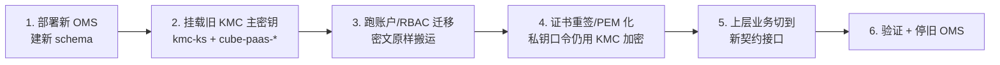

> 继续用 KMC:仍在使用的旧密文对应主密钥保留复用,旧密文原样搬入新库,无需重加密 Job。证书私钥口令仍由 KMC 主密钥加密,主密钥挂载就位后才能处理证书。KSUser 划分是否沿用旧体系待新底座设计团队确定(O-13)。

---

## 1. 旧底座数据模型回顾(迁出侧)

来源:`../OMS` 仓库直接核查(`srv-Framework`、`Deploy/apps/platform/sql/framework_iam.sql`、`oms-extension`)+ 真实环境 `model-engine-syc` 命名空间只读核验(附录 A)。

### 1.0 旧系统部署形态与替换范围

#### 1.0.1 旧系统部署形态

旧系统在一个 K8s 命名空间内(如 `model-engine-syc`)部署三层:

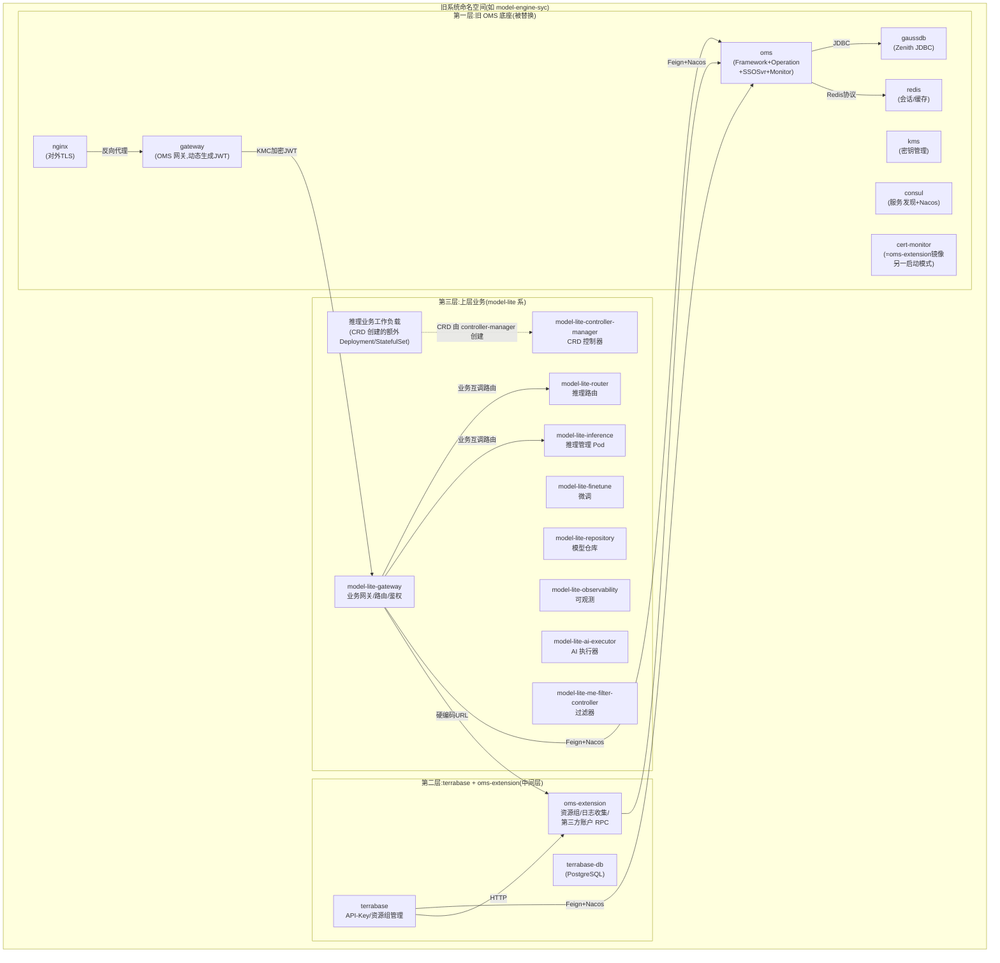

**三层职责**:

| 层 | 组件 | 数据库 | 职责 |
|---|---|---|---|
| 第一层(旧 OMS 底座) | oms / gateway / gaussdb / kms / redis / nginx / consul / cert-monitor | gaussdb(schema=framework+operation) | 账户/角色/权限/会话/证书/KMC 加解密/服务发现 |
| 第二层(中间层) | terrabase / terrabase-db / oms-extension | terrabase-db (PostgreSQL) + gaussdb (schema=extension) | API-Key 管理 / 资源组 RPC / 日志收集 / 第三方账户 |
| 第三层(上层业务) | model-lite 系 10 个 Deployment | model-lite-postgres | 推理/微调/仓库/可观测/CRD 控制器 |

**关键特征**:
- **三套数据库并存**:gaussdb(旧 OMS)、terrabase-db(terrabase 独立 PostgreSQL)、model-lite-postgres(model-lite 独立 PostgreSQL)。
- **cert-monitor 与 oms-extension 共用镜像**(`oms-extension:26.0.0.B020`),启动模式不同——印证 [cert-monitor 归属] 记忆。
- **上层业务经 `model-lite-gateway` 互调**,但 gateway 调 OMS 是直接调用(Feign + 硬编码 URL),**不是路由转发**(O-12 已确认,§8.6.1)。
- **推理业务工作负载**由 `model-inference` CRD 经 controller-manager 创建,是额外 Deployment/StatefulSet,不涉及迁移面(O-08 已确认)。

#### 1.0.2 替换范围

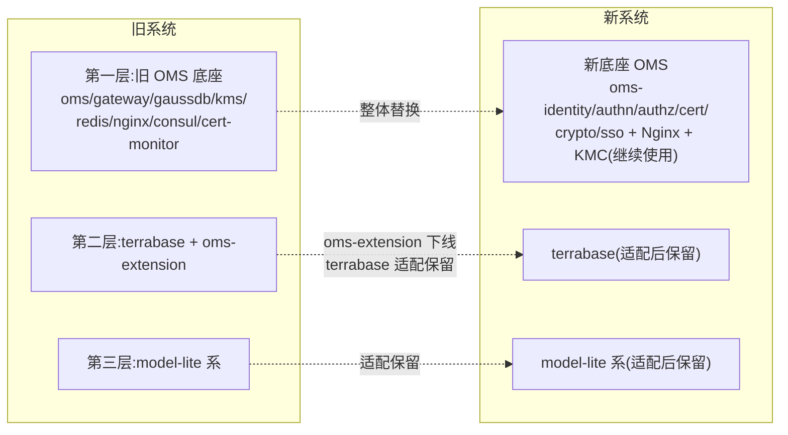

| 替换动作 | 范围 |
|---|---|
| **整体替换** | 旧 OMS 底座(oms/gateway/gaussdb/kms/redis/nginx/consul/cert-monitor)→ 新底座 OMS(oms-identity/authn/authz/cert/crypto/sso + Nginx + KMC 继续使用) |
| **下线** | `oms-extension` 进程——资源组/日志收集/第三方账户能力被新底座 M04/M09/M01 吸收(§8.1) |
| **适配保留** | terrabase——改 Feign→HTTP client(§8.6),改 UserContextFilter→X-OMS-Sid(§8.3),KMC 加解密保留(§5.2) |
| **适配保留** | model-lite 系 10 个管理 Deployment——同 terrabase 适配;推理业务工作负载不动 |
| **不动** | terrabase-db / model-lite-postgres——这两套独立 PostgreSQL 不在迁移面,各自业务自行管理 |

**gaussdb 的特殊处理**:旧 OMS 用 gaussdb(华为 Zenith JDBC,`jdbc:zenith:@gaussdbservice:1888`),schema=framework(账户/角色/权限)+ schema=operation(业务配置)+ schema=extension(资源组)。新底座用 PostgreSQL。迁移程序从 gaussdb 读旧数据 → 字段映射 → 写入新底座 PostgreSQL。**gaussdb 本身随旧 OMS 底座整体下线**。

### 1.1 账户表 `IAM_ACCOUNT_T`(schema=framework)

`AccountInfo.java:21` / `framework_iam.sql:3-27`。关键列:

| 列 | 说明 |
|---|---|
| `id` varchar(32) | UUID 主键 |
| `user_name` varchar(1536) | 用户名,唯一 |
| `password` varchar(256) | **PBKDF2 哈希**,格式 `iterations:saltHex:hashHex`(无独立 salt 列) |
| `locked` TINYINT | 0 未锁 / 1 锁 |
| `need_change_pwd` TINYINT | 首登/重置后须改密 |
| `user_type` int | **0=本地 / 1=SSO**(这就是 local/sso 区分) |
| `predefined` TINYINT | **1=内置**,0=普通 |
| `deleted` TINYINT | 逻辑删除 |
| `login_type` int | 位标志:1 人机 / 2 机机 / 4 内部 |
| `is_third_party` TINYINT | 三方账户来源 |
| `extensions` text | JSON 扩展 |

内置账户(`framework_iam.sql:157-161`):`admin` / `internal_admin` / `openapi` / `secadmin` / `secauditor`,固定 UUID。

### 1.2 角色与权限

- 角色 `IAM_ROLE_T`(`framework_iam.sql:83-94`):`role_name` 字符串唯一,内置角色 `SYS_ADMIN` / `SEC_ADMIN` / `SEC_AUDITOR` / `INTERNAL_ADMIN` / `OPEN_API` / `READ_ONLY`。新底座取消 `OPEN_API` 内置服务角色,改为两个准入角色 `m2mAccess`/`humanAccess` + 新建业务角色 `openAPI`(见 §4.5)。
- 账户↔角色:中间表 `IAM_ACCOUNT_ROLE_T(user_id, role_name)`,**无用户组层**;当前实现一个账户只挂一个角色(`AccountDao.tryChangeRoles` 取 `get(0)`)。
- 权限 `IAM_PERMISSION_T`:字符串编码 `"method uri"`,运行期由各微服务经 `/iam/permission/batch/register/internal` 注册。
- 角色↔权限 `IAM_ROLE_PERMISSION_RELATION_T`。

### 1.3 资源组(在 oms-extension,schema=extension)

#### 1.3.1 旧资源组建模

旧体系的资源组在 `oms-extension` 进程管理,schema=extension,与账户/角色(schema=framework)跨 schema 分离。

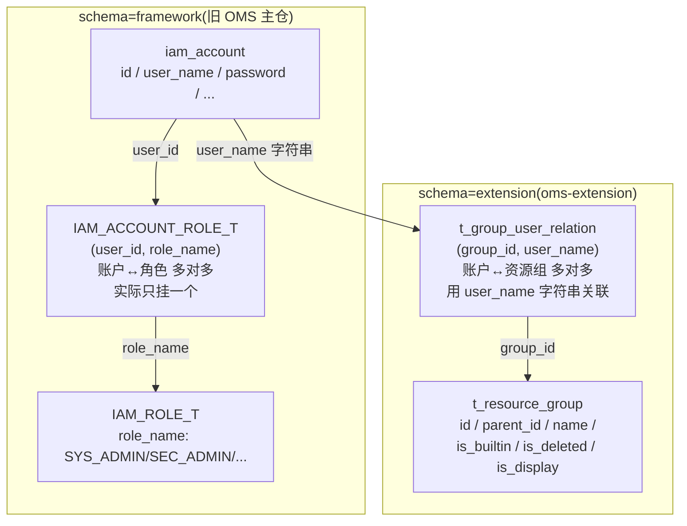

**表结构**:

| 表 | schema | 字段 | 说明 |
|---|---|---|---|
| `t_resource_group` | extension | `id`(PK) / `parent_id` / `name` / `description` / `create_time` / `update_time` / `is_deleted` / `is_builtin` / `is_display` | 支持 `parent_id` 层级但**实际只用平铺** |
| `t_group_user_relation` | extension | `id`(PK) / `group_id` / `user_name` / `create_time` / `update_time` | **用 `user_name` 字符串关联**(不是 `user_id` UUID),唯一索引 `(group_id, user_name)` |

**三个内置资源组**(`03_resource_insert_records.sql:3-8`):

| id | name | is_builtin | is_display | 语义 |
|---|---|---|---|---|
| `000` | `public_group` | true | — | 公共组,所有账户可访问 |
| `001` | `default_group` | true | — | 兜底组,未指定资源组时的默认归属 |
| `002` | `admin_group` | true | true | 管理员组,**成员可访问全部资源组**;其他账户不可访问本组资源 |

#### 1.3.2 旧体系的授权模型:角色(能力)× 资源组(数据域)在账户身上正交

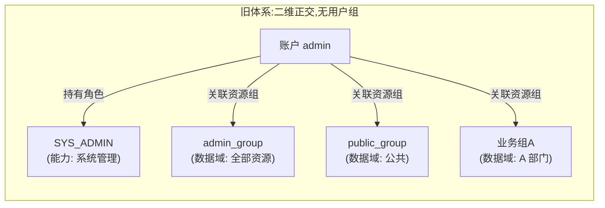

**旧体系的关键特征**:
- **没有"用户组"概念**——只有资源组承担"数据域",角色承担"能力",两者在账户身上正交。
- **账户直接持资源组**(`t_group_user_relation` 多对多),不经过任何中间层。
- **账户直接持角色**(`IAM_ACCOUNT_ROLE_T` 多对多),不经过任何中间层;当前实现一个账户只挂一个角色。
- **admin_group 的特殊特权**:成员可访问全部资源组(不只是 admin_group 本身);非 admin_group 成员不可访问 admin_group 内的资源。这是靠 `InnerChatAuthFilter` 等业务代码里的 `ADMIN_USER_RESOURCE_GROUP_ID = "002"` 硬编码判断实现的,不是数据库约束。
- **资源组关联用 `user_name` 字符串**,不是 `user_id` UUID——`t_group_user_relation` 与 `iam_account` 之间是松耦合,靠名字匹配。

### 1.4 登录、会话与 JWT

- 登录在 OMS IAM(`AuthService.authorize`):本地账户走 `CipherManager.checkSame`(PBKDF2)。本系统未使用 LDAP 认证场景,迁移不涉及 LDAP 账户。
- Token:`TokenUtils.generateToken()` 生成 128 字节 SecureRandom 的 hex(**非 JWT**),存 Redis。
- JWT:OMS 网关转发请求时由 `JwtParser.addJwt` 用 **KMC 加密** payload 动态生成(`E5`);下游(model-lite-gateway)用 `new JsonToken` 解密校验(`D14`)。
- 失败锁定:`LoginLockService` 本地内存 + Redis,阈值取 `IAM_ACCOUNT_STRATEGY_T.account_lockout_threshold`(默认 5)。

### 1.5 证书与加解密(旧体系要点)

- 证书:Nginx 对外证书 + 服务间 `framework.jks` / `platform.jks` 等多份 JKS;JKS 口令由 KMC 加密(详见 `docs/ME-security-requirements.md` 与既有记忆 `certificate-system-overview.md`)。
- KMC:华为密钥管理组件,主密钥按 `KMC_DATA_USER` 隔离(`paas/<user>/data.1+data.2`),由部署机 `install.sh --init-kmc` 调 KMC SDK 生成后 `kubectl create configmap kmc-ks`(model-lite 系 `modelenginepublic` 用户)或 `cube-paas-*` ConfigMap/Secret(OMS 平台用户 root/consul/gaussdba/redis/nginx/tomcat/fusioncube/kms 等)上传;密文形态为纯大写十六进制字符串(`GLOBAL_PWD` 即此类密文)。
- **两套加解密机制并存**:1 KMC 直连(`PassUtils` Java shell out Python SDK `kmc.kmc.API().encrypt/decrypt(0)`,密文=纯大写十六进制)用于证书私钥口令、组件口令;2 KMS gRPC 服务(`CryptClient`/`KeyMgmtEngine` → `crypt-grpc-server.jar` 端口 18400,DB 存 keyId UUID)用于账户 `email`/`telephone`、JWT 加密段。**新底座不再保留 KMS gRPC 服务**:迁移窗口内临时保留 crypt-grpc-server 用于解密 email/telephone 现有密文成明文 → KMC 直连重加密为纯大写十六进制搬入新库,迁移完成后 crypt-grpc-server 下线;新底座 `KmcCryptoPort` 统一覆盖两套机制(§5.2.3、§6.4.3)。
- `PassUtils.decryptWithUser` **非幂等**:PATTERN `^[A-F0-9]+$` 不匹配返回空串。
- 两套 SSL Bean:业务服务(terrabase、model-lite 推理/仓库/微调)走"裸密文→`decryptWithUser`→明文";gateway/jade 走"EPP 已解密→直接用明文 KeyStore"。

---

## 2. 新底座目标模型(迁入侧)

来源:`../OMS-refactor/design/OMS-总体设计-精炼版.md` V0.62。

### 2.1 身份与授权模型(§3.1)

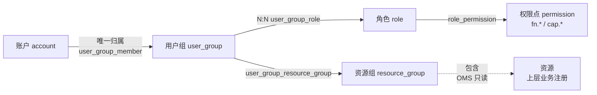

铁律 R-02:**库中不存在 `account_role`、`account_resource_group`**;`user_group_member` 有唯一约束;一个账户只能属于一个用户组。

### 2.2 关键表清单(§8.3、§3.8.3)

| 表 | 内容 | 关键约束 |
|---|---|---|
| `account` | 账户主体 | 唯一用户名;密码 PBKDF2 哈希 |
| `external_account` | 外部账号 | 与 `account` 一对一;不存凭据 |
| `user_group` | 用户组 | 内置三组(系统管理员组/安全管理员组/审计管理员组)`builtin_locked` |
| `user_group_member` | 账户↔用户组 | **账户唯一**(每账户一行) |
| `user_group_role` | 用户组↔角色 | N:N(一个用户组可绑多个角色) |
| `user_group_resource_group` | 用户组↔资源组 | N:N |
| `role` | 角色 | 三个管理员保留编码 `systemAdmin`/`securityAdmin`/`auditAdmin`;两个准入角色 `m2mAccess`/`humanAccess`;模块角色 `source=MODULE` |
| `permission` | 权限点 | `fn.*` 功能 / `cap.*` 能力;编码全局唯一 |
| `role_permission` | 角色↔权限点 | 内置角色随版本预置 |
| `resource_group` | 资源组 | 平铺无层级;内置资源组保留 |
| `auth_session` | 会话 | PostgreSQL 权威 + Redis 加速;状态机 `ACTIVE/STALE/REVOKED/EXPIRED_*` |

### 2.3 内置角色与三权分立(§3.1.4)

- 保留编码:`systemAdmin` / `securityAdmin` / `auditAdmin`,互斥;判定看角色编码集合是否同时出现两个。
- 三个内置用户组与内置角色绑定关系预置并置 `builtin_locked`,绑定接口对该标记做守卫。
- `openAPI` 旧内置服务角色已取消,改为两个**准入角色** `m2mAccess`(机机/token 通道)/ `humanAccess`(人机/页面通道);每个用户组必须至少绑定一个准入角色(§3.1.5)。准入角色只决定登录通道、不承载业务权限,不参与三权分立。旧 `OPEN_API` 角色拆为 `m2mAccess` + 新建业务角色 `openAPI` 的组合(见 §4.5)。

### 2.4 会话与 JWT(§3.2)

- OMS 签发 **HMAC JWT**,载荷只含 `sid`,**权限不进 JWT**(R-04)。
- 会话权威在 PostgreSQL `auth_session`,Redis 仅加速。
- 授权变更 → 受影响会话置 `stale`,下次请求 401 强制重登(目标 ≤1s,最坏 ≤5s)。
- 端点:`POST /oms/ui/auth/login`(页面,HttpOnly Cookie)/ `POST /oms/internal/v1/auth/token`(机机,Bearer)。

### 2.5 证书与加解密(§3.4 / §3.5 / §4.15)

- **统一用 PEM,不用 JKS / PKCS#12**;砍掉"keystore 口令"这一整类秘密。
- 三张证书:内部 CA(自签 100 年)+ 共享服务证书(mTLS)+ Nginx 对外证书(可被外部 CA 替换)。
- 私钥:PKCS#8 加密 PEM,私钥口令由 **KMC 主密钥**加密存 Secret(原设计为 SCC,本次改为 KMC,见 §5);明文只进 `emptyDir{medium: Memory}` 或进程内存。
- 主密钥:**复用旧 KMC 主密钥体系**(按 KSUser 隔离的多把主密钥,存 `kmc-ks` ConfigMap + `cube-paas-*` Secret),不再由 SCC 生成单层主密钥(见 §5.2)。
- `CryptoPort` 接口不变,实现从 `SccCryptoPort` 替换为 `KmcCryptoPort`(ADR-007 等价实现替换);国密本期不做,保留扩展位。

### 2.6 上层业务契约(§8.6,固定五个)

| 契约 | 方向 | 接口 | 失败语义 |
|---|---|---|---|
| 模块注册 | 业务 → OMS | 配置或登记接口 | 未注册:菜单不渲染、路由被拒 |
| 资源查询 | OMS → 业务 | `GET /resources?type=&ids=` | 失败:标记"陈旧",**不删归属** |
| 可见范围 | 业务 → OMS | `GET /oms/internal/v1/authz/scope` | **失败即拒绝** |
| 计量登记 | 业务 → OMS | `POST /oms/internal/v1/metering/report` | 失败重试,不阻断 |
| 审计上报 | 业务 → OMS | `POST /oms/internal/v1/audit/oplog` | 失败重试,超限告警 |

Nginx 向业务注入 `X-OMS-Sid` / `X-OMS-Subject`,业务**只信任这两个头**,不自己解 JWT、不自己查会话。

---

## 3. 账户与密码迁移

### 3.1 设计目标

> 用户识别到的第一诉求:**迁移后的账户能用同样的密码访问**。

新底座沿用 PBKDF2-HMAC-SHA256 / 10000 轮 /512bit / `iterations:saltHex:hashHex` 格式(§4.11、T-4),**与旧底座算法完全一致**——这意味着密码字段可以**原样搬运**,无需重算、无需重置、无需用户介入。

### 3.2 字段映射(旧 `IAM_ACCOUNT_T` → 新 `account`)

| 旧列 | 新列 | 映射规则 | 备注 |
|---|---|---|---|
| `id` varchar(32) | `id` | **原值保留** | 内置账户固定 UUID 必须保持,否则历史审计日志关联断 |
| `user_name` | `username` | 原值 | 唯一约束 |
| `password` | `password_hash` | **原样搬运**(已是 `10000:saltHex:hashHex`) | 不重算、不重置 |
| `locked` | `status` | 0→`ACTIVE`,1→`LOCKED` | 新底座状态机用枚举 |
| `need_change_pwd` | `must_change_password` | 原值 | 首登强制改密语义保留 |
| `user_type` | `auth_type` | 0→`LOCAL`,1→`SSO` | SSO 账户迁到 `external_account` 表(见 §3.5) |
| `predefined` | `is_builtin` | 原值 | 内置账户标志 |
| `deleted` | `deleted_at` | 0→NULL,1→迁移时刻 | 逻辑删除保留 |
| `login_type` | `login_types` | 位拆为数组 `[1,2]` 等 | 新底座用数组枚举 |
| `is_third_party` | `source` | 1→`THIRD_PARTY`,0→`LOCAL` | |
| `email` / `telephone` | `email` / `phone` | **保持密文,原样搬运** | KMC 密文不变,新底座 `KmcCryptoPort.decrypt` 用同一 `KMC_DATA_USER` 解密(见 §5.3) |
| `extensions` | `extensions` (JSONB) | 原值 | |
| `account_lock_time` | — | **丢弃** | 旧底座注释"恒为 0",无用 |
| `auth_privacy`/`eula_flag` | `agreement_accepted_at` | 合并 | 新底座用单一时间戳表达协议确认 |
| `first_login_status` | — | 折算到 `must_change_password` | |
| `usb_key_*` / `two_factor_auth_enable` | — | **丢弃**(O-09 已确认不保留) | 旧底座未使用 USBKey/双因子,新底座也不实现 |

### 3.3 密码校验侧的兼容性证明

新底座 `CryptoPort` 的 `PasswordEncoder` 实现必须能识别 `iterations:saltHex:hashHex` 三段格式:

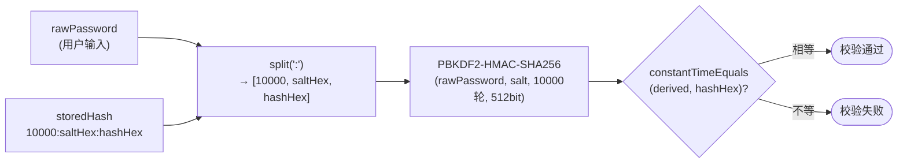

旧 `CryptoUtil.validatePassword`(`CryptoUtil.java:95-101`)逻辑等价,迁移期可把旧实现直接搬入新底座的 `CryptoPort` 适配层,迁移完成后再做算法枚举化重构。

**国密模式**:旧底座 SMMODE 走 `PBKDF2WithHmacSM3`。新底座本期不做国密,但保留 `CryptoPort` 适配层。**O-04 已确认(2026-10-28)**:客户局点未启用过 SMMODE(国密场景),所有密码哈希均为 `PBKDF2WithHmacSHA256`。迁移程序**无需识别 SM3 哈希**,`password_hash` 字段无需附加 `algorithm` 标记,`PasswordEncoder` 单一算法路由即可。

### 3.4 内置账户的处理

| 旧内置账户 | 旧 UUID | 新内置账户 | 新 UUID | 处理 |
|---|---|---|---|---|
| admin | `852f35cb640b4e50b3b1392961b1047b` | admin | **沿用旧 UUID** | 密码字段不迁——新底座部署期由 `migrate` 重新置入初始密码(与旧底座部署期同源),客户首次登录改密 |
| secadmin | `9f6465ee2ce04e0a92a2b0fd186cec73` | secadmin | 沿用 | 同上 |
| secauditor | `84200ab2c9a3402ebff9a3a70cdcc790` | secauditor | 沿用 | 同上 |
| internal_admin | `c8841351d6aa45ea9d866dcd0f10a371` | — | — | **新底座无此内置账户**;旧 internal_admin 仅用于服务间调用,新底座由 `m2mAccess` + `openAPI` 业务角色组合承担(见 §4.5)。**O-05 已确认(2026-10-28)**:客户局点未用 internal_admin 跑业务。迁移程序按普通账户处理:若该账户在旧 `admin_group` 内则按 §4.2 进 `UG_ADMIN_FULL`,否则按 §4.1 聚类归入普通系统管理员用户组。该账户在迁移后失去"服务间调用"特权,对应能力由新底座 `m2mAccess` + `openAPI` 业务角色承接 |
| openapi | `021a495b281d42d4911ad8d25de5e90d` | openapi | 沿用 | 同 admin |

> **内置账户密码不迁的合理性**:旧 DDL 中密码字段是占位符 `'PASSWORD_ADMIN'`,真实密码由部署脚本/KMC 流程在首次启动时替换——本身就不是数据库里的稳定值。新底座 `migrate` 在部署期重置内置账户密码、要求首登改密,与旧底座语义一致。

### 3.5 外部账号(SSO)迁移

旧 `user_type=1` 的 SSO 账户迁到新底座的 `external_account` 表,与 `account` 一对一:

- `account.auth_type=SSO`,`account.password_hash=NULL`。
- `external_account.account_id` 指向 `account.id`,`external_account.idp_id` 指向旧底座 SSO 上游标识(如 CAS)。**本系统未使用 LDAP**,`idp_id` 不会出现 LDAP 来源。
- 用户名保持原值;外部账号权限来源是**导入时指定的用户组**(§3.2.4 第 4 条),运行时无角色映射。
- **第三方账户**(`is_third_party=1`):旧底座经 oms-extension 的 `ThirdPartyAccount` 表登记,迁到新底座的 `external_account` 并标记 `source=THIRD_PARTY`;其资源组归属同步迁入用户组关联(见 §4.4)。

---

## 4. 资源组、用户、角色映射

> 这是迁移设计里**最难、最容易出错**的部分:旧体系没有用户组,只有"资源组(数据域)× 角色(能力)"在账户身上正交;新体系强制插入用户组层,且账户唯一归属。需要把旧的二维组合归并为新的一维归属。

### 4.0 新旧授权模型对照

#### 4.0.1 旧授权模型(二维正交,无用户组)

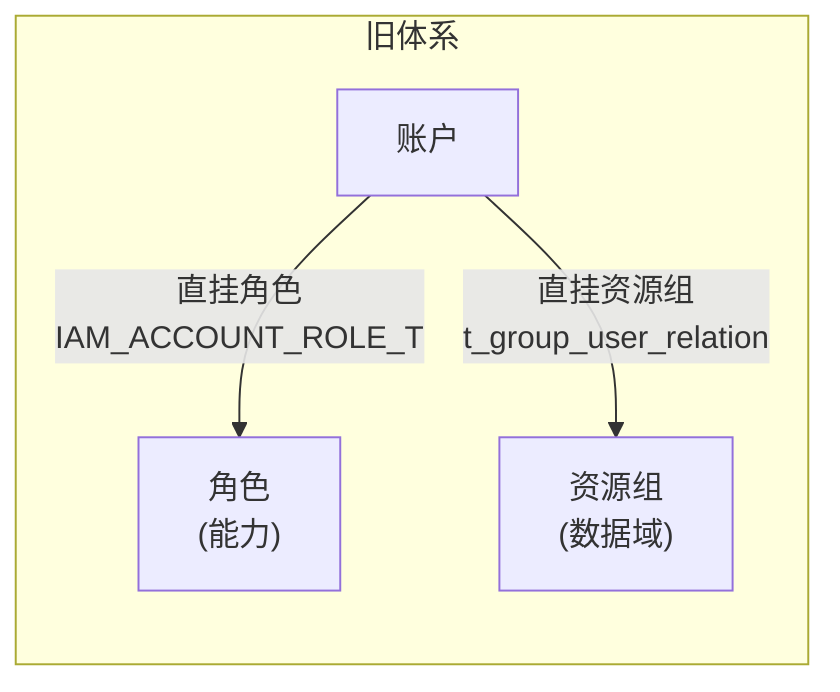

- 账户**直接**持角色(能力维度)+ **直接**持资源组(数据域维度),两者正交。
- 没有"用户组"中间层。
- `t_group_user_relation` 虽是多对多表结构,但业务层只承认 **3 条访问规则**(在业务代码中硬编码,不是 DB 约束):
 1. **admin_group 内的账户可访问全部资源组**——特权来自"在 admin_group 内"这一事实,不来自角色。
 2. **所有账户都可访问 `public_group`**——公共组对全员开放。
 3. **普通账户只能访问其当前所属资源组 + `public_group`**——不跨组访问。
- 即 `rg_set(u)` 在业务层的**有效取值**只有两类:`{本组, public_group}`(普通账户)或 `ALL`(admin_group 内账户);DB 里即使写入其他多对多组合,业务代码也不认。

#### 4.0.2 新授权模型(三层归一,账户唯一归属用户组)

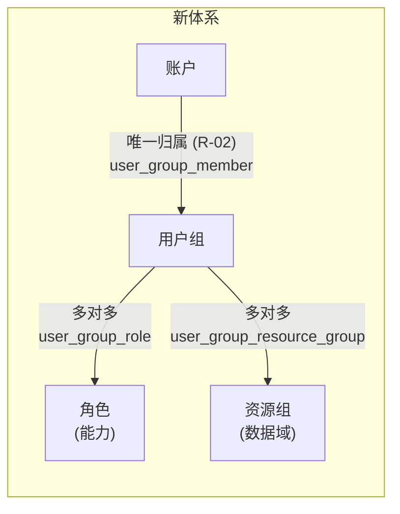

- 账户**不直接**持角色或资源组,全部经用户组中转(R-02/R-03)。
- 账户**唯一归属**一个用户组(`user_group_member` 唯一索引)。
- 用户组内多个角色、多个资源组取**并集**,不做交集,没有 deny 规则(§3.1.1 第 2 条)。
- 资源组**平铺无层级**,范围判定是集合成员检查 O(1)(§3.1.1第 3 条)。

#### 4.0.3 迁移的核心难点:二维折叠为一维

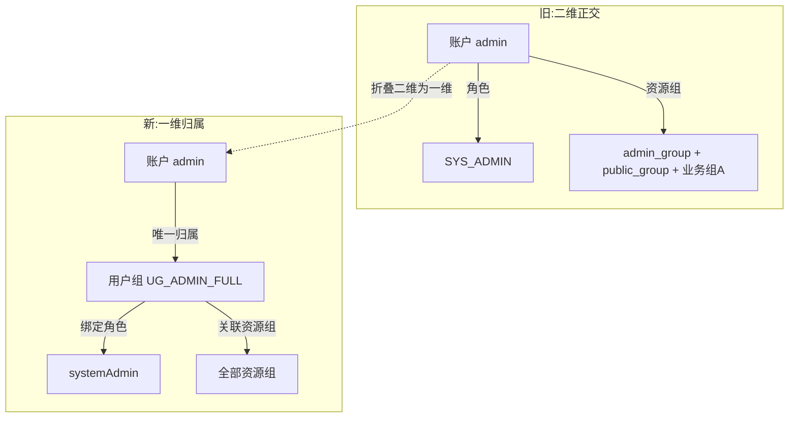

旧体系里"账户 × 角色"和"账户 × 资源组"是两条独立的关联,迁移后必须**折叠**为"账户 → 用户组 → (角色, 资源组)"一条链。折叠规则是 §4.1 的聚类算法。

### 4.1 映射策略:以"角色 × 资源组集合"为键归并用户组

定义:旧账户 `u` 的画像 = `(roles(u), rg_set(u))`,其中 `roles(u)` 来自 `IAM_ACCOUNT_ROLE_T`,`rg_set(u)` 来自 `t_group_user_relation`。

迁移程序对全部活跃账户**按画像聚类**——画像相同的账户归入同一个新用户组:

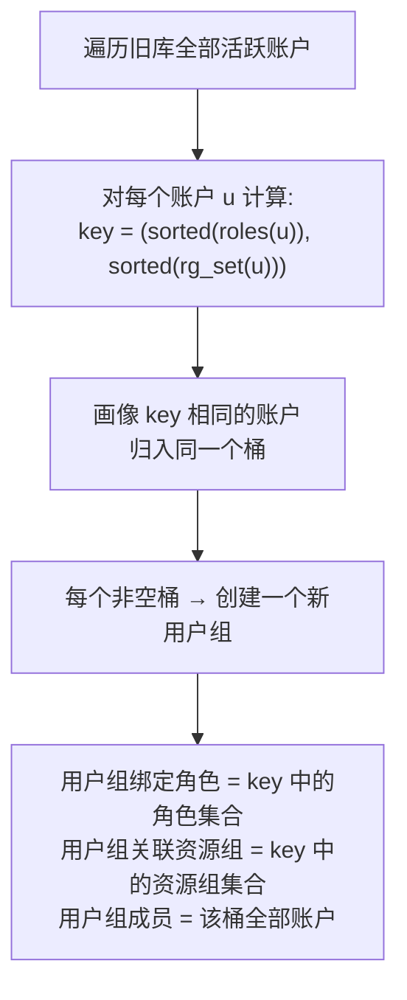

每个聚类产生的用户组 `ug`:
- **名称**:生成式,如 `迁移_<角色>_<资源组数>组`,迁移后由管理员手工改名(M04 OI-M04-003 允许改名)。
- **绑定角色**:`roles(key)`(聚类 key 中的角色集合)。
- **关联资源组**:`rg_set(key)`(聚类 key 中的资源组集合)。
- **成员**:该桶全部账户。

**内置组承载**(注意:系统管理员组**不走内置组承载**,见 §4.2):

聚类算法默认对每个非空画像桶"新建一个普通用户组 + 绑定角色 + 关联资源组"。对以下两个画像**改为内置组承载**——不为它们新建普通组,而是把账户直接塞进新底座已预置、角色绑定已锁定的内置组:

- `{SEC_ADMIN}` → 承载进内置**安全管理员组**(`builtin_locked`),只迁成员,不动绑定。
- `{SEC_AUDITOR}` → 承载进内置**审计管理员组**(`builtin_locked`),只迁成员,不动绑定。

**为什么不新建普通组**:新底座初始化时已预置安全管理员组/审计管理员组并锁定 `securityAdmin`/`auditAdmin` 角色绑定(OI-M04-007,`builtin_locked=true`,绕过页面直调接口也拒绝增删)。若再为这两个画像新建普通组并绑同名角色,会出现"两个组都持 securityAdmin"——与三权分立"内置组是这些角色的唯一规范持有者"的设计相悖(§3.1.4)。因此复用已锁定的内置组绑定,只迁成员。

**普通组 vs 内置组**(来源:`OMS-总体设计文档.md` DD-04、OI-M04-007/009):

| | 普通组(regular) | 内置组(builtin) |
|---|---|---|
| 谁创建 | 迁移程序/管理员新建 | 新底座初始化脚本预置,已存在 |
| 改名/删除 | 可以 | **不可** |
| 角色绑定能否增删 | 可以 | **不可**,`builtin_locked=true`,绕过接口也拒绝 |
| 资源组/成员能否调整 | 可以 | 可以(仅角色锁定) |
| 例子 | `UG_ADMIN_FULL`、`UG_SYS_A`、`UG_DEV_A` | 系统管理员组 / 安全管理员组 / 审计管理员组 |

> 系统管理员 `{SYS_ADMIN}` 不走内置组承载——见 §4.2,按"是否在 admin_group 内"拆成两类**普通组**,避免权限扩大。

#### 4.1.1 聚类示例

假设旧库有以下账户:

| 账户 | 角色 | 资源组 |
|---|---|---|
| admin | SYS_ADMIN | admin_group, public_group, 业务组A |
| sysuser1 | SYS_ADMIN | 业务组A, public_group |
| sysuser2 | SYS_ADMIN | 业务组A, public_group |
| dev1 | ModelDeveloper | 业务组A, public_group |
| dev2 | ModelDeveloper | 业务组B, public_group |
| sec1 | SEC_ADMIN | public_group |

聚类结果:

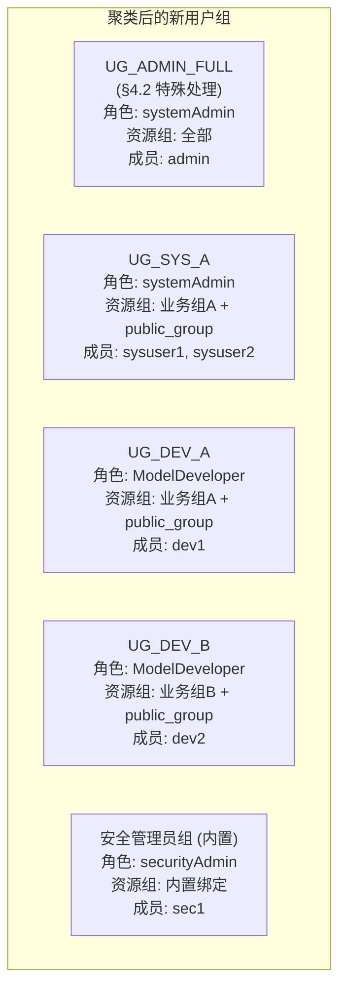

**关键观察**:
- `sysuser1` 和 `sysuser2` 画像相同,归入同一用户组 `UG_SYS_A`。
- `dev1` 和 `dev2` 仅资源组不同,画像不同,归入不同用户组。
- `admin` 虽然角色是 SYS_ADMIN,但在 admin_group 内,走 §4.2 特殊处理进 `UG_ADMIN_FULL`,不与 `sysuser1`/`sysuser2` 同组。
- `sec1` 走内置组承载,进内置安全管理员组。

### 4.2 admin_group 的特殊处理(O-01 已确认)

旧 `admin_group`(id=002)的语义:"仅包含 admin 账户,admin 角色固定系统管理员,可访问全局资源,其他账户不可访问本组资源"(`rbac-resource-group-design.md` §3.1)。但**实际局点 admin_group 内可能不止 admin 一个账户**——其他账户也可能被加入 admin_group 而获得全资源访问。

**O-01 已确认(2026-10-28)**:不允许"非 admin_group 内的系统管理员权限扩大到所有组"。映射规则按"是否在 admin_group 内"拆分系统管理员:

1. **旧 `admin_group` 作为普通内置资源组保留**(`is_builtin=true`),名称沿用 `admin_group` 或改名 `系统管理员资源组`,其下资源归属不变。

2. **新建一个普通用户组 `UG_ADMIN_FULL`**(非内置,可改名):
 - 成员 = 旧 `t_group_user_relation` 中 `group_id='002'`(admin_group)的全部账户(**不止 admin 一个**,逐一迁入)。
 - 绑定角色 = `{systemAdmin}`。
 - 关联资源组 = **全部资源组**(含 admin_group + public_group + 所有业务资源组)。
 - 这一组保持旧 admin_group 的"全资源访问"特权。

3. **admin_group 外的系统管理员账户**(`IAM_ACCOUNT_ROLE_T.role_name=SYS_ADMIN` 但 `t_group_user_relation` 无 `group_id='002'`):
 - 不进 `UG_ADMIN_FULL`。
 - 按 §4.1 聚类归入各自的普通用户组(key = `({SYS_ADMIN}, rg_set(u))`)。
 - 这些用户组绑定角色 `{systemAdmin}`,但**只关联该账户升级前所在的资源组 + `public_group`**——权限不扩大。

4. **内置"系统管理员组"留空**:迁移程序不把任何账户写入新底座内置的"系统管理员组"(`builtin_locked` 那个)。该内置组保留为空壳,由客户后续按需手动分配,避免迁移期意外扩权。

**关键判定流程**:

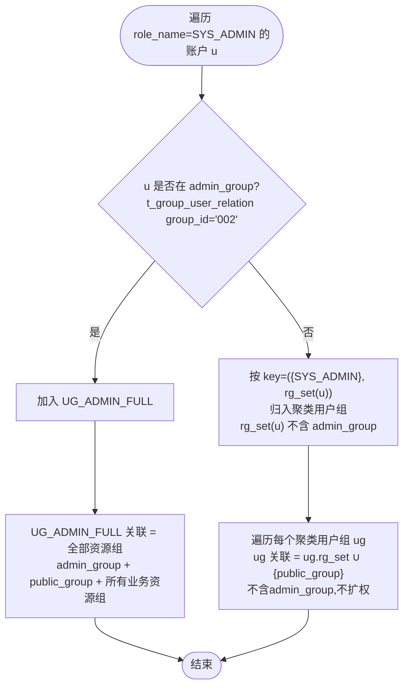

**对客户局点的影响**:
- admin_group 内的所有账户(含 admin 与其他账户)保持全资源访问,**无权限变化**。
- admin_group 外的系统管理员保持原范围(本组 + public_group),**无权限扩大**。
- 内置"系统管理员组"为空,需客户后续按需填充——这是与旧底座最大的体验差异,需在升级文档说明。

### 4.3 public_group 与 default_group

- `public_group`(id=000):新底座保留为内置资源组,语义"所有账户可访问"。迁移时所有新用户组**默认关联** `public_group`。
- `default_group`(id=001):旧底座用作"未指定资源组时的兜底"。新底座无此概念——账户必须归属一个用户组,用户组未关联资源组时成员无可访问资源(M04 FR-RG-004 异常规则)。迁移时 `default_group` 作为普通资源组保留,其下资源归属不变;旧 `default_group` 内的账户按 §4.1 聚类归入对应用户组。

### 4.4 资源组关系重挂:账户维度 → 用户组维度

旧 `t_group_user_relation(group_id, user_name)` 是**账户↔资源组**多对多。新底座要求**用户组↔资源组**多对多,账户不直接持资源组(R-02)。重挂规则:

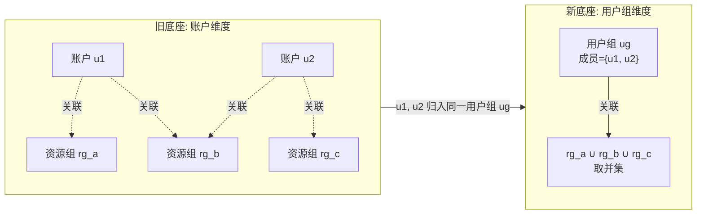

即用户组关联的资源组 = 其全部成员在旧底座关联过的资源组的并集。这与 §3.1.1 第 2 条"组内多个资源组取并集"一致。

**第三方账户的资源组绑定**(旧 oms-extension `ThirdPartyAccount`):迁到新 `external_account` 后,其资源组归属同样按 §4.1 聚类到对应用户组。

### 4.5 角色编码映射

| 旧 `role_name` | 新 `role.code` | 内置? | 备注 |
|---|---|---|---|
| `SYS_ADMIN` | `systemAdmin` | 是 | 保留编码 |
| `SEC_ADMIN` | `securityAdmin` | 是 | 保留编码 |
| `SEC_AUDITOR` | `auditAdmin` | 是 | 保留编码 |
| `OPEN_API` | `openAPI`(新建业务角色) + `m2mAccess`(准入角色) | 否(业务角色)+ 是(准入角色) | 见下方说明 |
| `READ_ONLY` | `readOnly` | 否(业务角色) | 由模块注册(§9.4) |
| `INTERNAL_ADMIN` | — | — | 新底座无;按 §3.4 降级为普通账户 |
| 业务自定义角色 | `<modulePrefix>.<name>` | 否 | 模块角色 `source=MODULE`;按 §9.4 由模块重新注册 |

**关于 `OPEN_API` 的特殊处理**:

新底座已取消旧 `openAPI` 这个内置服务角色,改为引入两个**准入角色**(来源:`OMS-总体设计-精炼版.md` V0.89,§3.1.5):

| 准入角色 | 通道 | 控制的权限点 | 说明 |
|---|---|---|---|
| `m2mAccess` | 机机(token 端点) | `fn.auth.token.api` | 只决定"能从 token 通道登录",不承载业务权限 |
| `humanAccess` | 人机(页面登录) | `fn.auth.login.web` | 只决定"能从页面通道登录",不承载业务权限 |

**铁律**:每个用户组必须至少绑定 `m2mAccess` / `humanAccess` 中的一个,否则不允许保存(§3.1.5)。准入角色**不承载业务权限**——三权分立判定时看管理员角色编码集合,准入角色不参与。

旧 `OPEN_API` 角色在新底座**没有单一等价角色**,需**拆为两个角色组合**:

1. **新建一个业务角色 `openAPI`**(`source=MODULE`,非内置,名称沿用旧名以减少认知负担):
 - 由负责服务间调用的模块(oms-extension 替代方,见 §8)在模块注册时声明(§4.6、§9.4)。
 - **绑定权限点 = 旧 `OPEN_API` 角色在旧底座持有的权限点的新等价**(旧 `"method uri"` 编码 → 新 `fn.*` / `cap.*` 编码,由模块注册时一并声明写入 `permission` 表 + `role_permission` 预置)。
 - 该业务角色承载 OPEN_API 的实际业务能力(调哪些接口)。

2. **`OPEN_API` 账户的用户组绑定 `{m2mAccess, openAPI}` 两个角色**:
 - `m2mAccess` 提供"机机通道登录"准入(旧 OPEN_API 账户是服务间调用,走 token 通道,对应 `m2mAccess` 而非 `humanAccess`)。
 - `openAPI` 业务角色提供实际接口权限。
 - 用户组关联资源组按 §4.1 聚类(旧 OPEN_API 账户的 `rg_set(u)`)。

3. **聚类与承载**:`OPEN_API` 不走 §4.1 的内置组承载(它不是三权分立的管理员角色),按普通聚类归入普通用户组;该用户组的角色集合 = `{m2mAccess, openAPI}`。若多个 OPEN_API 账户画像(资源组集合)相同,归同一用户组。

> **与 §4.6 的关系**:§4.6 称"旧 `IAM_ROLE_PERMISSION_RELATION_T` 不迁,角色↔权限点绑定由新底座按内置角色预置 + 模块注册时声明"。`openAPI` 业务角色及其权限点绑定正是走"模块注册时声明"这条路径——迁移程序不直接搬旧绑定表,而是由模块在注册 `openAPI` 角色时一并声明其权限点(与旧底座 OPEN_API 持有的权限点一一对应新建为新编码)。

### 4.6 权限点迁移

旧权限编码 `"method uri"`(如 `GET /framework/v1/iam/accounts`)与新权限点 `fn.*` / `cap.*` 命名空间不同,**不直接迁数据**:

- 新底座权限点由各模块安装时注册(§3.8.3 第 2 条"写入注册表,权限点进入 `permission`,随版本预置到内置角色")。
- 旧底座运行期注册的权限点随 `terrabase` / `model-lite` 在基于新底座安装时重新注册到新底座(见 §8)。`oms-extension` 整体下线(§8.1),其原注册的权限点由吸收其能力的新底座模块(M01/M04/M09/M13)或 `terrabase`/`model-lite` 承接注册,不由 oms-extension 自身迁移。
- **旧 `IAM_ROLE_PERMISSION_RELATION_T` 不迁**——角色↔权限点绑定由新底座按内置角色预置 + 模块注册时声明,不再保留客户局点手改的角色权限。**O-02 已确认(2026-10-28)**:客户局点未手工调整过内置角色与权限,一切以出厂权限配置为准。因此无需在新底座侧补"角色权限覆写"能力,R-06"运行期只读"无需评审——直接按新底座出厂预置 + 模块注册即可。

### 4.7 迁移期账户-用户组唯一性冲突处理

旧 `t_group_user_relation` 允许一个账户挂多个资源组,但 §4.1 的聚类保证每个账户只进一个用户组——这是**新底座 R-02 的硬约束**。冲突场景:

- 同一账户在旧底座同时关联 `admin_group` 和某业务资源组(admin 账户典型行为):按 §4.2 判定,凡 `group_id='002'` 的账户统一进 `UG_ADMIN_FULL`,该用户组关联全部资源组,自动满足。账户的多资源组关联在旧→新映射中"折叠"为用户组的资源组集合,账户本身不再持资源组。
- admin_group 内的账户同时也在其他业务资源组(典型 admin 行为):仍只进 `UG_ADMIN_FULL` 一个用户组,业务资源组归属被 `UG_ADMIN_FULL.resource_groups = ALL` 覆盖,无冲突。
- 同一账户在旧底座有多个角色(旧表结构支持多对多,但当前实现只挂一个):按 `IAM_ACCOUNT_ROLE_T` 全量读取,若实际有多条,按 §4.1 聚类时 `roles(u)` 取全部;若聚类后某用户组同时含 `systemAdmin` 和 `auditAdmin`,**迁移程序拒绝并报告冲突**(§3.1.4 互斥),需人工拆分。
- **准入角色补全**:聚类产生的每个用户组在迁移程序写入新底座时,必须补绑至少一个准入角色(`m2mAccess` 和/或 `humanAccess`),否则新底座拒绝保存(§3.1.5)。补绑规则:旧账户 `login_type` 含位`1`(人机)→ 补 `humanAccess`;含位 `2`(机机)→ 补 `m2mAccess`;两者都含则都补。`OPEN_API` 账户固定补 `m2mAccess`(见 §4.5)。

---

## 5. 加解密体系与证书替换

> **决策变更(2026-10-29)**:经重新评估,新底座**不切换 SCC**,**继续使用 KMC 加解密**。原 V0.4 的"KMC→SCC 重加密"方案废弃。本章重写为 KMC 持续使用方案——密钥体系设计 + 迁移简化(不再需要重加密 Job)。

### 5.1 决策背景与设计思路

新底座总体设计(`OMS-总体设计-精炼版.md` §3.5、ADR-007)原定用 **SCC(seccomponent,进程内 SDK)** 替换 KMC,通过 `CryptoPort` 适配层隔离加解密后端。但 ADR-007 选型理由明确:"`CryptoPort` 适配**进程内 SDK**,算法可插拔;便于测试替身、SCC 版本切换与**等价实现替换**"——即 `CryptoPort` 的设计**本身就支持替换加解密后端**。

本次决策利用这一扩展点:**实现 `KmcCryptoPort` 作为 `CryptoPort` 的等价实现**,把新底座的加解密后端从 SCC 替换为 KMC,保留 `CryptoPort` 接口不变,业务代码不直连 KMC。

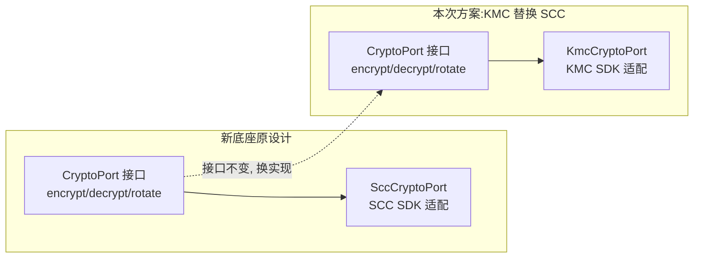

**为何继续用 KMC**:
1. 旧底座全部密文已用 KMC 加密,继续用 KMC 意味着**密文原样保留,无需重加密 Job**——迁移工作量与风险大幅降低。
2. 客户局点已有 KMC 部署与运维经验,不引入新组件(SCC)降低运维风险。
3. `CryptoPort` 接口不变,业务代码零改动;后续若需切回 SCC,只需换 `CryptoPort` 实现类。

**与原设计的差异**:

| 维度 | 原设计(SCC) | 本次方案(KMC) |
|---|---|---|
| `CryptoPort` 实现 | `SccCryptoPort`(SCC SDK 进程内) | `KmcCryptoPort`(KMC Python SDK + gRPC) |
| 主密钥 | SCC 部署期生成一把,存 `oms-crypto` Secret | 复用旧 KMC 主密钥体系,按 KSUser 隔离(见 §5.2) |
| 密文格式 | SCC 密文 | KMC 密文(纯大写十六进制字符串,不变) |
| 迁移期重加密 | KMC→SCC 重加密 Job(§4.15) | **不需要**——旧密文原样搬入新库 |
| 密钥轮换 | `CryptoPort.rotate` 双版本并存 | KMC `create_mk(0)` 重新生成 + 手工重加密(既有机制) |
| KMC 下线 | 迁移完成后下线 | **永不下线**——KMC 是生产加解密组件 |

### 5.2 密钥体系设计

#### 5.2.1 旧 KMC 密钥体系回顾

旧底座 KMC 主密钥**按 KS User 隔离**,每个用户在 `paas/<user>/data.1`+`data.2` 有独立主密钥文件,KMC SDK 通过 `KMC_DATA_USER` 环境变量选用哪份主密钥。不同用户互不可解。

旧底座的 KMC 用户清单(来源:`Deploy/runtime/kmc/kmc_update_master_key.sh` + 真实环境核验附录 A.3):

| KSUser | 主密钥存储 | 服务的密文 | 归属部署层 |
|---|---|---|---|
| `root` | `cube-paas-root` Secret | 平台根密钥 | OMS 底座 |
| `consul` | `cube-paas-consul` Secret | Consul/Nacos 密码。**新底座不再使用 Nacos/Consul 服务发现(§8.6),该密文无依赖,主密钥可下线(O-13)** | OMS 底座 |
| `gaussdba` | `cube-paas-gaussdba` Secret | gaussdb 连接口令 | OMS 底座 |
| `redis` | `cube-paas-redis` Secret | Redis 连接口令 | OMS 底座 |
| `nginx` | `cube-paas-nginx` Secret | Nginx 证书私钥口令 | OMS 底座 |
| `tomcat` | `cube-paas-tomcat` Secret | Tomcat 证书口令 | OMS 底座 |
| `fusioncube` | `cube-paas-fusioncube` Secret | 融合立方相关 | OMS 底座 |
| `kms` | `cube-paas-kms` Secret | KMS gRPC 服务相关。**crypt-grpc-server 迁移完成后下线(§6.4.3),若 kms user 名下仅 email/telephone/JWT 密文且已重加密搬运,主密钥可下线(O-13)** | OMS 底座 |
| `modelenginepublic` | `kmc-ks` ConfigMap + 对应 Secret | model-lite `GLOBAL_PWD`(证书私钥口令)、业务 SSL 口令 | model-lite 系 |
| `framework`(或 `platform`) | 对应 Secret | 账户 `email`/`telephone`(`DecryptEncryptTypeHandler`,迁移期由 KMS gRPC 解密后用本 user 重加密为 KMC 密文搬运,§5.3) | OMS Framework |

> 注:实际 KSUser 清单以客户局点 `kmc-ks` ConfigMap + `cube-paas-*` Secret 列表为准(附录 A.3 核验了 9-10 个用户)。`framework`/`platform` 用户的具体名称需在迁移前用 `kubectl get secret cube-paas-*` 核实——附录 A.3 列出的 `cube-paas-{consul,gaussdba,kms,nginx,redis,tomcat,fusioncube}` + `cube-paas-root` 共 8 个,加上 model-lite 系的 `modelenginepublic`,合计 9-10 个。

#### 5.2.2 新底座 KMC 密钥体系方案

**核心原则:仍在使用的旧密文对应主密钥保留复用,原样挂载。** 新底座不生成新主密钥,而是挂载旧 `kmc-ks` ConfigMap + `cube-paas-*` Secret,用相同 `KMC_DATA_USER` 解密相同密文。具体保留哪些 KSUser、是否合并/新增由新底座设计团队确定(O-13);约束是"旧密文仍需新底座解密的,对应主密钥必须保留;若某用户名下密文在新底座不再使用,该主密钥可删"。

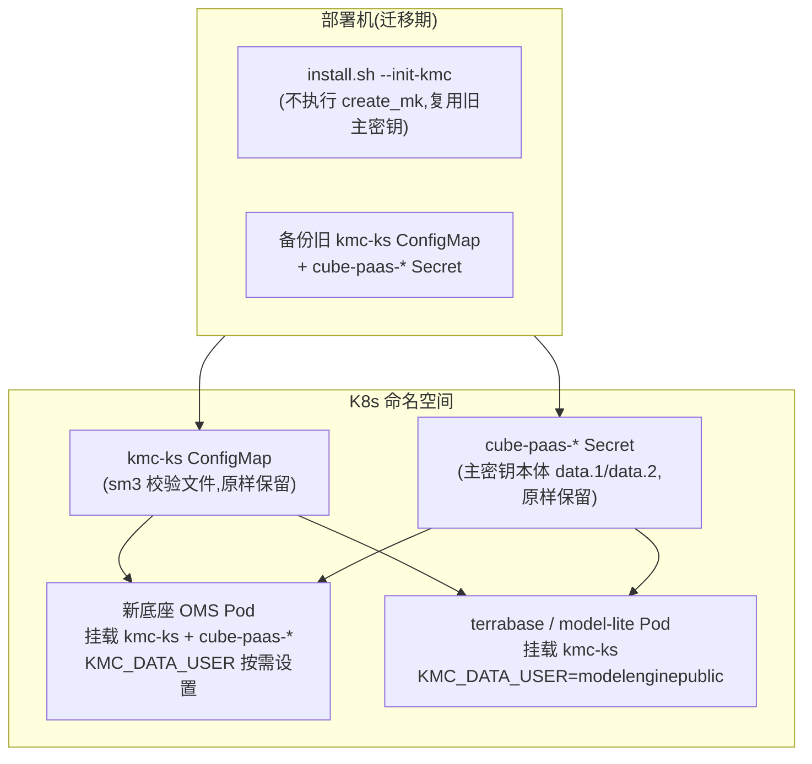

**密钥用户管理策略**:

| 策略 | 说明 |
|---|---|
| **主密钥不复用也不新建** | 迁移程序**不调用 `create_mk(0)`**——旧主密钥原样保留,新旧系统共用同一份主密钥文件。迁移期 `install.sh --init-kmc` 只负责**挂载**已有 `kmc-ks` + `cube-paas-*`,不重新生成。 |
| **KSUser 体系待新底座设计确定** | 旧底座按组件拆了 9-10 个 KSUser(`root`/`consul`/`gaussdba`/`redis`/`nginx`/`tomcat`/`fusioncube`/`kms`/`platform` + 产品层 `modelenginepublic`,见 §6.3),新底座**不强制沿用这套用户划分**——具体保留哪些旧用户、是否合并、是否新增用户,由新底座设计团队根据自身组件边界确定(**O-13 待确认**,见 §10.1)。**约束**:旧密文仍需新底座解密的,其加密时用的 `KMC_DATA_USER` 对应主密钥**必须保留**;若某用户名下密文在新底座不再使用,该主密钥可删。即"用户划分可调整,无密文依赖的旧主密钥可下线"。 |
| **主密钥分发路径不变** | `kmc-ks` ConfigMap 由部署机 `install.sh` 的 `createKmcKsConfigmap()` 上传(既有机制),各 Pod 通过 Helm chart `kmcKsVolume`/`kmcKsMount` 挂载到 `/opt/huawei/fce/paas/<user>`(`defaultMode: 0600`)。 |
| **`KmcCryptoPort` 适配层** | 新底座实现 `KmcCryptoPort implements CryptoPort`,内部调 KMC Python SDK(`kmc.kmc.API().encrypt(0)` / `decrypt(0)`)+ `PassUtils.decryptWithUser`。`CryptoPort.encrypt(plaintext)` → 选 `KMC_DATA_USER` → `kmc_encrypt`;`CryptoPort.decrypt(ciphertext)` → `kmc_decrypt`。 |

#### 5.2.3 KmcCryptoPort 适配层设计

`CryptoPort` 接口(新底座 §3.8.3)定义 `encrypt(plaintext) → ciphertext` / `decrypt(ciphertext) → plaintext` / `rotate()` 三个方法。`KmcCryptoPort` 的实现:

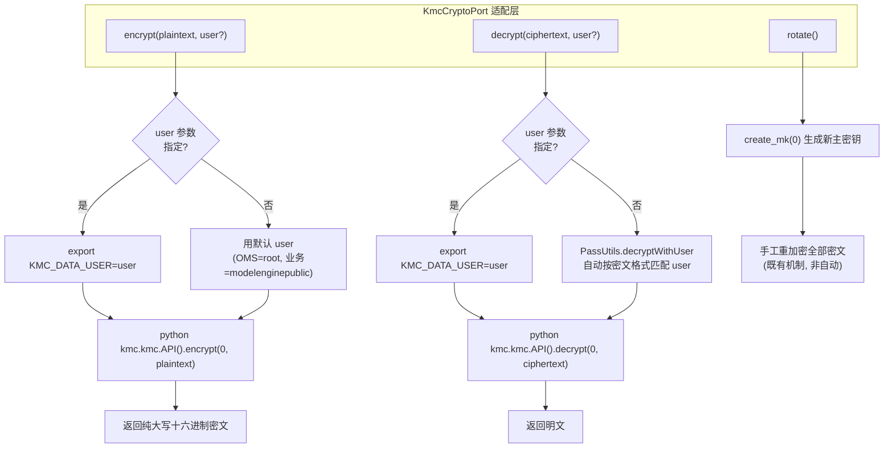

**关键设计点**:
- `encrypt` / `decrypt` 的 `user` 参数对应旧体系的 `KMC_DATA_USER`——调用方需指定用哪个 KSUser 的主密钥。新底座可按模块配置默认 user(如 OMS 的 `account` 表加密默认用 `framework`,证书口令用 `nginx`/`modelenginepublic`)。
- `decrypt` 也可用 `PassUtils.decryptWithUser(ciphertext, user)` 路径——与旧底座业务服务完全一致(既有记忆 `experience_kmc_decrypt_dual_track_idempotent.md`)。
- `rotate` 仍走 KMC 既有轮换机制(`kmc_update_master_key.sh` `create_mk(0)` + 手工重加密),不实现自动双版本并存。这与新底座原设计 `CryptoPort.rotate` 的"双版本并存"语义有差异——**降级为手动轮换**,需在升级文档说明。
- **覆盖范围**:`KmcCryptoPort` 统一覆盖旧底座 KMC 直连(方式一/二)与 KMS gRPC(方式三)两套机制。方式三的 email/telephone/JWT 旧密文在迁移窗口内由 crypt-grpc-server 解密成明文 → KMC 直连重加密为纯大写十六进制搬入新库(§5.3、§6.4.3),迁移完成后 crypt-grpc-server 下线,新底座不再保留任何 gRPC 加解密服务,全部走 `KmcCryptoPort`。

#### 5.2.4 `KMC_DATA_USER` 在新底座中的配置

新底座各模块需配置 `KMC_DATA_USER` 环境变量,与旧底座保持一致:

| 新底座模块 | `KMC_DATA_USER` | 加解密对象 |
|---|---|---|
| oms-identity(账户管理) | `framework`(或 `platform`,需核实) | `account.email` / `account.phone`(**迁移期由旧 KMS gRPC 解密成明文 → 用本 user KMC 直连重加密为纯大写十六进制搬入新库,§5.3;之后 `crypt-grpc-server` 下线**) |
| oms-crypto(CryptoPort 实现) | 按调用方传入 | 通用加解密入口 |
| oms-cert(证书管理) | `nginx` / `tomcat` / `modelenginepublic` | 证书私钥口令 |
| oms-authn(会话/JWT) | `framework` | JWT HMAC 密钥保护(如需加密) |
| terrabase(适配后) | `modelenginepublic` | SSL 口令、业务凭据 |
| model-lite 系(适配后) | `modelenginepublic` | `GLOBAL_PWD`、SSL 口令 |

### 5.3 迁移方案的简化:无需重加密 Job

**原方案**(V0.4,已废弃):KMC→SCC 重加密 Job,用旧 KMC 主密钥解密 → 用新 SCC 主密钥重新加密 → 写入新位置。需 `migration_progress` 幂等表、需处理 `PassUtils` 非幂等坑、需 KMC/SCC 并存期。

**本次方案**:**旧密文原样搬入新库,不做任何重加密。** 因为新底座继续用 KMC + 相同主密钥,旧密文在新底座中可直接被 `KmcCryptoPort.decrypt` 解开。

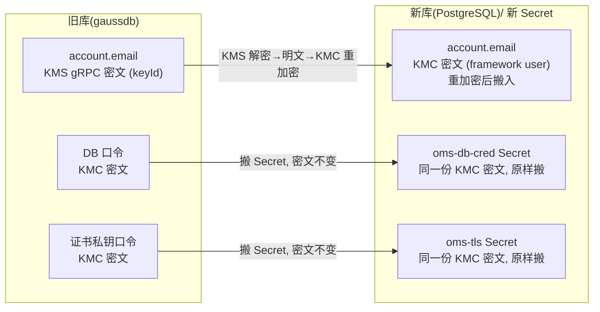

**各密文对象的迁移动作**:

| 旧密文位置 | 旧密文形态 | 迁移动作 | 新底座落点 |
|---|---|---|---|
| `iam_account.email` / `telephone` | **KMS gRPC 密文**(DB 存 keyId UUID,非 KMC 直连,见 §6.4.3) | **迁移期解密重加密**:迁移窗口内旧 KMS gRPC 服务(`crypt-grpc-server:18400`)还在线时,用 KMS 解密成明文 → 用 KMC 直连(`framework`/`platform` user)重新加密为纯大写十六进制密文 → 搬入新库。新底座 `KmcCryptoPort` 统一覆盖,不再保留 `crypt-grpc-server` 进程 | 新 `account` 表同字段(KMC 密文) |
| `iam_account.password` | PBKDF2 哈希,非加密 | **原样搬运**(§3.1) | 新 `account.password_hash` |
| DB 连接口令 | KMC 密文(`gaussdba` user) | **原样搬运**到 Secret | `oms-db-cred` Secret |
| ~~Nacos 密码 `ENC(...)`~~ | ~~KMC 密文~~ | **不迁移**——新底座不再使用 Nacos/Consul 服务发现(§8.6),对应密文与 `cube-paas-consul` 主密钥可下线(O-13) | — |
| 证书私钥口令 | KMC 密文(`nginx`/`modelenginepublic` user) | **原样搬运**(见 §5.4 证书处理) | `oms-tls` / `nginx-tls` Secret |
| `oms-extension` 业务凭据 | KMC 密文 | **原样搬运** | 新 DB |
| model-lite `GLOBAL_PWD` | 裸 KMC 密文(`modelenginepublic` user) | **原样搬运** | 新 Secret / 环境变量 |

**不再需要的原方案组件**:
- ~~KMC→SCC 重加密 Job~~(§12.2 废弃,改为"密文搬运校验 Job")
- ~~`migration_progress` 幂等表~~(O-03 的幂等需求降级——搬运不改密文,重跑只需比对行数)
- ~~KMC/SCC 并存期~~(不存在并存,全程 KMC)
- ~~KMC 下线步骤~~(KMC 永不下线)

**仍需注意的坑**:
- `PassUtils.decryptWithUser` **非幂等**(PATTERN `^[A-F0-9]+$` 不匹配返回空串)——新底座 `KmcCryptoPort.decrypt` 必须从**原始 KMC 密文**调用,不能从"已解密再喂回去"(既有记忆 `experience_kmc_decrypt_dual_track_idempotent.md`)。
- 搬运时需校验密文格式(纯大写十六进制),格式异常的记录报告并跳过。
- 旧 `kmc-ks` ConfigMap 和 `cube-paas-*` Secret **迁移前必须备份**——主密钥丢失则全部密文不可解(风险等级 **极高**)。

### 5.4 证书体系:JKS/p12 → PEM + 内部 CA

证书处理与加密体系**解耦**——即使继续用 KMC,证书格式仍需从 JKS/p12 转为 PEM(新底座 §3.4 要求统一 PEM)。但证书私钥口令的**加密方式不变**:仍用 KMC 加密,只是口令保护的私钥从 JKS 形态转为 PKCS#8 加密 PEM 形态。

按 §4.15 分类处理,**不一刀切**:

| 对象 | 做法 | 私钥口令加密 |
|---|---|---|
| 服务间证书(旧 `framework.jks` / `platform.jks` / `oms-extension-cert-secret`) | **重签**,由新内部 CA 签发共享服务证书 `oms-tls`(PEM 格式) | 新私钥口令用 KMC 加密(`KmcCryptoPort.encrypt`) |
| Nginx 对外证书 | **维持原证书不动**(O-06 已确认) | 口令不变,仍用 KMC 加密 |
| 内部 CA 私钥 | **重新生成,不迁移** | 新 CA 私钥口令用 KMC 加密 |
| 旧 p12 / JKS 文件 | 保留一个版本用于回滚,随发布下线 | — |

**O-06 已确认(2026-10-28)**:Nginx 对外证书**维持原证书不动**,不区分"客户导入的公共 CA 证书"还是"旧默认自签证书"。理由:
1. 客户局点的 Nginx 证书可能已被替换为外部 CA 签发,也可能仍是旧自签——两种情况都不再动它。
2. 换证书会让终端重新信任,客户侧有动作;维持原证书避免任何客户侧动作。
3. 服务间证书走新内部 CA + 共享服务证书(`oms-tls`),与 Nginx 对外证书是**两条独立链路**。

实现:迁移程序**跳过 Nginx 对外证书处理**,旧 `cube-security-nginx-cert` ConfigMap 原样保留;新底座 Nginx 配置指向同一个证书源。私钥口令仍用 KMC 加密(`KMC_DATA_USER=nginx`),不改变加密方式。

**证书私钥口令处理(与原方案的差异)**:

| 步骤 | 原方案(SCC) | 本次方案(KMC) |
|---|---|---|
| 1. 解开旧 JKS 口令 | 旧 KMC 主密钥解密 → 明文口令 | 同左(KMC 不变) |
| 2. 用明文口令加载旧私钥 | KMC 解出明文 → 加载 JKS → 取私钥 | 同左 |
| 3. 用新随机口令加密私钥 | 加密成 PKCS#8 PEM | 同左 |
| 4. 加密新口令 | **SCC 主密钥加密** → `tls.key.pass.enc` | **KMC 主密钥加密**(`KMC_DATA_USER=nginx` 或 `modelenginepublic`)→ `tls.key.pass.enc` |
| 5. 写入 Secret | `oms-tls` Secret | 同左 |

**私钥明文不落盘**,只在迁移 Job 进程内存短暂存在。

**model-lite 的两套 SSL Bean**(既有记忆 `experience_kmc_decrypt_dual_track_idempotent.md`):旧底座 `modellite-utils.HttpClientFactory` 走"裸密文→`decryptWithUser`→明文",`gateway.SslHttpClientFactory` 走"EPP 已解密→直接用明文"。新底座继续用 KMC,这两套 Bean 的解密逻辑**可原样保留**——不像 SCC 方案需要合并。但建议统一为一套走 `KmcCryptoPort`,减少维护负担(见 §6、§7.4)。

### 5.5 KMC 部署与运维

**迁移期 KMC 部署**:
1. 迁移前备份 `kmc-ks` ConfigMap + 全部 `cube-paas-*` Secret(与数据库备份**分离存放**)。
2. 新底座部署时,`install.sh` 的 KMC 初始化只做**挂载**(`createKmcKsConfigmap` 从备份恢复),**不执行 `create_mk(0)`**——避免覆盖旧主密钥。
3. 新底座 Pod 挂载 `kmc-ks` + `cube-paas-*`,`KMC_DATA_USER` 按模块配置(§5.2.4)。
4. 新底座 `KmcCryptoPort` 初始化时做**自检**:用已知密文调 `decrypt` 验证主密钥可用;失败则拒绝启动(与原设计 §3.5.2 自检语义一致)。

**KMC 持续运维**:
- KMC **永不下线**——是生产加解密组件,不是迁移期临时工具。
- 主密钥轮换走既有 `kmc_update_master_key.sh` + 手工重加密流程(非自动)。
- `kmc-ks` ConfigMap 和 `cube-paas-*` Secret 的管理与旧底座一致,运维无新增学习成本。

**与原设计 §3.5 的差异清单**(需新底座团队 `OMS-MIG-001` 落实):

| 原设计条目 | 本次方案 | 影响 |
|---|---|---|
| §3.5.1 单层主密钥存 `oms-crypto` Secret | 改为多用户主密钥存 `kmc-ks` + `cube-paas-*` | 不再是"一把主密钥",而是按 KSUser 隔离的多把 |
| §3.5.2 SCC 部署期生成主密钥 | 改为复用旧 KMC 主密钥,不生成新密钥 | `install.sh --init-kmc` 只挂载不创建 |
| ADR-007 `SccCryptoPort` | 改为 `KmcCryptoPort` | `CryptoPort` 接口不变,换实现类 |
| §3.5.4 证书私钥口令用 SCC 主密钥加密 | 改为用 KMC 主密钥加密 | 口令加密后端从 SCC 换 KMC |
| ADR-014 口令哈希 PBKDF2 经 SCC | **不受影响**——PBKDF2 哈希不依赖加解密组件,`PasswordEncoder` 直接实现 | 无影响 |
| §4.15 KMC→SCC 重加密 Job | **废弃**——不重加密 | 迁移程序简化 |
| §4.15 KMC 迁移完成后下线 | **废弃**——KMC 永不下线 | KMC 成为生产组件 |

---

## 6. KMC 技术背景(供新底座设计团队参考)

> **本章读者**:新底座(OMS-refactor)设计与开发团队。因合同/合规原因,新底座团队**无法获取旧底座(OMS)代码**,本章在不暴露旧代码的前提下,完整讲解 KMC 是什么、它如何工作、旧底座如何使用它,以及实现 `KmcCryptoPort`(§5.2.3)所需的全部技术信息。本章内容**已对照旧底座代码与真实环境核验**,可作为新底座设计的可信输入。

### 6.1 KMC 是什么

**KMC(Key Management Component,密钥管理组件)** 是华为内部的一款密钥管理组件,以 Python SDK 形式提供对称加解密能力。它不是云上 KMS(Key Management Service),也不是 K8s etcd 静态加密——三者是不同层次的密钥设施,本节只讲 KMC。

KMC 的几个关键特征:

| 维度 | 说明 |
|---|---|
| **形态** | 进程内 Python SDK(`import kmc.kmc`),非独立服务、非 sidecar。加解密在调用方进程内完成。 |
| **SDK 入口** | `kmc.kmc.API()`——单例入口类,方法 `encrypt(0)` / `decrypt(0)` / `create_mk(0)`(参数 `0` 是固定的算法标识,旧底座全量使用该值)。 |
| **密钥层级** | 单层主密钥(Master Key, MK)。无 KEK/DEK 二级结构——主密钥既保护数据,本身不再被上层密钥包裹。 |
| **主密钥形态** | 每个主密钥是两个文件 `data.1` + `data.2`(二进制),配一个校验文件 `.sm3`(国密 SM3 摘要)或 `.sha`(SHA256 摘要,非国密场景)。 |
| **密文形态** | **纯大写十六进制字符串**(如 `A1B2C3...`),无前缀、无 Base64、无 `ENC(...)` 包裹。正则 `^[A-F0-9]+$` 可匹配。 |
| **算法** | 旧底座客户局点未启用国密 SMMODE(O-04 已确认),全部为非国密对称加密。KMC 内部具体算法由 SDK 封装,调用方只传 `0`。 |

> ⚠️ **不要把 KMC 与 KMS 混淆**。旧底座同时存在一套 **KMS gRPC 服务**(`crypt-grpc-server.jar`,端口 18400),用于 `email`/`telephone`/JWT 加密,DB 存 keyId UUID——这是另一套机制,见 §6.4.3。本章只讲 KMC。

### 6.2 KMC 主密钥如何隔离:按 KSUser

KMC 主密钥**不是集群级单一密钥**,而是**按"KS User"(密钥用户)隔离**——每个 KSUser 拥有独立的主密钥文件,不同 KSUser 互不可解。

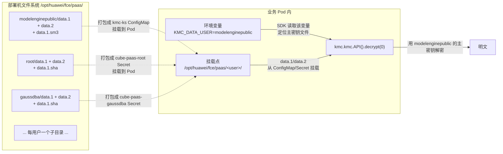

**核心机制**:
- 部署机上每个 KSUser 在 `/opt/huawei/fce/paas/<user>/` 下有独立的 `data.1` + `data.2` + 校验文件(`.sm3` 或 `.sha`)。
- KMC SDK 通过**环境变量 `KMC_DATA_USER=<user>`** 选择用哪个用户的主密钥。该变量在调用 `encrypt/decrypt` 前 export 到进程环境,SDK 内部据此定位 `paas/<user>/data.1+data.2`。
- **用 user A 加密的密文,必须用 user A 的主密钥才能解**——用 user B 的主密钥解不开。这意味着每个密文对象都隐式绑定了某个 KSUser,解密时必须用对应用户。
- 主密钥文件权限 `0600`(`defaultMode: 384`),owner 为对应用户。

### 6.3 旧底座的 KMC 用户清单

旧底座共有 **9-10 个 KSUser**,分为两类部署来源:

| KSUser | 主密钥分发载体 | 加解密对象 | 归属部署层 |
|---|---|---|---|
| `root` | `cube-paas-root` Secret | 平台根密钥 | OMS 底座 |
| `consul` | `cube-paas-consul` Secret | Consul/Nacos 密码。**新底座不再使用 Nacos/Consul 服务发现(§8.6),该密文无依赖,主密钥可下线(O-13)** | OMS 底座 |
| `gaussdba` | `cube-paas-gaussdba` Secret | gaussdb 连接口令 | OMS 底座 |
| `redis` | `cube-paas-redis` Secret | Redis 连接口令 | OMS 底座 |
| `nginx` | `cube-paas-nginx` Secret | Nginx 证书私钥口令 | OMS 底座 |
| `tomcat` | `cube-paas-tomcat` Secret | Tomcat 证书口令 | OMS 底座 |
| `fusioncube` | `cube-paas-fusioncube` Secret | 融合立方相关凭据 | OMS 底座 |
| `kms` | `cube-paas-kms` Secret | KMS gRPC 服务相关凭据。**crypt-grpc-server 迁移完成后下线(§6.4.3),若 kms user 名下仅 email/telephone/JWT 密文且已重加密搬运,主密钥可下线(O-13)** | OMS 底座 |
| `modelenginepublic` | `kmc-ks` ConfigMap(+ 对应 Secret) | model-lite `GLOBAL_PWD`(证书私钥口令)、业务 SSL 口令 | model-lite 系 / oms-extension |
| `framework`(或 `platform`) | 对应 Secret | 账户 `email`/`telephone`(旧经 KMS gRPC,迁移期解密后用本 user KMC 重加密搬运,§5.3;迁移后为 KMC 密文) | OMS Framework |

> 注:实际 KSUser 清单以客户局点 `kubectl get configmap kmc-ks` + `kubectl get secret cube-paas-*` 为准(附录 A.3 核验了 8 个 `cube-paas-*` + model-lite 系的 `modelenginepublic`,合计 9-10 个)。`framework`/`platform` 用户的确切名称迁移前需用 `kubectl get secret cube-paas-*` 核实。
>
> **新底座是否沿用这套用户划分待确定(O-13)**:上表是旧底座的现状,供新底座设计团队参考。新底座可合并、新增或重命名 KSUser;约束是"旧密文仍需新底座解密的,对应主密钥必须保留;无密文依赖的旧主密钥可下线"(见 §5.2.2)。若合并用户需用 `PassUtils.translate` 把旧密文转成新用户密文。

**两类分发载体的区别**:
- `cube-paas-*` **Secret**:承载 OMS 底座 8 个用户的主密钥本体(`data.1`/`data.2` + `.sha` 校验)。由 OMS 部署脚本 `kmc_update_master_key.sh` 上传。
- `kmc-ks` **ConfigMap**:只装 `.sm3` 校验文件,主密钥本体在配套 Secret。是 model-lite 系的 `modelenginepublic` 用户主密钥的分发载体。

### 6.4 旧底座如何调用 KMC:三种调用方式

旧底座对 KMC SDK 有**三种调用方式**,新底座 `KmcCryptoPort` 至少要覆盖前两种:

#### 6.4.1 方式一:Shell 脚本直调 Python SDK(部署期/运维期)

部署脚本和运维工具直接 `python -c "import kmc.kmc"` 调 SDK。明文/密文通过**环境变量**传入(避免命令行参数泄露):

```bash
# 加密(kmc_encrypt_decrypt_tool.sh:kmc_encrypt)
export KMC_PYTHON_PLAIN_TEXT="${明文}"
export KMC_DATA_USER="${user}"
python -c "import kmc.kmc as K;import os;print(K.API().encrypt(0))"
# 输出到 stdout:纯大写十六进制密文

# 解密(kmc_encrypt_decrypt_tool.sh:kmc_decrypt)
export KMC_PYTHON_ENCRYPT_DATA="${密文}"
export KMC_DATA_USER="${user}"
python -c "import kmc.kmc as K;import os;print(K.API().decrypt(0))"
# 输出到 stdout:明文
```

**关键点**:
- 明文经 `KMC_PYTHON_PLAIN_TEXT` 环境变量传入,密文经 `KMC_PYTHON_ENCRYPT_DATA` 传入——SDK 通过这两个固定环境变量名读取输入,不从命令行参数读。
- `KMC_DATA_USER` 决定用哪个用户的主密钥。加密和解密必须用**同一用户**。
- 调用后 `unset` 这些环境变量避免残留。

#### 6.4.2 方式二:Java shell out Python SDK(运行期,`PassUtils`)

业务进程(Java)运行期需要加解密时,通过工具类 `PassUtils` **shell out 调 Python SDK**——Java 进程 `Runtime.exec` 起 Python 子进程,通过环境变量传参,读 stdout 拿结果。

`PassUtils`(`crypt-grpc-client` 包)关键 API:

| 方法 | 签名 | 行为 |
|---|---|---|
| `encrypt(data)` | `String encrypt(String data)` | 用环境变量 `KMC_DATA_USER` 指定的用户加密;env 未设则用默认用户(`tomcat`) |
| `decrypt(data)` | `String decrypt(String data)` | 用 `KMC_DATA_USER` 解密;**密文必须匹配 `^[A-F0-9]+$`,否则返回空串** |
| `encryptWithUser(data, user)` | 显式传 user | 设 `KMC_DATA_USER=user` 后调 `encrypt` |
| `decryptWithUser(data, user)` | 显式传 user | **先校验密文格式 `^[A-F0-9]+$`,不匹配则 `log.error` 返回空串**;匹配则设 `KMC_DATA_USER=user` 调 `decrypt` |
| `translate(data, srcUser, dstUser)` | 密文用户转换 | 用 srcUser 解密 → 用 dstUser 重新加密(密文用户迁移) |

**`decryptWithUser` 的非幂等坑(重要)**:
- 该方法对输入先做 `PATTERN.matcher(data).matches()`(`^[A-F0-9]+$`)。
- 若传入的是**明文**(如已解密过的字符串),PATTERN 通常不匹配 → `log.error("decrypt data is invalid...")` + 返回空串。
- **不是幂等 no-op**——喂明文进去得到空串,不是原样返回。
- 因此 `KmcCryptoPort.decrypt` 必须只从**原始 KMC 密文**调用,不能对"已解密再喂回去"。

**Java 调用链(业务服务解密证书私钥口令)**:

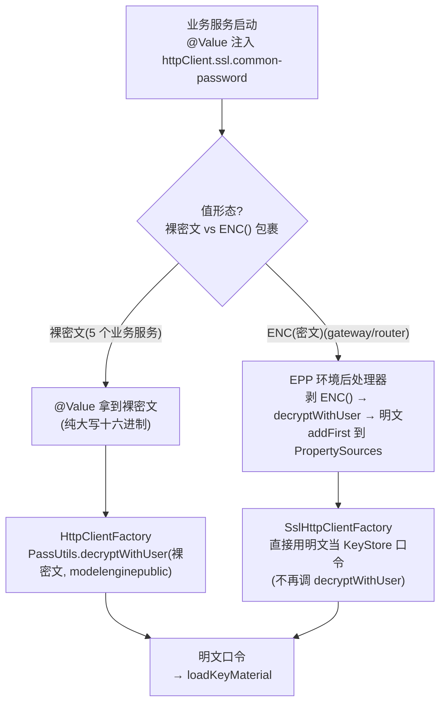

> ⚠️ **两条解密路径,各自只解密一次**。路径 A(业务服务)的 SSL Bean 自己调 `decryptWithUser`,假设上游是裸密文;路径 B(gateway/router)的 SSL Bean 假设上游已被 EPP 解密,直接用明文。两套 Bean 是**不同的类**,新底座 `KmcCryptoPort` 需明确自己走哪条路径,避免"明文进 decryptWithUser 返回空"或"密文直接当口令加载失败"。

#### 6.4.3 方式三:KMS gRPC 服务(`email`/`telephone`/JWT,非 KMC 直连)

旧底座还有一套 **KMS gRPC 服务**(`crypt-grpc-server.jar`,端口 18400),通过 `CryptClient`/`KeyMgmtEngine` 调用。这套机制与 KMC **不同**:

| 维度 | KMC 直连(方式一/二) | KMS gRPC(方式三) |
|---|---|---|
| 调用方式 | Python SDK 进程内 / Java shell out | Java gRPC 客户端 → `crypt-grpc-server.jar:18400` |
| 密文存储 | 密文直接存 DB 字段 / Secret / 环境变量 | DB 存 **keyId(UUID)**,密文由 gRPC 服务管理 |
| 用于 | 证书私钥口令、组件口令、SSL 口令、`GLOBAL_PWD` | 账户 `email`/`telephone`、JWT 加密段 |
| 密文形态 | 纯大写十六进制 | 由 gRPC 服务封装,DB 只见 keyId |

**迁移影响**:方式三(KMS gRPC)在**迁移窗口内临时保留** `crypt-grpc-server` 进程,唯一用途是解密 `email`/`telephone` 现有密文——迁移程序在 crypt-grpc-server 仍在线时用 KMS 解密成明文 → 用 KMC 直连(`framework`/`platform` user)重新加密为纯大写十六进制密文 → 搬入新库(§5.3)。**迁移完成后 `crypt-grpc-server` 进程下线,新底座不再保留任何 gRPC 加解密服务**。`KmcCryptoPort` 作为新底座 `CryptoPort` 等价实现,统一覆盖方式一/二/三的加解密入口(迁移后的 `email`/`telephone` 已是 KMC 密文,走方式一直连即可)。

### 6.5 主密钥的生命周期:生成、分发、轮换

#### 6.5.1 生成(仅部署期,`create_mk(0)`)

主密钥在**现场部署期**由 `install.sh --init-kmc` 触发生成,**不入镜像**:

```mermaid
flowchart TB
 Init["install.sh --init-kmc"] --> Loop["for user in service_list:<br/>root consul gaussdba ... modelenginepublic"]
 Loop --> SetEnv["export KMC_DATA_USER=${user}"]
 SetEnv --> CreateMK["python -c 'import kmc.kmc;print(kmc.kmc.API().create_mk(0))'"]
 CreateMK --> Write["生成/opt/huawei/fce/paas/&lt;user&gt;/data.1 + data.2"]
 Write --> Hash["生成校验文件<br/>.sha(非国密)或 .sm3(国密)<br/>chmod 600, chown &lt;user&gt;:fusioncube"]
 Hash --> Loop
```

**关键点**:
- `create_mk(0)` 每次只为**当前 `KMC_DATA_USER`** 生成一份主密钥——要为 N 个用户生成,需循环 N 次,每次改 `KMC_DATA_USER`。
- 主密钥**只生成一次**,后续部署若目录已有主密钥则跳过(兜底逻辑)。**迁移期严禁重新生成**——会换掉主密钥导致历史密文不可解(§5.2.2)。
- 校验文件有两种:`.sm3`(国密 SM3 摘要,model-lite 系用)与 `.sha`(SHA256 摘要,OMS 平台用户用)。KMC SDK 兼容两种。

#### 6.5.2 分发(ConfigMap / Secret → Pod 挂载)

主密钥生成后,打成 K8s 资源供 Pod 挂载:

```mermaid
flowchart LR
 FS["部署机<br/>/opt/huawei/fce/paas/&lt;user&gt;/<br/>data.1 + data.2 + 校验文件"] --> CM["kubectl create configmap kmc-ks<br/>--from-file=...(modelenginepublic)"]
 FS --> Sec["kubectl create secret cube-paas-&lt;user&gt;<br/>--from-file=...(OMS 平台用户)"]
 CM --> Mount["Pod 挂载<br/>/opt/huawei/fce/paas/&lt;user&gt;/<br/>defaultMode: 0600"]
 Sec --> Mount
 Mount --> SDK["KMC SDK 读取<br/>KMC_DATA_USER 定位"]
```

- model-lite 系的 `modelenginepublic` 主密钥 → `kmc-ks` ConfigMap(只装 `.sm3` 校验)+ 配套 Secret(装 `data.1`/`data.2` 本体)。
- OMS 平台用户(root/gaussdba/redis/...)→ `cube-paas-<user>` Secret(装 `data.1`/`data.2` + `.sha`)。
- 各 Helm chart 通过 `values.yaml` 锚点(`kmcKsVolume`/`kmcKsMount`)挂载到 Pod `/opt/huawei/fce/paas/<user>`,`defaultMode: 384`(即 0600)。
- **后装的 `createKmcKsConfigmap` 会 `kubectl delete` + `kubectl create` 覆盖先装的**——同 namespace 同名 ConfigMap 后写者赢。迁移期需注意挂载顺序。

#### 6.5.3 轮换(手动,无自动密文迁移)

KMC 主密钥轮换走 `kmc_update_master_key.sh`:
1. `create_mk(0)` 重新生成新主密钥(覆盖 `data.1`/`data.2`)。
2. **手工重加密全部历史密文**——旧底座**没有自动密文迁移脚本**,需运维逐个找出所有密文、用旧主密钥解密、用新主密钥重新加密。
3. 重新打包 ConfigMap/Secret 并重启所有 Pod。

**这意味着**:
- `CryptoPort.rotate`(新底座原设计的"双版本并存自动轮换")**无法直接实现**——KMC 不支持双版本并存。
- `KmcCryptoPort.rotate` **降级为手动轮换**:生成新主密钥 + 手工重加密 + 重启。需在升级文档明确说明此降级(§5.2.3)。
- 迁移期**严禁轮换**——主密钥一换,未重加密的密文全部不可解。

### 6.6 新底座实现 `KmcCryptoPort` 需知道的一切

综合以上,新底座实现 `KmcCryptoPort implements CryptoPort`(§5.2.3)的技术要点汇总:

| 要点 | 说明 |
|---|---|
| **接口方法** | `encrypt(plaintext) → ciphertext` / `decrypt(ciphertext) → plaintext` / `rotate()`(ADR-007 §3.8.3) |
| **实现机制** | 进程内 shell out Python SDK:`python -c "import kmc.kmc;print(K.API().encrypt(0))"`,明文经 `KMC_PYTHON_PLAIN_TEXT` env 传,密文经 `KMC_PYTHON_ENCRYPT_DATA` env 传 |
| **用户选择** | 通过 `KMC_DATA_USER` 环境变量。`encrypt`/`decrypt` 需传入 user 参数(对应旧 KSUser),或按模块配置默认 user(§5.2.4) |
| **密文格式** | 纯大写十六进制字符串,正则 `^[A-F0-9]+$`。`decrypt` 前应校验格式,不匹配则报错(勿返回空串掩盖问题) |
| **非幂等** | `decrypt` 只能对原始密文调用一次。喂明文进去得空串,不是 no-op。`KmcCryptoPort` 不要在已解密路径上再调 `decrypt` |
| **主密钥挂载** | Pod 需挂载 `kmc-ks` ConfigMap + `cube-paas-*` Secret 到 `/opt/huawei/fce/paas/<user>`,`defaultMode: 0600`。仍在使用的旧主密钥**迁移期原样复用,不重新生成**(§5.2.2);具体挂载哪些用户待 O-13 确定 |
| **KSUser 清单** | 旧底座 9-10 个用户(§6.3),新底座是否沿用待 O-13 确定。每个密文对象隐式绑定一个 KSUser,解密时必须用对应用户——用 A 加密的密文 B 解不开;若合并用户需用 `PassUtils.translate` 翻译密文 |
| **`rotate` 降级** | KMC 不支持双版本并存。`rotate` = `create_mk(0)` 生成新主密钥 + 手工重加密全部密文 + 重启 Pod。迁移期严禁轮换 |
| **KMS gRPC(方式三)** | `email`/`telephone`/JWT 旧密文走 KMS gRPC 服务(`crypt-grpc-server:18400`,DB 存 keyId),**不是 KMC 直连**。**迁移窗口内临时保留 crypt-grpc-server** 用于解密 email/telephone 现有密文成明文 → KMC 直连重加密为纯大写十六进制搬入新库(§5.3);**迁移完成后 crypt-grpc-server 下线,新底座不再保留任何 gRPC 加解密服务**。迁移后 email/telephone 已是 KMC 密文,`KmcCryptoPort` 走方式一直连覆盖;JWT 段若仍需加密也由 `KmcCryptoPort` 统一承接 |
| **Python 依赖** | Pod 镜像需预装 KMC Python 库(`import kmc.kmc` 可用)。旧底座在镜像构建期 `install.sh false` 只装库不生成密钥(既有经验:双阶段 isInit) |

**`KmcCryptoPort` 伪代码骨架**(供实现参考,非最终代码):

```mermaid
flowchart TB
 subgraph Enc["encrypt(plaintext, user?)"]
 E1["校验 plaintext 非空"] --> E2{"user 参数<br/>指定?"}
 E2 -->|"是"| E3["defaultUser = user"]
 E2 -->|"否"| E4["defaultUser = 模块配置默认 user<br/>(OMS=root, 业务=modelenginepublic)"]
 E3 --> E5["export KMC_DATA_USER=defaultUser<br/>export KMC_PYTHON_PLAIN_TEXT=plaintext"]
 E4 --> E5
 E5 --> E6["python -c 'import kmc.kmc;print(K.API().encrypt(0))'"]
 E6 --> E7["读 stdout → 密文(纯大写十六进制)<br/>unset 环境变量"]
 end
 subgraph Dec["decrypt(ciphertext, user?)"]
 D1["校验 ciphertext 匹配 ^[A-F0-9]+$<br/>不匹配则抛异常(勿返回空串)"] --> D2{"user 参数<br/>指定?"}
 D2 -->|"是"| D3["defaultUser = user"]
 D2 -->|"否"| D4["defaultUser = 模块配置默认 user"]
 D3 --> D5["export KMC_DATA_USER=defaultUser<br/>export KMC_PYTHON_ENCRYPT_DATA=ciphertext"]
 D4 --> D5
 D5 --> D6["python -c 'import kmc.kmc;print(K.API().decrypt(0))'"]
 D6 --> D7["读 stdout → 明文<br/>unset 环境变量"]
 end
```

**测试建议**:
- 单元测试用 KMC SDK 的测试替身(mock `kmc.kmc.API()`),不依赖真实主密钥。
- 集成测试需挂载真实 `kmc-ks`/`cube-paas-*`,用客户局点现有密文做解密验证(附录 A.3 的 `kmc-ks` ConfigMap 即测试源)。
- 重点测非幂等坑:传入明文应抛异常而非返回空串。

### 6.7 迁移期 KMC 资源清单(旧底座现状,供新底座设计参考)

下表是旧底座**现状**的 KMC 资源清单。新底座是否全部挂载、是否合并/拆分由新底座设计团队确定(**O-13**,见 §5.2.2)。约束:仍在使用的旧密文对应主密钥保留复用,不重建、不重新生成;无密文依赖的旧主密钥可下线。

| 资源名 | 类型 | 内容 | 旧底座挂载到 |
|---|---|---|---|
| `kmc-ks` | ConfigMap | `modelenginepublic` 的 `.sm3` 校验文件 | model-lite 系 Pod / oms-extension |
| `kmc-ks` 配套 Secret | Secret | `modelenginepublic` 的 `data.1`/`data.2` 本体 | 同上 |
| `cube-paas-root` | Secret | `root` 主密钥 + `.sha` | OMS 底座 Pod |
| `cube-paas-consul` | Secret | `consul` 主密钥 + `.sha` | OMS 底座 Pod。**新底座不再使用 Consul/Nacos 服务发现,无密文依赖,cube-paas-consul 可下线(O-13)** |
| `cube-paas-gaussdba` | Secret | `gaussdba` 主密钥 + `.sha` | OMS 底座 Pod |
| `cube-paas-redis` | Secret | `redis` 主密钥 + `.sha` | OMS 底座 Pod |
| `cube-paas-nginx` | Secret | `nginx` 主密钥 + `.sha` | OMS 底座 Pod |
| `cube-paas-tomcat` | Secret | `tomcat` 主密钥 + `.sha` | OMS 底座 Pod |
| `cube-paas-fusioncube` | Secret | `fusioncube` 主密钥 + `.sha` | OMS 底座 Pod |
|`cube-paas-kms` | Secret | `kms` 主密钥 + `.sha` | OMS 底座 Pod。**KMS gRPC 服务迁移完成后下线(§6.4.3),若 kms user 名下仅 email/telephone/JWT 密文且已重加密搬运,cube-paas-kms 可下线(O-13)** |
| `crypt-grpc-server` | Deployment/Service | KMS gRPC 服务(方式三,§6.4.3)。**迁移窗口内临时保留用于解密 email/telephone 现有密文;迁移完成后下线删除,新底座不再部署** | (仅迁移期)oms-identity 等需解 email/telephone 的模块 |

> ⚠️ **迁移前必须备份全部 `kmc-ks` + `cube-paas-*`**。主密钥丢失则该用户名下全部密文不可解,风险等级**极高**(§5.3、§10.2)。备份方式:`kubectl get configmap kmc-ks -o yaml > backup` + `kubectl get secret cube-paas-* -o yaml > backup`,存到迁移机离线目录。即便 O-13 决定合并/下线某些用户,也应在密文全部翻译完成后再删对应主密钥。

---

## 7. 证书体系技术背景(供新底座设计团队参考)

> **本章读者**:新底座(OMS-refactor)设计与开发团队。与 §6 KMC 技术背景同理,因新底座团队**无法获取旧底座代码**,本章在不暴露旧代码的前提下,完整讲解旧底座的证书体系:有哪些证书、各自用途、JKS/P12 格式如何加载、证书生成分发流程、oms-extension 混合形态、以及迁移方案。本章内容**已对照旧底座脚本与真实环境核验**,可作为新底座设计的可信输入。

### 7.1 旧底座证书体系总览

旧底座证书体系分**两条独立链路**:

```mermaid
flowchart LR
 subgraph Ext["链路 A: 对外 HTTPS"]
 NginxCert["Nginx 对外证书<br/>客户局点自签或外部 CA 签发<br/>维持原状不动"]
 end
 subgraph Int["链路 B: 服务间 mTLS + 内部服务 HTTPS"]
 InternalCA["内部 CA<br/>oms-extension generate_ray_cert.sh<br/>自签名根 CA"]
 GlobalCert["共享服务证书 global.crt<br/>内部 CA 签发<br/>SAN 含代表服务名"]
 Trust["信任库 ca_truststore.jks / global_trust.jks<br/>装 CA 证书"]
 end
 NginxCert -.->|"O-06: 不动, 不重签"| NginxCert
 InternalCA -->|"签发"| GlobalCert
 InternalCA -->|"导入"| Trust
 GlobalCert -->|"打成 p12 + jks<br/>分发到各 Pod"| Pods["各业务 Pod<br/>入站 HTTPS + 出站 mTLS"]
```

| 链路 | 用途 | 证书来源 | 格式 | 迁移动作 |
|---|---|---|---|---|
| **A. 对外 HTTPS** | Nginx 对外服务(用户浏览器→Nginx) | 客户局点自签或外部 CA 签发 | PEM(Nginx 原生) | **维持原状不动**(O-06 已确认) |
| **B. 服务间 mTLS** | 内部服务互调(OMS↔terrabase↔model-lite↔oms-extension) | 旧内部 CA 自签(`generate_ray_cert.sh`) | JKS + P12 混合 | **重签**:新内部 CA + PEM(§5.4) |

> ⚠️ **两条链路完全独立**。Nginx 对外证书不动不影响服务间 mTLS 重签;服务间 mTLS 重签不影响 Nginx 对外证书。不要把两者混为一谈。

### 7.2 旧底座有哪些证书文件

旧底座的证书文件按**来源**分为三类:

#### 7.2.1 OMS 平台证书(`Deploy/` 脚本生成,装 ConfigMap)

OMS 底座各组件(gateway/gaussdb/kms/redis/nginx/tomcat/appManager 等)各有独立的 JKS 证书,由 `Deploy/platform/*/cert_manage.sh` 脚本用 `keytool` 生成:

| 证书文件 | 格式 | 用途 | 分发载体 |
|---|---|---|---|
| `framework.jks` | JKS | OMS Framework 的 **出站 gRPC 客户端身份**(向 `kmsservice:18400` 的 KMS gRPC 服务)。**KMS gRPC 服务迁移完成后下线(§6.4.3),framework.jks 的出站身份用途随之消失,不迁移** | `cube-security-cert-platform` ConfigMap |
| `platform.jks` / `sso.jks` / `tomcat_common.jks` / `tomcat_fcc.jks` | JKS | Tomcat 服务端证书 + SSO 证书 | 同上 |
| `gateway.jks` | JKS | OMS Gateway 的 HTTPS 服务端证书 | `cube-security-cert-gateway` ConfigMap |
| `gaussdb.jks` / `redis.jks` | JKS | 各组件的服务端证书 | `cube-security-cert-<comp>` ConfigMap |
| `kms.jks` / `nacos.jks` 等 | JKS | KMS gRPC 服务 / Nacos 服务端证书。**KMS gRPC 服务迁移完成后下线(§6.4.3),Nacos 服务发现新底座不再使用(§8.6),这两类证书不迁移** | `cube-security-cert-<comp>` ConfigMap |
| `ca_truststore.jks` | JKS(信任库) | **OMS 平台统一信任库**——装内部 CA + gaussdb/redis 等组件的 CA 证书 | `cube-security-truststore` ConfigMap |

**关键特征**:
- OMS 平台证书用 `keytool -genkey` 生成密钥对,再用 `openssl x509 -req` 由内部 CA 签发,有效期 **18264 天(约 50 年)**。
- JKS 口令由 `ex_conf_cert_key` / `security_conf_private_key` 变量传入(来自 `sys.ini`),**不是 KMC 加密**——是部署脚本里的明文变量。
- `framework.jks` 是**身份库**(含私钥),被 `KeyManagerFactory` 加载用于出站 gRPC——**不是信任库**(名字有误导性,详见既有审计)。

#### 7.2.2 oms-extension/model-lite 共享证书(`generate_ray_cert.sh` 生成,装 Secret)

上层业务(oms-extension / terrabase / model-lite 系)共享一套由 `oms-extension` 的 `generate_ray_cert.sh` 脚本生成的证书:

| 证书文件 | 格式 | 用途 | 分发载体 |
|---|---|---|---|
| `ca.crt` + `ca.key` | PEM | **内部 CA 根证书**(自签名,`ModelEngine Root CA`) | `oms-extension-cert-secret` Secret |
| `global.crt` + `global.key` | PEM | **共享服务证书**(内部 CA 签发,`CN=ModelEngine`) | 同上 |
| `global_identity.p12` | PKCS12 | global 证书的 **Java 身份库**(含私钥+证书链) | 同上 |
| `global_trust.jks` | JKS(信任库) | **Java 信任库**——装内部 CA 证书 | 同上 |
| `pwd.txt` | 文本 | global 私钥口令的 **KMC 密文**(纯大写十六进制) | 同上 |
| `caPwd.txt` | 文本 | CA 私钥口令的 **KMC 密文** | 同上 |
| `global_with_chain.crt` | PEM | 证书链文件(global.crt + CA 证书拼接),Python/Nginx proxy 用 | 同上 |
| `global_trust_chain.crt` | PEM | 信任证书链文件,Python/Nginx proxy 用 | 同上 |

**关键特征**:
- **一套证书,所有上层业务共享**——不是每服务一份,是全局一份 `global.crt`,所有服务挂同一个 `oms-extension-cert-secret`。
- 证书 SAN 含 8 个 DNS 名:`localhost`/`model-lite-router`/`edatamate`/`ModelEngine`/`edatamate-raycluster-head-svc`/`terrabase`/`me-filter`/`oms-extension` + 动态 `POD_IP`。**不覆盖** gateway/inference/finetune 等十余个 Service——靠客户端跳过 hostname 校验兜底。
- CA 有效期 **36500 天(100 年)**,global 证书 **18250 天(50 年)**——超长有效期,无到期预警。
- 私钥口令用 KMC 加密(`kmc_encrypt <随机口令> modelenginepublic` → `pwd.txt`),**不是明文**。

#### 7.2.3 Nginx 对外证书

| 证书文件 | 格式 | 用途 | 分发载体 |
|---|---|---|---|
| Nginx 对外证书 + 私钥 | PEM | 用户浏览器→Nginx 的 HTTPS | `cube-security-nginx-cert` ConfigMap |

**关键特征**:
- 可能是客户导入的外部 CA 证书,也可能是旧默认自签证书——**O-06 已确认维持原状不动**,不区分两种情况。
- 私钥口令仍用 KMC 加密(`KMC_DATA_USER=nginx`),加密方式不变。

### 7.3 证书生成与分发流程

#### 7.3.1 oms-extension 共享证书的生成(`generate_ray_cert.sh`)

证书在 `oms-extension` Deployment 的 **init 容器**(`init-root`)中生成,**不是** cert-monitor 生成的:

```mermaid
flowchart TB
 Start["oms-extension init-root initContainer<br/>init.sh → generate_ray_cert.sh"] --> GenCA["generateCaCert:<br/>openssl genrsa 4096 → ca.key<br/>openssl req -x509 -days 36500 → ca.crt<br/>CA 口令 = kmc_encrypt(随机, modelenginepublic) → caPwd.txt"]
 GenCA --> GenGlobal["generateGlobalCert:<br/>openssl genrsa 3072 → global.key<br/>openssl req → global.csr<br/>openssl x509 -req -CA ca.crt -days18250 → global.crt<br/>私钥口令 = kmc_encrypt(随机, modelenginepublic) → pwd.txt"]
 GenGlobal --> WriteCNF["写 identity.cnf + trust.cnf<br/>记录证书/私钥/信任证书路径"]
 WriteCNF --> Done["证书写入 /cert/internal/"]
 Done --> Copy["部署机 kubectl cp 拷出 /certPersonal/<br/>kubectl create secret oms-extension-cert-secret"]
 Copy --> Mount["各业务 Pod 挂载 oms-extension-cert-secret<br/>到 /cert/internal 或 /certPersonal/"]
```

**关键点**:
- 证书**只在首次部署时生成一次**——`generate_ray_cert.sh` 检查 `identity.cnf` 是否存在,存在则跳过。
- 生成后由部署机 `kubectl cp` 拷出,打成 `oms-extension-cert-secret`(`managedFields.manager=kubectl-create`,**非 Helm 管理**)。
- 各业务 Pod 通过 `secret: { secretName: oms-extension-cert-secret }` 卷挂载到 `/cert/internal`。
- **集群中不存在共享 PVC**——证书分发靠 Secret,不是 PVC。

#### 7.3.2 OMS 平台证书的生成(`cert_manage.sh`)

OMS 平台各组件的 JKS 由 `Deploy/platform/*/cert_manage.sh` 在**部署机**上生成(非容器内):

```mermaid
flowchart TB
 Start["cert_manage.sh <service>"] --> GenKey["keytool -genkey -validity 18264<br/>RSA 3072 → <service>.jks<br/>CN=127.0.0.1"]
 GenKey --> CSR["keytool -certreq → cert-file"]
 CSR --> Sign["openssl x509 -req -CA ca.pem -days 18264<br/>→ cert-signed"]
 Sign --> ImportCA["keytool -import CARoot → ca.pem"]
 ImportCA --> ImportCert["keytool -import <service>-server → cert-signed"]
 ImportCert --> Deploy["update_binary_data_by_file<br/>cube-security-cert-<service> ConfigMap"]
```

- CA 根证书在 `${cert_temp_path}/demo_ca/` 下(`ca.pem` + `ca.key`),口令由 `security_conf_private_key` 传入。
- JKS 口令 = `ex_conf_cert_key`(来自 `sys.ini`),**不是 KMC 加密**。

#### 7.3.3 证书到 Pod 的分发

```mermaid
flowchart LR
 subgraph DeployMachine["部署机"]
 GenScript["cert_manage.sh / generate_ray_cert.sh<br/>生成证书文件"]
 end
 subgraph K8s["K8s 命名空间"]
 CM["cube-security-cert-* ConfigMap<br/>(OMS 平台证书, JKS)"]
 Sec["oms-extension-cert-secret Secret<br/>(上层业务共享证书, PEM+P12+JKS)"]
 TrustCM["cube-security-truststore ConfigMap<br/>(ca_truststore.jks)"]
 end
 subgraph Pods["业务 Pod"]
 OMS["OMS Pod<br/>挂载 ConfigMap → /opt/huawei/fce/runtime/security/"]
 Biz["oms-extension/terrabase/model-lite Pod<br/>挂载 Secret → /cert/internal 或 /certPersonal/"]
 end
 GenScript -->|"kubectl create/replace configmap"| CM
 GenScript -->|"kubectl cp + create secret"| Sec
 GenScript -->|"kubectl create configmap"| TrustCM
 CM --> OMS
 TrustCM --> OMS
 Sec --> Biz
```

**关键区分**:
- OMS 平台证书装 **ConfigMap**(`cube-security-cert-*`),不是 Secret。
- 上层业务共享证书装 **Secret**(`oms-extension-cert-secret`),因为含私钥。
- 信任库 `ca_truststore.jks` 单独装 ConfigMap(`cube-security-truststore`)。

### 7.4 Java 服务如何加载证书

旧底座 Java 服务通过**两种方式**加载证书:

#### 7.4.1 方式一:Spring Boot `server.ssl.*`(入站 HTTPS 服务端证书)

`application.yaml` 中配置 `server.ssl.*`,Spring Boot 自动加载 keystore 作为 HTTPS 服务端证书:

```yaml
# oms-extension application.yaml
server:
 ssl:
 key-store: /cert/global.p12 # 身份库(PKCS12)
 key-store-password: # 由环境变量 SERVER_SSL_KEY_STORE_PASSWORD 注入
 key-store-type: PKCS12
 key-alias: global_identity
 trust-store: /cert/truststore.jks # 信任库(JKS)
 trust-store-password: # 由环境变量 SERVER_SSL_TRUST_STORE_PASSWORD 注入
 trust-store-type: JKS
 client-auth: want # mTLS: 请求客户端证书但不强制
 enabled-protocols: TLSv1.2,TLSv1.3
```

环境变量由 `start.sh` 设置:
```bash
export SERVER_SSL_KEY_STORE=$GLOBAL_WITH_CHAIN_P12 # global_identity.p12
export SERVER_SSL_KEY_STORE_PASSWORD="ENC($GLOBAL_PWD)" # KMC 密文,ENC() 包裹
export SERVER_SSL_KEY_PASSWORD="ENC($GLOBAL_PWD)" # 同一个口令
export SERVER_SSL_TRUST_STORE=$GLOBAL_TRUST_JKS # global_trust.jks
export SERVER_SSL_TRUST_STORE_PASSWORD="ENC($GLOBAL_PWD)" # 同一个口令
```

**关键点**:
- SSL 三件套(key-store-password / key-password / trust-store-password)用的是**同一个口令密文**(都导出 `ENC($GLOBAL_PWD)`),解密后得到同一个明文口令,用于打开身份库和信任库。
- `ENC()` 前缀触发 EPP(环境后处理器)解密——`KmcEncryptedEnvironmentPostProcessor` 剥 `ENC()` → `PassUtils.decryptWithUser` → 明文,`addFirst` 到 PropertySources。
- **两层解密串联**:第一层 KMC 主密钥解密文→明文口令,第二层明文口令打开 keystore。

#### 7.4.2 方式二:Java 代码手动加载(出站客户端身份)

出站调用(如 gRPC 客户端)需手动加载 JKS 作为 `KeyManager`:

```java
// MachineTokenServiceImpl.java(Framework SDK)
byte[] bytesJks = FileUtils.readFileToByteArray(
 FileUtils.getFile(properties.getProperty("platform_framework_jks"))); // framework.jks 路径
KeyStore ks = KeyStore.getInstance("JKS");
char[] pass = PassUtils.decryptByFile(
 properties.getProperty("trustCertCollectionFilePass"), "platform").toCharArray(); // KMC 解密口令
ks.load(new ByteArrayInputStream(bytesJks), pass);

KeyManagerFactory kmf = KeyManagerFactory.getInstance("SunX509");
kmf.init(ks, pass);
GlobalConfig.sharedInstance().setKeyManager(kmf.getKeyManagers()[0]);
```

- `framework.jks` 被 `KeyManagerFactory` 加载 → 出站 gRPC 客户端身份(向 `kmsservice:18400`)。**该出站身份依赖 KMS gRPC 服务,迁移完成后 crypt-grpc-server 下线(§6.4.3),framework.jks 不再迁移**。
- 口令来自 `crypto_common.properties` 的 `trustCertCollectionFilePass` 配置项,经 `PassUtils.decryptByFile` + `KMC_DATA_USER=platform` 解密。

#### 7.4.3 信任库加载

信任库(`ca_truststore.jks` / `global_trust.jks`)被 `TrustManagerFactory` 加载,用于校验对端证书:

| 信任库 | 格式 | 装什么 | 谁用 |
|---|---|---|---|
| `ca_truststore.jks` | JKS | OMS 内部 CA + gaussdb/redis 等组件 CA 证书 | OMS 平台服务(gateway/framework/...) |
| `global_trust.jks` | JKS | oms-extension 内部 CA 证书(`ca.crt`)+ OMS CA(`oms_ca_path`) | 上层业务服务(oms-extension/terrabase/model-lite) |

`global_trust.jks` 由 `generate_java_jks.sh` 用 `keytool -import` 逐个导入 CA 证书生成,口令与身份库相同(`GLOBAL_PWD` 解密后)。

### 7.5 mTLS 的实际校验状态(重要)

> ⚠️ **mTLS 证书只加密,不认证**——这是旧底座最重要的证书体系特征,新底座设计需知晓。

旧底座 Java Feign 客户端虽然挂载了 mTLS 证书,但实际**主动放弃了对端身份校验**:

```mermaid
flowchart TB
 subgraph "Java Feign 客户端 SSL 配置"
 EmptyTM["TrustManager 空实现<br/>checkServerTrusted() 方法体为空<br/>getAcceptedIssuers() 返回空"]
 NoopHV["HostnameVerifier 恒真<br/>(s, sslSession) -> true"]
 end
 EmptyTM --> Result["证书只提供传输加密<br/>不校验对端身份"]
 NoopHV --> Result
 Result --> Auth["服务身份靠 X-Auth-Token-Inner<br/>(KMS 共享机器账号 token)<br/>用户身份靠 JWT/user header 透传"]
```

| 维度 | 旧底座 Java 路径 | 旧底座 Go 路径(me-filter) |
|---|---|---|
| TrustManager | **空实现**(不校验对端证书) | 真正校验(`NewMtlsClient`) |
| HostnameVerifier | **恒真**(不校验主机名) | 真正校验 |
| 服务身份认证 | `X-Auth-Token-Inner`(KMS 共享 token) | mTLS 双向校验 |

**这意味着**:
- SAN 不覆盖全部服务不是 bug——靠客户端跳过 hostname 校验兜底,这是设计取舍。
- 新底座若启用**真实 mTLS 校验**,需确保证书 SAN 覆盖所有需被 hostname 调用的服务名,或改用 Service IP + IP SAN。
- 新底座 §3.4.1 明确"mTLS 只做准入不做身份,身份靠 `client_id`"——与旧底座实际行为一致,只是显式化了。

### 7.6 cert-monitor 的角色(不续签)

旧底座有 `cert-monitor` 组件,但它的能力**被误解**:

| 维度 | cert-monitor 实际行为 | 常见误解 |
|---|---|---|
| 监控什么 | `identity.cnf` 文件的 **mtime**(修改时间) | ~~监控证书 `notAfter` 到期时间~~ |
| 触发什么 | mtime 变化时**删 Pod 触发重启**(让 Pod 重新挂载新证书) | ~~自动续签证书~~ |
| 生成证书 | **不生成**——只重启 | ~~生成新证书~~ |
| 部署状态 | 只有 oms-extension 的 cert-monitor 实际部署 | model-lite 的因 `INIT_CERT` 恒 false 被 Helm 跳过 |

**关键结论**:cert-monitor 是"重新挂载触发器",不是"证书轮换器"。证书到期需**人工重跑生成脚本**,cert-monitor 不会自动续签。

### 7.7 证书迁移方案(新底座需实现的部分)

#### 7.7.1 迁移分类

| 对象 | 迁移动作 | 私钥口令 | 详见 |
|---|---|---|---|
| **服务间证书**(旧 `global.crt`/`global_identity.p12`/`global_trust.jks`/`framework.jks`/`platform.jks`) | **重签**:新内部 CA 签发共享服务证书 `oms-tls`(PEM 格式) | 新私钥口令用 KMC 加密(`KmcCryptoPort.encrypt`) | §5.4 |
| **Nginx 对外证书** | **维持原状不动**(O-06 已确认) | 口令不变,仍用 KMC 加密 | §5.4 |
| **内部 CA 私钥** | **重新生成**,不迁移旧 CA | 新 CA 私钥口令用 KMC 加密 | §5.4 |
| **旧 p12/JKS 文件** | 保留一个版本用于回滚,随发布下线 | — | §5.4 |
| **真实环境 `cube-security-serverca`** | **可复用**——已是 PEM 格式(`ca.key`+`ca.pem`),前提是 SAN 覆盖新底座服务名 | — | 附录 A.3 |

#### 7.7.2 证书重签流程(新底座 `OMS-MIG-001` 需实现)

```mermaid
flowchart TD
 Start["证书重签 Job"] --> GenCA["1. 生成新内部 CA<br/>(或复用 cube-security-serverca)<br/>新 CA 私钥口令 = KmcCryptoPort.encrypt(随机)"]
 GenCA --> GenCert["2. 生成新共享服务证书<br/>openssl genrsa + req + x509<br/>SAN 覆盖新底座全部服务名<br/>有效期建议 1-5 年(非 50 年)"]
 GenCert --> EncPwd["3. 私钥口令加密<br/>KmcCryptoPort.encrypt(明文口令, modelenginepublic)<br/>→ tls.key.pass.enc"]
 EncPwd --> WriteSecret["4. 写入 oms-tls Secret<br/>tls.crt + tls.key(PKCS#8 加密 PEM) + tls.key.pass.enc"]
 WriteSecret --> Mount["5. 业务 Pod 挂载 oms-tls<br/>新底座 SSL Bean 用 PEM 加载"]
```

**新底座需注意的实现要点**:

| 要点 | 说明 |
|---|---|
| **PEM 替代 JKS** | 新底座 §3.4 要求统一 PEM 格式。旧 JKS/P12 → PEM 转换:`keytool -importkeystore -srckeystore global_identity.p12 -srcstoretype PKCS12 -destkeystore temp.jks` → `openssl pkcs12 -in global_identity.p12 -nocerts -out tls.key`(需口令解密)。但迁移方案是**重签不是转换**——直接用新 CA 签发新 PEM 证书,不从旧 JKS 提取私钥。 |
| **SAN 必须覆盖全** | 旧证书 SAN 不全靠客户端跳过校验兜底。新底座若启用真实 mTLS 校验,SAN 需覆盖所有需被 hostname 调用的服务名。建议用 cert-manager 或脚本动态生成 SAN。 |
| **有效期建议缩短** | 旧证书 50-100 年有效期无到期预警。新底座建议 1-5 年 + 引入 cert-manager 或定时续签 Job(新底座 §3.4.3 证书巡检)。 |
| **私钥口令仍用 KMC** | 新私钥口令用 `KmcCryptoPort.encrypt(明文口令, modelenginepublic)` 加密,存 `tls.key.pass.enc`。**不迁到 SCC**(V0.6 决策)。解密时 `KmcCryptoPort.decrypt(tls.key.pass.enc, modelenginepublic)` → 明文口令 → 加载 PEM 私钥。 |
| **私钥明文不落盘** | 迁移 Job 进程内存中短暂存在明文口令和明文私钥,写盘前必须加密。 |
| **两套 SSL Bean 统一** | 旧底座有两套 SSL Bean(业务服务走 `decryptWithUser`、gateway 走 EPP 解密后直接用明文)。新底座建议统一为一套走 `KmcCryptoPort`,减少维护负担。 |
| **信任库处理** | 旧 `ca_truststore.jks` / `global_trust.jks` 不迁移——新底座用新 CA 证书构建新信任库(PEM 格式 `ca.crt` 挂 ConfigMap)。 |

#### 7.7.3 Nginx 对外证书的特殊处理

Nginx 对外证书**完全不动**——迁移程序跳过它:

- 旧 `cube-security-nginx-cert` ConfigMap 原样保留。
- 新底座 Nginx 配置指向同一个证书源。
- 私钥口令仍用 KMC 加密(`KMC_DATA_USER=nginx`),加密方式不变。
- 不区分"客户导入的外部 CA 证书"还是"旧默认自签证书"——两种情况都不动。

**理由**(O-06 已确认):
1. 换证书会让终端重新信任,客户侧有动作;维持原证书避免任何客户侧动作。
2. 服务间证书走新内部 CA 是独立链路,与 Nginx 对外证书无关。

### 7.8 迁移期证书资源清单(新底座需处理的全部资源)

| 旧资源 | 类型 | 内容 | 迁移动作 |
|---|---|---|---|
| `oms-extension-cert-secret` | Secret | 旧共享证书(ca.crt/key, global.crt/key, global_identity.p12, global_trust.jks, pwd.txt, caPwd.txt) | **不迁移**——新底座用新 CA 重签 `oms-tls` |
| `cube-security-cert-platform` | ConfigMap | framework.jks(出站 KMS gRPC 身份,**KMS 下线后无用途**), platform.jks, sso.jks, tomcat_common.jks, tomcat_fcc.jks | **不迁移**——新底座用新 CA 重签;framework.jks 因 KMS gRPC 服务下线(§6.4.3)无对应出站用途 |
| `cube-security-cert-gateway` | ConfigMap | gateway.jks | **不迁移**——新底座用新 CA 重签 |
| `cube-security-cert-{gaussdb,redis,nginx,...}` | ConfigMap | 各组件 JKS/P12 | **不迁移**——新底座组件用新证书 |
| `cube-security-cert-{kms,nacos}` | ConfigMap | kms.jks / nacos.jks(KMS gRPC 服务 / Nacos 服务端证书) | **不迁移**——KMS gRPC 服务迁移完成后下线(§6.4.3)、Nacos 服务发现新底座不再使用(§8.6),两类证书无用途 |
| `cube-security-truststore` | ConfigMap | ca_truststore.jks | **不迁移**——新底座用新 CA 构建新信任库 |
| `cube-security-nginx-cert` | ConfigMap | Nginx 对外证书 + 私钥 | **原样保留不动**(O-06) |
| `cube-security-serverca` | ConfigMap | ca.key + ca.pem(内部 CA,已是 PEM) | **可复用**(前提 SAN 覆盖新服务名)或重新生成 |
| `cube-security-priv` | ConfigMap | 11 个 `*.conf`(各组件私钥口令的 KMC 密文) | **不迁移**——新证书用新口令,新口令用 KMC 加密存新 Secret |
| **新资源 `oms-tls`** | Secret | tls.crt + tls.key(PKCS#8 PEM) + tls.key.pass.enc | **新建**——重签的共享服务证书 |

> ⚠️ **迁移前备份全部证书 Secret/ConfigMap**。旧证书保留一个版本用于回滚——P7 旧系统下线前不删除。回滚时业务 Pod 重新挂载旧证书即可恢复。

---

## 8. 上层业务适配

来源:`OMS依赖分析.md` 已梳理三套上层业务对旧 OMS 的 10 类依赖。本节聚焦迁移期需要改动的契约。

### 8.1 oms-extension 的去留

**关键结论**:新底座把旧 `oms-extension` 的资源组、运行日志收集、第三方账户管理能力**吸收进 OMS 自身模块**(M04 资源组与用户组、M09 运行日志、M01 外部账号)。`oms-extension` 作为独立进程**整体下线**。

迁移动作:
- 资源组 RPC `GET /rpc/v1/{user}/user-resource-groups` → 新底座 `GET /oms/internal/v1/authz/scope`。
- 运行日志注册 `POST /rpc/v1/run-logs/register` → 新底座 M09 任务中心注册。
- 第三方账户导入 `ThirdPartyAccount` → 新底座 `external_account`(§3.5)。
- 巡检 `CertCollectController` → 新底座 M13 证书巡检。

### 8.2 三套上层业务的 Feign 客户端改造

按 §8.6 五个固定契约重写:

| 旧调用 | 新调用 | 影响模块 |
|---|---|---|
| `OmsUserClient` → Framework `/iam/accounts` | `GET /oms/internal/v1/authz/scope`(见范围)+ Nginx 注入 `X-OMS-Sid` | oms-extension(下线)、terrabase、model-lite |
| `OmsExtensionClient` → oms-extension `/rpc/v1/{user}/user-resource-groups` | 同上 | terrabase、model-lite |
| `OperateLogFeignClient` → Framework `/log/operateLogs` | `POST /oms/internal/v1/audit/oplog` | 三套全改 |
| `AlarmFeignClient` → Monitor `/events/*` | 新底座告警接口(路径待 DD 确认,§10.1 命名空间 `alarm` 域) | 三套全改 |
| `LicenseClient` → Framework `/license/*` | 新底座 `license` 域 + `POST /oms/internal/v1/metering/report` | oms-extension、model-lite |
| `OmsBackupRegisterFeignClient` → Framework `/system/backup` | 新底座 `task` 域备份注册 | 三套全改 |
| `PermissionFeignClient` / `MenuFeignClient` / `RoleFeignClient` / `BlockRegisterRunner` | 新底座模块注册接口(§8.6) | 三套全改 |
| `CertMgmtClient` / `CertFeignClient` → Framework `/certificate` | 新底座 `cert` 域 | oms-extension、model-lite、terrabase |
| `CryptClientUtils` (KMS gRPC) | **删除**——KMS gRPC 服务迁移完成后下线(§6.4.3)。email/telephone 现有密文在迁移窗口内由 crypt-grpc-server 解密成明文 → KMC 直连重加密搬入新库;新底座加解密统一走 `CryptoPort` + `KmcCryptoPort`(KMC 适配层,§5.2.3),不再有 gRPC 客户端 | 三套全改(删除 gRPC 调用,接口换 `CryptoPort`,后端 KMC) |

### 8.3 用户上下文获取方式的变化

旧底座(既有记忆 `experience_usercontext_filter_include_path.md`):上层业务用 `UserContextFilter` 从 JWT 解析 `user`/`userId`/`role` 塞入 ThreadLocal,资源组列表由 `OmsExtensionFactory.getUserGroups()` 从 oms-extension 拉取预填到 `LoginUserDto.resourceGroups`。

新底座(§3.1.3 第 4-5 条):业务**不自己解 JWT、不自己查会话**,只信任 Nginx 注入的 `X-OMS-Sid` / `X-OMS-Subject`;可见范围调 `GET /oms/internal/v1/authz/scope` 拿资源组集合(按 `sid` 缓存 ≤60s),下推 SQL。

迁移动作:
- 删除三套业务中的 `UserContextFilter` / `JwtParser` / `JsonToken` 直接解析逻辑。
- 改为读 `X-OMS-Sid` 头 + 调 `authz/scope`。
- **`UserContextFilter.include-path` 配置项整体废弃**——既有记忆里的"新端点需补 include-path"坑在新底座不再存在。

### 8.4 JWT 校验的变化

旧:OMS 网关用 KMC 加密 payload 生成 JWT,下游用 KMC 解密校验(`E5`/`D14`)。
新:OMS 签发 HMAC JWT(载荷只含 `sid`),业务不校验 JWT,只透传 `X-OMS-Sid`。HMAC 签名密钥存 Secret,其保护方式与加解密体系一致——继续用 KMC 时,HMAC 密钥本身可用 `KmcCryptoPort.encrypt` 加密存 Secret(原设计为 SCC 加密,本次改为 KMC,见 §5)。

迁移动作:
- 删除 `model-lite/gateway/utils/UserUtil.java` 中 `new JsonToken(jwtStr)` 解密逻辑。
- 删除 `terrabase` / `oms-extension` 中的 `JwtParser` 直接使用。
- model-lite-gateway 的 JWT 校验职责整体移除,改为信任 Nginx 注入头。

### 8.5 服务间认证的变化

旧:mTLS(双向 TLS)+ `X-Auth-Token-Inner` 机机账号 token(KMS 共享 token)。
新:mTLS(共享服务证书,**只做准入不做身份**,§3.4.1 第 3 条)+ `client_id` + 令牌(§4.7)。

迁移动作:
- mTLS 证书由新内部 CA 重签,业务 Pod 挂 `oms-tls` Secret。
- `FeignInnerRequestAuthInterceptor` 注入的 `X-Auth-Token-Inner` 改为新底座的 `client_id` + 令牌(模块注册时分配)。
- **身份不再靠证书**——授权建立在 `client_id` / 用户 `sid` 上,证书只验证"在圈内"。

### 8.6 服务间调用方式:Feign 拦截器 → HTTP client 直连

新底座 §4.7 明确:"服务之间用 **HTTP client 直连对方的 Service IP**,**不使用 Feign 拦截器**,也不存在独立网关进程"。OMS 不是网关,不转发业务流量;用户访问业务系统的请求由 **Nginx 的 `auth_request`** 调 OMS 判定能力维度。

这是对三套上层业务影响**最大**的一条契约变化——旧底座下三套业务**普遍使用 Feign + Nacos + `FeignInnerRequestAuthInterceptor`** 调用 OMS Framework/Monitor/KMS 与 oms-extension(见 `OMS依赖分析.md` §1.2)。

迁移动作:
- 三套业务中调用 OMS 契约接口的 Feign client(`OmsExtensionClient`、`OperateLogFeignClient`、`AlarmFeignClient`、`LicenseClient`、`OmsBackupRegisterFeignClient`、`PermissionFeignClient`/`MenuFeignClient`/`RoleFeignClient`/`BlockRegisterRunner`、`CertMgmtClient`/`CertFeignClient`)**改为 HTTP client 直连 OMS Service IP**,URL 走集群内 DNS(`oms-svc.<ns>.svc.cluster.local:8080`)。
- 删除 `HttpsFeignClientConfig` + `FeignInnerRequestAuthInterceptor` 这套统一拦截器;认证改为在 HTTP client 层注入 `client_id` + 令牌头。
- **新底座抛弃 Nacos 服务发现,统一走 K8s Service 机制**——无论调 OMS 还是业务之间互调,服务发现一律改为 K8s Service + 集群内 DNS(`<svc>.<ns>.svc.cluster.local`),不再依赖 Nacos/Consul。三套业务中的 Nacos 客户端配置(`spring.cloud.nacos.*`)整体删除。
- 业务之间的互相调用(如 terrabase 调 model-lite)同样改 K8s Service + HTTP client,不保留 Feign + Nacos。
- **OMS-INT-001 待补充**:新底座需提供 HTTP client 的参考实现(Java/Go/Python),含 `client_id` + 令牌注入、mTLS 配置、重试策略,供三套业务照搬。

#### 8.6.1 `model-lite-gateway` 调 OMS 的两类方式(O-12 已确认)

`model-lite-gateway` 是上层业务调 OMS 的最大调用方。核验 `application.yml` 的 `spring.cloud.gateway.routes`(20 条路由全部指向上层业务互调,**无一条路由转发到 OMS**)后确认:gateway 调 OMS 不是"路由转发",而是以下**两类直接调用**,迁移时分别切换:

**类一:Feign client 调 Framework(旧 OMS 主仓)**——6 个 `@FeignClient(value = "Framework")` + 1 个 `@FeignClient(name = "Monitor")`:

| FeignClient | path | 用途 | 迁移后 |
|---|---|---|---|
| `PermissionFeignClient` | `/framework/v1/iam/permission` | 批量注册权限 | 改 HTTP client 调新底座模块注册接口 `POST /oms/internal/v1/registry/modules`(§8.6) |
| `MenuFeignClient` | `/framework/v1/customize` | 菜单注册 | 同上,并入模块注册 body 的 `menus` 字段 |
| `CertMgmtClient` | `/framework/v1/certificate` | 证书管理 | 改 HTTP client 调新底座 `oms-cert` 域接口 |
| `LicenseClient` | `framework/v1/license` | License | 改 HTTP client 调新底座 `license` 域接口 |
| `OperateLogFeignClient` | `/framework/v1/log/operateLogs` | 操作日志上报 | 改 HTTP client 调新底座 `POST /oms/internal/v1/audit/oplog`(§8.6 契约 5) |
| `OmsBackupRegisterFeignClient` | `framework/v1/system/backup` | 备份注册 | 改 HTTP client 调新底座 `common` 域备份接口 |
| `AlarmFeignClient` | `/monitor/v1`(`name="Monitor"`) | 告警 | 改 HTTP client 调新底座 `alarm` 域接口 |

切换方式(O-12 已确认):**按新底座方式用 Service + HTTP client + `client_id` 令牌**。`@FeignClient(value = "Framework")` 通过 Nacos 解析到旧 OMS `omsservice` Service 的路径全部废弃,改为直连新底座 Service IP + HTTP client + `client_id` 令牌头。

**类二:硬编码 HTTPS URL调 oms-extension**——4 处 `https://oms-extension:8021/rpc/v1/*`:

| 调用方 | 旧 URL | 用途 | 迁移后 |
|---|---|---|---|
| `InnerChatAuthFilter` | `/rpc/v1/{username}/user-resource-groups` | 取用户资源组(chat 鉴权) | 新底座 `GET /oms/internal/v1/authz/scope`(§8.6 契约 3) |
| `ResourceQuotaImpl` | `/rpc/v1/create` | 创建资源组 | 新底座 M04 资源组管理接口 |
| `FlexibleGatewayService` | `/rpc/v1/delete/{id}` | 删除资源组 | 同上 |
| `HttpClientUtil` | `/rpc/v1/resource-groups/list` | 列资源组 | 同上 |
| `LogCollectRegister` | `/rpc/v1/run-logs/register` | 日志收集注册 | 新底座 `POST /oms/internal/v1/audit/oplog` 或专用日志注册接口 |

切换方式:新底座**没有 oms-extension 进程**(§1 已确认整体下线),这 4 处硬编码 URL 全部废弃,按上表映射到新底座 5 个固定契约接口(§8.6),同样走 Service + HTTP client + `client_id` 令牌。

**`resources/register` 目录的 JSON**(三个仓都有:gateway/oms-extension/terrabase):

```
register/
 api/commercial/ # API 权限点声明(oms-api.json + rest-service-*.json)
 alarm/ # 告警规则
 menu/ # 菜单
 backup/ # 备份配置
 hyper_fusion_block/ # 区块
 previous_version_block/
```

这些 JSON 是各模块启动时向旧 OMS 注册自身权限点/菜单/告警的声明文件(不是路由表)。**O-12 已确认(2026-10-28)**:迁移后这些 JSON **按新底座模块注册逻辑改写并注册**——对应新底座 `POST /oms/internal/v1/registry/modules`(§8.6),body 含 `module`/`version`/`permissions`/`roles`/`bindings`。改写要点:
- `api/*.json` 的 `ResourceKey`(旧格式 `"method uri"`)改写为新底座权限点编码 `<域>.<对象>.<动作>`(§3.1.2)。
- `Roles` 字段从旧角色名(`SYS_ADMIN` 等)映射到新底座角色编码(`systemAdmin` 等,§4.5)。
- **旧 `OPEN_API` 角色拆分注册**(§4.5):负责服务间调用的模块在注册时声明一个业务角色 `openAPI`(`source=MODULE`),其 `permissions` = 旧 `OPEN_API` 角色持有权限点的新等价编码;该角色的 `bindings` 指向承载 OPEN_API 账户的用户组(聚类产生,见 §4.5 第 3 条)。用户组还需额外绑定准入角色 `m2mAccess`(机机通道),由迁移程序在创建用户组时一并写入。
- `menu/*.json` 并入模块注册 body 的 `menus` 字段。
- `alarm/*.json` 改写为新底座 `alarm` 域的告警规则注册格式。

> **O-08 已确认(2026-10-28)**:迁移期除**正在运行的推理业务工作负载**外,其他服务都允许中断,建议**全量切换**——不保留 Feign 与 HTTP client 并存的过渡态。这意味着:
> - 调用 OMS 契约接口的 Feign client 一次性全部改为 HTTP client 直连,不分批。
> - 切换在 P4 业务切换阶段一次性完成(§9.1),相应服务停机重启加载新代码。
> - **"推理业务工作负载"指由 `model-inference` CRD 经 controller-manager 创建的额外 Deployment/StatefulSet**(承载实际推理任务),**不是** `model-lite-inference` 这个管理 Pod——后者是控制面,可随 P4 正常重启。
> - **关键简化**:这些推理业务 Pod **不涉及迁移面**——它们不挂载证书、不使用 HTTP client/Feign、不直接调用 OMS 契约接口。因此 P4 全量切换时无需为它们做任何特殊处理,它们在迁移窗口内可继续运行不受影响。
> - 工作量评估:原"分两批切"的降风险策略不再适用,需在一次发布内完成全部 Feign→HTTP client 改造 + 静态扫描 + 全功能回归。

### 8.7 资源归属与上层业务契约的适配

§8.1-§8.6 覆盖了"调 OMS 接口"的改造,但还有一类适配点来自**新底座对资源归属与授权的契约变化**——这些不是简单换 URL,而是上层业务的**业务逻辑与数据模型**需要调整。

#### 8.7.1 资源创建时显式指定目标资源组(最重要的逻辑变更)

**旧底座行为**(代码核实 `oms-extension/MvcUserInfoService.java:44`):上层业务取用户资源组时调 `resourceGroupService.getUserGroups(user).get(0).getId()`——只取**第一个**(即用户"本组"),作为创建资源时的固定归属。即使用户能同时看到/操作本组 + `public_group`,**新建资源一律落到本组**;`admin_group` 内的用户也只能创建到 `admin_group`。目标资源组不由前端选择,后端从用户上下文隐式取。

**新底座契约**(`OMS-总体设计-精炼版.md` §2.5 第 6 关、§3.1.3 第 5 条):资源归属由上层业务在创建时**显式指定** `resourceGroupId`,OMS 在第 6 关判定"目标资源所属资源组 ∈ 该用户组关联的资源组集合",不在集合内则 403。可见资源组集合由 `GET /oms/internal/v1/authz/scope` 返回(按 `sid` 缓存 ≤60s),可能含多个资源组(用户组关联了多个资源组的情况,§4.1 聚类产生)。

**差异对照**:

| 维度 | 旧底座 | 新底座 |
|---|---|---|
| 目标资源组来源 | 后端隐式取 `getUserGroups(user).get(0)`(本组) | 前端/调用方显式传 `resourceGroupId` |
| 可选范围 | 单一(本组) | 用户组关联的全部资源组集合(`authz/scope` 返回,可能多个) |
| public_group 能否创建 | 否(只能看不能写) | 取决于用户组是否关联了 public_group——关联了即可创建 |
| admin_group 内用户 | 固定创建到 admin_group | 可在 `UG_ADMIN_FULL` 关联的全部资源组中任选 |
| OMS 侧校验 | 不校验(信任后端取的本组) | 第 6 关同步校验,越界 403 |

**迁移动作**:
- **前端**:所有"创建资源"表单(推理服务、模型、数据集、训练任务等)新增**目标资源组选择器**,下拉项来自 `authz/scope` 返回的可见资源组集合;单资源组场景默认选中、可改;多资源组场景必选。旧前端没有这个选择器(后端隐式决定)。
- **后端**:创建资源的接口新增 `resourceGroupId` 入参(必填),透传到 CR 的 label / 资源记录的 `resource_group_id`;删除"从用户上下文取本组"的隐式逻辑(`MvcUserInfoService.getUserResourceGroupId` 那套)。
- **CRD spec**:`ModelInference` 等 CR 的 `spec` 或 `metadata.labels` 中的 `USER_RESOURCE_GROUP_ID_LABEL_KEY` 改为接收前端传入值,不再由后端固定填充本组。
- **public_group 语义变化提示**:旧底座 public_group 是"只读共享",新底座若用户组关联了 public_group 则"可读可写"——需产品确认这是否符合预期(见 §10.1 O-14)。
- **admin_group 账户**:旧固定创建到 admin_group,新可在全部资源组中任选——需产品确认(同 O-14)。

> **为什么这是最重要的逻辑变更**:这是上层业务**业务语义**的变化,不是接口换 URL。漏改会导致前端无选择器、后端无入参、资源全部创建失败或归属错乱。需逐个排查三套业务中所有"创建资源"路径。

#### 8.7.2 资源查询接口实现(`IF-RES-QUERY`,新底座回调)

新底座资源清单的归属**OMS 侧只读**(HC-09、OI-M04-005),由 OMS 周期回调上层业务的 `GET /resources?type=&ids=` 获取资源全集及其 `resourceGroupId`(`OMS-总体设计文档.md` §7.6.1)。旧底座没有这个"OMS 回调业务"的反向接口——旧底座的资源归属在 oms-extension 的 `t_resource_group` + 业务侧 CR label 各存一份,无统一对账。

**迁移动作**:
- 三套业务各实现 `IF-RES-QUERY` 端点:按资源类型返回 `{resourceId, name, type, resourceGroupId, status, updatedAt}`,支持分页游标、超时 10s、单页 ≤500。
- 资源类型清单在模块注册时声明(§8.6 `POST /oms/internal/v1/registry/modules` 的 `resourceTypes` 字段)。
- 该接口返回的 `resourceGroupId` 必须与创建时写入的归属一致——即 §8.7.1 前端选的那个资源组 ID 要在 CR/记录里持久化,并能被此查询接口回读。
- **全量对齐语义**:返回集合即该类型当前资源全集,OMS 据此更新归属;接口失败时 OMS 保留上次结果并标记"陈旧",**不删除既有归属**。

#### 8.7.3 操作前同步权限校验(`IF-AUTHZ-CHECK`,业务调 OMS)

新底座要求上层业务在**操作资源前同步调用** `POST /api/authz/check` 做两维判定(能力 × 范围),不得仅凭本地缓存(OI-G-007、§7.6.2)。旧底座的范围校验在上层业务本地用 `LoginUserDto.resourceGroups` 集合做内存判定,不回调 OMS。

**迁移动作**:
- 三套业务在所有"单资源操作"(启停推理、删除模型、修改训练任务等)路径上新增对 `IF-AUTHZ-CHECK` 的同步调用,入参 `(主体标识, 资源标识/资源组+类型, 动作)`。
- **fail-closed**:OMS 不可达时**拒绝操作**,不降级到本地缓存判定(与旧底座的"本地集合判定"语义相反,是安全增强)。
- 性能:P95 ≤50ms(OMS 侧 Redis 缓存);上层可加本机短缓存但不得替代同步校验。
- 列表查询场景用 `authz/scope` 下推 SQL(§8.3 已覆盖),单资源操作用 `IF-AUTHZ-CHECK`——两条路径分工不同,不要混用。

#### 8.7.4 前端静态资源发布到 PVC(`IF-STATIC-PUBLISH` / Job 直写)

新底座前端静态资源**不打进应用镜像**,统一落 `oms-static` PVC(RWX),由 Nginx 只读挂载托管(`OMS-总体设计文档.md` §7.6.6、ADR-021)。上层业务模块的页面资源需发布到 PVC 的 `/modules/<code>/<version>/` 目录并原子切 `current`。旧底座前端资源随业务镜像一起部署,无独立发布流程。

**迁移动作**:
- 三套业务的 CI 流水线新增"静态资源发布"步骤:同命名空间直接 Job 挂 PVC 写;跨命名空间走 `IF-STATIC-PUBLISH` 接口。
- 生成 `manifest.json`(entry、assets、构建时间、SHA-256),OMS 校验后原子切换 `current` 软链。
- 菜单/路由前缀在模块注册时声明(§8.6),Nginx 按注册信息渲染路由——路由变更只需 reload 不重启,但**新增模块的首发**仍需注册生效。

#### 8.7.5 Nginx 路由注册(声明式)

新底座路由由模块注册时声明(`IF-ROUTE-REGISTER`),OMS 统一渲染到 Nginx ConfigMap,热加载生效(§7.6.7)。旧底座 model-lite-gateway 的 `spring.cloud.gateway.routes` 是各业务自维护的 20 条路由(O-12 已确认全是业务互调,无 OMS 转发)。

**迁移动作**:
- model-lite-gateway 的 20 条业务互调路由:迁移后这些路由是否仍需保留取决于上层业务是否还经 gateway 转发——若全切 HTTP client 直连则可整体废弃;若保留业务互调网关则按新底座路由注册格式声明。
- 上层业务对外暴露的路径前缀需在模块注册时登记,否则 Nginx 不渲染、路由 404。

#### 8.7.6 适配点清单汇总

| § | 适配点 | 性质 | 影响模块 | 旧→新 |
|---|---|---|---|---|
| 8.7.1 | 资源创建显式指定资源组 | **业务逻辑变更** | 三套全改 | 隐式本组 → 显式入参 + 前端选择器 |
| 8.7.2 | 资源查询接口 `IF-RES-QUERY` | 新增反向接口 | 三套全改 | 无 → 实现回调端点 |
| 8.7.3 | 操作前同步校验 `IF-AUTHZ-CHECK` | 新增同步调用 | 三套全改 | 本地内存判定 → 同步调 OMS + fail-closed |
| 8.7.4 | 前端静态资源发布 PVC | 新增 CI 步骤 | 三套全改 | 随镜像部署 → Job 发布到 PVC |
| 8.7.5 | Nginx 路由注册 | 新增声明 | model-lite-gateway | 自维护 routes → 模块注册声明 |
| 8.1-8.6 | Feign/HTTP/JWT/认证等(前序章节) | 接口替换 | 三套全改 | 见各节 |

> **OMS-INT-001 待补充**:§8.7.2-8.7.5 涉及的四个新契约接口(`IF-RES-QUERY`/`IF-AUTHZ-CHECK`/`IF-STATIC-PUBLISH`/`IF-ROUTE-REGISTER`)的参考实现、入参出参 schema、fail-closed 处理范例应由新底座团队在 `OMS-INT-001` 上层业务接入指南中提供,供三套业务照搬。其中部分接口在 `OMS-总体设计文档.md` 标注"契约待定/待实现",需新底座团队定稿后回填本文。

---

## 9. 迁移执行步骤

### 9.1 阶段划分

| 阶段 | 动作 | 停机? | 可回滚? |
|---|---|---|---|
| P0 准备 | 部署新 OMS schema(空库)、挂载旧 KMC 主密钥(`kmc-ks` + `cube-paas-*`) | 否 | 是(删 schema) |
| P1 数据搬迁 | 跑账户/RBAC 迁移程序:旧库读 → 字段映射 → 新库写(密文原样搬运,不重加密) | 否(旧库只读) | 是(新库清空重跑) |
| P2 密文搬运校验 | 校验搬运后的 KMC 密文可解(`KmcCryptoPort.decrypt` 自检) | 否 | 是(重跑校验) |
| P3 证书重签 | 服务间证书重签;**Nginx 对外证书不动**(O-06) | 否 | 是(保留旧 p12/JKS) |
| P4 上层业务切换 | 三套业务发新版本,Feign 客户端切到新契约(§8) | **短停**(业务侧滚动升级) | 是(业务回滚到旧版本) |
| P5 割接 | 流量从旧 OMS 切到新 OMS;旧会话失效,用户重新登录 | **用户感知**(强制重登) | 是(DNS/Ingress 切回) |
| P6 验证 | 全功能回归、权限矩阵核对、证书巡检、加解密自检 | 否 | — |
| P7 旧系统下线 | 停旧 OMS、删除旧 Secret/ConfigMap(**KMC 保留不下线**) | 否 | **否**(回滚需重新部署旧 OMS) |

### 9.2 迁移程序的设计原则(与 §10.1 对齐)

- 脚本命名 `V<版本>__<描述>.sql`,幂等、带校验和、可续跑。
- **运行期禁止 DDL**,应用账号没有 DDL 权限——所有 DDL 在 `migrate` 阶段完成。
- 迁移程序**不读旧库做字段映射猜业务语义**(§9.4)——字段映射规则在本文 §3.2、§4 中固化,迁移程序只是执行。
- 迁移进度表 `migration_progress` 记录每步完成的主键范围,重跑时跳过(注:继续用 KMC 方案下,密文搬运校验天然幂等,`migration_progress` 仅用于数据搬迁阶段的主键追踪,不用于重加密幂等——见 §12.2)。

### 9.3 回滚策略

按 §4.15 "回滚 = 换回挂载并重启,不涉及数据反向迁移":

- **P1-P3 回滚**:清空新库,旧库未被修改,旧 OMS 继续服务。
- **P4 回滚**:业务回滚到旧版本镜像,旧 OMS 继续服务。
- **P5 回滚**:Ingress/DNS 切回旧 OMS,旧会话恢复(旧 Redis token 未清)。
- **P7 后回滚**:需重新部署旧 OMS——旧库数据在 P1-P3 未被删除,可恢复;但 P5 后用户在新 OMS 产生的数据(新会话、新操作日志)会丢失。**P7 是不可逆点**。

### 9.4 停机窗口预估

**O-07 已确认(2026-10-28)**:30-70 分钟停机窗口可接受,无需灰度。结合 O-08(除推理业务工作负载外全量切换),停机计划如下:

| 步骤 | 预估时长 | 备注 |
|---|---|---|
| P1 数据搬迁 | 5-30 分钟(1 万账户级别) | 全量读旧库写新库 |
| P2 密文搬运校验 | <1 分钟(几十条密文解密自检) | §5.3 密文原样搬运,只校验可解 |
| P3 证书重签 | 1-5 分钟 | Job 生成 + Secret 写入;Nginx 证书不动(O-06) |
| P4 业务切换 | 10-30 分钟 | 三套业务的管理 Pod 一次性全量重启加载新代码(O-08),不分批;**推理业务工作负载不受影响**(见下方说明) |
| P5 割接 | 5 分钟 | Ingress 切换 + 旧会话清理;不灰度,全量切 |
| **总计** | **30-70 分钟** | 主要停机在 P4-P5 |

**推理业务工作负载的处理**(O-08 联动澄清):
- "推理业务工作负载"指由 `model-inference` CRD 经 `model-lite-controller-manager` 创建的额外 Deployment/StatefulSet(承载实际推理任务),**不是** `model-lite-inference` 管理 Pod——后者是控制面,可随 P4 正常重启。
- 这些推理业务 Pod **不涉及迁移面**:不挂载证书、不使用 HTTP client/Feign、不直接调用 OMS 契约接口。迁移窗口内可继续运行,P4 全量切换无需为它们做任何特殊处理。
- 唯一注意点:P4 重启 `model-lite-controller-manager` 时,需确认 controller 不会因重启而误删/重建已存在的推理业务工作负载——这是 controller 的常规行为保障,不属于迁移设计范畴。

---

## 10. 风险与待确认项

### 10.1 待确认项(需客户/产品决策)

| 编号 | 问题 | 影响范围 | 责任方 |
|---|---|---|---|
| ~~O-01~~ | ~~旧底座"非 admin 系统管理员"权限扩大到所有组,客户是否接受?~~ **已确认(2026-10-28):不接受扩大。新建 `UG_ADMIN_FULL` 用户组承载 admin_group 内全部账户(含非 admin 账户)并关联全部资源组;admin_group 外的系统管理员按 §4.1 聚类,只关联本组+public_group;内置"系统管理员组"留空** | §4.2 / §12.1 流程 | 迁移程序 |
| ~~O-02~~ | ~~客户局点是否曾手工调整过内置角色的权限点?~~ **已确认(2026-10-28):未手工调整,以出厂权限配置为准;R-06 无需评审,无需补"角色权限覆写"能力** | §4.6 权限点迁移 | — |
| ~~O-03~~ | ~~旧表是否方便加 `encryption_version` 列?~~ **已确认(2026-10-28):旧表不能新增字段;改用新侧 `migration_progress` 表记录已迁主键做幂等。V0.6 更新:继续用 KMC 方案下不重加密,`migration_progress` 降级为数据搬迁主键追踪,密文校验天然幂等(§10.2)** | §5.3 / §10.2 流程 | 迁移程序 |
| ~~O-04~~ | ~~客户局点是否启用过 SMMODE(国密 PBKDF2WithHmacSM3)?~~ **已确认(2026-10-28):未启用国密,全部为 PBKDF2WithHmacSHA256;无需 algorithm 字段路由** | §3.3 密码哈希兼容 | — |
| ~~O-05~~ | ~~旧 `internal_admin` 账户在客户局点是否跑过业务?~~ **已确认(2026-10-28):未跑业务;按普通账户处理,服务间调用能力由新底座 `m2mAccess` + `openAPI` 业务角色承接** | §3.4 内置账户 | 迁移程序 |
| ~~O-06~~ | ~~客户是否已有公共 CA 签发的对外证书?~~ **已确认(2026-10-28):Nginx 对外证书维持原状不动,不区分自签/外部导入;私钥口令继续用 KMC 加密(V0.6 更新:不迁到 SCC)** | §5.4 证书 / §0 速览 | 迁移程序 |
| ~~O-07~~ | ~~停机窗口 30-70 分钟是否可接受?是否需要灰度?~~ **已确认(2026-10-28):可接受,无需灰度,全量切换** | §9.4 停机窗口 | — |
| ~~O-08~~ | ~~迁移期是否允许 Feign 与 HTTP client 并存?~~ **已确认(2026-10-28):除推理业务工作负载(CRD 创建的额外 Deployment/StatefulSet,不涉及迁移面——无证书/HTTP client/Feign)外其他服务允许中断,全量切换 Feign→HTTP client,不并存;`model-lite-inference` 是管理 Pod 可正常重启** | §8.6 / §9.4 | 业务/架构 |
| ~~O-09~~ | ~~新底座是否保留 USBKey/双因子认证?~~ **已确认(2026-10-28):旧底座未使用,新底座不保留,相关字段直接丢弃** | §3.2 字段映射 | — |
| ~~O-10~~ | ~~新底座密码策略是否兼容旧 `IAM_HISTORY_PWD_T` 表结构?~~ **已确认(2026-10-28):不要求兼容表结构,但历史密码数据必须迁移到新底座密码策略对应的位置** | §3.2 / 附录 A.2 | 迁移程序 |
| ~~O-11~~ | ~~`iam_user_resource_t` 表用途?是否与 `t_group_user_relation` 重叠?~~ **已确认(2026-10-28):忽略。该表是 framework 预留的细粒度单资源授权基础设施,实际未承载业务数据,无上层业务调用,鉴权链路不读;与 `t_group_user_relation`(资源组粒度)职责不同非冗余。迁移时不迁数据、新底座不重建** | 附录 A.2 | — |
| ~~O-12~~ | ~~`model-lite-gateway` 内 OMS 路由规则是配置化还是硬编码?~~ **已确认(2026-10-28):前提纠正——gateway 不路由到 OMS,20 条路由全是业务互调。gateway 调 OMS 是两类直接调用:1 6 个 FeignClient 调 Framework 2 4 处硬编码 URL 调 oms-extension。迁移后全部按新底座方式 Service + HTTP client + `client_id` 令牌;`resources/register` JSON 按新底座模块注册逻辑改写** | §8.6.1 / 附录 A.4 | 业务/架构 |
| O-13 | 新底座 KMC 的 KSUser 划分如何设计?旧底座按组件拆了 9-10 个用户(`root`/`consul`/`gaussdba`/`redis`/`nginx`/`tomcat`/`fusioncube`/`kms`/`platform` + 产品层 `modelenginepublic`,见 §6.3)。新底座是否沿用、合并、新增用户由新底座设计团队确定。**约束**:旧密文仍需新底座解密的,其加密时用的 `KMC_DATA_USER` 对应主密钥**必须保留**;若某用户名下密文在新底座不再使用,该主密钥可删。需输出:(1) 新底座最终保留/新建的 KSUser 清单;(2) 每个旧用户→新用户的映射(若合并则需 `PassUtils.translate` 把旧密文转成新用户密文);(3) 哪些旧用户名下密文在新底座不再使用、对应主密钥可下线。 | §5.2.2 / §6.3 | 新底座设计团队 |
| O-14 | 资源创建归属语义变化是否接受?旧底座 public_group 对普通账户是"只读共享"、admin_group 内账户固定创建到 admin_group;新底座下用户组关联了哪些资源组就能在其中任选创建(§8.7.1)。需产品确认两点:(1) 普通账户用户组是否应关联 public_group 且允许在 public_group 创建资源(旧底座不允许)?还是只关联本组?(2) `UG_ADMIN_FULL` 关联全部资源组后,admin_group 内账户能在任意资源组创建资源——是否符合预期?若需保留"admin_group 内账户固定创建到 admin_group"的旧行为,需在 §4.2 的 `UG_ADMIN_FULL` 资源组关联上做特殊收敛。 | §8.7.1 / §4.2 | 产品 |

### 10.2 已识别风险

| 风险 | 等级 | 缓解 |
|---|---|---|
| 旧 `t_group_user_relation` 用 `user_name` 字符串关联,迁移时若旧库有同名账户合并/改名,关联错位 | 高 | 迁移前用 `framework.IAM_ACCOUNT` 视图核对 user_name 唯一性;同名冲突先在旧库修复 |
| 旧账户挂多个角色导致聚类后用户组同时含 `systemAdmin`+`auditAdmin`,违反三权分立 | 高 | 迁移程序拒绝并报告冲突,人工拆分(§4.7) |
| 旧 `OPEN_API` 角色拆分时,新业务角色 `openAPI` 的权限点声明遗漏(旧 `method uri` 编码未全部映射到新 `fn.*`/`cap.*`) | 中 | 模块注册前对照旧 `IAM_ROLE_PERMISSION_RELATION_T` 中 `role_name=OPEN_API` 的行逐条核对;迁移程序输出"已声明/未声明"清单供人工 review(§4.5、§4.6) |
| 聚类产生的用户组漏绑准入角色 `m2mAccess`/`humanAccess`,新底座拒绝保存 | 中 | 迁移程序按 `login_type` 位标志自动补绑(位1→humanAccess,位2→m2mAccess),写入前断言每个用户组至少含一个准入角色(§4.7) |
| KMC 密文搬运后主密钥不匹配导致密文不可解(如 `KMC_DATA_USER` 配置错误) | 中 | §12.2 密文搬运校验 Job 逐条验证可解;失败项报告并人工排查用户映射 |
| 旧 KMC 主密钥丢失(如 `kmc-ks` ConfigMap / `cube-paas-*` Secret 被误删),密文不可解 | **极高** | 迁移前备份 `kmc-ks` ConfigMap + 全部 `cube-paas-*` Secret;主密钥与数据库备份分离存放;KMC 永不下线,主密钥持续在用(§5.5) |
| 上层业务漏改某处 JWT 直接解析,割接后该路径 401 | 中 | P6 验证阶段全功能回归;构建期静态扫描 `JsonToken`/`JwtParser` 引用 |
| 上层业务漏改"资源创建"路径,仍隐式取本组而非显式传 `resourceGroupId`,割接后创建失败或归属错乱 | **高** | 逐个排查三套业务所有创建资源接口;构建期静态扫描 `getUserGroups(...).get(0)` / `getUserResourceGroupId` 调用点;前端全量回归创建表单(§8.7.1) |
| 漏实现 `IF-RES-QUERY`/`IF-AUTHZ-CHECK` 任一契约接口,导致 OMS 资源清单陈旧或单资源操作越权 | 高 | 按 §8.7.6 清单逐项联调;`IF-AUTHZ-CHECK` 漏调会导致安全降级(本地缓存判定可被绕过),需代码审查确认每个单资源操作路径都加了同步校验 |
| 证书重签后客户端未预置新 CA 根,mTLS 握手失败 | 中 | 共享服务证书只集群内有效,业务 Pod 由 Helm 自动挂载 `oms-ca` ConfigMap;对外证书按 O-06 处理 |
| 旧 `default_group` 内的账户在新底座无明确用户组归属 | 低 | 按 §4.1 聚类,最差情况归入"未分组"用户组(无角色无资源组,登录后无权限),由管理员手工调整 |
| Feign→HTTP client 切换工作量大、易遗漏某 Feign 方法 | 中 | 按"调 OMS 的 client"与"业务间 client"分批切;构建期静态扫描 Feign 注解;OMS-INT-001 提供 HTTP client 参考实现 |
| **email/telephone 迁移期解密依赖旧 KMS gRPC 服务(`crypt-grpc-server:18400`)仍在线**——若迁移窗口内 crypt-grpc-server 不可用,现有 email/telephone 密文无法解密成明文,重加密搬运链路断裂 | **高** | 迁移前确认 `crypt-grpc-server` Deployment 健康 + 端口可达;迁移程序先做小批量解密验证再全量;保留旧 DB 备份以便重试;crypt-grpc-server 在 email/telephone 全部重加密完成前**不得下线**(§5.3、§6.4.3) |
| **KMS gRPC 服务过早下线**——迁移完成后误删 crypt-grpc-server 前仍有未重加密的 email/telephone 密文,导致永久不可解 | **高** | 迁移程序输出"已重加密 email/telephone 行数 vs 旧库总行数"对账报表,两者相等且校验通过后才允许下线 crypt-grpc-server;下线动作由迁移程序最后一步触发,不手工执行 |

---

## 11. 与新底座 `OMS-MIG-001` 的分工

本文是 ME 侧(上层业务 + 旧 OMS 数据模型)的迁移设计,作为 `OMS-MIG-001` 的输入。`OMS-MIG-001` 由新底座团队编写,负责:

- 新底座 schema 的 `baseline` 脚本与 `migrate` 执行器(§9.4)。
- `KmcCryptoPort` 适配层实现(`CryptoPort` 接口的 KMC 等价实现,§5.2.3)、旧 KMC 主密钥挂载与自检(§5.5)。
- **KSUser 划分设计(O-13)**:确定新底座最终保留/合并/新增的 KSUser 清单 + 旧用户→新用户映射 + 可下线的旧主密钥(§5.2.2、§6.3)。
- 内部 CA 生成、证书重签 Job 的实现(§3.4)。
- 内置账户、内置角色、内置用户组、内置资源组的初始化 INSERT(`migrate` 阶段)。

ME 侧负责:

- 三套上层业务的 Feign 客户端改造(§8.2)。
- `UserContextFilter` / `JwtParser` 直接解析逻辑的删除(§8.3、§8.4)。
- `oms-extension` 进程的整体下线(§8.1)。
- 业务侧模块注册信息的重新登记(菜单、权限点、资源类型,§3.8.3)。
- **资源创建改为显式指定资源组**:前端加资源组选择器、后端加 `resourceGroupId` 入参、删除隐式取本组逻辑(§8.7.1)。
- **实现新底座契约接口**:`IF-RES-QUERY`(资源查询回调)、`IF-AUTHZ-CHECK`(操作前同步校验)、`IF-STATIC-PUBLISH`/Job(静态资源发布 PVC)、路由声明式注册(§8.7.2-8.7.5)。角色配置等权限信息上层业务按需调 OMS 内部接口获取,新底座无推送机制。
- **`OMS-INT-001` 上层业务接入指南**:新底座团队提供四个新契约接口的参考实现与 schema(§8.7.6)。

---

## 12. 附录:迁移程序流程

### 12.1 账户与 RBAC 迁移主流程

迁移程序按以下顺序执行,每阶段对应正文相应章节:

```mermaid
flowchart TD
 Start([migrate_accounts_and_rbac]) --> S1

 subgraph S1["1 账户迁移 §3.2"]
 Q1["读 IAM_ACCOUNT_T WHERE deleted=0"]
 Q1 --> M1{user_type?}
 M1 -- "=1 SSO" --> SSO["auth_type=SSO<br/>password_hash=NULL<br/>写 account + external_account<br/>source: CAS/THIRD_PARTY"]
 M1 -- "本地账户" --> Local["map_account_fields<br/>写account<br/>PBKDF2 哈希原样搬运"]
 end

 S1 --> S2

 subgraph S2["2 角色迁移 §4.5"]
 Q2["读 IAM_ROLE_T<br/>排除内置角色清单"]
 Q2 --> R2["写 role<br/>code = biz.role_name<br/>source = MODULE"]
 R2 --> R3["OPEN_API 特殊处理:<br/>新建业务角色 openAPI<br/>权限点 = 旧 OPEN_API 持有的<br/>method-uri → fn.*/cap.* 编码"]
 end

 S2 --> S3

 subgraph S3["3 用户组建模 §4.1 + §4.2"]
 Pre["查 admin_group_members<br/>group_id='002'<br/>查 all_rgs"]
 Pre --> Full["3a 建 UG_ADMIN_FULL<br/>成员 = admin_group_members<br/>角色 = systemAdmin<br/>资源组 = ALL"]
 Pre --> Cluster["3b admin_group 外账户聚类<br/>key = (sorted roles, sorted rgs)<br/>同 key 入同用户组"]
 Cluster --> Bind["绑定角色 + 资源组<br/>若含 systemAdmin:<br/> rgs = rgs ∪ public_group<br/> rgs.discard admin_group 不扩权<br/>按 login_type 补准入角色:<br/> 位1=人机→humanAccess<br/> 位2=机机→m2mAccess<br/> OPEN_API 账户→m2mAccess+openAPI"]
 end

 S3 --> S4

 subgraph S4["4 资源组迁移 §4.3"]
 Q4["读 t_resource_group WHERE is_deleted=false"]
 Q4 --> R4["map_rg_fields<br/>写 resource_group<br/>public/default/admin 保留为内置"]
 end

 S4 --> S5

 subgraph S5["5 验证断言"]
 V1["account 数 == 旧活跃账户数"]
 V2["无账户在两个用户组"]
 V3["无用户组含互斥角色 §3.1.4"]
 V4["UG_ADMIN_FULL.members == admin_group_members"]
 V5["UG_ADMIN_FULL.resource_groups == ALL"]
 V6["非 admin_group 的 SYS_ADMIN 用户组<br/>不含 admin_group"]
 end

 S5 --> End([迁移完成])
```

**要点提示**:
- 12 顺序无依赖,可并行;3 依赖 1(需要 active_accounts)和 2(需要角色清单)。
- 3a 必须在 3b 之前——`UG_ADMIN_FULL` 先占位,聚类时跳过 admin_group 内账户,避免重复入组。
- 5 验证断言失败即中止迁移,不写脏数据。
- 完整字段映射见 §3.2(账户)/ §4.3(资源组)/ §4.5(角色编码);幂等机制见 §12.2。

### 12.2 密文搬运校验 Job(KMC 原样保留,不重加密)

> **决策变更(2026-10-29)**:原 V0.4/V0.5 的"KMC→SCC 重加密 Job"已废弃。新底座继续用 KMC,旧密文原样搬运,本 Job 只做**搬运后的可解性校验**,不做重加密。

```mermaid
flowchart TD
 Start([verify_kmc_ciphertext_migration]) --> LoadKeys

 LoadKeys["加载旧 KMC 主密钥<br/>挂载 kmc-ks + cube-paas-*<br/>初始化 KmcCryptoPort"]
 LoadKeys --> SelfTest

 SelfTest["自检: 用已知密文调 decrypt<br/>验证主密钥可用<br/>失败则拒绝继续"]
 SelfTest --> Loop

 Loop{"遍历新库全部<br/>KMC 密文字段<br/>还有记录?"}
 Loop -- "有" --> Check
 Loop -- "无" --> Report

 Check["对每条密文:<br/>1. 格式校验 (纯大写十六进制)<br/>2. KmcCryptoPort.decrypt(ciphertext, user)<br/>3. 验证返回非空"]
 Check --> Result{"解密成功?"}
 Result -- "是" --> Loop
 Result -- "否" --> LogErr["记录失败项<br/>(table, pk, user, 错误原因)<br/>不删除密文, 待人工处理"]
 LogErr --> Loop

 Report["生成校验报告:<br/>总密文数 / 成功数 / 失败数<br/>失败清单"]
 Report --> Assert{"失败数 == 0?"}
 Assert -- "是" --> End([校验通过, 密文可解])
 Assert -- "否" --> Fail([校验失败, 需人工介入])
```

**与原重加密 Job 的对比**:

| 维度 | 原方案(重加密) | 本次方案(搬运校验) |
|---|---|---|
| Job 职责 | KMC 解密 → SCC 重新加密 → 写回 | 密文原样搬运 → 校验可解 |
| 修改密文 | 是(密文从 KMC 格式变 SCC 格式) | **否**(密文不变) |
| 幂等表 | `migration_progress`(防二次加密) | 不需要(不修改密文,重跑只校验) |
| 失败处理 | 跳过并记录,后续重跑 | 记录失败项,人工排查主密钥/用户映射 |
| 依赖 | 旧 KMC 主密钥 + 新 SCC 主密钥 | 仅仍在使用的旧密文对应 KMC 主密钥(具体清单待 O-13) |

**O-03 的状态变更**:O-03 原为"旧表不能加字段,用 `migration_progress` 表做幂等"——在 KMC 继续使用方案下,**不再需要 `migration_progress` 幂等表**(不重加密即无二次加密风险)。O-03 降级为"密文搬运校验 Job 的失败重试机制"——重跑只校验不修改,天然幂等。

---

## 13. 变更记录

| 版本 | 日期 | 变更 |
|---|---|---|
| V0.1 | 2026-10-27 | 初版:账户/密码、RBAC、证书、加解密、上层业务适配、执行步骤 |
| V0.2 | 2026-10-27 | 补充 §6.6 Feign→HTTP client 直连契约变化(新底座 §4.7);新增 O-08 待确认项 |
| V0.3 | 2026-10-27 | 新增附录 A:真实环境 `model-engine-syc` 命名空间只读核验报告;修正表名 `IAM_ACCOUNT_T`→`iam_account`;标注 `email/telephone` 走 KMC 加密;标注 `iam_user_resource_t` 表 |
| V0.4 | 2026-10-28 | O-09 确认:旧底座未使用 USBKey/双因子认证,新底座不保留;§3.2 字段映射表 + 附录 A.2 字段表 + §8.1 待确认项三处同步更新,`usb_key_*`/`two_factor_auth_enable` 改为"直接丢弃"。O-10 确认:不要求新底座兼容旧 `IAM_HISTORY_PWD_T` 表结构,但历史密码数据必须迁到新底座密码策略对应位置;附录 A.2 + §8.1 同步更新。O-01 确认:不接受非 admin_group 系统管理员扩权;§4.1/4.2/4.7/§10.1 伪代码重写——新建 `UG_ADMIN_FULL` 承载 admin_group 全部账户(含非 admin 账户)+ 关联全部资源组;admin_group 外的 SYS_ADMIN 按聚类归普通组只关联本组+public_group;内置"系统管理员组"留空;§3.4 internal_admin 归入说明同步修正。O-02 确认:客户局点未手工调整内置角色与权限,以出厂配置为准;R-06 无需评审,无需补"角色权限覆写"能力;§4.6 + §8.1 同步更新。O-03 确认:旧表不能新增字段,改用新侧 `migration_progress` 表做幂等;§5.2 + §10.2 伪代码重写。O-04 确认:未启用国密 SMMODE,全部为 PBKDF2WithHmacSHA256,无需 algorithm 字段路由;§3.3 + §0 速览同步更新。O-05 确认:internal_admin 未跑业务,按普通账户处理,服务间调用由新底座 openAPI 角色承接;§3.4 + §8.1 同步更新。O-06 确认:Nginx 对外证书维持原状不动,不区分自签/外部导入,私钥口令仍从 KMC 迁到 SCC;§5.3 证书处理表 + §0 速览 + §7.1 P3 阶段 + §8.1 同步更新。O-07 确认:30-70 分钟停机窗口可接受,无需灰度,全量切换;§7.4 停机窗口重写。O-08 确认:除推理业务工作负载(CRD 创建的额外 Deployment/StatefulSet,不涉及迁移面——无证书/HTTP client/Feign)外其他服务允许中断,全量切换 Feign→HTTP client,不并存;`model-lite-inference` 是管理 Pod 可正常重启;§6.6 评估段 + §7.4 P4 阶段 + §8.1 同步澄清。O-11 确认:`iam_user_resource_t` 表忽略——是 framework 预留的细粒度单资源授权基础设施,实际未承载业务数据、无上层业务调用、鉴权链路不读;与 `t_group_user_relation` 职责不同非冗余;迁移时不迁数据、新底座不重建;附录 A.2 + §8.1 + 附录 A.6 同步更新。O-12 确认:前提纠正——gateway 不路由到 OMS(20 条路由全是业务互调),调 OMS 是两类直接调用(6 个 FeignClient 调 Framework + 4 处硬编码 URL 调 oms-extension);迁移后全部按新底座方式 Service + HTTP client + `client_id` 令牌;`resources/register` JSON 按新底座模块注册逻辑改写;新增 §6.6.1 两类调用映射表 + 附录 A.4 纠正路由转发误述 + §8.1 + 附录 A.6 同步更新|
| V0.5 | 2026-10-29 | 完善旧底座现状描述与资源组建模。1新增 §1.0 旧系统部署形态与替换范围:含三层部署架构 mermaid 图(第一层旧 OMS 底座 oms/gateway/gaussdb/kms/redis/nginx/consul/cert-monitor + 第二层 terrabase/terrabase-db/oms-extension + 第三层 model-lite 系 10 Deployment)+ 替换范围 mermaid 图(oms/oms-extension→新底座,terrabase 及以上做适配)+ 三层职责表 + 替换动作表 + gaussdb 特殊处理说明。2扩充 §1.3 资源组为四个子节:§1.3.1 旧资源组建模(mermaid 跨 schema 关系图 + `t_resource_group`/`t_group_user_relation` 表结构表 + 三个内置资源组 000=public/001=default/002=admin 语义表);§1.3.2 旧体系授权模型(资源组×角色二维正交 mermaid 图 + 关键特征:无用户组层、admin_group 硬编码特权)。3新增 §4.0 新旧授权模型对照:§4.0.1 旧模型 mermaid、§4.0.2 新模型 mermaid(账户→用户组唯一归属 R-02→角色/资源组)、§4.0.3 二维折叠一维 mermaid。4重写 §4.1 聚类策略:伪代码改 mermaid 流程图;新增 §4.1.1 聚类示例(6 账户示例表 + 聚类结果 mermaid 图 + 关键观察)。5§4.2 admin_group 特殊处理伪代码改 mermaid 判定流程图。6§4.4 资源组关系重挂伪代码改 mermaid 账户维度→用户组维度图。7§3.3 密码校验伪代码改 mermaid 流程图。8§10 附录"迁移程序伪代码"改名为"迁移程序流程",§10.1/§10.2 全部伪代码改 mermaid 流程图。9§8.1 待确认项表中 §4.2/§10.1、§5.2/§10.2 引用从"伪代码"改"流程"。全文已无 `text` 伪代码块 |
| V0.6 | 2026-10-29 | **加解密方案重大变更:不切换 SCC,继续使用 KMC。** 1§5 整章重写:原"KMC→SCC 重加密"方案废弃,改为 KMC 持续使用方案。新增 §5.1 决策背景(利用 ADR-007 CryptoPort 等价实现替换扩展点,实现 `KmcCryptoPort`);§5.2 密钥体系设计(§5.2.1 旧 KMC 密钥体系回顾含 9-10 个 KSUser 清单 + §5.2.2 新底座复用旧主密钥方案 mermaid 图 + §5.2.3 `KmcCryptoPort` 适配层设计 mermaid 图 + §5.2.4 各模块 `KMC_DATA_USER` 配置表);§5.3 迁移简化——无需重加密 Job(旧密文原样搬运 mermaid 图 + 各密文对象迁移动作表 + 废弃组件清单);§5.4 证书体系(私钥口令仍用 KMC 加密,与原方案 SCC 加密的步骤对比表);§5.5 KMC 部署与运维(迁移期挂载不创建 + 持续运维 + 与原设计 §3.5 差异清单 7 项)。2§1.5 补充两套加解密机制并存说明(KMC 直连 PassUtils + KMS gRPC 服务 CryptClient)。3§0 速览表更新(加解密/证书两行 + 总体顺序 mermaid 图改 6 步)。4§1.0.2 替换范围表/图更新(SCC→KMC)。5§2.5 新底座加解密设计更新(主密钥复用旧 KMC + CryptoPort 实现换 KmcCryptoPort)。6§3.2 字段映射表 email/telephone 行更新(原样搬运不重加密)。7§7.2 CryptClientUtils 行更新。8§7.4 JWT HMAC 密钥保护方式更新。9§8.1 P0/P2/P7 阶段表更新。10§8.4 停机表 P2 更新。11§9.1 O-03/O-06 更新。12§9.2 风险表更新(KMC 密文校验 + 主密钥丢失风险)。13§10 分工更新。14§11.2 从"KMC→SCC 重加密 Job"重写为"密文搬运校验 Job"mermaid 图 + 对比表 + O-03 状态变更。15附录 A.2/A.3/A.6 同步更新。 |
| V0.7 | 2026-10-29 | **新增 §6 KMC 技术背景章节**(供无法获取旧底座代码的新底座设计团队参考)。因新底座团队无法获取旧 OMS 代码,新增独立章节完整讲解 KMC:§6.1 KMC 是什么(进程内 Python SDK、单层主密钥、纯大写十六进制密文、与 KMS 区别);§6.2 主密钥按 KSUser 隔离机制(`KMC_DATA_USER` 环境变量选主密钥、不同用户互不可解、mermaid 图);§6.3 旧底座 9-10 个 KSUser 清单(含主密钥分发载体 + 加解密对象 + 归属部署层);§6.4 三种调用方式(shell 脚本直调 / Java PassUtils shell out / KMS gRPC 服务,含 `PassUtils` API 表 + `decryptWithUser` 非幂等坑 + 两条解密路径 mermaid 图 + KMC 与 KMS gRPC 对比表);§6.5 主密钥生命周期(生成 `create_mk(0)` 仅部署期不入镜像 mermaid 图 + 分发 ConfigMap/Secret 挂载 mermaid 图 + 轮换手动无自动密文迁移);§6.6 新底座实现 `KmcCryptoPort` 需知道的一切(技术要点汇总表 + 伪代码骨架 mermaid 图 + 测试建议);§6.7 迁移期 KMC 资源清单(新底座需挂载的全部 ConfigMap/Secret 表 + 备份警告)。同步重编章节号:原 §6 上层业务适配→§7、原 §7 迁移执行步骤→§8、原 §8 风险→§9、原 §9 分工→§10、原 §10 附录→§11、原 §11 变更记录→§12。修复 §4.2/§4.4 mermaid 渲染失败(节点标签含括号/花括号未加双引号 + §4.4 非法边语法 `===关联==>` 改 `-->|关联|`)。 |
| V0.8 | 2026-10-29 | **新增 §7 证书体系技术背景章节**(供无法获取旧底座代码的新底座设计团队参考)。与 §6 KMC 技术背景同理,新增独立章节完整讲解旧底座证书体系:§7.1 证书体系总览(两条独立链路 mermaid 图——对外 HTTPS Nginx 证书不动 + 服务间 mTLS 重签);§7.2 证书文件清单(三类来源:OMS 平台证书 JKS 装 ConfigMap + oms-extension 共享证书 PEM/P12/JKS 装 Secret + Nginx 对外证书 PEM);§7.3 证书生成分发流程(generate_ray_cert.sh mermaid 图 + cert_manage.sh keytool 生成 mermaid 图 + ConfigMap/Secret 分发 mermaid 图);§7.4 Java 服务加载证书两种方式(Spring Boot server.ssl 入站 HTTPS + Java 代码 KeyManagerFactory 出站 gRPC + 信任库加载 + 两层解密串联说明);§7.5 mTLS 实际校验状态(Java Feign 空 TrustManager + 恒真 HostnameVerifier mermaid 图 + Java vs Go 路径差异表 + 新底座需知);§7.6 cert-monitor 角色(只比 mtime 不续签 + 只有 oms-extension 部署);§7.7 证书迁移方案(分类表 + 重签流程 mermaid 图 + 实现要点表 7 项 + Nginx 特殊处理);§7.8 迁移期证书资源清单(旧资源 9 项 + 新资源 oms-tls + 备份警告)。同步重编章节号:原 §7 上层业务适配→§8、原 §8 迁移执行步骤→§9、原 §9 风险→§10、原 §10 分工→§11、原 §11 附录→§12、原 §12 变更记录→§13。全文约 25 处交叉引用同步更新。 |
| V0.9 | 2026-10-29 | 对齐新底座 V0.89 角色模型变更与多处用词修正。1**§4.5 角色编码映射重写**:新底座取消旧 `openAPI` 内置服务角色,改为两个准入角色 `m2mAccess`(机机/token 通道)/ `humanAccess`(人机/页面通道);每个用户组必须至少绑一个准入角色(§3.1.5);旧 `OPEN_API` 角色拆为 `m2mAccess` + 新建业务角色 `openAPI`(`source=MODULE`,权限点由模块注册时声明,对应旧 OPEN_API 持有的权限点新编码);OPEN_API 账户聚类进普通用户组,角色集合=`{m2mAccess, openAPI}`。2**§4.7 冲突处理补"准入角色补全"规则**:按 `login_type` 位标志自动补绑(位1→humanAccess,位2→m2mAccess)。3**§8.5 模块注册改写要点**补"OPEN_API 角色拆分注册"条目。4**§9 迁移流程图** S2 加 OPEN_API 拆分节点、S3 Bind 步骤加准入角色补绑。5**§10.2 风险表**新增两条:OPEN_API 权限点声明遗漏 + 漏绑准入角色。6同步更新 §1.2 角色清单、§2.2 role 表行、§2.3 openAPI 说明、§3.4 internal_admin 备注、O-05 待确认项。7**用词统一**:`user_type=1` 一律称 SSO 账户(旧称"域账户"歧义已消除);"内置用户组例外"改称"内置组承载"并补普通组 vs 内置组对照表;§4.0.1 补旧资源组 3 条业务规则(admin_group 全访问/全员 public/普通账户只本组+public);§1.4 去掉域账户/LDAP 描述(本系统未用 LDAP);§2.1/§2.2 `user_group_role` 基数 N:1→N:N。 |
| V0.10 | 2026-10-30 | KSUser 划分改为遗留问题 + 权限点注册措辞修正。1**§5.2.2 新底座 KMC 密钥体系方案**:原"KSUser 映射不变"(硬定沿用旧 9-10 用户)改为"KSUser 体系待新底座设计确定",约束改为"旧密文仍需新底座解密的对应主密钥必须保留;无密文依赖的旧主密钥可下线",合并用户需用 `PassUtils.translate` 翻译密文;核心原则从"旧主密钥全部保留"改为"仍在使用的旧密文对应主密钥保留复用"。2**新增待确认项 O-13**(§10.1):新底座 KSUser 划分设计,需输出保留/合并/新增清单 + 旧→新用户映射 + 哪些旧用户名下密文不再使用可下线主密钥;责任方为新底座设计团队。3**§6.3 KSUser 清单**补注:上表是旧底座现状供参考,新底座是否沿用待 O-13。4**§6.6 技术要点表**主密钥挂载行 + KSUser 清单行更新引用 O-13。5**§6.7 资源清单**标题从"新底座需挂载的全部资源"改为"旧底座现状供参考",表头列名加"旧底座"前缀,补 O-13 + 翻译密文后再删主密钥的警告。6**§11 分工**新底座团队侧新增"KSUser 划分设计(O-13)"条目。7**§4.6 权限点迁移**:去掉 `oms-extension`(已下线),改为"`terrabase`/`model-lite` 在基于新底座安装时重新注册",oms-extension 原注册权限点由吸收其能力的模块承接。8同步软化 §0 速览、§0 引言、§5.3 对比表、附录 A.3/A.6 的"全部保留复用"措辞为"仍在使用的旧密文对应主密钥保留复用,具体清单待 O-13"。 |
| V0.11 | 2026-10-30 | **新增 §8.7 资源归属与上层业务契约的适配**(覆盖 §8.1-8.6 未涉及的"非接口替换"类适配点)。1**§8.7.1 资源创建显式指定资源组**(最重要逻辑变更):旧后端隐式取 `getUserGroups(user).get(0)` 本组、前端无选择器;新前端需加资源组选择器、后端需加 `resourceGroupId` 入参、CRD label 改接收前端值;附旧 vs 新差异对照表(5 维度)+ public_group/admin_group 语义变化提示(O-14)。2**§8.7.2 资源查询接口 `IF-RES-QUERY`**:三套业务新增反向回调端点供 OMS 拉取资源归属(旧无此接口)。3**§8.7.3 操作前同步校验 `IF-AUTHZ-CHECK`**:单资源操作改同步调 OMS 两维判定 + fail-closed(旧为本地内存判定)。4**§8.7.4 角色配置同步 `IF-AUTHZ-SYNC`**:三套业务新增接收端点替代解 JWT 取 role(旧无主动推送)。5**§8.7.5 前端静态资源发布 PVC**:CI 流水线新增 Job 发布到 `oms-static` PVC + manifest.json(旧随镜像部署)。6**§8.7.6 Nginx 路由注册**:声明式注册替代 model-lite-gateway 自维护 routes。7**§8.7.7 适配点清单汇总表**(7 行)+ OMS-INT-001 待补充说明(5 个新契约接口参考实现)。8**新增待确认项 O-14**(§10.1):资源创建归属语义变化(public_group 可写性 + admin_group 任选)需产品确认。9**§10.2 风险表**新增两条:漏改资源创建路径(高)+ 漏实现契约接口(高)。 |
| V0.12 | 2026-10-30 | **Nacos/KMS 服务下线——删除其加解密与证书逻辑。** 1**§8.6 服务发现**:去掉"Nacos 服务发现可保留",改为"新底座抛弃 Nacos 服务发现,统一走 K8s Service 机制",业务间互调也不再保留 Feign+Nacos。2**§5.3 email/telephone 密文迁移**:从"原样搬运"改为"迁移期解密重加密"——迁移窗口内旧 KMS gRPC 服务(`crypt-grpc-server:18400`)还在线时,用 KMS 解密成明文 → 用 KMC 直连(`framework`/`platform` user)重新加密为纯大写十六进制密文 → 搬入新库;新底座 `KmcCryptoPort` 统一覆盖,迁移完成后 `crypt-grpc-server` 进程下线,新底座不再保留任何 gRPC 加解密服务。§5.3 Mermaid 图 email 节点同步更新。3**§5.3 Nacos 密码 ENC(...) 密文**:标记不迁移——新底座不再使用 Nacos/Consul 服务发现(§8.6),对应密文与 `cube-paas-consul` 主密钥可下线(O-13)。4**§6.4.3 方式三**:从"需保留 crypt-grpc-server 或等价 gRPC 服务"重写为"迁移窗口内临时保留解密能力、迁移完成后下线删除,KmcCryptoPort 统一覆盖方式一/二/三"。5**§6.6 技术要点表 KMS gRPC 行**:同步更新为迁移窗口临时保留 + 迁移后下线。6**§6.3/§6.7 主密钥清单**:`consul`/`kms` user 标注可下线(无密文依赖,O-13);`framework` user 标注迁移期由 KMS gRPC 解密后用本 user KMC 重加密搬运;`crypt-grpc-server` 资源标注迁移窗口临时保留、迁移完成后下线删除。7**§7 证书章节**:`framework.jks`(出站 KMS gRPC 身份)/`kms.jks`/`nacos.jks` 标注不迁移——KMS gRPC 服务下线 + Nacos 服务不再使用,对应证书无用途;§7.5 迁移资源清单拆分 `cube-security-cert-{kms,nacos}` 独立行。8**§8.2 CryptClientUtils 行**:从"接口换 CryptoPort"改为"删除——KMS gRPC 服务下线,email/telephone 迁移期解密重加密,新底座加解密统一走 KmcCryptoPort,不再有 gRPC 客户端"。9**§5.2.3 KmcCryptoPort 覆盖范围**:补"统一覆盖方式一/二/三,方式三迁移期解密重加密后全部走 KmcCryptoPort"。10**§0 速览表**加解密行 + 上层业务对接行更新;§1.5 两套加解密并存说明改为"新底座不再保留 KMS gRPC 服务"。11**附录 A.2** email/telephone 字段迁移动作从"原样搬运"改为"迁移期解密重加密为 KMC 密文"。 |
| V0.13 | 2026-10-30 | **删除 §8.7.4 角色配置同步接收(`IF-AUTHZ-SYNC`)。** 新底座无把 `user_group_role` 推送给上层业务的机制,OMS 改为提供内部接口供上层业务按需调用,不再有"OMS 推送 + 业务接收端点"的契约。1删除原 §8.7.4 整节。2原 §8.7.5/8.7.6/8.7.7 顺次重编为 §8.7.4/8.7.5/8.7.6。3§8.7.6 适配点清单汇总表去掉 `IF-AUTHZ-SYNC` 行(5 行→4 行);OMS-INT-001 待补充说明从"五个新契约接口"改为"四个"。4§10.2 风险表"漏实现契约接口"行去掉 `IF-AUTHZ-SYNC`,引用从 §8.7.7 改 §8.7.6。5§11 分工 ME 侧契约接口清单去掉 `IF-AUTHZ-SYNC`,补"角色配置等权限信息上层业务按需调 OMS 内部接口获取,新底座无推送机制"。 |

---

## 附录 A. 真实环境核验报告(model-engine-syc 命名空间)

> 数据来源:master 节点 `141.111.135.192` 只读 `kubectl`。**严格只读**:仅 `get/describe/exec -- sh`(只读命令),未执行任何 `apply/delete/edit/scale`。
> 核验日期:2026-10-27。命名空间 age 14d(OMS 系)/ 6d7h(model-lite 上层业务系)。

### A.1 实际部署形态印证

| 组件 | 部署形态 | 印证/修正 |
|---|---|---|
| OMS 主仓 | `oms`、`gateway`、`gaussdb`、`kms`、`redis`、`nginx`、`consul`、`cert-monitor`、`oms-extension`、`terrabase`、`terrabase-db` 共 11 个 Deployment,镜像 `26.0.1.b853` | 印证 §1 "旧底座组件清单" |
| OMS 数据库 | **gaussdb**(Zenith JDBC `jdbc:zenith:@gaussdbservice:1888`),schema=framework/operation | 印证记忆 [旧 OMS 账户 RBAC 数据模型],迁移目标需选 PostgreSQL 兼容路径 |
| 上层数据库 | `model-lite-postgresql`(model-lite 独立)+ `terrabase-db`(terrabase 独立) | **三套数据库并存**,迁移不能假设单一数据库 |
| 上层业务 | `envoy-gateway`、`model-lite-gateway`、`model-lite-router`、`model-lite-inference`、`model-lite-finetune`、`model-lite-ai-executor`、`model-lite-repository`、`model-lite-observability`、`model-lite-controller-manager`、`model-lite-me-filter-controller` 共 10 个 Deployment | 印证 §8 "上层业务清单" |
| cert-monitor | 与 `oms-extension` 共用镜像 `oms-extension:26.0.0.B020`,启动模式不同 | 印证记忆 [cert-monitor 归属] |
| 镜像版本 | OMS 系 `26.0.1.b853`;model-lite 系 `2026.10.21-120141` | 上层业务比 OMS 主仓新 8 天,迁移时需锁定版本基线 |

### A.2 表名与字段映射修正

**修正 1(§3.2 账户字段映射表)**:实际表名是 **`iam_account`**(小写无 `_T` 后缀),不是 `IAM_ACCOUNT_T`。mybatis mapper 路径 `/opt/huawei/fce/apps/platform/webapps/framework/WEB-INF/classes/mybatis/mapper/iam/IAccountMapper.xml` 中 SQL 同时出现 `iam_account` 与 `IAM_ACCOUNT_T`(mapper 大小写不敏感或 GaussDB 大小写折叠),迁移程序统一按小写 `iam_account` 取数。

**修正 2(§3.2 字段映射表新增字段)**:实际 `iam_account` 表含以下原映射表未列字段,迁移程序必须处理:

| 旧字段 | 类型 | 含义 | 迁移动作 |
|---|---|---|---|
| `auth_privacy` | TINYINT | 授权隐私开关 | 直接搬 |
| `account_lock_time` | BIGINT | 锁定时间戳 | 直接搬 |
| `email` | VARCHAR | 邮箱 | **旧为 KMS gRPC 密文**(经 `DecryptEncryptTypeHandler` 读写,DB 存 keyId UUID)。**迁移期解密重加密**:迁移窗口内 crypt-grpc-server 还在线时用 KMS 解密成明文 → KMC 直连(framework user)重加密为纯大写十六进制搬入新库(§5.3);迁移完成后 crypt-grpc-server 下线,新底座 `KmcCryptoPort` 走方式一直连覆盖 |
| `telephone` | VARCHAR | 电话 | **旧为 KMS gRPC 密文**(同 email),迁移期解密重加密为 KMC 密文搬运(§5.3) |
| `two_factor_auth_enable` | INTEGER | 双因子开关 | **丢弃**(O-09 已确认不保留) |
| `eula_flag` | INTEGER | EULA 同意标志 | 直接搬 |
| `usb_key_auth_enable` | TINYINT | USBKey 认证开关 | **丢弃**(O-09 已确认不保留) |
| `usb_key_certalias` | VARCHAR | USBKey 证书别名 | **丢弃**(O-09 已确认不保留) |
| `user_usage` | VARCHAR | 用户用途 | 直接搬 |
| `first_login_status` | INTEGER | 首登状态 | 直接搬 |
| `extensions` | VARCHAR | 扩展字段 | 直接搬(JSON 串) |

**O-09 已确认(2026-10-28)**:旧底座未使用 USBKey 认证、未使用双因子认证,新底座也不保留这两项能力。`two_factor_auth_enable`/`usb_key_auth_enable`/`usb_key_certalias` 三个字段在迁移时**直接丢弃**,账户本身正常迁移。

**修正 3(§3.2 历史密码表)**:实际存在 `HistoryPwd` 表(id, user_id, password, create_time),用于密码策略历史校验。迁移程序需同步搬运,否则用户改密时会跳过历史校验。**O-10 已确认(2026-10-28)**:新底座有自己的密码策略与历史密码存放位置,**不要求兼容旧 `IAM_HISTORY_PWD_T` 表结构**,但**历史密码数据必须迁过来**——迁移程序按新底座密码策略表的字段映射 `(user_id→account_id, password, create_time)` 写入,旧表结构只是数据源不是目标 schema。

**修正 4(§1 RBAC 表清单)**:实际 RBAC 涉及以下表(schema=framework):

| 表名 | 用途 |
|---|---|
|`iam_account` | 账户主表 |
| `IAM_ROLE_T` / `iam_role_i` | 角色表(同表两个别名) |
| `framework.IAM_ACCOUNT_ROLE_T` / `iam_account_role_t` | 账户-角色关联 |
| ~~`iam_user_resource_t`~~ | ~~用户-资源关联~~ **O-11 已确认忽略**(见下方说明) |
| `extension.t_resource_group` | 资源组 |
| `extension.t_group_user_relation` | 资源组-用户关联 |

**O-11 已确认(2026-10-28)**:`iam_user_resource_t` 表**迁移时忽略**,不迁数据、新底座不重建。原因(代码调查结论):
1. 该表是 framework IAM 为"细粒度单资源授权"预留的通用基础设施(schema=framework,字段 `user_id`+`resource_id`),与 `t_group_user_relation`(schema=extension,`user_name`+`group_id`,资源组粒度)**职责不同,不是冗余双写**。
2. **实际未承载业务数据**——CRUD 接口 `/framework/v1/iam/accounts/resources/internal` 虽暴露,但无任何上层业务(terrabase/model-lite/oms-extension)调用;`boundResourceWithUser` 绑定接口没有已知调用方。
3. **登录/鉴权链路完全不读这张表**——鉴权走 `IAM_PERMISSION_T` + `IAM_ROLE_PERMISSION_RELATION_T` + `IAM_ACCOUNT_ROLE_T`,与本表无关。框架内部唯一消费是"用户删除/角色变更时清空旧绑定"的一致性维护动作(全是删除)。
4. 资源归属关系实际由 oms-extension 的 `t_group_user_relation` + `t_resource_group` 承担,与本表无关。

迁移程序无需处理这张表;新底座若将来需要"细粒度单资源授权"能力,由新底座自己的 schema 承载,不迁旧数据。

### A.3 证书与 KMC 实际形态

| 资源 | 类型 | DATA | 备注 |
|---|---|---|---|
| `kmc-ks` ConfigMap | ConfigMap | 4(`data.1.sm3`/`data.2.sm3` × 用户) | **只装 sm3 校验**,主密钥本体在 Secret |
| `cube-paas-root` Secret | Opaque | 4(`data.1/data.1.sha/data.2/data.2.sha`) | **root 用户主密钥本体**,与 ConfigMap sm3 配套 |
| `cube-paas-{consul,gaussdba,kms,nginx,redis,tomcat,fusioncube}` Secret | Opaque | 4 | 每个用户一份独立主密钥,印证 [KMC 主密钥按 KSUser 隔离] |
| `cube-security-serverca` ConfigMap | ConfigMap | 2(`ca.key`+`ca.pem`) | **内部 CA 已是 PEM 格式**,§5.3 可直接复用 |
| `cube-security-cert-{gateway,gaussdb,kms,nacos,platform,redis,nginx}` ConfigMap | ConfigMap | 1-5 | 服务证书 ConfigMap 形态(不是 Secret) |
| `cube-security-truststore` ConfigMap | ConfigMap | 2 | 信任库 |
| `oms-extension-cert-secret` Secret | Opaque | 16 | **JKS + PKCS12 共存**:含 `global_trust.jks`、`global_identity.p12`、`ca.crt/key`、`pwd.txt`、`caPwd.txt` |
| `me-jks-pvc` PVC | PVC | — | oms-extension 挂载,运行时 JKS 工作目录 |

**重要修正**:§5.3 "证书分类处理表"需按以下实际形态调整:

1. **服务证书主要装在 ConfigMap(`cube-security-cert-*`)**,不是 Secret;私钥口令在 `cube-security-priv` ConfigMap(11 个 `*.conf`)+ KMC 加密。
2. **oms-extension 是 JKS+P12 混合形态**,是迁移工作量最大的单体——需同时拆 JKS、拆 P12、转 PEM;私钥口令继续用 KMC 加密(§5.4),不迁到 SCC。
3. **内部 CA 已是 PEM**——§5.3 "内部 CA 重签"可改为"复用现有 `cube-security-serverca` 的 ca.key/ca.pem"(前提是 SAN 覆盖新底座服务名)。
4. **每个 KMC 用户独立 Secret**——继续用 KMC 方案下,承载密文的旧 `cube-paas-*` 用户主密钥需保留复用(§5.2.2),不能只保留 `modelenginepublic`。具体保留哪些用户由新底座设计团队确定(O-13)。

### A.4 上层业务调用方式核验

`model-lite-inference` pod 探查结果:

- **无 feign jar**(`find / -name "*feign*.jar"` 空)——印证 §8.6 "上层业务通过环境变量配置 endpoint"。
- 通过 `UNIFIED_GATEWAY_URL=https://model-lite-gateway.model-engine-syc.svc.cluster.local:9080` 统一访问上层业务互调接口,**不直连旧 OMS**。
- 服务发现走 Consul/Nacos(`CONSULSERVICE_SERVICE_PORT_NACOS_*` env)。

**对 §8 的重要修正(O-12 核验后纠正)**:上层业务 Pod 之间的调用经 `model-lite-gateway`(9080) 转发,但 **gateway 不转发到 OMS**——`application.yml` 的 `spring.cloud.gateway.routes` 20 条路由全部指向上层业务互调(inference/router/finetune/repository/observability/terrabase),**无一条路由指向 OMS**。gateway 调 OMS 是两类**直接调用**(Feign client 调 Framework + 硬编码 URL 调 oms-extension),详见 §8.6.1。

```
model-lite-* ──业务互调──→ model-lite-gateway(9080) ──路由──→ model-lite-{inference/router/...}
 │
 ┌───────────────────────────────┘
 ↓ 直接调用(非路由转发)
 ┌─────────┴─────────┐
 ↓ ↓
 旧 OMS Framework oms-extension:8021
 (Feign + Nacos) (硬编码 HTTPS URL)
 │ │
 ↓ 迁移后 ↓ 迁移后
 新底座 Service + 新底座 5 个固定契约接口
 HTTP client + (§8.6) + HTTP client +
 client_id 令牌 client_id 令牌
```

**O-12 已确认(2026-10-28)**:
1. gateway 调 OMS 按**新底座方式**用 Service + HTTP client + `client_id` 令牌(不走 Feign + Nacos)。
2. `resources/register` 目录的 JSON 按新底座模块注册逻辑改写并注册(`POST /oms/internal/v1/registry/modules`)。
3. 详见 §8.6.1 两类调用方式映射表。

### A.5 KMC 主密钥挂载结构核验

`oms-extension` pod 内 `/opt/huawei/fce/paas/` 目录实际挂载 3 个 KMC 用户:

| 用户 | 文件 | 校验文件 | 来源 |
|---|---|---|---|
| `modelenginepublic` | `data.1`/`data.2` | `data.1.sm3`/`data.2.sm3` | `kmc-ks` ConfigMap |
| `consul` | `data.1`/`data.2` | `data.1.sha`/`data.2.sha` | `cube-paas-consul` Secret |
| `tomcat` | `data.1`/`data.2` | `data.1.sha`/`data.2.sha` | `cube-paas-tomcat` Secret |

**印证**:KMC 主密钥按 `KMC_DATA_USER` 隔离,每个用户独立 `data.1`/`data.2` + 校验文件。校验文件有两种:`.sm3`(modelenginepublic)与 `.sha`(其他)——这是 model-lite 系与其他 OMS 子组件的签名差异,KMC SDK 兼容两种。

### A.6 核验小结

1. **迁移可行**:账户表、RBAC 表、资源组表结构与设计假设基本一致,密码哈希算法一致。
2. **需修正**:表名 `iam_account`(小写);新增 11 个字段(含 `email/telephone` 经 KMS gRPC 服务加密,DB 存 keyId);标注 `iam_user_resource_t` 表(**O-11 已确认忽略**);新增 `HistoryPwd` 表;证书主要装 ConfigMap 而非 Secret;上层业务经 `model-lite-gateway` 转发不直连 OMS。
3. **新增 4 个待确认项**:O-09 USBKey/双因子是否保留(**已确认:不保留**);O-10 HistoryPwd 表结构兼容(**已确认:不要求兼容表结构,数据须迁**);O-11 `iam_user_resource_t` 用途(**已确认:忽略,不迁不建**);O-12 `model-lite-gateway` 路由配置化程度(**已确认:前提纠正——gateway 不路由到 OMS,两类直接调用按新底座方式切换,register JSON 按模块注册改写**)。
4. **风险**:每个 KMC 用户独立 Secret(9-10 个 `cube-paas-*`),仍在使用的旧密文对应主密钥需保留复用(§5.2.2,具体清单待 O-13 确定),任一丢失则对应密文不可解;`oms-extension` 是 JKS+P12 混合,证书迁移工作量最大(但私钥口令加密方式不变,仍用 KMC)。
